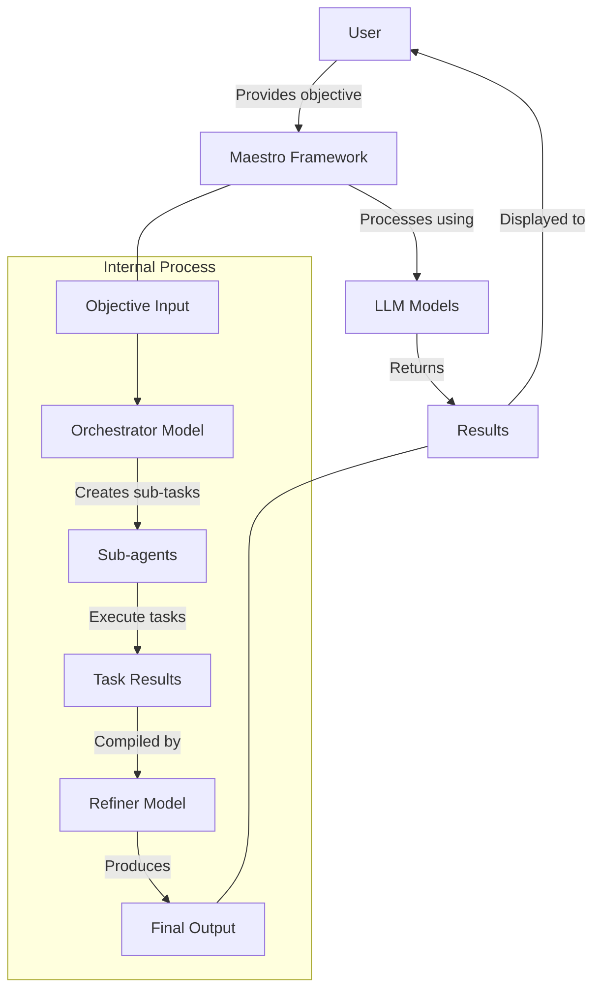
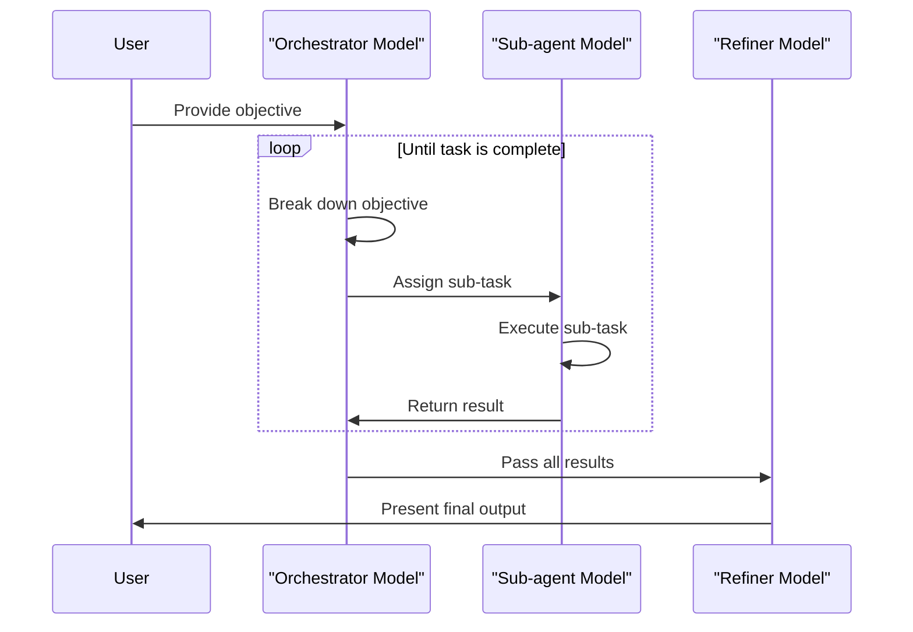
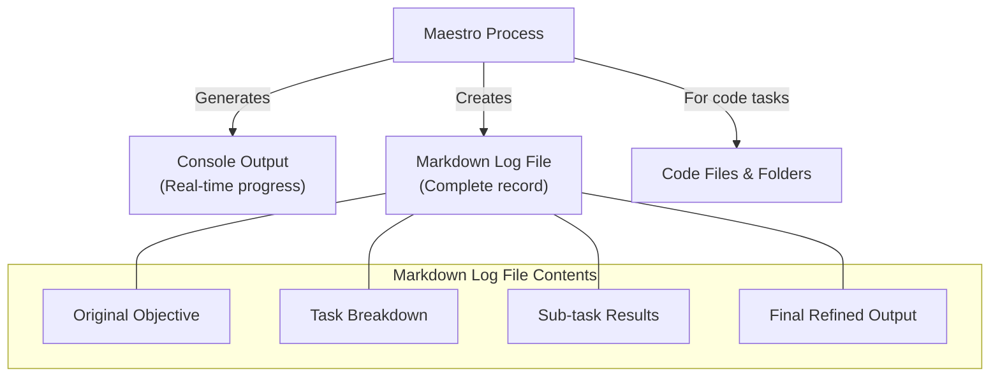

<!-- source: DeepWiki mcp.deepwiki.com · repo Doriandarko/maestro · page 3 Usage Guide · fetched 2026-10-26 -->

# Usage Guide

<details>
<summary>Relevant source files</summary>

The following files were used as context for generating this wiki page:

- [README.md](README.md)

</details>


This guide provides comprehensive instructions for using the Maestro LLM Orchestration Framework. It covers basic usage patterns, command-line options, and advanced features. For installation instructions, see [Installation & Setup](#2), and for detailed explanations of core concepts, see [Core Concepts](#1.1).

## Getting Started with Maestro

Maestro works by breaking down complex objectives into manageable sub-tasks that are executed by AI sub-agents, then refining the results into a cohesive output. You can run Maestro through the command line or web interface.



Sources: [README.md:171-188]()

### Basic Command Line Usage

To use Maestro from the command line:

1. Open a terminal and navigate to the Maestro directory
2. Run one of the Maestro implementations (choose based on your preferred LLM provider)
3. Enter your objective when prompted
4. Wait for Maestro to process and display the results

```
$ python maestro.py
Please enter your objective: Your objective here
```

Maestro will display its progress in the console with formatted panels showing each sub-task and its results. When complete, it saves a full exchange log to a Markdown file named based on your objective.

Sources: [README.md:171-188]()

## Selecting a Maestro Implementation

Maestro offers several implementations for different LLM providers. Choose the one that best fits your needs:

| Implementation | File | Description | API Key Required |
|---------------|------|-------------|------------------|
| Anthropic Claude | `maestro.py` | Original implementation using Claude 3.5 Sonnet | ANTHROPIC_API_KEY |
| Multi-provider | `maestro-anyapi.py` | Supports multiple APIs (Anthropic, OpenAI, Gemini, etc.) | Varies by provider |
| OpenAI GPT-4 | `maestro-gpt.py` | Uses GPT-4 for orchestration | OPENAI_API_KEY |
| OpenAI GPT-4o | `maestro-gpt4o.py` | Enhanced for GPT-4o's code capabilities | OPENAI_API_KEY |
| Groq | `maestro-groq.py` | Uses Groq for faster API responses | GROQ_API_KEY |
| Local LM Studio | `maestro-lmstudio.py` | Runs with local models via LM Studio | None (local) |
| Local Ollama | `maestro-ollama.py` | Runs with local models via Ollama | None (local) |

```mermaid
graph TD
    User["User"]
    
    subgraph "Cloud Provider Implementations"
        Claude["maestro.py<br>(Claude)"]
        MultiAPI["maestro-anyapi.py<br>(Multi-provider)"]
        GPT4["maestro-gpt.py<br>(GPT-4)"]
        GPT4o["maestro-gpt4o.py<br>(GPT-4o)"]
        Groq["maestro-groq.py<br>(Groq)"]
    end
    
    subgraph "Local Implementations"
        LMStudio["maestro-lmstudio.py<br>(LM Studio)"]
        Ollama["maestro-ollama.py<br>(Ollama)"]
    end
    
    User -->|"Choose implementation"| Cloud Provider Implementations
    User -->|"Choose implementation"| Local Implementations
    
    Cloud Provider Implementations -->|"Requires"| APIKey["API Keys"]
    Local Implementations -->|"Requires"| LocalSetup["Local LLM Setup"]
```

Sources: [README.md:6-127]()

## Configuring Models

When using the multi-provider implementation (`maestro-anyapi.py`), you can configure which models to use for each role:

1. Set environment variables for API keys:
```python
os.environ["OPENAI_API_KEY"] = "YOUR KEY" 
os.environ["ANTHROPIC_API_KEY"] = "YOUR KEY"
os.environ["GEMINI_API_KEY"] = "YOUR KEY"
```

2. Define the models for each stage:
```python
ORCHESTRATOR_MODEL = "gemini/gemini-1.5-flash-latest"
SUB_AGENT_MODEL = "gemini/gemini-1.5-flash-latest"
REFINER_MODEL = "gemini/gemini-1.5-flash-latest"
```

You can mix and match different models from different providers. For example, you might use Claude for orchestration, GPT for sub-agents, and Gemini for refinement.

Sources: [README.md:13-31]()

## Common Usage Patterns

### Basic Workflow

Maestro's basic workflow involves:

1. Entering an objective
2. The orchestrator model breaking it down into sub-tasks
3. Sub-agent models executing each sub-task
4. The refiner model combining results into a coherent output

For detailed information on this workflow, see [Basic Workflow](#3.1).



Sources: [README.md:132-140](), [README.md:190-202]()

### Code Generation

Maestro can generate complete code projects by:

1. Breaking down the coding task into logical components
2. Writing code for each component
3. Organizing files and folders based on the project structure
4. Creating a cohesive codebase with proper imports and dependencies

For detailed information on code generation, see [Code Generation](#3.2).

Sources: [README.md:141-142]()

### Search Integration

With search integration enabled, Maestro uses the Tavily API to perform web searches when gathering information for sub-tasks. This enhances the accuracy and relevance of generated content by incorporating up-to-date information.

To use search functionality:

1. Obtain a Tavily API key from https://tavily.com/
2. Add your API key to the script:
```python
tavily = TavilyClient(api_key="YOUR API KEY HERE")
```

For detailed information on search integration, see [Search Integration](#3.3).

Sources: [README.md:113-119](), [README.md:165-169]()

## Using Different Implementations

### Using with Cloud Providers

#### Anthropic Claude (Original)

```bash
python maestro.py
```

This implementation uses Claude 3.5 Sonnet (default) for both orchestration and refinement.

#### Multi-provider with LiteLLM

First, install LiteLLM:
```bash
pip install litellm
```

Then run:
```bash
python maestro-anyapi.py
```

#### OpenAI GPT-4 and GPT-4o

For GPT-4:
```bash
python maestro-gpt.py
```

For GPT-4o (optimized for code):
```bash
python maestro-gpt4o.py
```

#### Groq

Install the Groq package:
```bash
pip install groq
```

Then run:
```bash
python maestro-groq.py
```

Sources: [README.md:6-127]()

### Using with Local LLMs

#### LM Studio

1. Download and install LM Studio from https://lmstudio.ai/
2. Start the local server in LM Studio (remove any system prompt)
3. Run:
```bash
python maestro-lmstudio.py
```

#### Ollama

1. Install Ollama client from https://ollama.com/download
2. Install the Python package:
```bash
pip install ollama
```
3. Pull your preferred model(s):
```bash
ollama pull llama3:70b
ollama pull llama3:8b
```
4. Run:
```bash
python maestro-ollama.py
```

Sources: [README.md:55-98]()

## Output and Results

Maestro provides output in two ways:

1. **Console output**: Displays the progress of task execution with formatted panels showing each sub-task and its results.

2. **Markdown log file**: Saves a complete exchange log to a Markdown file named based on your objective. This log includes:
   - The original objective
   - All sub-tasks and their results
   - The final refined output

For code generation tasks, Maestro also creates the actual code files and folders according to the project structure it determines is appropriate.



Sources: [README.md:186-188](), [README.md:202-204]()

## Customization Options

You can customize Maestro in several ways:

1. **Model selection**: Choose different models for orchestrator, sub-agent, and refiner roles.

2. **Token limits**: Adjust the `max_tokens` parameter to control the length of generated responses.

3. **Console formatting**: Modify the Rich library's Panel and Console configurations for different output styles.

4. **Exchange log formatting**: Customize the format and file extension of the exchange logs.

Sources: [README.md:205-211]()

## Web Interface

For a graphical user interface to Maestro, you can use the included Flask web application. See [Web Interface](#5) and [Web Interface Setup](#5.1) for detailed instructions.

Sources: [README.md]()

## Next Steps

- For detailed instructions on the basic workflow, see [Basic Workflow](#3.1)
- For code generation specifics, see [Code Generation](#3.2)
- For search integration details, see [Search Integration](#3.3)
- To learn about different implementations, see [Implementations](#4)
- For troubleshooting help, see [Troubleshooting & FAQ](#7)

---

