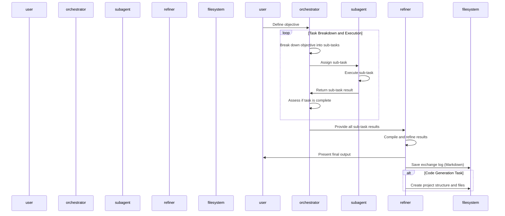
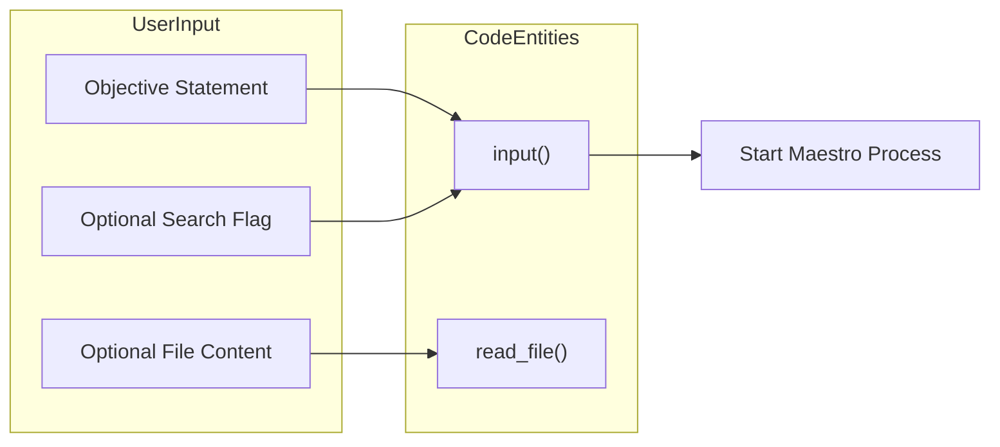
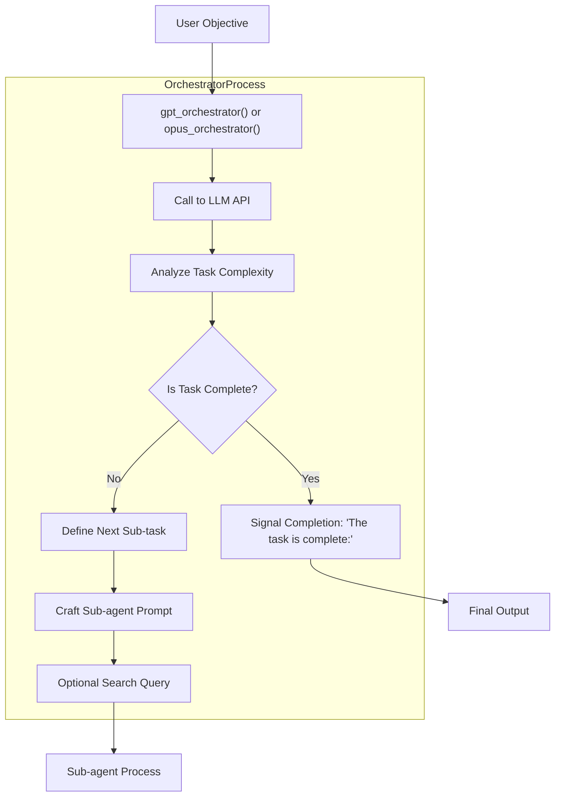
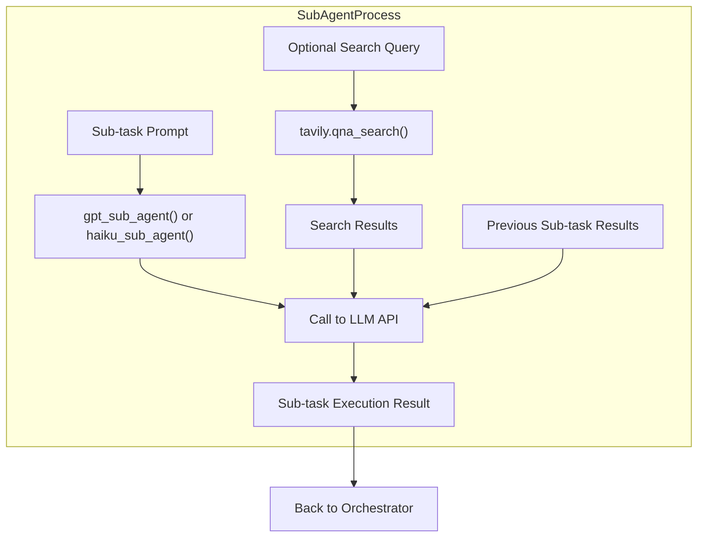
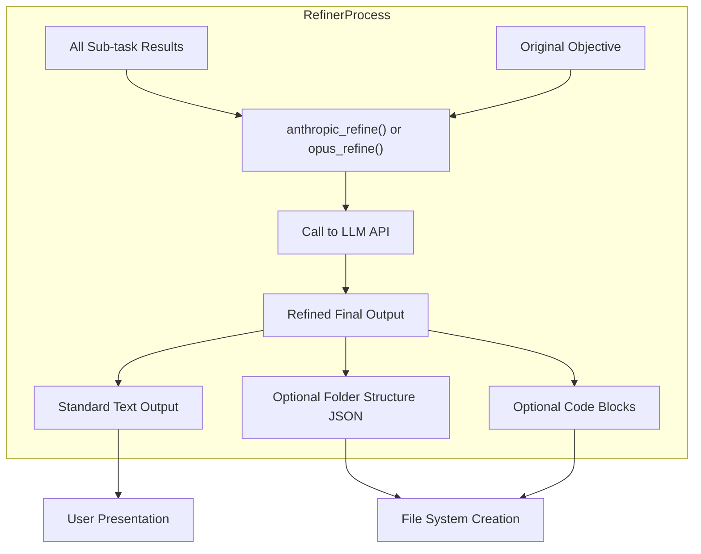
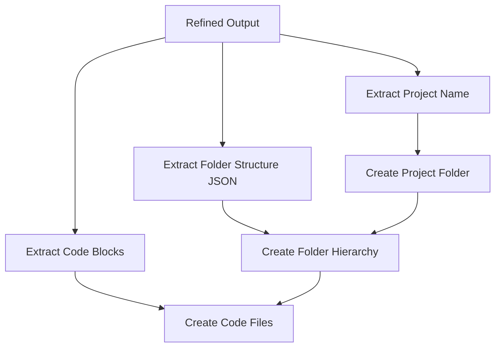

<!-- source: DeepWiki mcp.deepwiki.com · repo Doriandarko/maestro · page 3.1 Basic Workflow · fetched 2026-10-26 -->

# Basic Workflow

<details>
<summary>Relevant source files</summary>

The following files were used as context for generating this wiki page:

- [README.md](README.md)
- [maestro-gpt4o.py](maestro-gpt4o.py)

</details>


This page explains the fundamental workflow for using the Maestro framework to orchestrate Large Language Models (LLMs) for task completion. You'll learn how to define objectives, understand how the system breaks down tasks, and interpret the results. For specific implementations with different LLM providers, see [Implementations](#4), and for code generation details, see [Code Generation](#3.2).

## Workflow Overview

The Maestro framework follows a structured approach to task completion, using multiple LLM instances in specific roles to break down complex tasks into manageable pieces.



Sources: [README.md:188-202](), [maestro-gpt4o.py:214-234]()

## Step 1: Defining Your Objective

The workflow begins with defining an objective - a clear statement of what you want to accomplish. This is provided as input to the system.



When running Maestro, you'll be prompted to:
1. Enter your objective
2. Specify whether to provide a reference file (optional)
3. Choose whether to enable search capabilities (optional)

### Example Objective Input

```
Please enter your objective: Create a simple Flask web app for a todo list
Do you want to provide a file path? (y/n): n
Do you want to use search? (y/n): y
```

Sources: [README.md:180-184](), [maestro-gpt4o.py:192-209]()

## Step 2: Task Orchestration

Once you've provided an objective, the orchestrator model (e.g., Claude Opus, GPT-4, etc.) breaks it down into manageable sub-tasks.



The orchestrator:
1. Analyzes the objective and any previous sub-task results
2. Determines if the objective has been fully achieved
3. If not complete, creates a prompt for the next sub-task
4. May generate a search query for the sub-agent to gather information

The orchestrator continues this process until it determines the task is complete, signaled by the phrase "The task is complete:" in its response.

Sources: [README.md:194-196](), [maestro-gpt4o.py:40-81]()

## Step 3: Sub-task Execution

Each sub-task is executed by a sub-agent model, which may be the same or a different model than the orchestrator.



The sub-agent:
1. Receives the sub-task prompt from the orchestrator
2. May perform a search query if enabled
3. Has access to results from previous sub-tasks for context
4. Executes the sub-task and returns results

Sub-agents maintain "memory" of previous tasks, ensuring continuity and context-awareness throughout the process.

Sources: [README.md:136-137](), [maestro-gpt4o.py:83-123]()

## Step 4: Result Refinement

After all sub-tasks are completed, the refiner model (typically a more capable model like Claude Opus) compiles and refines the results into a cohesive final output.



The refiner:
1. Reviews all sub-task results in context of the original objective
2. Organizes and refines the information into a cohesive final output
3. For code-related tasks, may include project structure and code files

Sources: [README.md:138](), [maestro-gpt4o.py:125-153]()

## Step 5: Output Generation

Maestro generates two primary outputs:

1. **Exchange Log**: A detailed Markdown file capturing the entire process
2. **Project Files** (for code tasks): Code files and folder structure based on the refined output

### Exchange Log Structure

```
Objective: [Your objective text]

========================================== Task Breakdown ==========================================

Task 1:
Prompt: [Sub-task prompt]
Result: [Sub-task result]

Task 2:
Prompt: [Sub-task prompt]
Result: [Sub-task result]

...

========================================== Refined Final Output ==========================================

[Refined output text]
```

### Project Structure Creation

For coding tasks, Maestro can extract a folder structure and code content from the refined output, then create the actual files and folders on your system.



Sources: [README.md:140-141](), [maestro-gpt4o.py:155-186](), [maestro-gpt4o.py:239-254](), [maestro-gpt4o.py:261-274]()

## Common Options and Parameters

When running Maestro, you can customize your workflow with these common options:

| Option | Description | How to Use |
|--------|-------------|------------|
| File Reference | Provide a file to give context to the LLM | Answer 'y' when prompted and provide file path |
| Search Integration | Enable web search for better answers | Answer 'y' when prompted for search option |
| Model Selection | Choose which models to use for each role | Configure in script (see [Implementations](#4)) |

### Model Roles

Maestro uses three distinct roles for its LLMs:

| Role | Variable | Default Model | Purpose |
|------|----------|---------------|---------|
| Orchestrator | `ORCHESTRATOR_MODEL` | Claude Opus/GPT-4o | Break down objectives into sub-tasks |
| Sub-agent | `SUB_AGENT_MODEL` | Claude Haiku/GPT-4o | Execute individual sub-tasks |
| Refiner | `REFINER_MODEL` | Claude Opus | Compile and refine final results |

Sources: [README.md:112-118](), [maestro-gpt4o.py:15-20]()

## Understanding Task Completion

A successful Maestro run will:

1. Show progress through each sub-task in the console
2. Signal completion with "The task is complete:" in the orchestrator output
3. Present the refined final output
4. Save the exchange log to a Markdown file
5. Create project files (for code tasks)

The completion signal happens when the orchestrator determines that all necessary sub-tasks have been executed and the objective has been fully achieved.

Sources: [README.md:197-198](), [maestro-gpt4o.py:223-225]()

---

