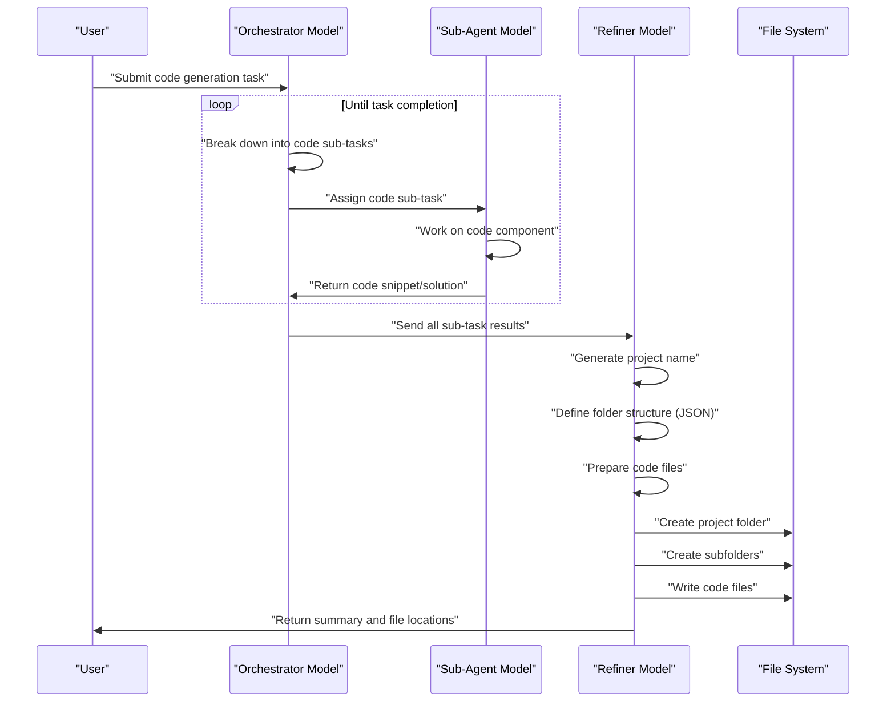
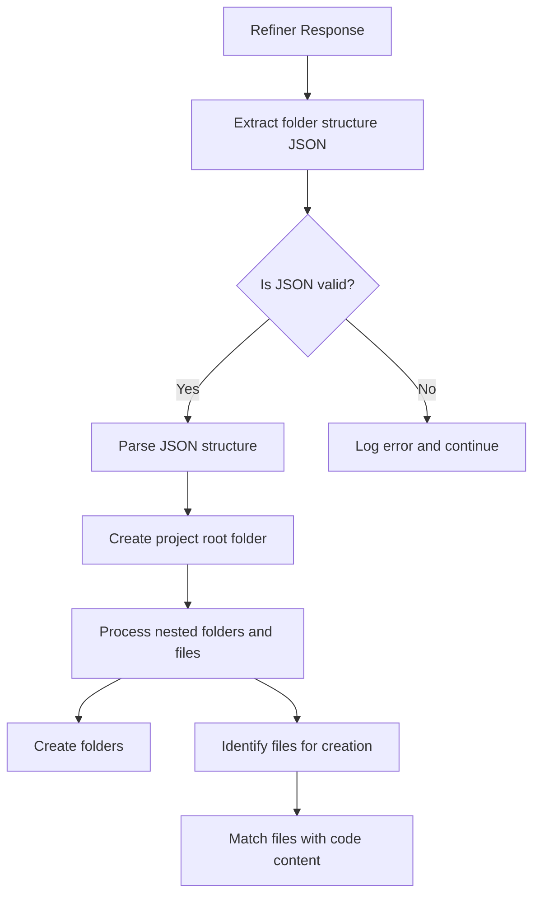
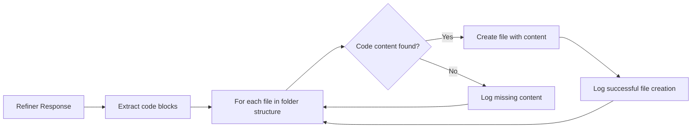
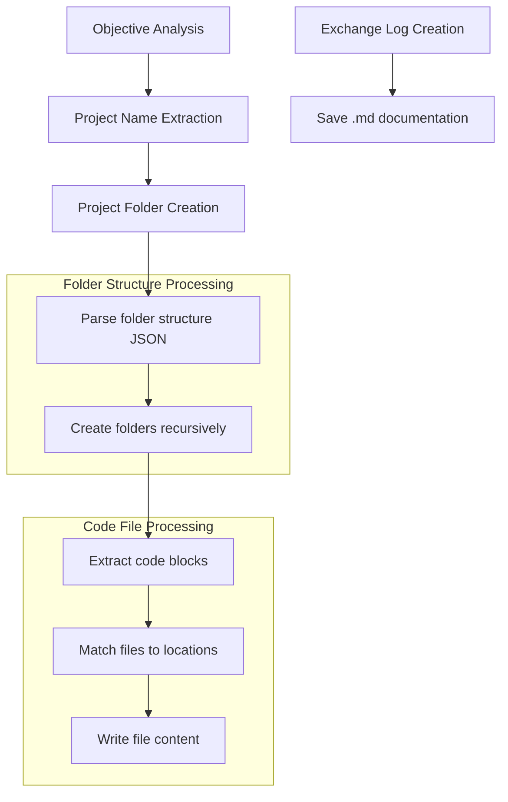

<!-- source: DeepWiki mcp.deepwiki.com · repo Doriandarko/maestro · page 3.2 Code Generation · fetched 2026-10-26 -->

# Code Generation

<details>
<summary>Relevant source files</summary>

The following files were used as context for generating this wiki page:

- [README.md](README.md)
- [maestro-gpt4o.py](maestro-gpt4o.py)
- [maestro-ollama.py](maestro-ollama.py)

</details>


This document details Maestro's code generation capabilities, explaining how the framework processes code-related tasks, generates project structures, and creates functional code files. For information about the basic workflow, see [Basic Workflow](#3.1). For details on integrating search functionality to enhance code generation, see [Search Integration](#3.3).

## Overview of Code Generation

Maestro can generate complete code projects by breaking down coding tasks into smaller sub-tasks, solving them sequentially, and then producing a cohesive final output with proper project structure and implementation files. The framework supports code generation across all its implementations, including Claude, GPT, Groq, and local models via Ollama and LM Studio.

Sources: [README.md:137-142](), [maestro-gpt4o.py:125-153](), [maestro-ollama.py:90-111]()

## Code Generation Process



The code generation process involves three main phases:
1. **Code Task Breakdown**: The orchestrator model breaks down the coding objective into manageable sub-tasks
2. **Code Development**: Sub-agent models implement different code components
3. **Project Integration**: The refiner model combines all code solutions into a cohesive project structure

Sources: [maestro-gpt4o.py:40-153](), [maestro-ollama.py:37-111]()

## Expected Refiner Output Format

When handling code-related tasks, the refiner model is explicitly instructed to produce output in a specific format:

1. **Project Name**: A concise, appropriate name (max 20 characters)
2. **Folder Structure**: A JSON object defining the project's directory structure
3. **Code Files**: Individual code files with their content

The prompt for the refiner model contains specific instructions for formatting this information:

```
When working on code projects, ONLY AND ONLY IF THE PROJECT IS CLEARLY A CODING ONE, please provide the following:

1. Project Name: Create a concise and appropriate project name that fits the project based on what it's creating. The project name should be no more than 20 characters long.

2. Folder Structure: Provide the folder structure as a valid JSON object, where each key represents a folder or file, and nested keys represent subfolders. Use null values for files. Ensure the JSON is properly formatted without any syntax errors. Please make sure all keys are enclosed in double quotes, and ensure objects are correctly encapsulated with braces, separating items with commas as necessary. Wrap the JSON object in <folder_structure> tags.

3. Code Files: For each code file, include ONLY the file name, NEVER EVER USE THE FILE PATH OR ANY OTHER FORMATTING. YOU ONLY USE THE FOLLOWING format 'Filename: <filename>' followed by the code block enclosed in triple backticks, with the language identifier after the opening backticks.
```

Sources: [maestro-gpt4o.py:125-153](), [maestro-ollama.py:90-111]()

## Folder Structure Generation

### JSON Format

The folder structure is provided by the refiner model as a valid JSON object wrapped in `<folder_structure>` tags. Each key in the JSON represents a folder or file, and nested keys represent subfolders. Files are represented with null values.

Example folder structure JSON:
```json
{
  "src": {
    "main.py": null,
    "utils": {
      "helpers.py": null,
      "config.py": null
    }
  },
  "tests": {
    "test_main.py": null
  },
  "README.md": null
}
```

### Extraction and Processing



The framework extracts the folder structure from the refiner's output using regex pattern matching, seeking content between the `<folder_structure>` tags. After extracting the JSON string, the system:

1. Attempts to parse the JSON into a Python dictionary
2. Creates the top-level project folder named after the project
3. Recursively creates all necessary subfolders according to the structure
4. Identifies file entries that will need code content

Sources: [maestro-gpt4o.py:242-250](), [maestro-ollama.py:246-255]()

## Code Files Generation

### Code Block Format

The refiner model is instructed to format each code file with:
1. A "Filename:" prefix with the file's name
2. The code content wrapped in triple backticks (```) with appropriate language identifier

Example:
```
Filename: main.py
```python
def main():
    print("Hello, world!")

if __name__ == "__main__":
    main()
```
```

### Extraction and File Creation

The system extracts code blocks using regex pattern matching that looks for:
1. The "Filename:" prefix followed by a filename
2. Code content between triple backticks

This extraction creates a list of (filename, code_content) pairs that are matched against the folder structure to determine where each file should be created.



Sources: [maestro-gpt4o.py:253-254](), [maestro-ollama.py:258-259](), [maestro-ollama.py:155-186](), [maestro-gpt4o.py:155-185]()

## Implementation-Specific Details

Maestro maintains consistent code generation functionality across different model implementations, with minor variations:

| Implementation | Model Used for Code Generation | Model(s) Used for Code Evaluation | Key Functions |
|----------------|---------------------------------|----------------------------------|---------------|
| Original Maestro | Claude-3-Opus | Claude (Opus/Haiku) | opus_refine |
| GPT4o | Claude-3-Opus (for refining) | GPT-4o | anthropic_refine + create_folder_structure |
| Ollama | llama3:70b-instruct | llama3 models | opus_refine + create_folder_structure |
| Multi-API | Various (configurable) | Various (configurable) | Uses LiteLLM interface |

Each implementation follows the same general pattern:
1. Extract folder structure JSON
2. Extract code blocks
3. Create project structure
4. Write code files

Sources: [README.md:42-53](), [README.md:70-98](), [maestro-gpt4o.py:125-153](), [maestro-ollama.py:90-111]()

## Projects and File Management



The framework handles several file management operations:

1. **Project Naming**: Extracts project name from the refiner's output or uses a sanitized version of the objective
2. **Folder Creation**: Creates a project root folder and all subfolders based on the JSON structure
3. **File Creation**: Creates each file with its corresponding content from the extracted code blocks
4. **Documentation**: Generates a Markdown file containing the complete task exchange and code generation process

Sources: [maestro-gpt4o.py:155-185](), [maestro-ollama.py:155-186](), [maestro-ollama.py:261-269](), [maestro-gpt4o.py:260-275]()

## Error Handling

Maestro implements several error handling mechanisms for code generation:

1. **JSON Parsing Errors**: If the folder structure JSON is invalid, the error is logged, and the system continues without creating the folder structure
2. **Missing Code Content**: If a file is defined in the folder structure but no code content is found, a warning is logged
3. **File/Folder Creation Errors**: If there are issues creating files or folders (permissions, disk space, etc.), errors are logged, and the system attempts to continue with other files

This error handling ensures that even if parts of the code generation process fail, the system can still provide partial results.

Sources: [maestro-gpt4o.py:245-250](), [maestro-ollama.py:246-255](), [maestro-ollama.py:172-186](), [maestro-gpt4o.py:170-185]()

## Triggering Code Generation

Code generation is triggered automatically when:

1. The system detects that the user's objective is related to code development
2. The refiner model determines that the task requires generating code files
3. The refiner produces properly formatted output with project structure and code files

The decision to generate code is primarily made by the refiner model based on its analysis of the objective and the sub-task results. If the refiner does not produce output in the expected format, the code generation steps are skipped.

Sources: [maestro-gpt4o.py:125-153](), [maestro-ollama.py:90-111]()

---

