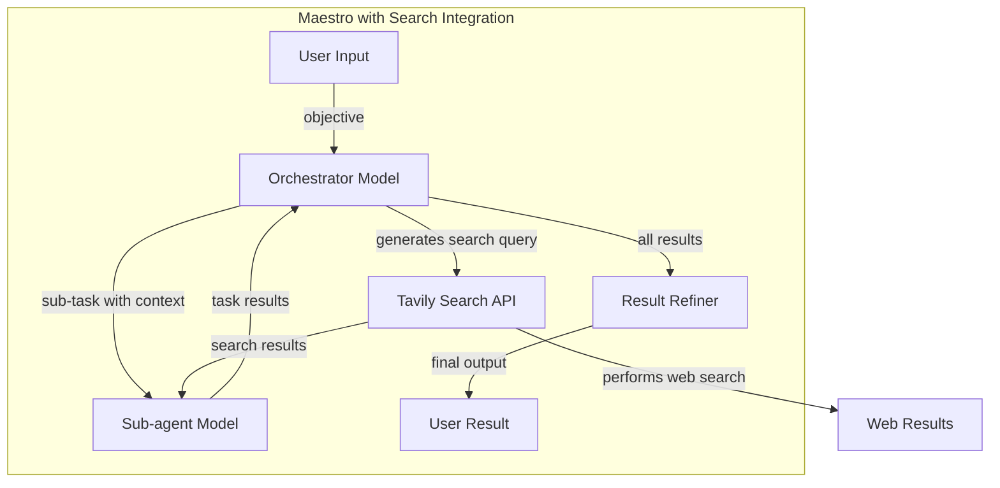
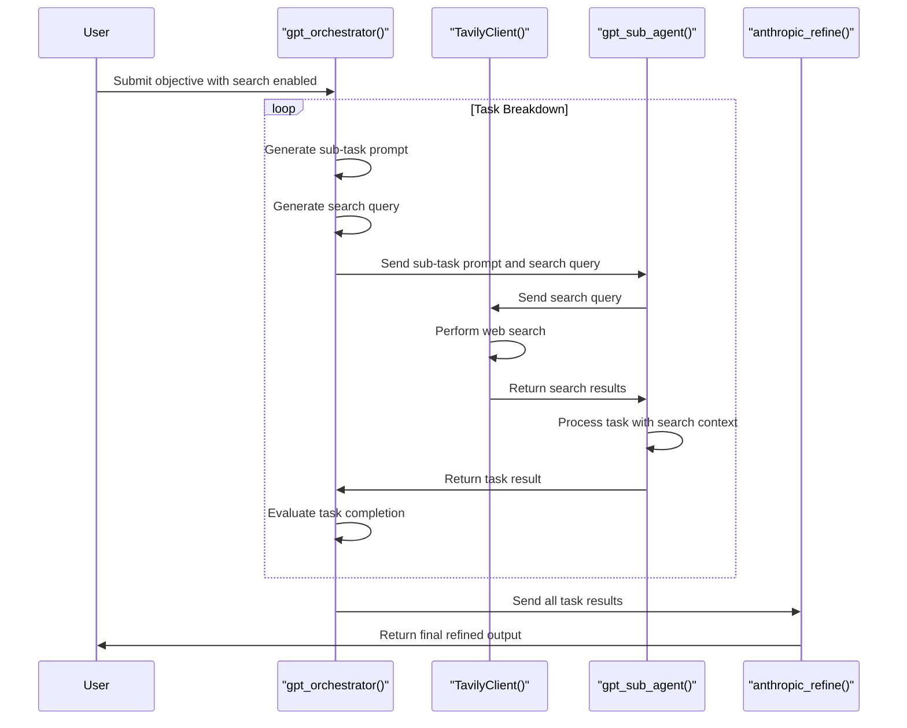
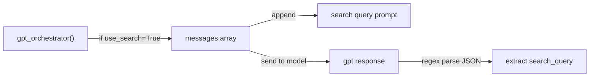
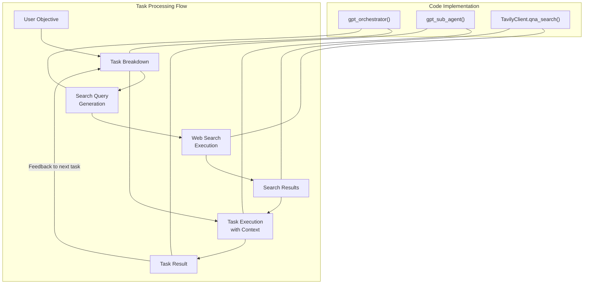

<!-- source: DeepWiki mcp.deepwiki.com · repo Doriandarko/maestro · page 3.3 Search Integration · fetched 2026-10-26 -->

# Search Integration

<details>
<summary>Relevant source files</summary>

The following files were used as context for generating this wiki page:

- [README.md](README.md)
- [maestro-gpt4o.py](maestro-gpt4o.py)

</details>


This document describes the search integration feature in Maestro, which allows the AI orchestrator and sub-agents to access real-time information from the web during task execution. Search integration enhances the AI's ability to solve tasks by providing up-to-date information, references, and facts that might not be present in its training data.

## Overview

The Maestro framework integrates with the Tavily Search API to enable AI agents to perform web searches when working on tasks. This feature is particularly useful for:

- Retrieving current information (news, trends, recent developments)
- Obtaining factual data for analysis tasks
- Finding code examples and documentation
- Gathering reference material for research tasks



Sources: [README.md:113-120](), [maestro-gpt4o.py:8-9](), [maestro-gpt4o.py:92-96]()

## Setting Up Search Integration

To use the search integration feature, you need to:

1. Create an account at [Tavily](https://tavily.com/) and obtain an API key
2. Configure your Maestro instance with the Tavily API key
3. Enable search when running Maestro

### API Key Configuration

In your Maestro script, replace the placeholder API key with your actual Tavily API key:

```python
tavily = TavilyClient(api_key="YOUR_API_KEY_HERE")
```

Sources: [README.md:166-169](), [maestro-gpt4o.py:94]()

## Search Integration Workflow

The search integration follows a specific workflow within the Maestro orchestration process:



Sources: [maestro-gpt4o.py:40-81](), [maestro-gpt4o.py:83-123]()

## Implementation Details

### Search Query Generation

When search is enabled, the orchestrator model generates a specialized search query in JSON format. This is implemented in the `gpt_orchestrator` function:



The orchestrator instructs the model to generate a JSON object with a `search_query` key, which is then extracted using regex pattern matching.

Sources: [maestro-gpt4o.py:51-52](), [maestro-gpt4o.py:66-79]()

### Search Execution

When a search query is available and search is enabled, the `gpt_sub_agent` function:

1. Creates a TavilyClient instance
2. Calls the `qna_search` method with the query
3. Incorporates the search results into the context provided to the sub-agent model

This allows the sub-agent to use the search results when executing its task.

Sources: [maestro-gpt4o.py:92-104]()

## Using Search Integration

To enable search when running Maestro:

1. Make sure your Tavily API key is configured
2. When prompted, respond with "y" to the question:

```
Do you want to use search? (y/n):
```

The search feature will then be automatically used throughout the task processing pipeline.

Sources: [maestro-gpt4o.py:209](), [maestro-gpt4o.py:214-222]()

## Technical Implementation Reference

The following table summarizes the key components and their roles in search integration:

| Component | File | Function | Purpose |
|-----------|------|----------|---------|
| Tavily Client Initialization | maestro-gpt4o.py | N/A (global) | Imports and initializes the TavilyClient |
| Search Query Generation | maestro-gpt4o.py | gpt_orchestrator() | Adds search query request to model prompt and extracts query from response |
| Search Execution | maestro-gpt4o.py | gpt_sub_agent() | Performs the search using the Tavily API and adds results to context |
| Search Toggle | maestro-gpt4o.py | Main execution flow | Gets user input on whether to use search and maintains use_search flag |

Sources: [maestro-gpt4o.py:8-9](), [maestro-gpt4o.py:40-81](), [maestro-gpt4o.py:83-123](), [maestro-gpt4o.py:209]()

## Search Integration Architecture

The search integration is designed to enhance the task performance of sub-agents by providing them with relevant, up-to-date information from the web. This creates a feedback loop where:

1. The orchestrator analyzes the task to determine what information would be helpful
2. A targeted search query is generated to find that information
3. The search results are incorporated into the sub-agent's context
4. The sub-agent uses this enriched context to produce better task results



Sources: [maestro-gpt4o.py:40-81](), [maestro-gpt4o.py:83-123](), [maestro-gpt4o.py:92-96]()

## Limitations and Considerations

When using search integration, consider the following:

1. **API Usage**: Search calls consume Tavily API credits
2. **Response Time**: Enabling search may increase the overall execution time
3. **Quality of Queries**: The effectiveness depends on the quality of search queries generated by the orchestrator
4. **Internet Connection**: A stable internet connection is required for search functionality

## Conclusion

The search integration feature significantly enhances Maestro's capabilities by providing access to real-time information from the web. This allows AI agents to work with current data, references, and examples, leading to more accurate and up-to-date results for tasks that benefit from external information.

For more information about the overall Maestro framework architecture, see [Architecture](#1.2). To learn about other integration capabilities, such as code generation, see [Code Generation](#3.2).

---

