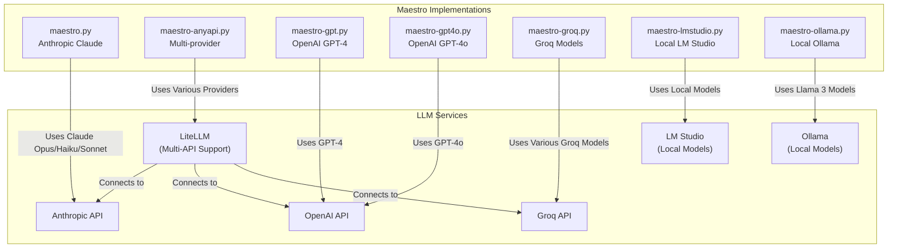
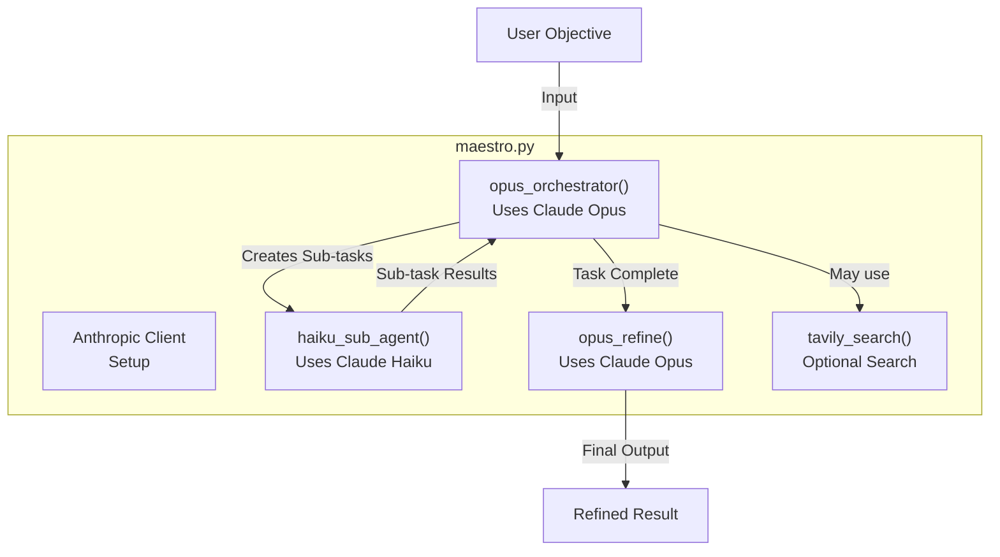
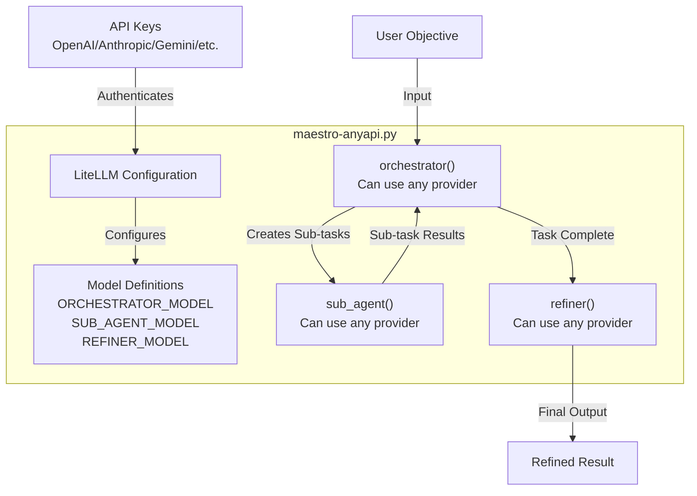
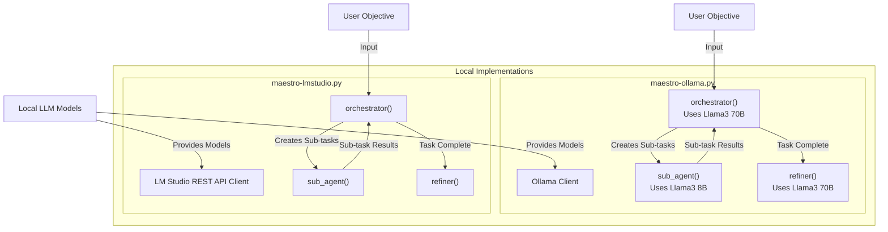
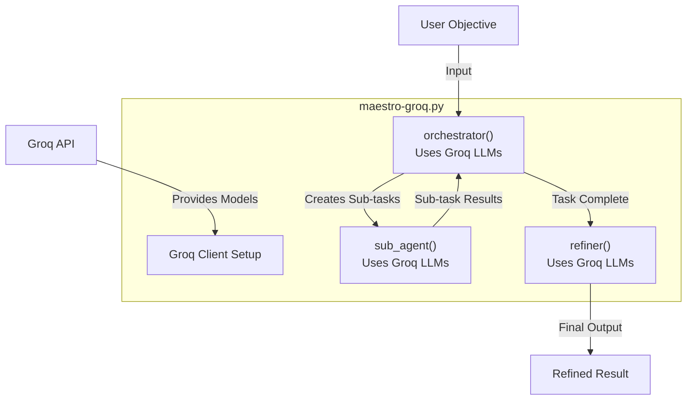
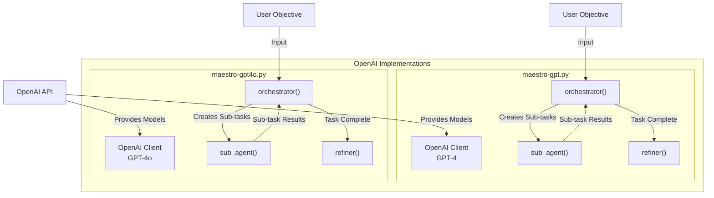
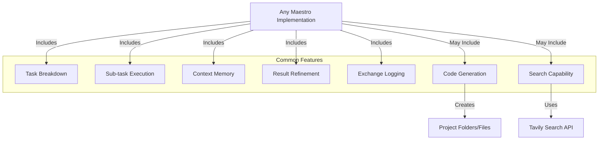

<!-- source: DeepWiki mcp.deepwiki.com · repo Doriandarko/maestro · page 4 Implementations · fetched 2026-10-26 -->

# Implementations

<details>
<summary>Relevant source files</summary>

The following files were used as context for generating this wiki page:

- [README.md](README.md)

</details>


This page provides an overview of the different Maestro implementations available for various LLM providers. Maestro offers multiple implementation variants designed to work with different AI model providers including Anthropic, OpenAI, Groq, and local LLM solutions. For detailed instructions on installation and setup, see [Installation & Setup](#2). For usage guidance, see [Usage Guide](#3).

## Implementation Overview

Maestro offers implementations for different LLM providers, each designed to leverage the specific capabilities of the target models while maintaining the core orchestration architecture.



Sources: [README.md:1-130]()

## Implementation Components

Each implementation follows the same architectural pattern but uses different clients and model configurations. The main components include:

```mermaid
classDiagram
    class "Maestro Implementation" {
        +client_setup()
        +run_maestro(objective)
        +orchestrator(objective, previous_results)
        +sub_agent(prompt, previous_tasks)
        +refiner(objective, sub_task_results)
        +search_capability(optional)
        +code_generation_capability(optional)
    }
    
    class "API Client" {
        +create_message()
        +handle_response()
    }
    
    class "Models Configuration" {
        +ORCHESTRATOR_MODEL: string
        +SUB_AGENT_MODEL: string
        +REFINER_MODEL: string
    }
    
    class "Optional Components" {
        +TavilyClient
        +code_generation_utilities
    }
    
    "Maestro Implementation" --> "API Client" : uses
    "Maestro Implementation" --> "Models Configuration" : configures
    "Maestro Implementation" --> "Optional Components" : may include
```

Sources: [README.md:132-211]()

## Implementation Comparison

The table below summarizes the key differences between Maestro implementations:

| Implementation | File | LLM Provider | Models Used | Key Features | Requirements |
|----------------|------|-------------|-------------|--------------|--------------|
| Claude Maestro | maestro.py | Anthropic | Claude 3.5 Sonnet, Claude 3 Opus/Haiku | Original implementation, search capability | anthropic package, Anthropic API key |
| Multi-API Maestro | maestro-anyapi.py | Multiple (via LiteLLM) | Any supported by LiteLLM | Multi-provider flexibility | litellm package, API keys for chosen providers |
| GPT-4 Maestro | maestro-gpt.py | OpenAI | GPT-4 | GPT-4 optimization | openai package, OpenAI API key |
| GPT-4o Maestro | maestro-gpt4o.py | OpenAI | GPT-4o | Enhanced code capabilities | openai package, OpenAI API key |
| Groq Maestro | maestro-groq.py | Groq | Various Groq models | Fast API responses | groq package, Groq API key |
| LM Studio Maestro | maestro-lmstudio.py | Local | Models in LM Studio | Local execution, no API costs | LM Studio application |
| Ollama Maestro | maestro-ollama.py | Local | Llama 3 models (8B/70B) | Local execution, no API costs | ollama package, Ollama application |

Sources: [README.md:6-130]()

## Core Implementation: Anthropic Claude

The original Maestro implementation uses Anthropic's Claude models, specifically designed to work with Claude 3.5 Sonnet and Claude 3 Opus/Haiku.



Sources: [README.md:3-5](), [README.md:7-10]()

## Multi-Provider Implementation

The `maestro-anyapi.py` implementation leverages LiteLLM to support multiple LLM providers in a unified interface.



Sources: [README.md:13-42]()

## Local LLM Implementations

Maestro supports local LLM execution through both Ollama and LM Studio implementations.



Sources: [README.md:55-98]()

## Groq Implementation

The Groq implementation leverages Groq's high-speed API for faster processing.



Sources: [README.md:100-110]()

## OpenAI Implementations

Maestro provides dedicated implementations for OpenAI's GPT models, with specific optimizations for GPT-4 and GPT-4o.



Sources: [README.md:45-54](), [README.md:121-129]()

## Common Features Across Implementations

All implementations share a common set of features regardless of the LLM provider used:



Sources: [README.md:132-142]()

## Implementation Selection Guide

When choosing a Maestro implementation, consider the following factors:

1. **API Access**: Which LLM provider APIs you have access to
2. **Model Capabilities**: Required capabilities for your use case (code generation, reasoning, etc.)
3. **Cost Considerations**: API usage costs vs. local computation
4. **Response Speed**: Some implementations like Groq focus on faster responses
5. **Local vs. Cloud**: Privacy or network connectivity requirements

For detailed usage of specific implementations, see:
- [OpenAI (GPT) Implementation](#4.1)
- [Local LLM with Ollama](#4.2)
- [Other Implementations](#4.3)

Sources: [README.md:6-130]()

---

