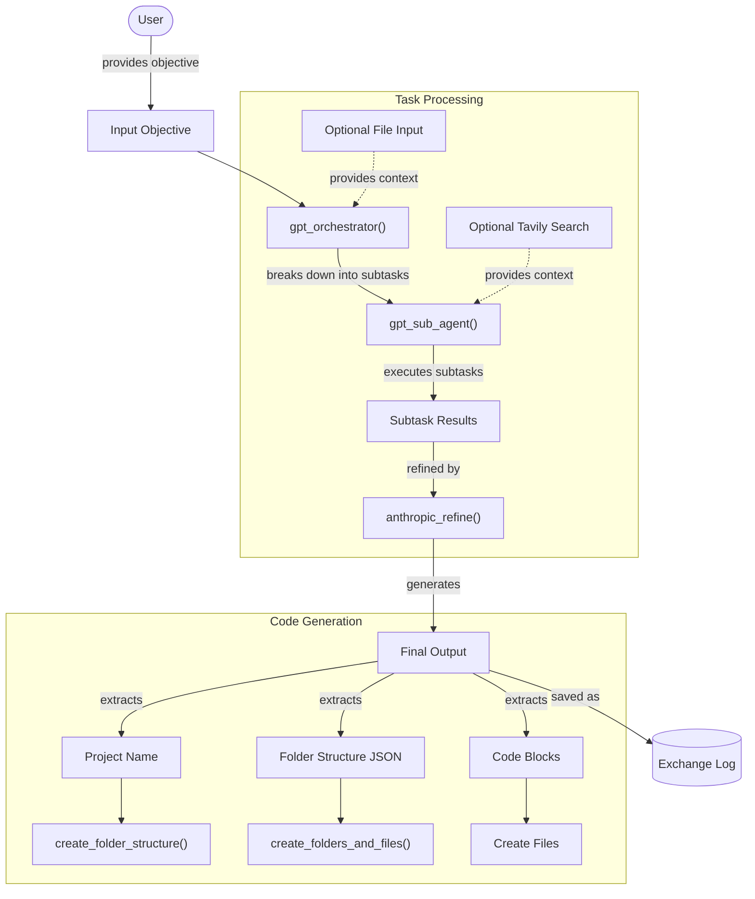
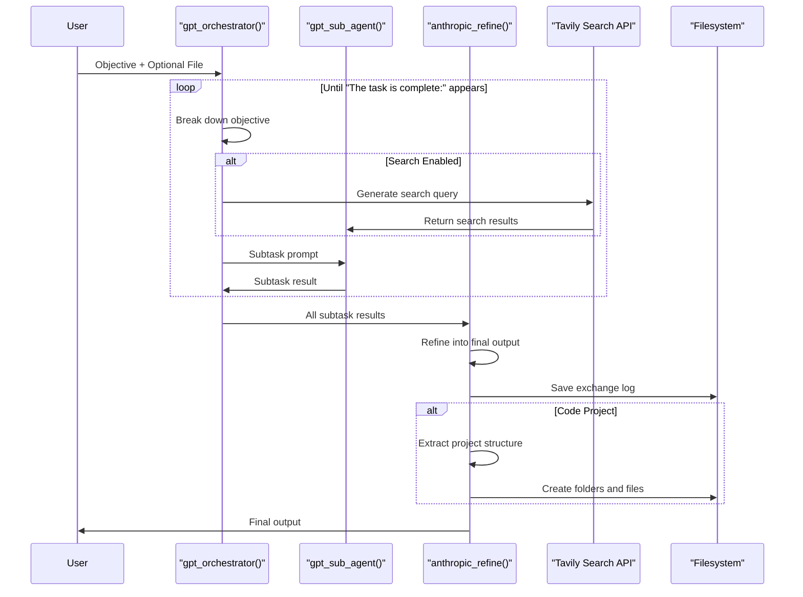
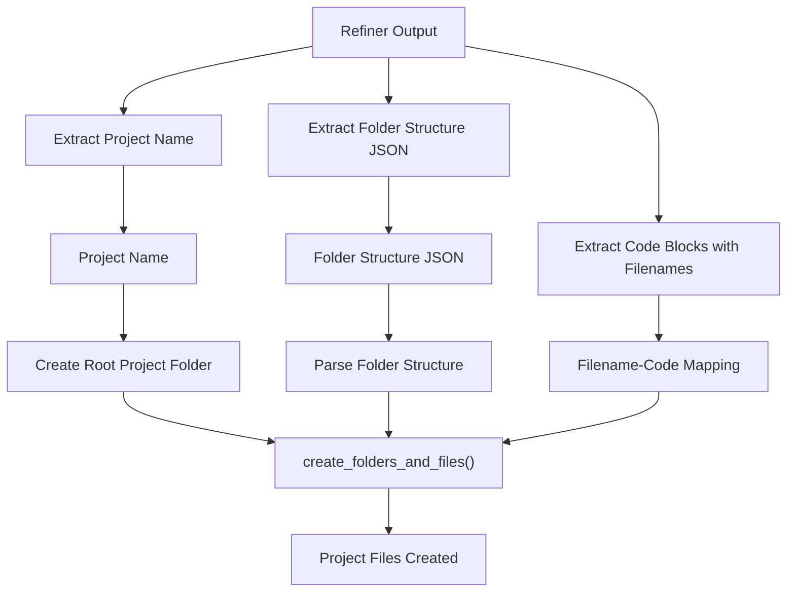
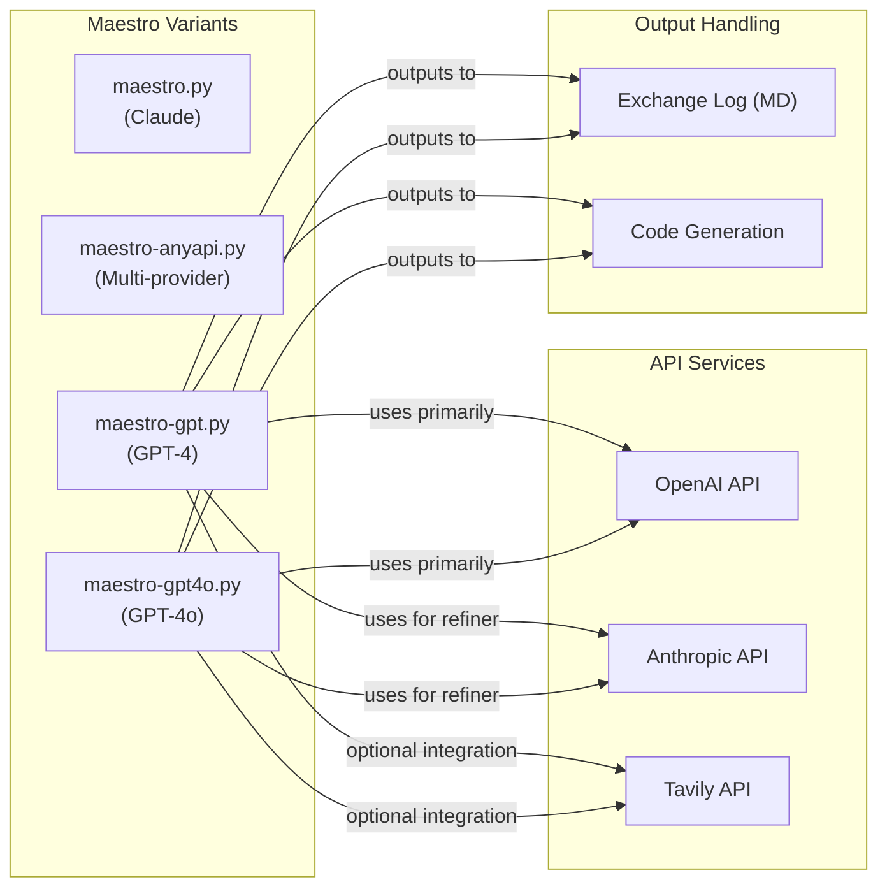

<!-- source: DeepWiki mcp.deepwiki.com · repo Doriandarko/maestro · page 4.1 OpenAI (GPT) Implementation · fetched 2026-10-26 -->

# OpenAI (GPT) Implementation

<details>
<summary>Relevant source files</summary>

The following files were used as context for generating this wiki page:

- [README.md](README.md)
- [maestro-gpt4o.py](maestro-gpt4o.py)

</details>


This page provides a comprehensive technical overview of the OpenAI GPT implementation of the Maestro framework. It covers the architecture, configuration, usage, and unique capabilities of Maestro when using GPT models as the primary LLM provider. For information about local LLM implementations, see [Local LLM with Ollama](#4.2).

## Overview

The OpenAI GPT implementation of Maestro leverages GPT models (particularly GPT-4o) to provide advanced task orchestration capabilities with specific optimizations for code generation. This implementation uses GPT models for the orchestrator and sub-agent components, while still leveraging Claude models for the refinement phase in some configurations.

The implementation is available in multiple variants:
- `maestro-gpt.py` - Uses GPT-4 
- `maestro-gpt4o.py` - Uses GPT-4o with enhanced code capabilities

Sources: [README.md:45-53](). [maestro-gpt4o.py:1-13]()

## Architecture

The Maestro GPT implementation follows the core orchestration pattern of the Maestro framework but uses OpenAI's models for key components.

### Architecture Diagram



Sources: [maestro-gpt4o.py:40-81](), [maestro-gpt4o.py:83-123](), [maestro-gpt4o.py:125-153]()

### Components and Model Configuration

The GPT implementation uses specific models for each role in the orchestration process:

| Component Role | Model | File Reference |
|---------------|-------|----------------|
| Orchestrator | `gpt-4o` | [maestro-gpt4o.py:16]() |
| Sub-Agent | `gpt-4o` | [maestro-gpt4o.py:17]() |
| Refiner | `claude-3-opus-20240229` | [maestro-gpt4o.py:20]() |

Note that while the orchestrator and sub-agent use OpenAI models, the refiner still uses Anthropic's Claude model in the default configuration.

Sources: [maestro-gpt4o.py:16-20]()

## Workflow Process

The following sequence diagram shows the execution flow of the GPT implementation:



Sources: [maestro-gpt4o.py:214-234](), [maestro-gpt4o.py:235-275]()

## Core Functions

### Orchestrator Function

The `gpt_orchestrator()` function handles breaking down objectives into manageable subtasks:

```
gpt_orchestrator(objective, file_content=None, previous_results=None, use_search=False)
```

Key capabilities:
- Analyzes the objective and progress so far
- Determines when a task is complete (checks for "The task is complete:" marker)
- Generates search queries when search integration is enabled
- Returns the next subtask prompt

Sources: [maestro-gpt4o.py:40-81]()

### Sub-Agent Function

The `gpt_sub_agent()` function handles executing individual subtasks:

```
gpt_sub_agent(prompt, search_query=None, previous_gpt_tasks=None, use_search=False, continuation=False)
```

Key capabilities:
- Executes subtasks based on prompts from the orchestrator
- Incorporates context from previous subtasks
- Integrates search results when applicable
- Handles continuation for long responses

Sources: [maestro-gpt4o.py:83-123]()

### Refiner Function

The `anthropic_refine()` function synthesizes all subtask results:

```
anthropic_refine(objective, sub_task_results, filename, projectname, continuation=False)
```

Key capabilities:
- Combines all subtask results into a cohesive final output
- Formats the output for code projects including project structure
- Extracts code blocks and file names
- Handles continuation for very long outputs

Sources: [maestro-gpt4o.py:125-153]()

## Code Generation Capabilities

The GPT implementation excels at code generation tasks, with specialized capabilities for creating complete project structures.

### Project Structure Extraction and Creation

The system extracts three key elements from the refined output:

1. **Project Name** - An appropriate name for the code project
2. **Folder Structure** - A JSON representation of the project structure
3. **Code Blocks** - Properly formatted code with filenames



The function `create_folder_structure()` initiates the process, and `create_folders_and_files()` recursively creates the project directories and files.

Sources: [maestro-gpt4o.py:155-185](), [maestro-gpt4o.py:239-254]()

## Optional Features

### File Input Context

The GPT implementation can process an existing file as context:

```python
provide_file = input("Do you want to provide a file path? (y/n): ").lower() == 'y'
```

When enabled, file content is passed to the orchestrator to inform task breakdown and execution.

Sources: [maestro-gpt4o.py:195-206]()

### Search Integration

Search capabilities are provided through the Tavily API integration:

```python
use_search = input("Do you want to use search? (y/n): ").lower() == 'y'
```

When enabled, the system generates relevant search queries and incorporates search results into the subtask execution.

Sources: [maestro-gpt4o.py:209](), [maestro-gpt4o.py:92-96]()

## Token Usage and Cost Tracking

The GPT implementation includes functions to track token usage and calculate costs:

```python
calculate_subagent_cost(model, input_tokens, output_tokens)
```

The system tracks:
- Input tokens
- Output tokens
- Total tokens
- Cost based on model-specific pricing

Sources: [maestro-gpt4o.py:25-38](), [maestro-gpt4o.py:143-145]()

## Usage Example

To use the GPT implementation:

1. Set up API keys:
   ```python
   openai_client = OpenAI(api_key="YOUR API KEY")
   anthropic_client = Anthropic(api_key="YOUR API KEY")
   ```

2. Run the appropriate script:
   ```bash
   python maestro-gpt4o.py
   ```

3. Enter your objective when prompted
4. Choose whether to provide a file and use search
5. View results in the console and in the generated markdown file

Sources: [README.md:45-53](), [maestro-gpt4o.py:193-210]()

## Integration with Other Maestro Components

The GPT implementation integrates with the broader Maestro framework as shown below:



Sources: [README.md:13-30](), [README.md:45-53]()

## Conclusion

The OpenAI GPT implementation of Maestro offers a powerful alternative to the Claude-based implementation, with specific strengths in code generation and project structure creation. It maintains the core orchestration pattern of breaking objectives into subtasks while leveraging GPT-4o's capabilities for both orchestration and subtask execution.

For more information on other implementations, see [Other Implementations](#4.3).

---

