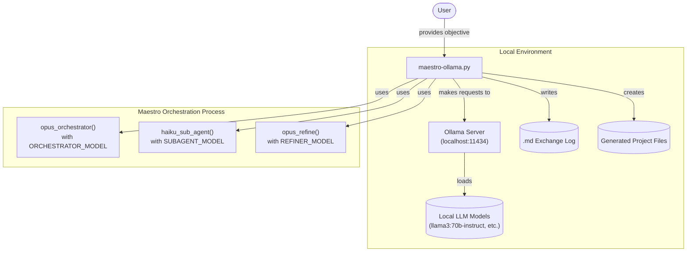
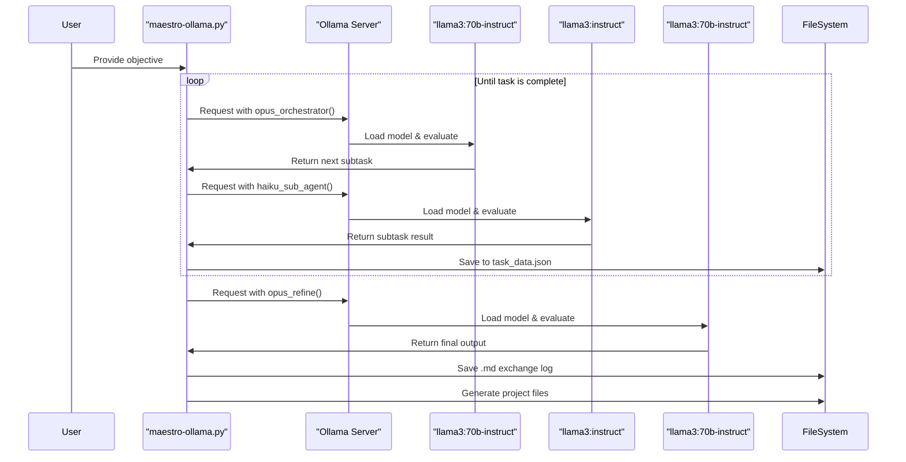
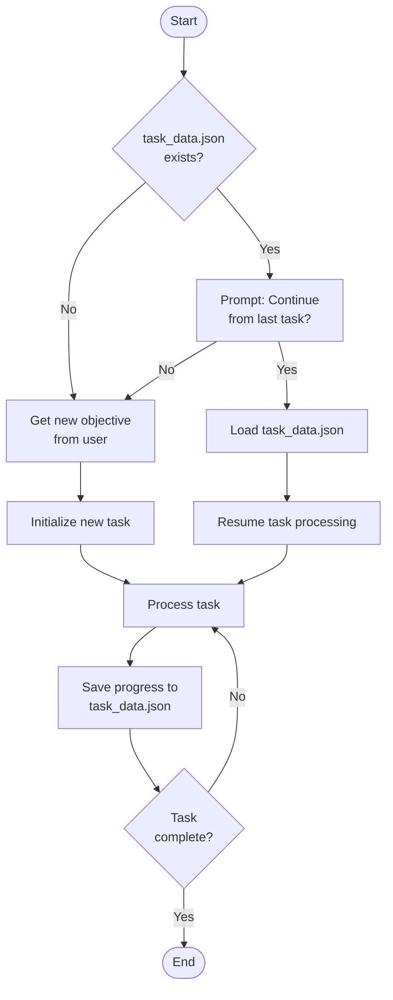

<!-- source: DeepWiki mcp.deepwiki.com · repo Doriandarko/maestro · page 4.2 Local LLM with Ollama · fetched 2026-10-26 -->

# Local LLM with Ollama

<details>
<summary>Relevant source files</summary>

The following files were used as context for generating this wiki page:

- [README.md](README.md)
- [maestro-ollama.py](maestro-ollama.py)

</details>


This document explains how to use the Maestro framework with locally run language models via Ollama. This integration allows you to run Maestro without relying on cloud API services, providing benefits like privacy, no API costs, and no internet dependency after initial model download. For information about running Maestro with other local LLM solutions, see [Other Implementations](#4.3).

## Overview of Maestro with Ollama

Ollama is an open-source platform for running large language models locally on your machine. The Maestro-Ollama integration enables you to leverage powerful open-source models like Llama 3 for task orchestration while keeping all processing on your local hardware.



Sources: [maestro-ollama.py:38-56](), [maestro-ollama.py:57-88](), [maestro-ollama.py:90-111]()

## Installation and Setup

Before using Maestro with Ollama, you need to set up both the Ollama platform and the required Python packages.

### 1. Install Ollama

Download and install the Ollama client from the official website:
```
https://ollama.com/download
```

### 2. Install Required Python Package

Install the Ollama Python client:
```bash
pip install ollama
```

### 3. Pull Required Models

Pull the language models you want to use with Maestro (you only need to do this once per model):

```bash
ollama pull llama3:70b
# Or for smaller models with less hardware requirements
ollama pull llama3:8b
```

Sources: [README.md:70-98](), [maestro-ollama.py:11-16]()

## Architecture and Implementation

The Maestro-Ollama implementation follows the same orchestration pattern as other Maestro variants but uses locally hosted models instead of cloud APIs.



Sources: [maestro-ollama.py:201-234](), [maestro-ollama.py:240-285]()

### Model Configuration

The implementation uses three different model roles, which can be configured in the code:

```python
ORCHESTRATOR_MODEL = 'llama3:70b-instruct'  # For breaking down tasks
SUBAGENT_MODEL = 'llama3:instruct'          # For executing subtasks
REFINER_MODEL = 'llama3:70b-instruct'       # For compiling results
```

The script automatically checks for and pulls these models if they don't already exist locally:

```python
for model in [ORCHESTRATOR_MODEL, SUBAGENT_MODEL, REFINER_MODEL]:
    try:
        print(f"Checking for model: {model}")
        m = ollama.show(model)
    except ollama._types.ResponseError as e:
        print(f"Pulling model from ollama: {model}")
        ollama.pull(model)
```

Sources: [maestro-ollama.py:18-30]()

### Key Components

| Component | Purpose | Implementation |
|-----------|---------|----------------|
| `opus_orchestrator()` | Breaks down objectives into subtasks | Uses `ORCHESTRATOR_MODEL` to generate task prompts |
| `haiku_sub_agent()` | Executes individual subtasks | Uses `SUBAGENT_MODEL` to complete assigned tasks |
| `opus_refine()` | Combines results into final output | Uses `REFINER_MODEL` to synthesize a cohesive result |
| `create_folder_structure()` | Generates project files from output | Creates directories and files based on LLM output |

Sources: [maestro-ollama.py:37-111](), [maestro-ollama.py:113-142]()

## Using Maestro with Ollama

### Running the Script

You can run Maestro with Ollama in two ways:

1. With command-line argument:
```bash
python maestro-ollama.py -p "Your objective here"
```

2. With interactive prompt:
```bash
python maestro-ollama.py
# You'll be prompted to enter your objective
```

Sources: [maestro-ollama.py:166-186]()

### Processing Flow

1. **Task Initialization**:
   - Objective is provided via command-line or interactive prompt
   - Optional file content can be included by specifying a file path

2. **Task Breakdown and Execution**:
   - The orchestrator model breaks down the objective into subtasks
   - The subagent model executes each subtask
   - Results are stored in `task_exchanges` list
   - Progress is saved to `task_data.json` to allow resuming interrupted sessions

3. **Result Refinement**:
   - The refiner model compiles subtask results into a coherent output
   - For code projects, it generates:
     - Project name
     - Folder structure (as JSON)
     - Code files (with filename and content)

4. **Output Generation**:
   - Creates project folders and files based on the refined output
   - Saves a complete exchange log as a Markdown file

Sources: [maestro-ollama.py:201-285]()

## Task Persistence and Resumption

Maestro-Ollama includes functionality to save and resume tasks:



The script saves task state to `task_data.json` after each subtask, allowing you to resume an interrupted session.

Sources: [maestro-ollama.py:149-161](), [maestro-ollama.py:174-186](), [maestro-ollama.py:229-231]()

## Advantages and Limitations

### Advantages

- **Privacy**: All data processing happens locally on your machine
- **No API costs**: Use open-source models without usage fees
- **Offline operation**: Works without internet once models are downloaded
- **Model flexibility**: Use different sized models based on your hardware capabilities

### Limitations

- **Hardware requirements**: Larger models like `llama3:70b` require significant RAM and GPU resources
- **Processing speed**: Generally slower than cloud API services, depending on your hardware
- **Limited model selection**: Fewer model options compared to commercial API services

Sources: [README.md:70-98](), [maestro-ollama.py:18-21]()

## Example Use Cases

1. **Code generation projects**: Create complete applications with folder structures and files
2. **Content development**: Generate articles, reports, or other text content
3. **Planning and strategy**: Break down complex problems into manageable steps
4. **Learning and experimentation**: Test AI capabilities without API costs

## Troubleshooting

If you encounter issues with Maestro-Ollama:

- **Model loading errors**: Ensure Ollama server is running (`ollama serve`)
- **Out of memory errors**: Try using smaller models like `llama3:8b`
- **Incomplete responses**: The script handles continuation for truncated responses
- **JSON parsing errors**: The script includes error handling for malformed JSON in folder structures

Sources: [maestro-ollama.py:23-30](), [maestro-ollama.py:81-86](), [maestro-ollama.py:247-255]()

---

