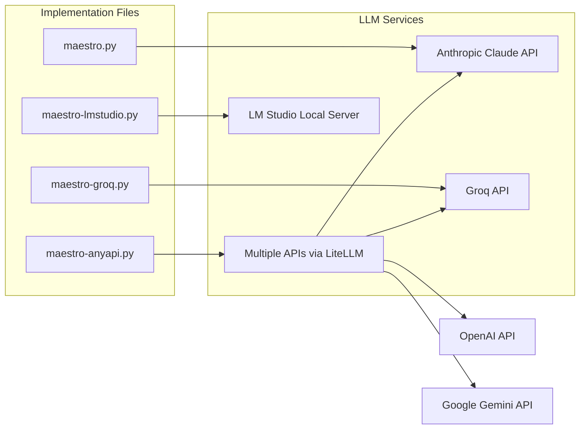
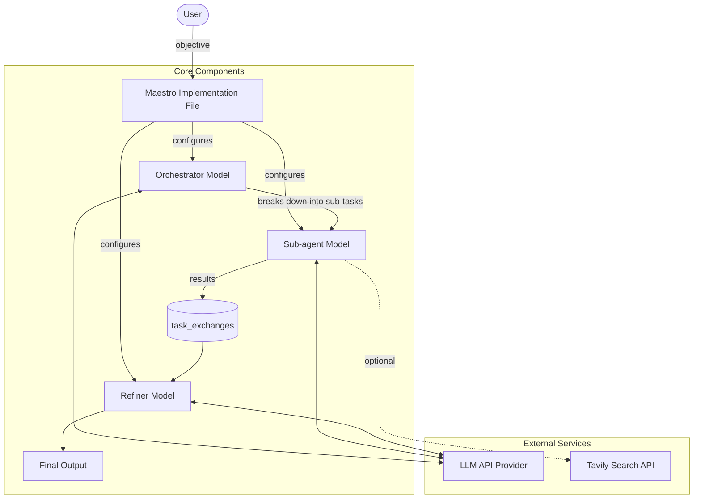
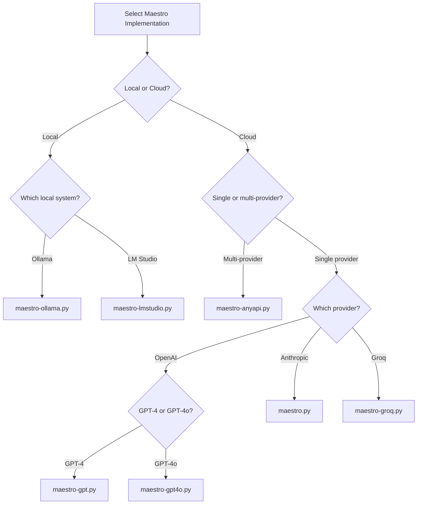

<!-- source: DeepWiki mcp.deepwiki.com · repo Doriandarko/maestro · page 4.3 Other Implementations · fetched 2026-10-26 -->

# Other Implementations

<details>
<summary>Relevant source files</summary>

The following files were used as context for generating this wiki page:

- [README.md](README.md)

</details>


This page provides an overview of additional Maestro implementations beyond the OpenAI/GPT implementations (covered in [OpenAI (GPT) Implementation](#4.1)) and Ollama implementation (covered in [Local LLM with Ollama](#4.2)). These implementations enable Maestro to work with various LLM providers and deployment methods, offering flexibility in choosing the right solution for specific use cases.

## Implementation Overview

Maestro supports multiple LLM providers through dedicated implementation files, each optimized for specific models or services:



Sources: [README.md:6-110]()

## Common Architecture

All implementations share the same core architecture and workflow, with differences primarily in the API integration layer:



Sources: [README.md:132-139](), [README.md:190-202]()

## Multi-Provider Implementation (maestro-anyapi.py)

### Overview

The `maestro-anyapi.py` implementation provides a unified interface to multiple LLM providers through the LiteLLM library. This allows for using Maestro with various AI models from different providers including Anthropic (Claude), OpenAI (GPT models), Google (Gemini), Cohere, and more.

Key features:
- Flexible model selection for each role (orchestrator, sub-agent, refiner)
- Unified API interface through LiteLLM
- Support for multiple API providers with a single implementation file

### Setup and Usage

To use the multi-provider implementation:

1. Install the required dependency:
   ```bash
   pip install litellm
   ```

2. Set environment variables for the API keys of the services you plan to use
3. Define the models to be used for each role in the Maestro process
4. Run the implementation:
   ```bash
   python maestro-anyapi.py
   ```

Example model configuration:
```
ORCHESTRATOR_MODEL = "gemini/gemini-1.5-flash-latest"
SUB_AGENT_MODEL = "gemini/gemini-1.5-flash-latest"
REFINER_MODEL = "gemini/gemini-1.5-flash-latest"
```

Sources: [README.md:13-42]()

## Groq Implementation (maestro-groq.py)

### Overview

The `maestro-groq.py` implementation leverages Groq's API for high-speed inference. Groq is known for its extremely fast response times, which can significantly reduce the overall execution time of the Maestro orchestration process.

Key benefits:
- Significantly faster response times compared to other APIs
- Reduced latency for complex orchestration tasks
- Maintains the same core Maestro functionality

### Setup and Usage

To use the Groq implementation:

1. Install the required dependency:
   ```bash
   pip install groq
   ```

2. Set your Groq API key
3. Run the implementation:
   ```bash
   python maestro-groq.py
   ```

Sources: [README.md:101-110]()

## LM Studio Implementation (maestro-lmstudio.py)

### Overview

The `maestro-lmstudio.py` implementation provides integration with LM Studio, allowing you to run Maestro using local language models. This offers privacy benefits and eliminates the need for external API costs once you have the models downloaded.

Key benefits:
- Full privacy with local model execution
- No ongoing API costs
- Customizable model selection based on available models in LM Studio
- Ability to run offline without internet connectivity

### Setup and Usage

To use the LM Studio implementation:

1. Download and install LM Studio from https://lmstudio.ai/
2. Run the local server in LM Studio:
   - Launch LM Studio
   - Download your preferred model
   - Start the local server
   - Optionally remove any system prompt to leverage Maestro's prompting

3. Run the implementation:
   ```bash
   python maestro-lmstudio.py
   ```

Sources: [README.md:57-68]()

## Original Claude/Anthropic Implementation (maestro.py)

### Overview

The original `maestro.py` implementation uses Anthropic's Claude models (primarily Claude 3.5 Sonnet, Claude Opus, and Claude Haiku) to perform the orchestration, sub-task execution, and refinement.

Key features:
- Designed specifically for Anthropic's Claude models
- Takes advantage of Claude's specific capabilities
- Updated to support Claude 3.5 Sonnet

### Setup and Usage

To use the original Anthropic implementation:

1. Ensure you have an Anthropic API key
2. Install the required dependencies:
   ```bash
   pip install anthropic rich
   ```

3. Replace the placeholder API key in the script with your actual Anthropic API key
4. Run the implementation:
   ```bash
   python maestro.py
   ```

This implementation typically uses Claude Opus for orchestration and refinement tasks, and Claude Haiku for sub-agent tasks.

Sources: [README.md:1-10](), [README.md:150-164]()

## Implementation Comparison

| Implementation | Primary LLM Provider | Key Advantages | Requirements |
|----------------|----------------------|----------------|--------------|
| maestro.py | Anthropic Claude | Original implementation, optimized for Claude models | Anthropic API key |
| maestro-anyapi.py | Multiple (via LiteLLM) | Flexibility to choose models from different providers | API keys for chosen providers, LiteLLM |
| maestro-groq.py | Groq | Very fast response times | Groq API key |
| maestro-lmstudio.py | Local LM Studio server | Privacy, no API costs, offline operation | LM Studio application, local models |
| maestro-gpt.py | OpenAI GPT-4 | Optimized for GPT-4 capabilities | OpenAI API key |
| maestro-gpt4o.py | OpenAI GPT-4o | Optimized for GPT-4o's code capabilities | OpenAI API key |
| maestro-ollama.py | Local Ollama | Local execution, no API costs | Ollama client, local models |

Sources: [README.md:1-110]()

## Implementation Selection Process

When choosing which Maestro implementation to use, consider the following factors:



Sources: [README.md:1-110]()

## Technical Considerations

When working with different implementations, be aware of the following technical considerations:

1. **API Keys**: Each cloud implementation requires specific API keys to be set, either as environment variables or within the script
2. **Model Capabilities**: Different models have varying capabilities and specializations (code generation, reasoning, etc.)
3. **Response Speed**: Performance varies significantly between providers (Groq being notably faster)
4. **Cost**: API costs differ between providers, while local implementations have no ongoing costs after initial setup
5. **Implementation Updates**: Implementation files may be updated at different rates as models and APIs evolve

Sources: [README.md:13-28](), [README.md:101-110](), [README.md:204-212]()

---

