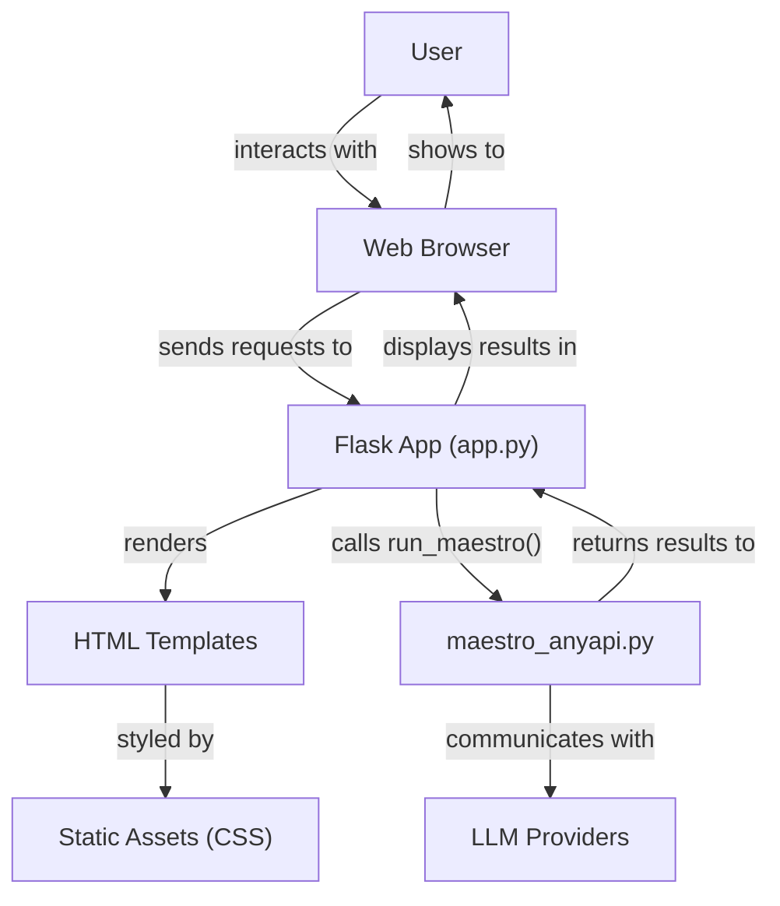
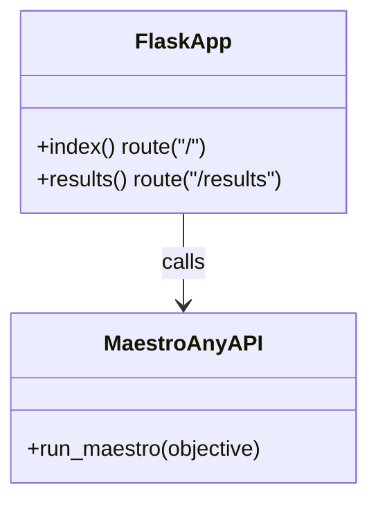
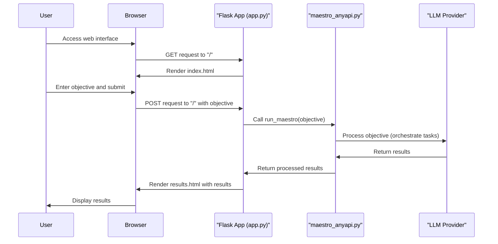
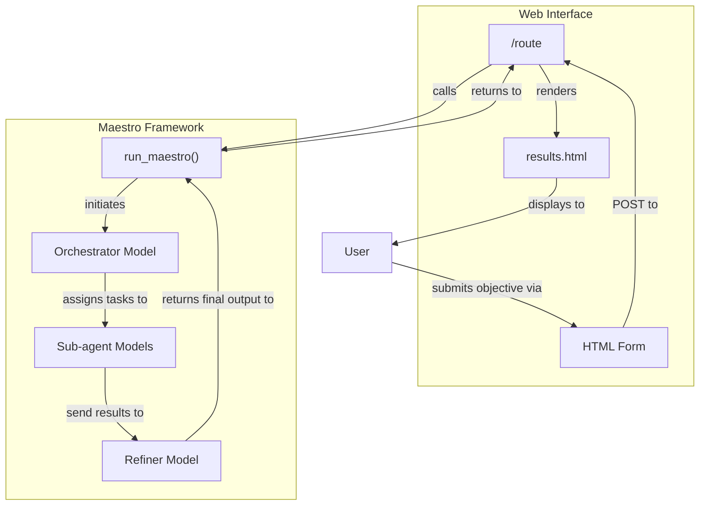

<!-- source: DeepWiki mcp.deepwiki.com · repo Doriandarko/maestro · page 5 Web Interface · fetched 2026-10-26 -->

# Web Interface

<details>
<summary>Relevant source files</summary>

The following files were used as context for generating this wiki page:

- [flask_app/app.py](flask_app/app.py)
- [flask_app/templates/base.html](flask_app/templates/base.html)
- [flask_app/templates/index.html](flask_app/templates/index.html)

</details>


This document provides an overview of the Flask-based web interface for the Maestro LLM Orchestration Framework. The web interface allows users to interact with Maestro through a browser instead of the command line, making it more accessible for non-technical users.

For instructions on setting up the web interface, see [Web Interface Setup](#5.1). For a guide on how to use the web interface, see [Using the Web Interface](#5.2).

## Architecture Overview

The web interface is built with Flask, a lightweight web framework for Python. It serves as a thin wrapper around the Maestro framework, providing a user-friendly interface for submitting objectives and viewing results.



Sources: [flask_app/app.py:1-26]()

## Components

### Flask Application

The core of the web interface is the Flask application defined in `app.py`. It has two main routes:

1. `/` (index) - Handles both GET requests (displays the form) and POST requests (processes the form and displays results)
2. `/results` - A placeholder route for displaying results (though currently unused)

When a user submits an objective, the application passes it to `maestro_anyapi.run_maestro()` and then renders the results.



Sources: [flask_app/app.py:7-26]()

### HTML Templates

The web interface uses two HTML templates:

1. `base.html` - The base template that provides the common structure for all pages
2. `index.html` - The main page template that contains the form for submitting objectives

#### Base Template Structure

The base template (`base.html`) provides the foundation for all pages in the web interface. It includes:

- Document structure (HTML, head, body)
- CSS styling reference
- Header with title
- Navigation menu
- Content block (filled by child templates)
- Footer

Sources: [flask_app/templates/base.html:1-29]()

#### Index Template Structure

The index template (`index.html`) contains:

- A form for submitting objectives
- A section for displaying results if available

Sources: [flask_app/templates/index.html:1-29]()

## User Interaction Flow

The following diagram illustrates how a user interacts with the Maestro system through the web interface:



Sources: [flask_app/app.py:12-23](), [flask_app/templates/index.html:15-25]()

## Integration with Maestro Framework

The web interface integrates with the Maestro framework through the `maestro_anyapi` module. When a user submits an objective, the Flask application calls `maestro_anyapi.run_maestro(objective)`, which processes the objective using the appropriate LLM provider and returns the results.

This integration is intentionally minimal, keeping the web interface as a simple wrapper around the core Maestro functionality.



Sources: [flask_app/app.py:17-18]()

## Technical Details

### Flask Application

The Flask application is created with the standard Flask initialization and runs in debug mode during development:

```python
app = Flask(__name__)
```

Debug mode is enabled when running the application directly:

```python
if __name__ == '__main__':
    app.run(debug=True)
```

Sources: [flask_app/app.py:10-26]()

### Routes

The application defines two routes:

| Route    | Method | Function                                                     |
|----------|--------|--------------------------------------------------------------|
| `/`      | GET    | Displays the form for entering an objective                  |
| `/`      | POST   | Processes the submitted objective and displays results       |
| `/results`| GET   | Currently a placeholder route (not fully implemented)        |

Sources: [flask_app/app.py:12-23]()

## Form Submission and Processing

When a user submits the objective form, the following process occurs:

1. The browser sends a POST request to the `/` route with the objective in the form data
2. The Flask application extracts the objective from the form data
3. The application calls `maestro_anyapi.run_maestro(objective)` to process the objective
4. The application renders the `results.html` template with the processed results
5. The browser displays the results to the user

Sources: [flask_app/app.py:14-18](), [flask_app/templates/index.html:15-25]()

## User Interface Elements

The web interface includes the following key UI elements:

1. **Header** - Displays the title "Maestro Task Orchestrator"
2. **Navigation Menu** - Provides links to different sections of the application
3. **Objective Form** - Allows users to enter and submit their objectives
4. **Results Section** - Displays the results of the processed objective

Sources: [flask_app/templates/base.html:11-13](), [flask_app/templates/index.html:15-25]()

## Summary

The Maestro web interface provides a simple, intuitive way to interact with the Maestro LLM Orchestration Framework through a web browser. It uses Flask to handle HTTP requests and integrates seamlessly with the Maestro framework through the `maestro_anyapi` module.

The interface is intentionally minimalist, focusing on making the core functionality of Maestro accessible to users without requiring command-line interaction.

---

