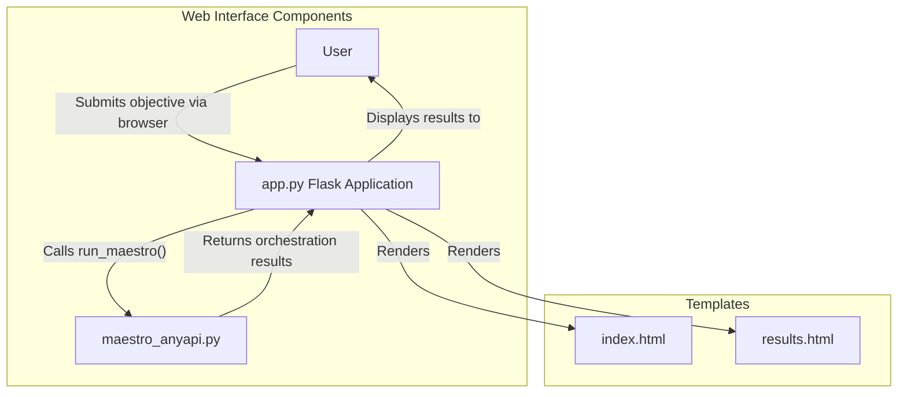
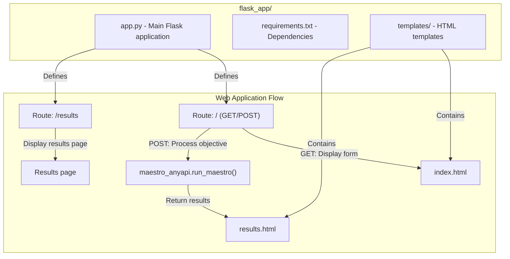
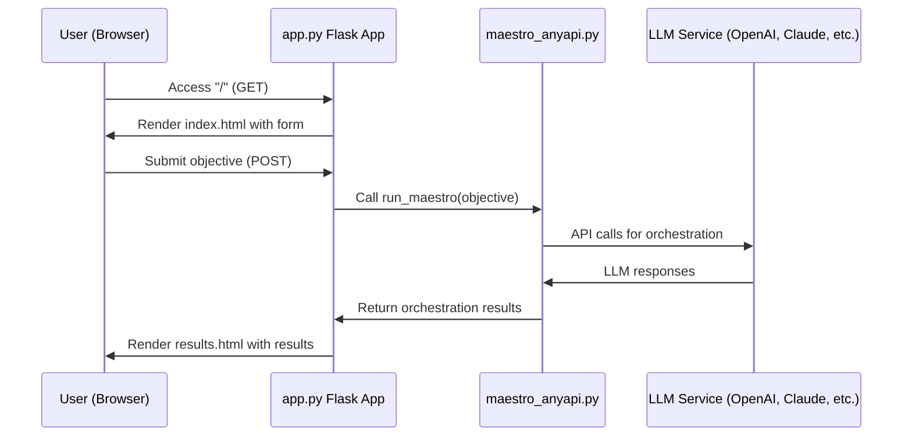
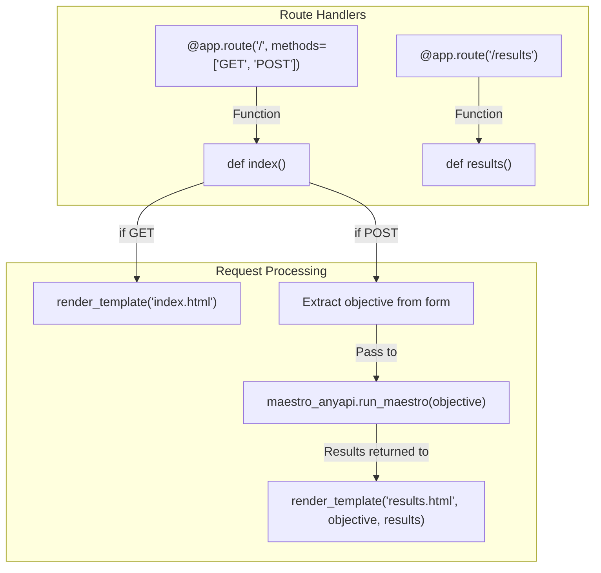

<!-- source: DeepWiki mcp.deepwiki.com · repo Doriandarko/maestro · page 5.1 Web Interface Setup · fetched 2026-10-26 -->

# Web Interface Setup

<details>
<summary>Relevant source files</summary>

The following files were used as context for generating this wiki page:

- [flask_app/app.py](flask_app/app.py)
- [flask_app/requirements.txt](flask_app/requirements.txt)

</details>


This document provides instructions for setting up and configuring the Maestro web interface, which offers a browser-based alternative to the command-line interface. The web interface allows users to interact with Maestro's LLM orchestration capabilities through a simple, intuitive Flask application.

For information on how to use the web interface after setup, see [Using the Web Interface](#5.2).

## Overview

The Maestro web interface is built using Flask, a lightweight Python web framework. It provides a simple form where users can input their objectives and view the results generated by the Maestro orchestration system.



Sources: [flask_app/app.py:7-19]()

## Prerequisites

Before setting up the web interface, ensure you have:

1. Python 3.8 or higher installed
2. Required API keys configured (see [API Keys Configuration](#2.1))
3. Git installed (for cloning the repository)

## Installation

### Step 1: Clone the Repository

First, clone the Maestro repository to your local machine if you haven't already.

### Step 2: Install Required Dependencies

Navigate to the `flask_app` directory and install the required dependencies:

```bash
cd flask_app
pip install -r requirements.txt
```

The requirements file includes all necessary packages for both the web interface and the underlying Maestro functionality:

| Category | Packages |
|----------|----------|
| Web Framework | Flask |
| LLM APIs | anthropic, openai, groq |
| Local LLM Integration | ollama |
| Utilities | rich, tavily-python |

Sources: [flask_app/requirements.txt:1-7]()

## Web Application Structure

The web interface consists of the following key components:



Sources: [flask_app/app.py:7-23]()

## Configuration

The Flask application is configured to integrate with the `maestro_anyapi` module, which supports multiple LLM providers. No additional configuration is needed for the web interface itself, as it inherits the configuration from the Maestro implementation.



Sources: [flask_app/app.py:12-19]()

## Running the Web Interface

To start the web interface, run the following command from the `flask_app` directory:

```bash
python app.py
```

The Flask development server will start running, typically on `http://127.0.0.1:5000/`. The application runs in debug mode by default, which is useful during development but should be disabled in production environments.

Sources: [flask_app/app.py:25-26]()

## Implementation Details

### Main Application File

The main application file (`app.py`) handles two primary routes:

1. **Root route ("/")**:
   - GET: Displays the input form
   - POST: Processes the objective and calls the Maestro orchestration

2. **Results route ("/results")**:
   - Placeholder for displaying results (currently returns a simple message)

The application integrates with Maestro by importing the `maestro_anyapi` module and calling its `run_maestro()` function when a user submits an objective.



Sources: [flask_app/app.py:12-23]()

## Security Considerations

The current implementation runs in debug mode, which is suitable for development but not for production. When deploying to a production environment, consider:

1. Disabling debug mode
2. Adding proper authentication
3. Setting up a production-ready WSGI server (like Gunicorn or uWSGI)
4. Implementing rate limiting to prevent API abuse

## Common Issues and Troubleshooting

If you encounter issues with the web interface:

1. **Missing dependencies**: Ensure all requirements are installed using `pip install -r requirements.txt`
2. **API key issues**: Verify that LLM API keys are properly configured
3. **Port conflicts**: If port 5000 is already in use, modify the port in the `app.run()` call

## Next Steps

After setting up the web interface, refer to [Using the Web Interface](#5.2) for instructions on how to effectively use the interface to submit objectives and review results.

---

