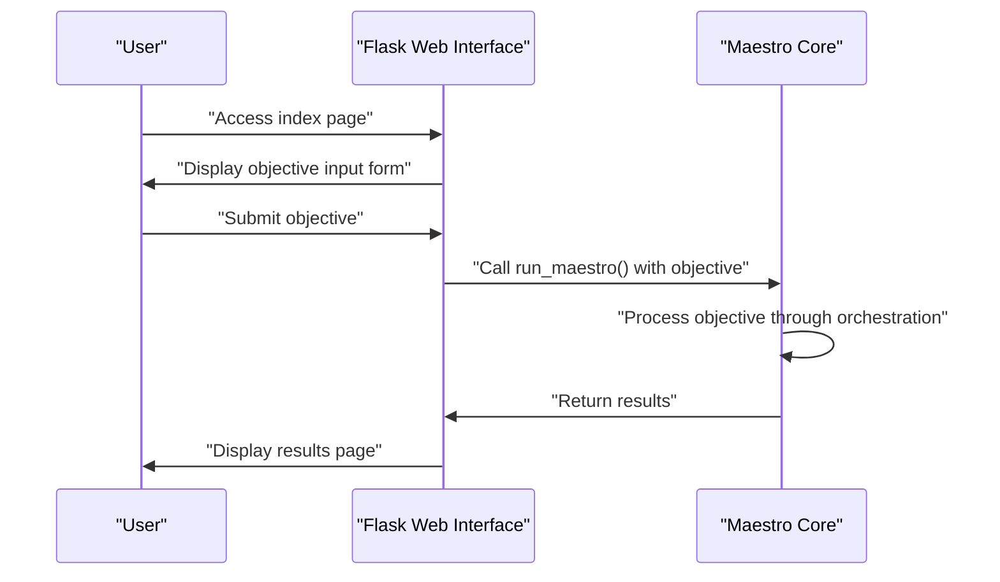
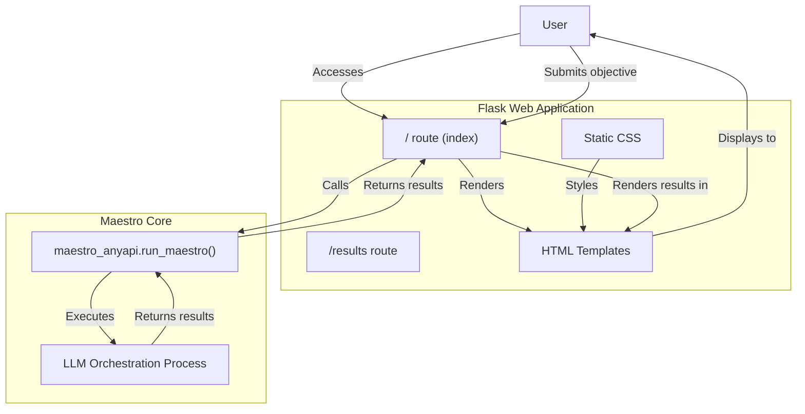
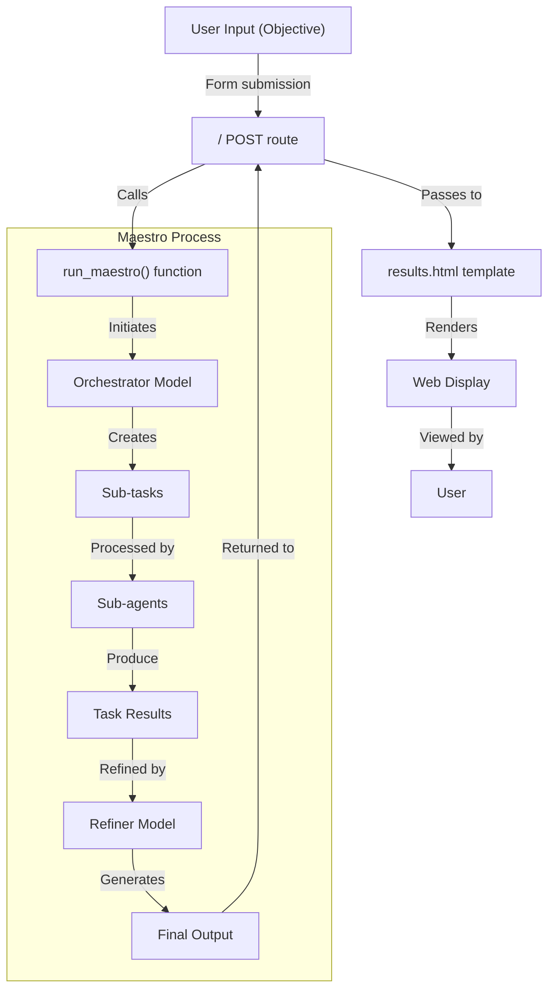

<!-- source: DeepWiki mcp.deepwiki.com · repo Doriandarko/maestro · page 5.2 Using the Web Interface · fetched 2026-10-26 -->

# Using the Web Interface

Relevant source files

The following files were used as context for generating this wiki page:

- [flask_app/app.py](flask_app/app.py)
- [flask_app/static/css/style.css](flask_app/static/css/style.css)
- [flask_app/templates/index.html](flask_app/templates/index.html)

This page provides a comprehensive guide to using Maestro's web-based user interface. The web interface offers an accessible way to submit objectives to Maestro and view results without using the command line. For information about setting up and configuring the web interface, see [Web Interface Setup](#5.1).

## Overview

The Maestro web interface is implemented as a Flask application that provides a simple, user-friendly way to interact with the Maestro orchestration framework. It allows users to submit objectives through a web form and view the resulting output after processing.

### User Interaction Flow

Sources: [flask_app/app.py:12-19](), [flask_app/templates/index.html:15-19]()

## Web Interface Architecture

The web interface is built on Flask and serves as a frontend to the Maestro orchestration system. It connects to the same underlying functionality as the command-line interface but provides a graphical interface instead.

Sources: [flask_app/app.py:7-19](), [flask_app/templates/index.html:1-29](), [flask_app/static/css/style.css:1-64]()

## Web Interface Components

The web interface consists of the following key components:

| Component | File Path | Description |
|-----------|-----------|-------------|
| Flask Application | flask_app/app.py | Main web application that handles HTTP requests and integrates with Maestro |
| Index Template | flask_app/templates/index.html | HTML template for the main page with the objective input form |
| CSS Styling | flask_app/static/css/style.css | Stylesheet that defines the appearance of the web interface |
| Maestro Integration | Imported as `maestro_anyapi` | The core Maestro functionality accessed via the `run_maestro()` function |

Sources: [flask_app/app.py:7-9](), [flask_app/templates/index.html:1-29](), [flask_app/static/css/style.css:1-64]()

## Using the Web Interface

### Accessing the Interface

1. Ensure the Flask application is running (see [Web Interface Setup](#5.1))
2. Open your web browser and navigate to the address where the Flask app is running
   - By default, this is http://127.0.0.1:5000/ when running locally
3. The Maestro Task Orchestrator interface will load with a form to enter your objective

Sources: [flask_app/app.py:25-26]()

### Submitting an Objective

1. On the main page, you'll find a text area labeled "Enter your objective"
2. Type your objective in the text area
   - This should be a clear description of what you want Maestro to accomplish
   - Be as specific as possible to get the best results
3. Click the "Submit" button to send your objective to Maestro for processing

Sources: [flask_app/templates/index.html:15-19](), [flask_app/app.py:14-17]()

### Viewing Results

After submitting your objective, the system processes it through the Maestro orchestration framework:

1. The Flask app calls `maestro_anyapi.run_maestro()` with your objective
2. The results page automatically loads when processing is complete
3. The results include the final output compiled by the refiner model

Sources: [flask_app/app.py:17-18](), [flask_app/templates/index.html:20-25]()

## Data Flow in the Web Interface

The following diagram illustrates how data flows through the web interface when processing an objective:

Sources: [flask_app/app.py:12-18]()

## Best Practices

To get the most out of the Maestro web interface:

1. **Be Specific**: Provide clear, detailed objectives rather than vague requests
2. **Set Context**: Include relevant background information in your objective when necessary
3. **Be Patient**: Complex objectives may take time to process as they require multiple LLM calls
4. **Review Results Carefully**: Examine the complete output to understand how Maestro approached your objective
5. **Iterative Refinement**: If results aren't as expected, try reformulating your objective with more details

## Troubleshooting

| Issue | Possible Cause | Solution |
|-------|---------------|----------|
| Web interface doesn't load | Flask server not running | Start the Flask application (see [Web Interface Setup](#5.1)) |
| Long processing time | Complex objective requiring many sub-tasks | Be patient; complex tasks require more processing time |
| Incomplete or error results | API key issues or rate limiting | Check your API keys and quotas (see [API Keys Configuration](#2.1)) |
| Browser times out | Very complex tasks taking too long | Consider breaking your objective into smaller, separate objectives |

Sources: [flask_app/app.py:25-26]()

---

