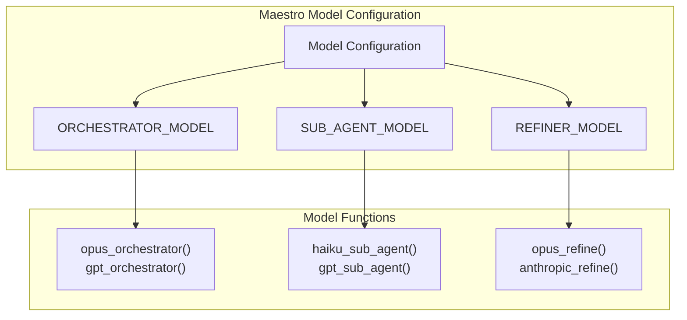
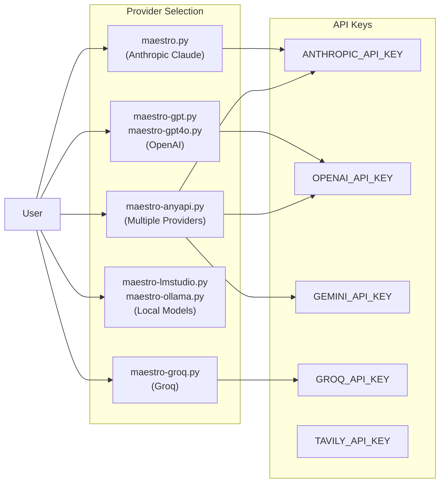
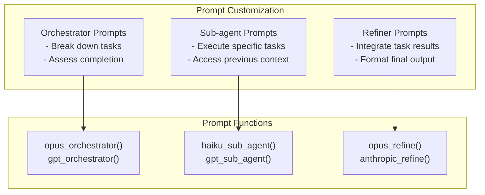
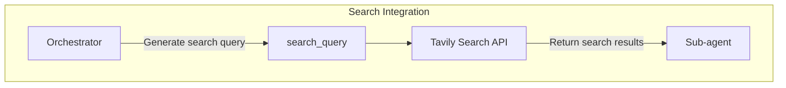
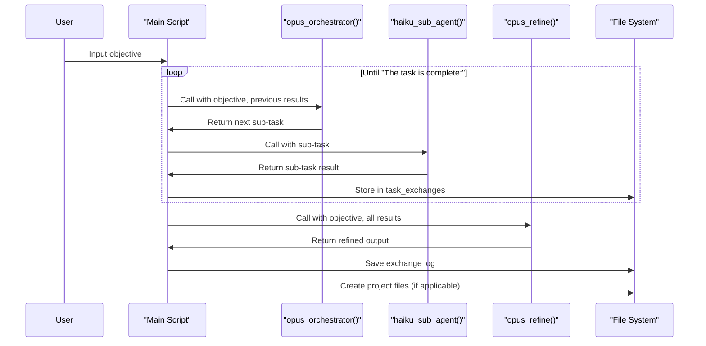

<!-- source: DeepWiki mcp.deepwiki.com · repo Doriandarko/maestro · page 6 Customizing Maestro · fetched 2026-10-26 -->

# Customizing Maestro

<details>
<summary>Relevant source files</summary>

The following files were used as context for generating this wiki page:

- [README.md](README.md)
- [maestro-gpt4o.py](maestro-gpt4o.py)
- [maestro-ollama.py](maestro-ollama.py)

</details>


This page provides a detailed guide on how to customize and extend the Maestro LLM Orchestration Framework for specific use cases. It covers model selection, LLM provider configuration, prompt engineering, search integration, and other advanced customization options.

For basic usage information, see [Usage Guide](#3), and for installation instructions, see [Installation & Setup](#2).

## Model Configuration

Maestro's flexibility comes from its ability to use different language models for different roles in the orchestration process. You can customize which models handle each of the three primary roles.



Sources: [maestro-ollama.py:19-21](), [maestro-gpt4o.py:16-20](), [README.md:24-29]()

### Customizing Model Selection

You can define different models for each stage of the orchestration process by modifying the model constants at the top of your chosen Maestro implementation file:

```
ORCHESTRATOR_MODEL = "model-identifier"
SUB_AGENT_MODEL = "model-identifier" 
REFINER_MODEL = "model-identifier"
```

Model identifiers vary by provider:

| Provider | Example Model Identifiers |
|----------|--------------------------|
| OpenAI | "gpt-4o", "gpt-3.5-turbo" |
| Anthropic | "claude-3-opus-20240229", "claude-3-haiku-20240307" |
| Gemini | "gemini/gemini-1.5-flash-latest" |
| Ollama | "llama3:70b-instruct", "llama3:8b" |

For the `maestro-anyapi.py` implementation, you can mix and match models from different providers.

Sources: [maestro-ollama.py:19-21](), [maestro-gpt4o.py:16-20](), [README.md:24-29]()

## LLM Provider Configuration

Maestro supports multiple LLM providers through different implementation files. Each implementation has specific configuration requirements.



Sources: [README.md:13-22](), [maestro-gpt4o.py:11-13]()

### Setting API Keys

Set environment variables for the API keys required by your chosen provider:

```python
# For OpenAI
os.environ["OPENAI_API_KEY"] = "YOUR KEY"

# For Anthropic
os.environ["ANTHROPIC_API_KEY"] = "YOUR KEY"

# For Gemini
os.environ["GEMINI_API_KEY"] = "YOUR KEY"

# For Groq
os.environ["GROQ_API_KEY"] = "YOUR KEY"

# For Tavily (optional search integration)
os.environ["TAVILY_API_KEY"] = "YOUR KEY"
```

Alternatively, you can directly set the API key in the client initialization:

```python
openai_client = OpenAI(api_key="YOUR API KEY")
anthropic_client = Anthropic(api_key="YOUR API KEY")
```

Sources: [README.md:17-22](), [maestro-gpt4o.py:11-13]()

## Customizing Local Models

For local model implementations, you can customize which models to use and how they're configured.

### Ollama Implementation

For the Ollama implementation, you can:

1. Pull different models:

```python
ollama.pull('llama3:70b')
ollama.pull('llama3:8b')
```

2. Define which models to use for each role:

```python
ORCHESTRATOR_MODEL = 'llama3:70b-instruct'
SUBAGENT_MODEL = 'llama3:instruct'
REFINER_MODEL = 'llama3:70b-instruct'
```

Sources: [maestro-ollama.py:11-16](), [maestro-ollama.py:19-21](), [README.md:85-93]()

### LM Studio Implementation

For LM Studio:

1. Download and set up LM Studio (https://lmstudio.ai/)
2. Run a local server with your preferred model
3. Remove any system prompts from the app
4. Run the Maestro LM Studio implementation

Sources: [README.md:59-67]()

## Customizing Prompts

You can customize the prompts used for each stage of the orchestration process to adapt them to your specific use cases.



Sources: [maestro-ollama.py:37-55](), [maestro-ollama.py:57-88](), [maestro-ollama.py:90-111]()

### Orchestrator Prompts

The orchestrator prompt can be customized by modifying the content string in the relevant function. For example, in the Ollama implementation:

```python
response = client.chat(
    model=ORCHESTRATOR_MODEL,
    messages=[
        {
            "role": "user",
            "content": f"Based on the following objective{' and file content' if file_content else ''}, and the previous sub-task results (if any), please break down the objective into the next sub-task, and create a concise and detailed prompt for a subagent so it can execute that task. [...]"
        }
    ]
)
```

Sources: [maestro-ollama.py:43-54](), [maestro-gpt4o.py:46-48]()

### Sub-agent Prompts

Similarly, sub-agent prompts can be customized:

```python
response = client.chat(
    model=SUBAGENT_MODEL, 
    messages=[{"role": "user", "content": full_prompt}]
)
```

Sources: [maestro-ollama.py:75-77](), [maestro-gpt4o.py:98-104]()

### Refiner Prompts

The refiner prompt defines how the final output is structured:

```python
response = client.chat(
    model=REFINER_MODEL,
    messages=[
        {
            "role": "user",
            "content": "Objective: " + objective + "\n\nSub-task results:\n" + "\n".join(sub_task_results) + "\n\nPlease review and refine the sub-task results into a cohesive final output. [...]"
        }
    ]
)
```

Sources: [maestro-ollama.py:93-100](), [maestro-gpt4o.py:127-133]()

## Integrating Search Capability

You can enhance Maestro with search capabilities using the Tavily API, allowing the models to access up-to-date information.



Sources: [maestro-gpt4o.py:40-81](), [README.md:113-119]()

### Enabling Search

In `maestro-gpt4o.py`, search can be enabled by:

1. Setting up the Tavily API key:
```python
tavily = TavilyClient(api_key="YOUR_API_KEY")
```

2. Passing `use_search=True` to the orchestrator function:
```python
gpt_result, file_content_for_gpt, search_query = gpt_orchestrator(objective, file_content, previous_results, use_search=True)
```

3. Adding search query extraction to the orchestrator function:
```python
if use_search:
    messages.append({"role": "user", "content": "Please also generate a JSON object containing a single 'search_query' key [...]"})
```

4. Processing search results in the sub-agent function:
```python
if search_query and use_search:
    tavily = TavilyClient(api_key="YOUR_API_KEY")
    qna_response = tavily.qna_search(query=search_query)
    # Add search results to the prompt
```

Sources: [maestro-gpt4o.py:51-53](), [maestro-gpt4o.py:66-79](), [maestro-gpt4o.py:92-104]()

## Customizing Output Generation

Maestro generates both exchange logs and code files. You can customize these outputs.

### Exchange Log Customization

Modify the exchange log format by changing how it's constructed:

```python
exchange_log = f"Objective: {objective}\n\n"
exchange_log += "=" * 40 + " Task Breakdown " + "=" * 40 + "\n\n"
for i, (prompt, result) in enumerate(task_exchanges, start=1):
    exchange_log += f"Task {i}:\n"
    exchange_log += f"Prompt: {prompt}\n"
    exchange_log += f"Result: {result}\n\n"
```

Sources: [maestro-ollama.py:270-276](), [maestro-gpt4o.py:261-266]()

### Code Generation Customization

The code generation behavior is controlled by the refiner prompt:

```python
"When working on code projects, ONLY AND ONLY IF THE PROJECT IS CLEARLY A CODING ONE, please provide the following:
1. Project Name: [...]
2. Folder Structure: Provide the folder structure as a valid JSON object [...]
3. Code Files: For each code file, include ONLY the file name [...]"
```

You can customize:
- Project name format
- Folder structure JSON format
- Code file naming and organization

Sources: [maestro-ollama.py:98-98](), [maestro-gpt4o.py:131-131]()

## Advanced Customization

For deeper customization, you can modify the core functions and their interactions.



Sources: [maestro-ollama.py:201-233](), [maestro-gpt4o.py:211-233]()

### Customizing the Main Loop

You can modify how tasks are broken down and executed by changing the main loop:

```python
while True:
    # Call Orchestrator to break down the objective
    previous_results = [result for _, result in task_exchanges]
    opus_result, _ = opus_orchestrator(objective, previous_results=previous_results)

    if "The task is complete:" in opus_result:
        # If task is complete, exit the loop
        final_output = opus_result.replace("The task is complete:", "").strip()
        break
    else:
        # Execute the next sub-task
        sub_task_prompt = opus_result
        sub_task_result = haiku_sub_agent(sub_task_prompt, haiku_tasks)
        # Record the task and result
        haiku_tasks.append({"task": sub_task_prompt, "result": sub_task_result})
        task_exchanges.append((sub_task_prompt, sub_task_result))
```

Sources: [maestro-ollama.py:204-233](), [maestro-gpt4o.py:214-233]()

### Customizing Model Parameters

You can adjust parameters for each API call, such as `max_tokens`, temperature, and other model-specific settings:

```python
gpt_response = openai_client.chat.completions.create(
    model=ORCHESTRATOR_MODEL,
    messages=messages,
    max_tokens=4096,
    # Add other parameters here
)
```

Sources: [maestro-gpt4o.py:54-58](), [maestro-ollama.py:43-49]()

## Example Customization Scenarios

Here are some example scenarios for customizing Maestro:

1. **Specialized Domain Adaption**: Modify prompts to include domain-specific terminology and context

2. **Cost Optimization**: Use less expensive models for sub-tasks and more powerful models for orchestration and refinement:
   ```python
   ORCHESTRATOR_MODEL = "gpt-4o"
   SUB_AGENT_MODEL = "gpt-3.5-turbo"
   REFINER_MODEL = "gpt-4o"
   ```

3. **Performance Optimization**: Use faster models for quick tasks and more thorough models for complex tasks

4. **Output Format Customization**: Modify the refiner prompt to generate output in specific formats (JSON, XML, Markdown, etc.)

5. **Custom Error Handling**: Add error handling and retry logic for API calls

Sources: [README.md:206-211]()

## Summary

Maestro offers extensive customization options at multiple levels:

1. **Model Selection**: Choose which models handle each role in the orchestration process
2. **LLM Provider**: Select from multiple providers or use local models
3. **Prompts**: Customize the instructions for each stage of the process
4. **Search Integration**: Enable and configure web search capabilities
5. **Output Generation**: Control how results are formatted and saved
6. **Core Logic**: Modify the main orchestration loop for specialized workflows

These customization options allow you to adapt Maestro to a wide range of use cases while maintaining its powerful orchestration capabilities.

Sources: [README.md:204-211](), [maestro-ollama.py:19-21](), [maestro-gpt4o.py:16-20]()

---

