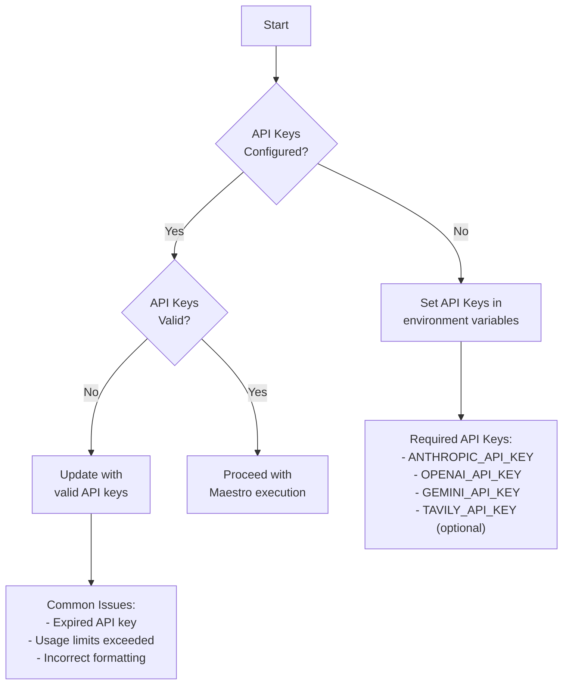
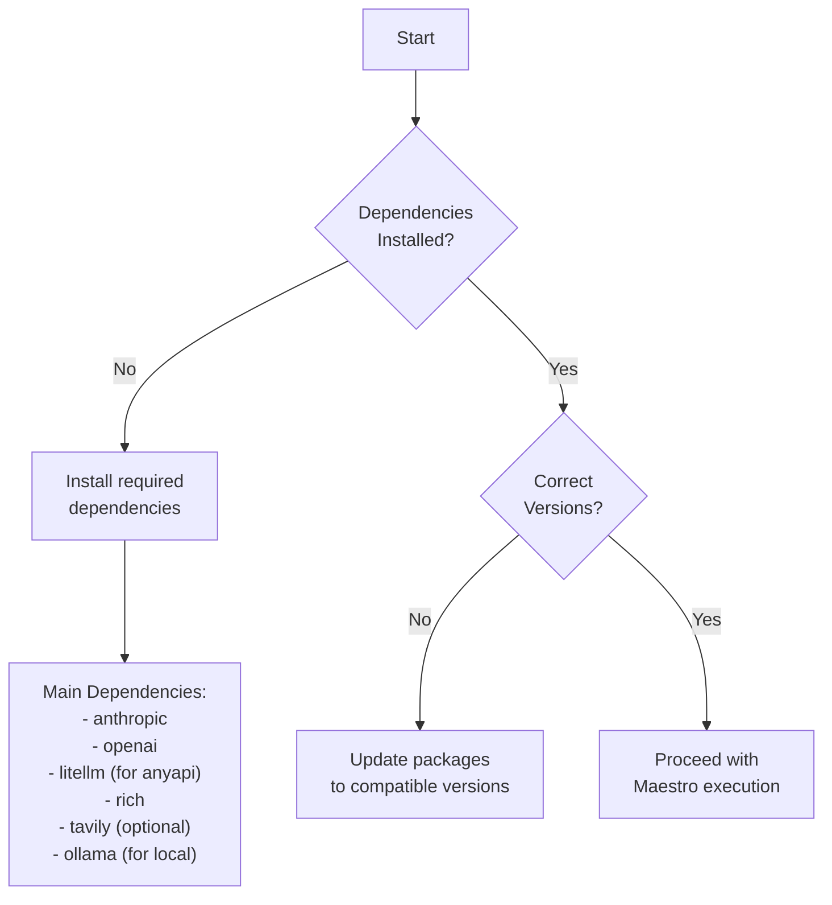
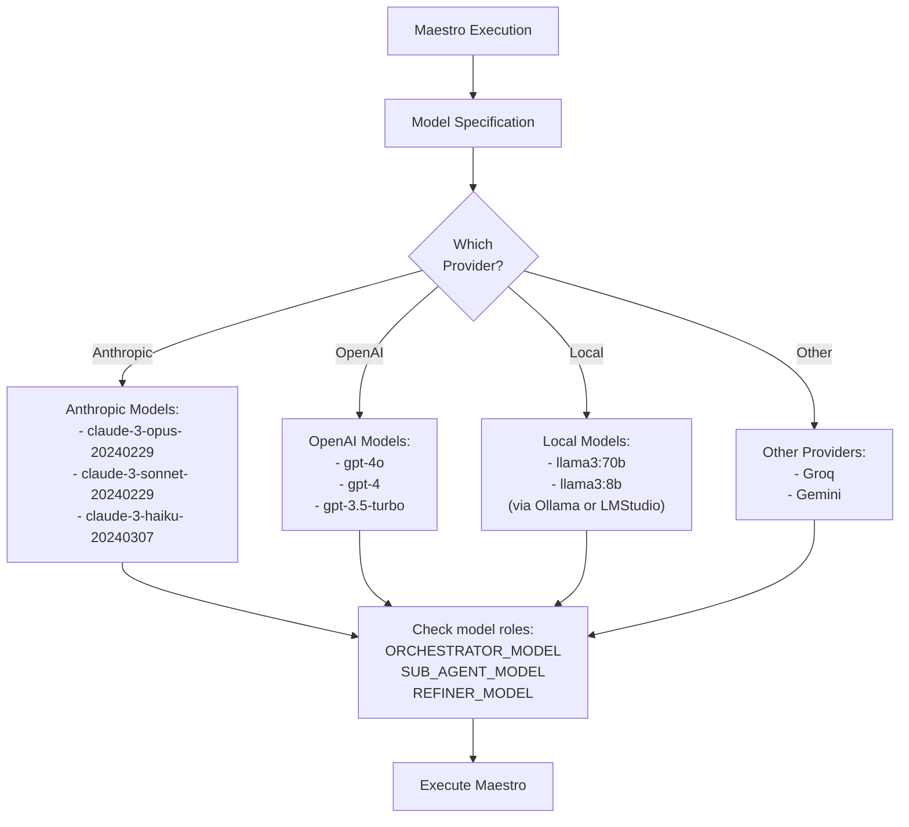
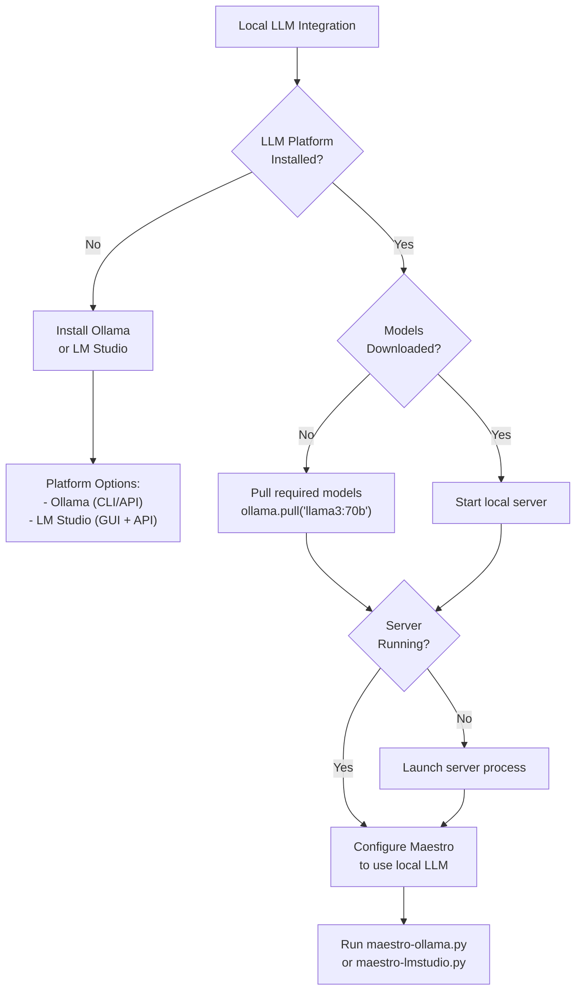
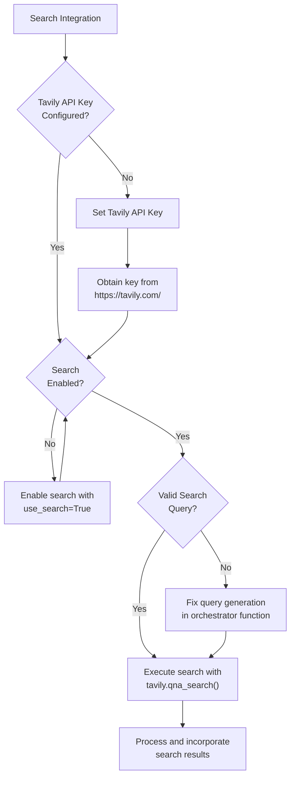
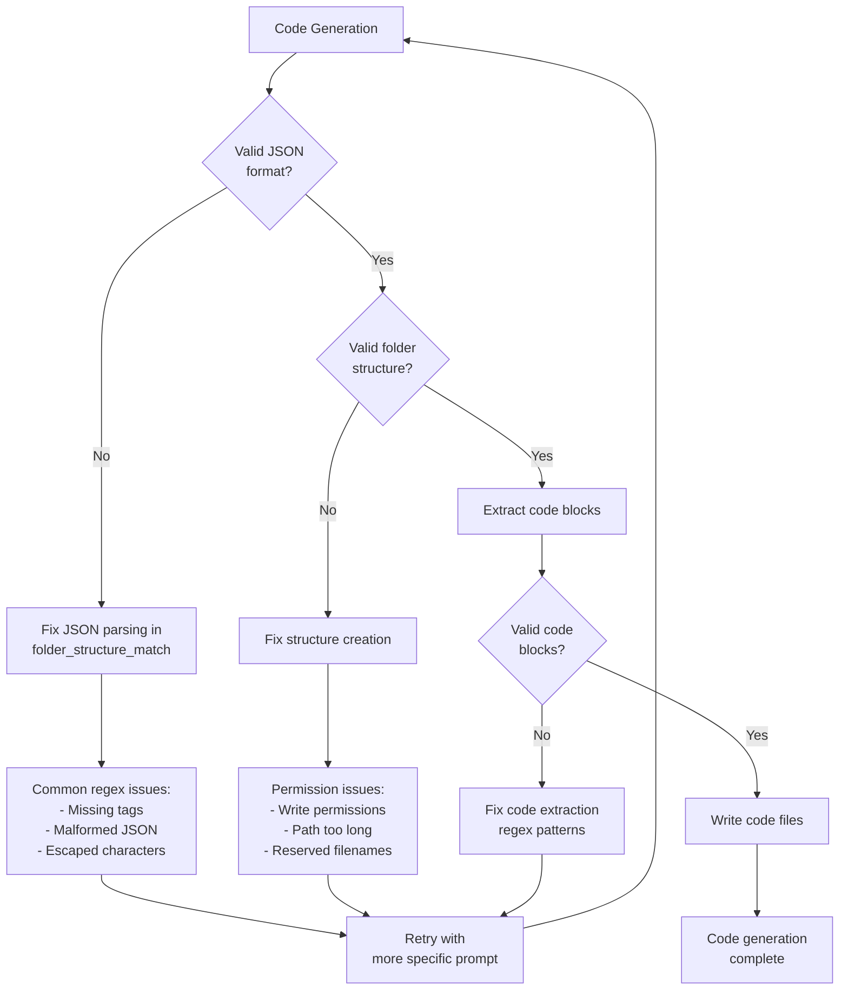
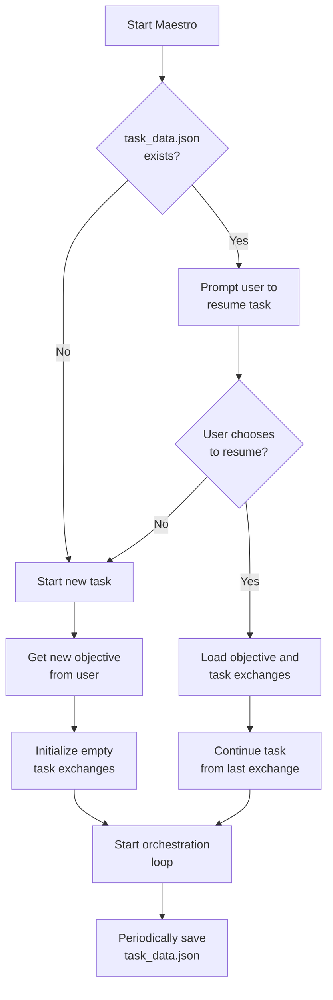
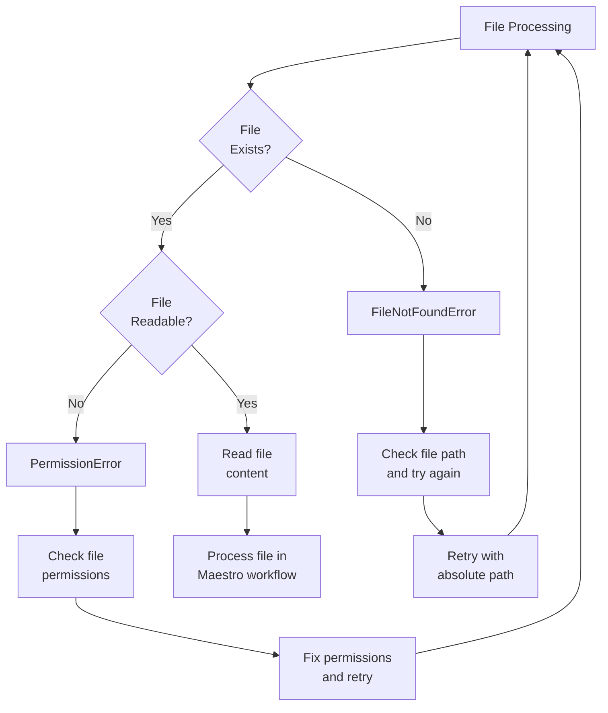
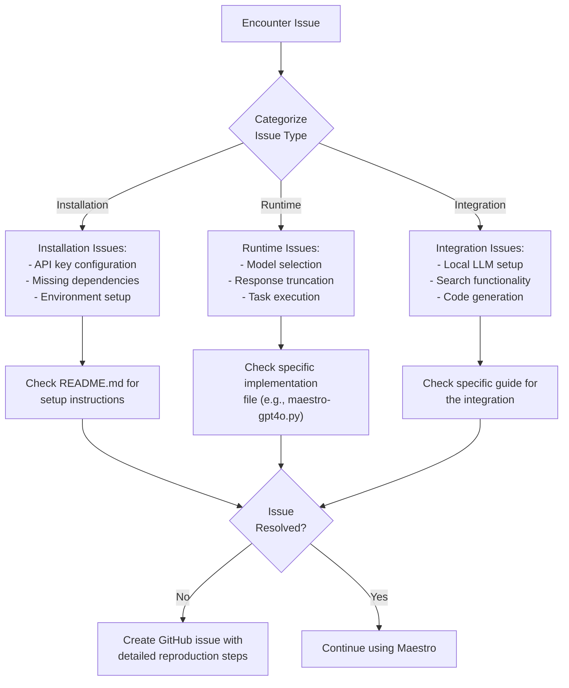
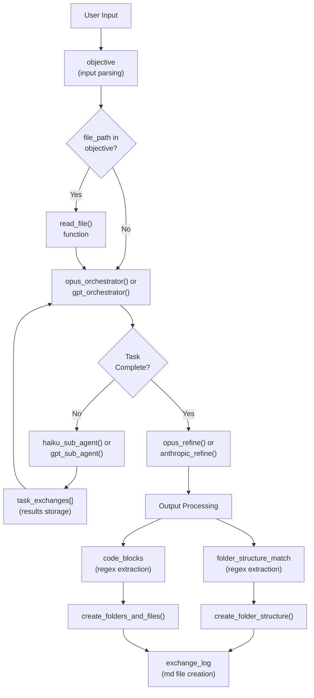

<!-- source: DeepWiki mcp.deepwiki.com · repo Doriandarko/maestro · page 7 Troubleshooting & FAQ · fetched 2026-10-26 -->

# Troubleshooting & FAQ

<details>
<summary>Relevant source files</summary>

The following files were used as context for generating this wiki page:

- [README.md](README.md)
- [maestro-gpt4o.py](maestro-gpt4o.py)
- [maestro-ollama.py](maestro-ollama.py)

</details>


This page provides solutions to common issues encountered when using the Maestro LLM Orchestration Framework and answers frequently asked questions. For information about setting up the framework initially, see [Installation & Setup](#2) or for basic usage instructions, see [Usage Guide](#3).

## Common Installation Issues

### API Key Configuration Problems

One of the most common issues involves improperly configured API keys for different LLM providers.



**Solution**: Set your API keys as environment variables before running Maestro:

```python
# Required before importing any Maestro modules
import os
os.environ["ANTHROPIC_API_KEY"] = "YOUR_API_KEY"
os.environ["OPENAI_API_KEY"] = "YOUR_API_KEY"
# For other implementations
os.environ["GEMINI_API_KEY"] = "YOUR_API_KEY"
```

**Verification**: To verify your API keys are working, try a simple test call to the respective API before running a full Maestro workflow.

Sources: [README.md:17-22](), [maestro-gpt4o.py:11-13]()

### Package Installation Issues



**Solution**: Install all required dependencies using the requirements file:

```bash
pip install -r requirements.txt
```

For specific implementations, you may need additional packages:
- For `maestro-anyapi.py`: `pip install litellm`
- For `maestro-groq.py`: `pip install groq`
- For `maestro-ollama.py`: `pip install ollama`

Sources: [README.md:34-35](), [README.md:80-82](), [README.md:104-105]()

## Runtime Issues

### Model Selection Problems

Issues often occur when specifying unavailable or incorrect model names.



**Solution**: Ensure you're using the correct model identifiers for each provider and role:

```python
# For maestro-anyapi.py
ORCHESTRATOR_MODEL = "anthropic/claude-3-opus-20240229"  # Using litellm format
SUB_AGENT_MODEL = "openai/gpt-4o"                       # Using litellm format
REFINER_MODEL = "anthropic/claude-3-sonnet-20240229"    # Using litellm format

# For maestro-ollama.py
ORCHESTRATOR_MODEL = 'llama3:70b-instruct'
SUBAGENT_MODEL = 'llama3:instruct'
REFINER_MODEL = 'llama3:70b-instruct'
```

Sources: [maestro-gpt4o.py:16-20](), [maestro-ollama.py:19-21]()

### Response Truncation Issues

When dealing with long responses, you might encounter truncation issues.

**Symptoms**:
- Incomplete responses
- Cut-off code blocks
- Missing folder structure in the final output

**Solution**: The framework includes continuation handling for truncated responses. Look for code like this in your implementation:

```python
if usage.completion_tokens >= 4000:  # Threshold for truncation
    console.print("[bold yellow]Warning:[/bold yellow] Output may be truncated. Attempting to continue the response.")
    continuation_response_text = function_call(continuation=True)
    response_text += continuation_response_text
```

For implementations that don't handle this automatically, consider breaking down your objective into smaller tasks.

Sources: [maestro-gpt4o.py:118-121](), [maestro-ollama.py:82-85]()

## Integration Issues

### Local LLM Integration



**Common Ollama Issues**:

1. **Server not running**: 
   ```
   ConnectionError: Failed to connect to Ollama server
   ```

   **Solution**: Start the Ollama service first:
   ```bash
   # On macOS/Linux
   ollama serve
   
   # On Windows
   # Launch the Ollama application
   ```

2. **Model not found**:
   ```
   ResponseError: model 'llama3:70b' not found
   ```

   **Solution**: Pull the model before using:
   ```python
   import ollama
   ollama.pull('llama3:70b')
   ```

Sources: [README.md:70-93](), [maestro-ollama.py:11-30]()

### Search Integration Issues



**Common Issues**:

1. **Missing Tavily API key**:
   ```
   AuthenticationError: No API key provided
   ```

   **Solution**: Set your Tavily API key:
   ```python
   tavily = TavilyClient(api_key="YOUR_TAVILY_API_KEY")
   ```

2. **Search not enabled**:
   
   **Solution**: Make sure to enable search when prompted or set `use_search=True`

3. **Invalid search query JSON**:
   
   **Solution**: Check the JSON parsing code for the search query

Sources: [README.md:113-119](), [maestro-gpt4o.py:93-96]()

## Code Generation Issues

### JSON Parsing Errors

Folder structure creation often fails due to JSON parsing errors in the LLM's output.



**Common Issues**:

1. **Invalid JSON format**:
   ```
   JSONDecodeError: Expecting property name enclosed in double quotes
   ```

   **Solution**: Check the regex pattern that extracts the JSON and ensure proper error handling:
   ```python
   folder_structure_match = re.search(r'<folder_structure>(.*?)</folder_structure>', refined_output, re.DOTALL)
   if folder_structure_match:
       json_string = folder_structure_match.group(1).strip()
       try:
           folder_structure = json.loads(json_string)
       except json.JSONDecodeError as e:
           console.print(f"Error parsing JSON: {e}")
   ```

2. **File creation issues**:
   ```
   Error creating file: Permission denied
   ```

   **Solution**: Check file permissions in the target directory and ensure no illegal characters in filenames.

Sources: [maestro-ollama.py:242-255](), [maestro-gpt4o.py:243-250]()

## Technical FAQ

### How do I resume a previously interrupted task?

Maestro supports task resumption through the `task_data.json` file, which stores the objective and task exchanges from previous runs.



**Solution**:
1. When running Maestro, if a `task_data.json` file exists, you'll be prompted to continue
2. Answer 'y' to the prompt "Do you want to continue from the last task? (y/n): "
3. Maestro will load the previous objective and task exchanges and continue from where it left off

Sources: [maestro-ollama.py:149-161](), [maestro-ollama.py:175-187]()

### How do I customize the models used for different roles?

You can customize the models by changing the model variables at the top of the script:

```python
# For maestro-anyapi.py
ORCHESTRATOR_MODEL = "gemini/gemini-1.5-flash-latest"  # Change to your preferred orchestrator
SUB_AGENT_MODEL = "anthropic/claude-3-haiku-20240307"  # Change to your preferred sub-agent
REFINER_MODEL = "openai/gpt-4o"                       # Change to your preferred refiner

# For local models
ORCHESTRATOR_MODEL = 'llama3:70b'  # Choose a more capable model for orchestration
SUBAGENT_MODEL = 'llama3:8b'       # Can use a smaller model for sub-tasks
REFINER_MODEL = 'llama3:70b'       # Use a capable model for refinement
```

Different Maestro implementations are already optimized for specific providers:
- `maestro.py`: Anthropic's Claude models
- `maestro-gpt4o.py`: OpenAI's GPT-4o
- `maestro-ollama.py`: Local Llama models via Ollama
- `maestro-anyapi.py`: Multiple providers via LiteLLM

Sources: [README.md:24-31](), [maestro-ollama.py:19-21]()

### What are the token limits and how do I handle them?

Different models have different context window sizes:

| Model | Approximate Token Limit |
|-------|-------------------------|
| Claude 3 Opus | 200,000 tokens |
| Claude 3 Sonnet | 200,000 tokens |
| Claude 3 Haiku | 200,000 tokens |
| GPT-4o | 128,000 tokens |
| GPT-4 | 8,000-32,000 tokens |
| Llama 3 70B | 8,000 tokens |

**Handling Token Limitations**:

1. **Response Continuation**: Maestro implements continuation handling for truncated responses:

```python
if opus_response.usage.output_tokens >= 4000:  # Near the limit
    continuation_response_text = function_call(continuation=True)
    response_text += continuation_response_text
```

2. **Task Breakdown**: Break complex objectives into smaller sub-tasks automatically through the orchestrator.

Sources: [maestro-gpt4o.py:118-121](), [maestro-ollama.py:105-108]()

### How do I troubleshoot file processing issues?

When providing a file for Maestro to process:



**Common Issues**:

1. **File not found**:
   ```
   FileNotFoundError: [Errno 2] No such file or directory
   ```

   **Solution**: Check the file path and ensure it exists. Consider using an absolute path.

2. **Unable to parse file content**:

   **Solution**: Check that the file is in a readable format and not corrupted.

3. **File path extraction error**:

   **Solution**: If using the regex-based file path extraction, ensure the regular expression pattern matches your file path format.

Sources: [maestro-ollama.py:144-147](), [maestro-ollama.py:190-199]()

## Performance Considerations

### Cost Optimization

When using paid API services, costs can accumulate. Here are strategies to optimize costs:

| Strategy | Description |
|----------|-------------|
| Use Claude Haiku for sub-agents | For simpler sub-tasks, using the cheaper and faster Haiku model can reduce costs |
| Use local models when possible | For development and testing, local models via Ollama provide free inference |
| Implement caching | Cache responses to avoid redundant API calls |
| Monitor token usage | Track token usage (shown in console output) to identify inefficient prompts |

The `maestro-gpt4o.py` implementation displays token usage and calculates costs:

```python
console.print(f"Input Tokens: {usage.prompt_tokens}, Output Tokens: {usage.completion_tokens}, Total Tokens: {usage.total_tokens}")
total_cost = calculate_subagent_cost(REFINER_MODEL, opus_response.usage.input_tokens, opus_response.usage.output_tokens)
console.print(f"Refine Cost: ${total_cost:.4f}")
```

Sources: [maestro-gpt4o.py:144-145]()

## Diagrams

### Error Resolution Flow

This diagram shows the general troubleshooting process for Maestro issues:



Sources: [README.md](), [maestro-ollama.py](), [maestro-gpt4o.py]()

### Maestro Technical Architecture

This diagram illustrates the technical components and their relationships in the Maestro framework:



Sources: [maestro-ollama.py:37-112](), [maestro-gpt4o.py:40-153](), [maestro-ollama.py:155-162]()