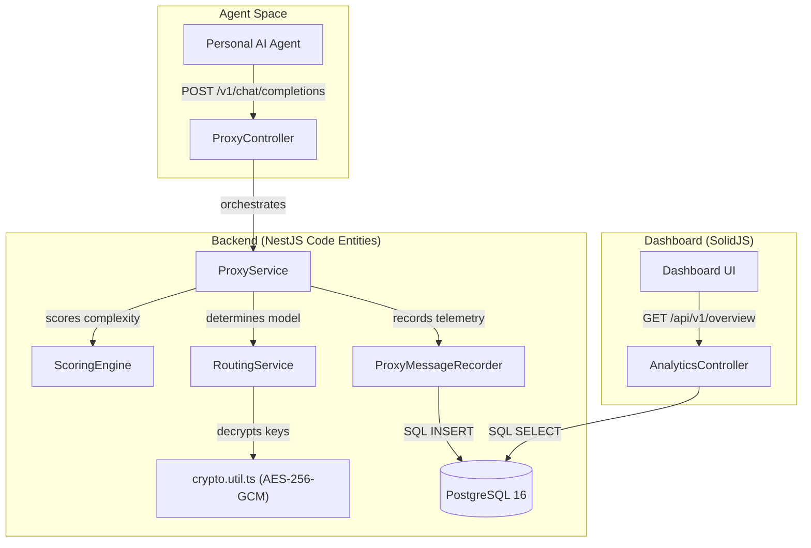
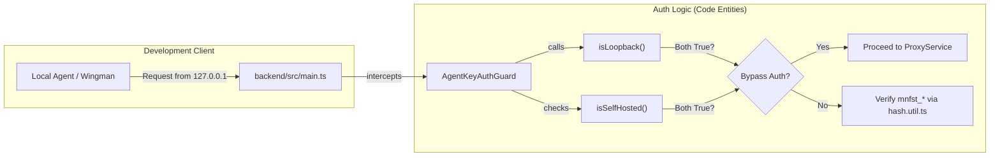

<!-- source: DeepWiki mcp.deepwiki.com · repo mnfst/manifest · page 1.1 Getting Started · fetched 2026-10-26 -->

# Getting Started

<details>
<summary>Relevant source files</summary>

The following files were used as context for generating this wiki page:

- [.changeset/README.md](.changeset/README.md)
- [.changeset/config.json](.changeset/config.json)
- [.github/dependabot.yml](.github/dependabot.yml)
- [.github/workflows/docker-smoke.yml](.github/workflows/docker-smoke.yml)
- [.github/workflows/docker.yml](.github/workflows/docker.yml)
- [.gitignore](.gitignore)
- [CLAUDE.md](CLAUDE.md)
- [CONTRIBUTING.md](CONTRIBUTING.md)
- [README.md](README.md)
- [docker/.env.example](docker/.env.example)
- [docker/DOCKER_README.md](docker/DOCKER_README.md)
- [docker/Dockerfile](docker/Dockerfile)
- [docker/docker-compose.yml](docker/docker-compose.yml)
- [docker/install.sh](docker/install.sh)
- [package-lock.json](package-lock.json)
- [package.json](package.json)
- [packages/backend/package.json](packages/backend/package.json)
- [packages/backend/src/analytics/services/agent-analytics.service.ts](packages/backend/src/analytics/services/agent-analytics.service.ts)
- [packages/frontend/public/icons/providers/claude-code.svg](packages/frontend/public/icons/providers/claude-code.svg)
- [packages/frontend/src/components/ApiKeyDisplay.tsx](packages/frontend/src/components/ApiKeyDisplay.tsx)
- [packages/frontend/src/components/ClaudeCodeSetup.tsx](packages/frontend/src/components/ClaudeCodeSetup.tsx)
- [packages/frontend/src/components/CopyButton.tsx](packages/frontend/src/components/CopyButton.tsx)
- [packages/frontend/src/components/FrameworkSnippets.tsx](packages/frontend/src/components/FrameworkSnippets.tsx)
- [packages/frontend/src/components/OpenClawSetup.tsx](packages/frontend/src/components/OpenClawSetup.tsx)
- [packages/frontend/src/components/SetupModal.tsx](packages/frontend/src/components/SetupModal.tsx)
- [packages/frontend/src/components/SetupStepAddProvider.tsx](packages/frontend/src/components/SetupStepAddProvider.tsx)
- [packages/frontend/src/components/SetupStepProviders.tsx](packages/frontend/src/components/SetupStepProviders.tsx)
- [packages/frontend/src/services/framework-snippets.ts](packages/frontend/src/services/framework-snippets.ts)
- [packages/frontend/src/styles/overview.css](packages/frontend/src/styles/overview.css)
- [packages/frontend/tests/components/ApiKeyDisplay.test.tsx](packages/frontend/tests/components/ApiKeyDisplay.test.tsx)
- [packages/frontend/tests/components/CopyButton.test.tsx](packages/frontend/tests/components/CopyButton.test.tsx)
- [packages/frontend/tests/components/FrameworkSnippets.test.tsx](packages/frontend/tests/components/FrameworkSnippets.test.tsx)
- [packages/frontend/tests/components/OpenClawSetup.test.tsx](packages/frontend/tests/components/OpenClawSetup.test.tsx)
- [packages/frontend/tests/components/SetupModal.test.tsx](packages/frontend/tests/components/SetupModal.test.tsx)
- [packages/frontend/tests/components/SetupStepAddProvider.test.tsx](packages/frontend/tests/components/SetupStepAddProvider.test.tsx)
- [packages/frontend/tests/components/SetupStepProviders.test.tsx](packages/frontend/tests/components/SetupStepProviders.test.tsx)
- [packages/frontend/tests/services/framework-snippets.test.ts](packages/frontend/tests/services/framework-snippets.test.ts)
- [turbo.json](turbo.json)

</details>


Manifest is a smart LLM model router designed to reduce inference costs by scoring requests and routing them to the most cost-effective model. It sits between a personal AI agent and LLM providers, classifying requests into complexity tiers (simple, standard, complex, reasoning) to optimize routing.

## Deployment Modes

Manifest can be used via the managed cloud service or self-hosted using Docker. The legacy `manifest` npm package and local SQLite modes are deprecated in favor of PostgreSQL-backed deployments.

| Mode | Hosting | Database | Best For |
| :--- | :--- | :--- | :--- |
| **Cloud Mode** | [app.manifest.build](https://app.manifest.build) | Managed (PostgreSQL) | Zero-maintenance setup and multi-device access. |
| **Self-Hosted** | Docker (Primary) | PostgreSQL 16 | Privacy-conscious users and custom infrastructure. |

**Sources:** [README.md:36-62](), [CLAUDE.md:13-16](), [CONTRIBUTING.md:17-18]()

---

## Self-Hosted Installation (Docker)

Docker is the only supported distribution for self-hosting. The deployment consists of a NestJS backend, a SolidJS frontend (served by the backend via a SPA fallback filter), and a PostgreSQL database.

### Quick Start Script
The fastest way to deploy is using the automated install script, which downloads the `docker-compose.yml`, generates a secret, and starts the stack.

```bash
bash <(curl -sSL https://raw.githubusercontent.com/mnfst/manifest/main/docker/install.sh)
```

### Manual Configuration
For manual control, users configure the stack via environment variables in a `.env` file. Key variables include:
- `BETTER_AUTH_SECRET`: Used for session security and credential encryption (generate with `openssl rand -hex 32`) [docker/docker-compose.yml:60-60]().
- `DATABASE_URL`: Connection string for the PostgreSQL 16 instance [docker/docker-compose.yml:59-59]().
- `MANIFEST_MODE`: Set to `selfhosted` to enforce local semantics and allow private/HTTP URLs [docker/docker-compose.yml:76-76]().
- `PORT`: Defaults to `2099` [docker/docker-compose.yml:58-58]().

**Sources:** [README.md:51-59](), [docker/DOCKER_README.md:68-74](), [docker/docker-compose.yml:43-93]()

---

## Initial Configuration & Setup Wizard

After installation, if no users exist in the database, visitors are directed to the setup wizard at `/setup` [docker/docker-compose.yml:1-3]().

### Setup Flow
- **Admin Creation**: The setup process handles the creation of the first admin user. The first account created becomes the system administrator [docker/DOCKER_README.md:64-64]().
- **Ollama Integration**: Manifest automatically attempts to discover local models via `OLLAMA_HOST` (defaulting to `http://host.docker.internal:11434`) [docker/docker-compose.yml:67-67]().
- **Email & OAuth**: Optional configuration for Resend/Mailgun/SendGrid and Google/GitHub/Discord OAuth providers can be set in `.env` to enable advanced features [docker/docker-compose.yml:77-90]().

### Request Lifecycle and Code Entity Mapping
The following diagram bridges the "Natural Language Space" of a user request to the "Code Entity Space" of the Manifest backend.

Title: Request Lifecycle and Code Entity Mapping

**Sources:** [CLAUDE.md:65-116](), [CONTRIBUTING.md:112-114](), [packages/frontend/src/services/framework-snippets.ts:118-160]()

---

## Agent Integration

To use Manifest, an agent must be configured to point to the Manifest proxy as an OpenAI-compatible endpoint.

### Virtual Model: `manifest/auto`
Agents should use the model ID `manifest/auto`. This virtual endpoint triggers the internal routing logic to select the best provider model based on complexity and specificity [README.md:64-66](), [CLAUDE.md:45-46]().

### Authentication
Agents authenticate using an `AgentApiKey` (prefixed with `mnfst_`) [CLAUDE.md:87-87]().
- **Onboarding**: The "Connect Agent" flow in the dashboard provides setup snippets for frameworks like OpenClaw, Hermes, OpenAI SDK, Vercel AI SDK, LangChain, and cURL [CONTRIBUTING.md:112-114]().
- **Code Snippets**: The `framework-snippets.ts` service generates the exact configuration code for these agents, including `base_url` and `api_key` [packages/frontend/src/services/framework-snippets.ts:118-138]().

**Sources:** [CLAUDE.md:9-10](), [packages/frontend/src/services/framework-snippets.ts:1-31](), [packages/frontend/tests/components/SetupStepAddProvider.test.tsx:49-56]()

---

## Local Development (`devMode`)

Developers contributing to the monorepo use a specialized setup to avoid environment conflicts and data pollution.

### Prerequisites
- **Node.js**: 24.x (LTS) [CONTRIBUTING.md:21-21]().
- **Database**: A **fresh PostgreSQL database** is required for every dev session. The `CLAUDE.md` guide recommends creating a pristine database with a unique name using `openssl rand -hex 4` to prevent cross-run pollution [CLAUDE.md:15-24]().

### Development Setup
1. **PostgreSQL**: Start a container (e.g., `postgres:16`).
2. **Environment**: Set `MANIFEST_MODE=cloud` (the default for development) and `SEED_DATA=true` to populate the DB with demo data [CLAUDE.md:15-30]().
3. **Execution**: Run the backend and frontend in separate terminals:
   - Backend: `cd packages/backend && NODE_OPTIONS='-r dotenv/config' npx nest start --watch` [CONTRIBUTING.md:98-98]().
   - Frontend: `npm run dev` (starts SolidJS and Wingman) [CONTRIBUTING.md:101-101]().

### Loopback Bypass
In development, the `AgentKeyAuthGuard` supports a loopback bypass. It accepts any non-`mnfst_*` token from loopback IPs (`127.0.0.1`) when in self-hosted mode, allowing developers to test without creating valid keys [CLAUDE.md:52-52]().

Title: DevMode Loopback Authentication Flow

**Sources:** [CLAUDE.md:13-53](), [CONTRIBUTING.md:39-106](), [packages/backend/package.json:1-10]()

---

