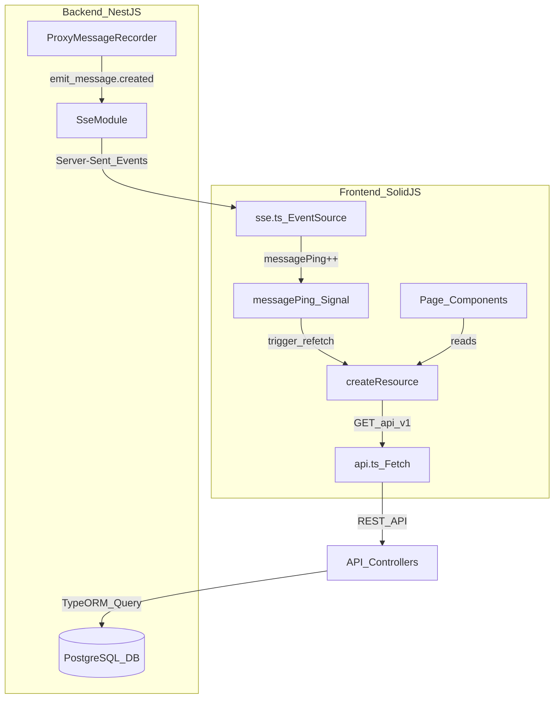
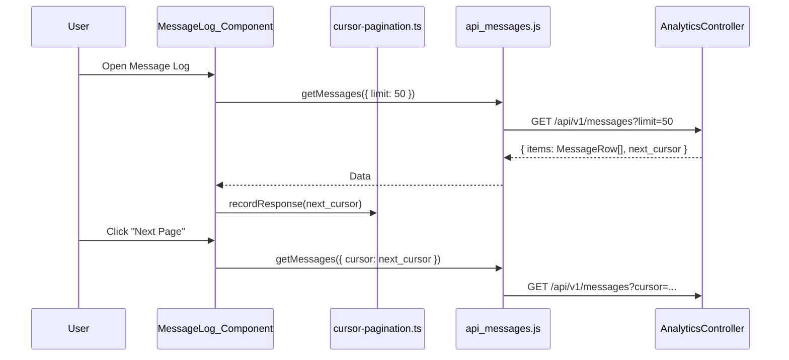

<!-- source: DeepWiki mcp.deepwiki.com · repo mnfst/manifest · page 2.2 Frontend (SolidJS Dashboard) · fetched 2026-10-26 -->

# Frontend (SolidJS Dashboard)

Relevant source files

The following files were used as context for generating this wiki page:

- [packages/frontend/index.html](packages/frontend/index.html)
- [packages/frontend/public/example-messages.svg](packages/frontend/public/example-messages.svg)
- [packages/frontend/public/example-overview.svg](packages/frontend/public/example-overview.svg)
- [packages/frontend/public/fonts/boxicons/boxicons-duotone.min.css](packages/frontend/public/fonts/boxicons/boxicons-duotone.min.css)
- [packages/frontend/public/fonts/boxicons/boxicons-duotone.woff2](packages/frontend/public/fonts/boxicons/boxicons-duotone.woff2)
- [packages/frontend/public/og-image.png](packages/frontend/public/og-image.png)
- [packages/frontend/src/App.tsx](packages/frontend/src/App.tsx)
- [packages/frontend/src/components/VersionIndicator.tsx](packages/frontend/src/components/VersionIndicator.tsx)
- [packages/frontend/src/index.tsx](packages/frontend/src/index.tsx)
- [packages/frontend/src/pages/MessageLog.tsx](packages/frontend/src/pages/MessageLog.tsx)
- [packages/frontend/src/pages/Overview.tsx](packages/frontend/src/pages/Overview.tsx)
- [packages/frontend/src/services/api.ts](packages/frontend/src/services/api.ts)
- [packages/frontend/src/styles/theme.css](packages/frontend/src/styles/theme.css)
- [packages/frontend/src/styles/version-indicator.css](packages/frontend/src/styles/version-indicator.css)
- [packages/frontend/src/vite-env.d.ts](packages/frontend/src/vite-env.d.ts)
- [packages/frontend/tests/components/App.test.tsx](packages/frontend/tests/components/App.test.tsx)
- [packages/frontend/tests/components/AuthLayout.test.tsx](packages/frontend/tests/components/AuthLayout.test.tsx)
- [packages/frontend/tests/components/VersionIndicator.test.tsx](packages/frontend/tests/components/VersionIndicator.test.tsx)
- [packages/frontend/tests/pages/MessageLog.test.tsx](packages/frontend/tests/pages/MessageLog.test.tsx)
- [packages/frontend/tests/pages/Overview.test.tsx](packages/frontend/tests/pages/Overview.test.tsx)
- [packages/frontend/vite.config.ts](packages/frontend/vite.config.ts)

The Manifest dashboard is a high-performance Single Page Application (SPA) built with **SolidJS**. It provides real-time monitoring of LLM usage, configuration of intelligent routing tiers, and management of provider credentials. The dashboard communicates with the NestJS backend via a REST API and receives real-time updates through Server-Sent Events (SSE).

## Component Architecture and Data Flow

The frontend follows a reactive architecture leveraging SolidJS signals and resources. Data fetching is centralized in an API service layer, while real-time UI updates are driven by a global SSE listener.

### Page Structure
The dashboard is organized into several primary views, each corresponding to a specific management or monitoring domain:

*   **Workspace (`/`)**: The entry point displaying a grid of all connected AI agents, including sparklines for recent activity and high-level stats (tokens, messages, cost) [packages/frontend/src/index.tsx:59-59]().
*   **Overview (`/agents/:agentName`)**: A detailed dashboard for a specific agent featuring time-series charts for costs, tokens, and messages, as well as a "Cost by Model" breakdown [packages/frontend/src/pages/Overview.tsx:83-180]().
*   **Routing (`/agents/:agentName/routing`)**: The core configuration interface where users assign models to complexity tiers and manage specificity overrides [packages/frontend/src/index.tsx:64-64]().
*   **Message Log (`/agents/:agentName/messages`)**: A paginated, searchable table of every LLM call processed by the proxy, including detailed metadata like cache hits, duration, and specific provider status [packages/frontend/src/pages/MessageLog.tsx:46-177]().
*   **Settings (`/agents/:agentName/settings`)**: Management of agent metadata, API key rotation, and setup instructions [packages/frontend/src/index.tsx:63-63]().
*   **Free Models**: Displays available free-tier models from various providers [packages/frontend/src/services/api.ts:9-9]().
*   **Model Prices**: A catalog of global model pricing synchronized from external sources [packages/frontend/src/index.tsx:66-66]().

### Real-Time Updates (SSE)
The dashboard maintains a live connection to the backend via `connectSse` [packages/frontend/src/App.tsx:10-16](). When the proxy processes a message, the backend emits an event that increments a global `messagePing` signal [packages/frontend/src/services/sse.ts:1-36](). Components use this signal as a dependency for their `createResource` calls, triggering automatic data refreshes [packages/frontend/src/pages/Overview.tsx:188-191](), [packages/frontend/src/pages/MessageLog.tsx:157-165]().

**Dashboard Data Flow**

*Sources: [packages/frontend/src/services/sse.ts:1-36](), [packages/frontend/src/pages/Overview.tsx:188-191](), [packages/frontend/src/services/api.ts:1-10](), [packages/frontend/src/App.tsx:10-16]()*

---

## Core Routing Configuration

The Routing page allows users to define how requests are distributed across models based on the **Scoring Engine's** classification.

### Tier and Specificity Management
Requests are categorized into complexity tiers (simple, standard, complex, reasoning). The UI provides controls for:
1.  **Auto-Assignment**: Relying on Manifest's internal logic to pick the best model for that tier.
2.  **Overrides**: Manually selecting a specific model/provider for a tier.
3.  **Fallback Chains**: Defining a list of models to attempt if the primary model fails.
4.  **Specificity**: Overriding models for specific categories (e.g., `coding`, `trading`).

### Provider Integration
The dashboard manages the connection of various LLM providers through standard API keys or subscription-based authentication.
*   **API Keys**: Standard credential entry for providers like OpenAI, Anthropic, and Google.
*   **Subscriptions (OAuth)**: Web-based OAuth flow for ChatGPT Plus or Claude Pro [packages/frontend/src/services/api.ts:8-8]().
*   **Custom Providers**: Users can define custom endpoints via the `getCustomProviders` service [packages/frontend/src/pages/Overview.tsx:122-132]().

**Code-to-Entity Mapping: Routing and UI**

| UI Component | Code Entity | Purpose |
| :--- | :--- | :--- |
| `Header` | `Header.tsx` | Main navigation and agent breadcrumbs. |
| `Overview` | `Overview.tsx` | Visualizes `OverviewData` including `cost_by_model` [packages/frontend/src/pages/Overview.tsx:43-81](). |
| `MessageLog` | `MessageLog.tsx` | Renders `MessageRow` data in a filterable table [packages/frontend/src/pages/MessageLog.tsx:39-45](). |
| `Sidebar` | `Sidebar.tsx` | Provides context-sensitive navigation for agents [packages/frontend/src/App.tsx:32-34](). |
| `VersionIndicator` | `VersionIndicator.tsx` | Displays `__MANIFEST_VERSION__` in self-hosted environments [packages/frontend/src/components/VersionIndicator.tsx:3-17](). |

*Sources: [packages/frontend/src/pages/Overview.tsx:43-180](), [packages/frontend/src/services/api.ts:1-10](), [packages/frontend/src/App.tsx:18-50]()*

---

## Message Logging and Analytics

The `MessageLog` provides a high-fidelity audit trail of proxy activity. It utilizes a custom cursor-based pagination system to handle large volumes of telemetry data efficiently.

### Implementation Details
*   **Cursor Pagination**: Uses `createCursorPagination` to manage the `next_cursor` returned by the backend [packages/frontend/src/pages/MessageLog.tsx:138-138]().
*   **Filtering**: Real-time filtering by Provider, Min Cost, and Max Cost. Filters are debounced to prevent excessive API calls [packages/frontend/src/pages/MessageLog.tsx:140-153]().
*   **Feedback System**: Users can "Like" or "Dislike" messages. Dislikes trigger a `FeedbackModal` to collect tags and details, which are sent via `setMessageFeedback` [packages/frontend/src/pages/MessageLog.tsx:75-116]().

**Message Log Interaction**

*Sources: [packages/frontend/src/pages/MessageLog.tsx:157-186](), [packages/frontend/src/services/api.ts:3-3](), [packages/frontend/src/services/cursor-pagination.ts:1-20]()*

---

## Authentication and Security

The dashboard integrates with **Better Auth** for user session management and provides tools for managing agent-level security.

1.  **Dashboard Auth**: Enforced by `AuthGuard` surrounding the application shell [packages/frontend/src/App.tsx:24-24]().
2.  **Agent Authentication**: Managed via `AgentGuard` which ensures the user has access to the requested agent context [packages/frontend/src/index.tsx:60-60]().
3.  **Self-Hosted Detection**: The UI detects if it is running in self-hosted mode via `checkIsSelfHosted` (checking `VITE_MANIFEST_SELFHOSTED`) and displays the `VersionIndicator` [packages/frontend/src/components/VersionIndicator.tsx:4-12](), [packages/frontend/src/pages/Overview.tsx:88-91]().
4.  **Dev Mode Tools**: When running in development mode (`__DEV_MODE__`), the `WingmanDevTools` component is injected for easier debugging [packages/frontend/src/App.tsx:45-45](), [packages/frontend/vite.config.ts:26-26]().

*Sources: [packages/frontend/src/App.tsx:24-45](), [packages/frontend/src/index.tsx:60-60](), [packages/frontend/src/components/VersionIndicator.tsx:1-17](), [packages/frontend/vite.config.ts:18-31]()*

---

