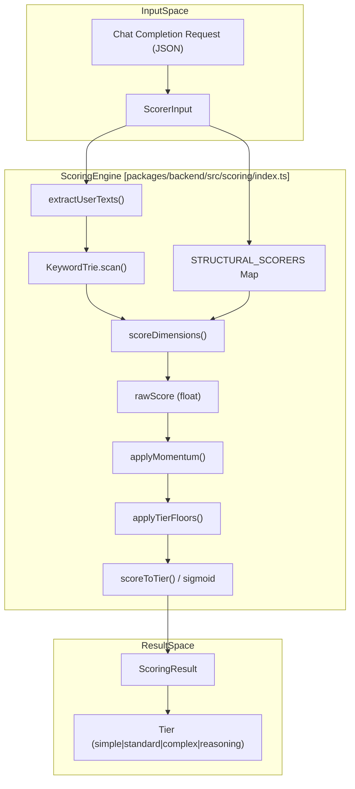
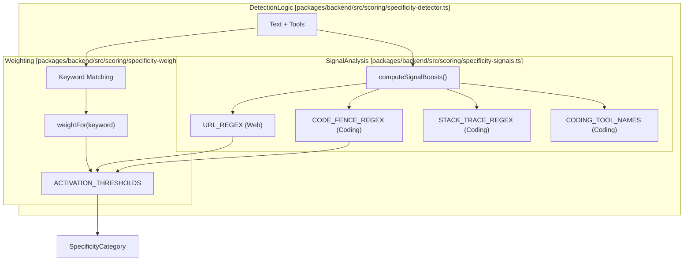

<!-- source: DeepWiki mcp.deepwiki.com · repo mnfst/manifest · page 3.1 Scoring Engine · fetched 2026-10-26 -->

# Scoring Engine

Relevant source files

The following files were used as context for generating this wiki page:

- [packages/backend/src/common/utils/baseline-cost.spec.ts](packages/backend/src/common/utils/baseline-cost.spec.ts)
- [packages/backend/src/common/utils/baseline-cost.ts](packages/backend/src/common/utils/baseline-cost.ts)
- [packages/backend/src/database/migrations/1784000000000-DropLegacyRoutingColumns.spec.ts](packages/backend/src/database/migrations/1784000000000-DropLegacyRoutingColumns.spec.ts)
- [packages/backend/src/database/migrations/1784000000000-DropLegacyRoutingColumns.ts](packages/backend/src/database/migrations/1784000000000-DropLegacyRoutingColumns.ts)
- [packages/backend/src/routing/routing-core/__tests__/provider.service.spec.ts](packages/backend/src/routing/routing-core/__tests__/provider.service.spec.ts)
- [packages/backend/src/routing/routing-core/__tests__/routing-invalidation.service.spec.ts](packages/backend/src/routing/routing-core/__tests__/routing-invalidation.service.spec.ts)
- [packages/backend/src/routing/routing-core/__tests__/tier-auto-assign.service.spec.ts](packages/backend/src/routing/routing-core/__tests__/tier-auto-assign.service.spec.ts)
- [packages/backend/src/scoring/__tests__/agent-envelope-regression.spec.ts](packages/backend/src/scoring/__tests__/agent-envelope-regression.spec.ts)
- [packages/backend/src/scoring/__tests__/envelope-peeler.spec.ts](packages/backend/src/scoring/__tests__/envelope-peeler.spec.ts)
- [packages/backend/src/scoring/__tests__/score-request-advanced.spec.ts](packages/backend/src/scoring/__tests__/score-request-advanced.spec.ts)
- [packages/backend/src/scoring/__tests__/score-request.spec.ts](packages/backend/src/scoring/__tests__/score-request.spec.ts)
- [packages/backend/src/scoring/__tests__/specificity-signals.spec.ts](packages/backend/src/scoring/__tests__/specificity-signals.spec.ts)
- [packages/backend/src/scoring/__tests__/text-extractor.spec.ts](packages/backend/src/scoring/__tests__/text-extractor.spec.ts)
- [packages/backend/src/scoring/envelope-peeler.ts](packages/backend/src/scoring/envelope-peeler.ts)
- [packages/backend/src/scoring/index.ts](packages/backend/src/scoring/index.ts)
- [packages/backend/src/scoring/keywords.ts](packages/backend/src/scoring/keywords.ts)
- [packages/backend/src/scoring/specificity-signals.ts](packages/backend/src/scoring/specificity-signals.ts)
- [packages/backend/src/scoring/specificity-weights.ts](packages/backend/src/scoring/specificity-weights.ts)
- [packages/backend/src/scoring/text-extractor.ts](packages/backend/src/scoring/text-extractor.ts)

The Scoring Engine is the core intelligence of Manifest. It evaluates incoming LLM requests across 23 distinct dimensions to classify them into one of four routing tiers: **Simple**, **Standard**, **Complex**, or **Reasoning**. By analyzing both the semantic content and structural properties of a request, Manifest can route tasks to the most cost-effective model that meets the required quality threshold.

## Classification Tiers

Manifest uses a fixed hierarchy of tiers to categorize request difficulty:

| Tier | Description | Target Model Example |
| :--- | :--- | :--- |
| **Simple** | Greetings, short factual lookups, and basic chat. | GPT-4o-mini, Claude Haiku |
| **Standard** | General conversation, basic tool use, and moderate instructions. | GPT-4o, Claude Sonnet |
| **Complex** | Heavy coding, multi-step reasoning, or dense constraints. | Claude Opus, Llama 3.1 405B |
| **Reasoning** | Formal logic, complex math, or deep architectural planning. | OpenAI o1-preview, o3-mini |

Sources: `[packages/backend/src/scoring/types.ts:68-73]()`, `[packages/backend/src/routing/routing-core/__tests__/tier-auto-assign.service.spec.ts:128-136]()`

## Scoring Architecture

The engine processes requests through a pipeline that combines keyword analysis, structural heuristics, and session-aware momentum.

### Data Flow Diagram: Request to Tier

This diagram illustrates how a raw `ScorerInput` (OpenAI-compatible request) is transformed into a `ScoringResult` by the `scoreRequest` function in `packages/backend/src/scoring/index.ts`.

"Natural Language Space to Code Entity Space: Request Scoring"

Sources: `[packages/backend/src/scoring/index.ts:155-231]()`, `[packages/backend/src/scoring/types.ts:1-40]()`, `[packages/backend/src/scoring/index.ts:99-109]()`

## Scoring Dimensions

The engine evaluates 23 dimensions, categorized into Keyword-based and Structural-based metrics.

### Keyword Analysis (`KeywordTrie`)
Manifest uses an Aho-Corasick inspired `KeywordTrie` to perform high-performance, single-pass scanning of the combined conversation text.
*   **Dimensions**: Includes complexity dimensions and specificity categories defined in `packages/backend/src/scoring/keywords.ts`.
*   **Implementation**: The `KeywordTrie` is built from `DEFAULT_CONFIG` and scans `combinedText` to return `TrieMatch` objects.

### Structural Dimensions
These dimensions look at the metadata and "shape" of the request rather than just the text.

| Dimension | Logic | Code Entity |
| :--- | :--- | :--- |
| **Token Count** | Estimated volume of input/output tokens. | `scoreTokenCount` |
| **Tool Count** | Number of available functions/tools. | `scoreToolCount` |
| **Conversation Depth**| Number of previous turns in the history. | `scoreConversationDepth` |
| **Code to Prose** | Ratio of code blocks to natural language. | `scoreCodeToProse` |
| **Constraint Density**| Frequency of imperative verbs and bullet points. | `scoreConstraintDensity` |

Sources: `[packages/backend/src/scoring/index.ts:99-109]()`, `[packages/backend/src/scoring/keyword-trie.ts:1-20]()`, `[packages/backend/src/scoring/keywords.ts:18-28]()`

## Special Logic and Overrides

### Short-Message Fast Path
To minimize latency and avoid over-complicating simple interactions, `scoreRequest` includes a fast path for brief messages (under 50 characters). 
*   **Logic**: If a message is short and lacks complex technical keywords, it is automatically assigned the `simple` tier with a `short_message` reason.
*   **Tools Bypass**: Greetings like "hi" or "hello" remain in the `simple` tier even if a `tools` array is present in the request, bypassing heavy tool-count scoring.

### Formal Logic Override
The `checkFormalLogicOverride` function looks for specific triggers (like complex mathematical notation or explicit "prove that" requests) that force the request into the **Reasoning** tier regardless of other scores.

### Specificity Detector and Signal Boosts
The `detectSpecificity` utility classifies requests into task-type categories like `CODING`, `TRADING`, or `WEB_BROWSING`. It uses a combination of weighted keywords and structural "signals".

"Natural Language Space to Code Entity Space: Specificity Detection"

*   **Keyword Weights**: Strong anchor phrases like `navigate to` (weight: 4) are weighted more heavily than generics like `website` (weight: 1.5).
*   **Structural Signals**: Detection of URLs, code fences (minimum 40 characters), and specific tool names (e.g., `apply_patch`, `str_replace_editor`) provide boosts. Generic agent tools like `read` or `write` are excluded to prevent false coding classifications.
*   **Activation Thresholds**: Each category has a threshold; `web_browsing` requires a score of 3.0 to activate, whereas `coding` requires 1.0.
*   **SpecificityPenaltyService**: Applies per-category weight penalties based on user-flagged miscategorizations to refine future routing.

Sources: `[packages/backend/src/scoring/index.ts:180-212]()`, `[packages/backend/src/scoring/overrides.ts:1-32]()`, `[packages/backend/src/scoring/specificity-detector.ts:1-20]()`, `[packages/backend/src/scoring/specificity-weights.ts:11-89]()`, `[packages/backend/src/scoring/specificity-signals.ts:16-66]()`

## Normalization and Momentum

### Sigmoid Normalization
Raw scores are normalized using a sigmoid function in `sigmoid.ts` to map them onto a probability curve (0 to 1). This allows the engine to calculate a `confidence` metric for its classification.

### Session Momentum
The engine uses `applyMomentum` to prevent "model jumping" mid-conversation. It looks at `recentTiers` in the session and biases the current score toward the previously used tier if the text change is minimal.

Sources: `[packages/backend/src/scoring/sigmoid.ts:1-40]()`, `[packages/backend/src/scoring/momentum.ts:1-30]()`

## Text Pre-processing

### Envelope Peeling
The `peelEnvelope` function identifies and strips metadata wrappers (e.g., JSON or YAML blocks containing session IDs) added by agents like OpenClaw. This ensures the engine scores the human's actual intent rather than the agent's boilerplate, preventing short messages from being misclassified as complex coding tasks.

Sources: `[packages/backend/src/scoring/text-extractor.ts:46-48]()`, `[packages/backend/src/scoring/envelope-peeler.ts:1-33]()`

---

