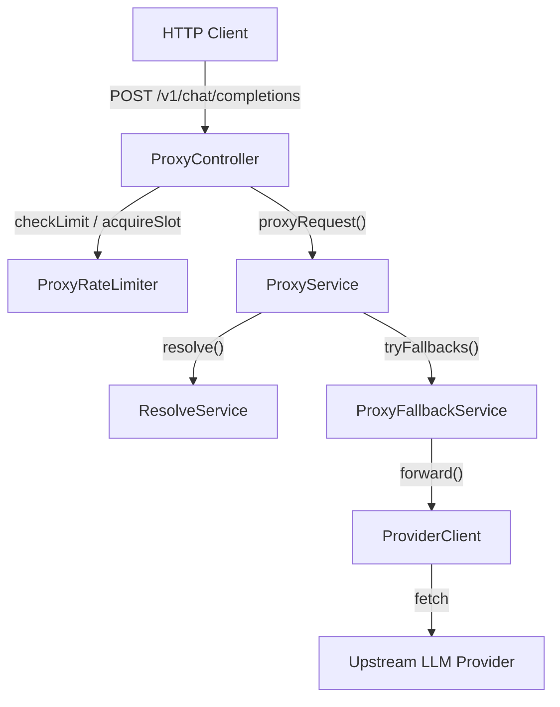
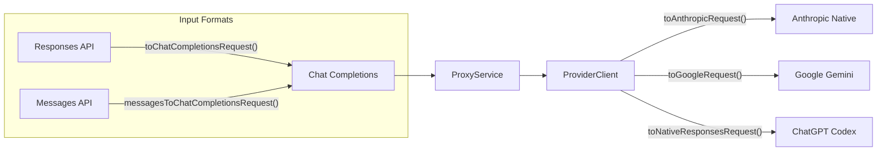

<!-- source: DeepWiki mcp.deepwiki.com · repo mnfst/manifest · page 3.2 Proxy Pipeline · fetched 2026-10-26 -->

# Proxy Pipeline

Relevant source files

The following files were used as context for generating this wiki page:

- [.changeset/fix-messages-cache-token-roundtrip.md](.changeset/fix-messages-cache-token-roundtrip.md)
- [packages/backend/src/common/errors/__tests__/error-codes.spec.ts](packages/backend/src/common/errors/__tests__/error-codes.spec.ts)
- [packages/backend/src/common/errors/error-codes.ts](packages/backend/src/common/errors/error-codes.ts)
- [packages/backend/src/routing/proxy/__tests__/anthropic-cache-control-roundtrip.spec.ts](packages/backend/src/routing/proxy/__tests__/anthropic-cache-control-roundtrip.spec.ts)
- [packages/backend/src/routing/proxy/__tests__/anthropic-messages-adapter.spec.ts](packages/backend/src/routing/proxy/__tests__/anthropic-messages-adapter.spec.ts)
- [packages/backend/src/routing/proxy/__tests__/proxy-exception.filter.spec.ts](packages/backend/src/routing/proxy/__tests__/proxy-exception.filter.spec.ts)
- [packages/backend/src/routing/proxy/__tests__/proxy-friendly-response.spec.ts](packages/backend/src/routing/proxy/__tests__/proxy-friendly-response.spec.ts)
- [packages/backend/src/routing/proxy/__tests__/proxy-message-dedup.spec.ts](packages/backend/src/routing/proxy/__tests__/proxy-message-dedup.spec.ts)
- [packages/backend/src/routing/proxy/__tests__/proxy-rate-limiter.spec.ts](packages/backend/src/routing/proxy/__tests__/proxy-rate-limiter.spec.ts)
- [packages/backend/src/routing/proxy/__tests__/proxy-response-handler.spec.ts](packages/backend/src/routing/proxy/__tests__/proxy-response-handler.spec.ts)
- [packages/backend/src/routing/proxy/__tests__/proxy.controller.spec.ts](packages/backend/src/routing/proxy/__tests__/proxy.controller.spec.ts)
- [packages/backend/src/routing/proxy/__tests__/proxy.service.spec.ts](packages/backend/src/routing/proxy/__tests__/proxy.service.spec.ts)
- [packages/backend/src/routing/proxy/__tests__/responses-adapter.spec.ts](packages/backend/src/routing/proxy/__tests__/responses-adapter.spec.ts)
- [packages/backend/src/routing/proxy/__tests__/stream-warmup.spec.ts](packages/backend/src/routing/proxy/__tests__/stream-warmup.spec.ts)
- [packages/backend/src/routing/proxy/__tests__/stream-writer.spec.ts](packages/backend/src/routing/proxy/__tests__/stream-writer.spec.ts)
- [packages/backend/src/routing/proxy/anthropic-messages-adapter.ts](packages/backend/src/routing/proxy/anthropic-messages-adapter.ts)
- [packages/backend/src/routing/proxy/proxy-exception.filter.ts](packages/backend/src/routing/proxy/proxy-exception.filter.ts)
- [packages/backend/src/routing/proxy/proxy-friendly-response.ts](packages/backend/src/routing/proxy/proxy-friendly-response.ts)
- [packages/backend/src/routing/proxy/proxy-message-dedup.ts](packages/backend/src/routing/proxy/proxy-message-dedup.ts)
- [packages/backend/src/routing/proxy/proxy-rate-limiter.ts](packages/backend/src/routing/proxy/proxy-rate-limiter.ts)
- [packages/backend/src/routing/proxy/proxy-response-handler.ts](packages/backend/src/routing/proxy/proxy-response-handler.ts)
- [packages/backend/src/routing/proxy/proxy-types.ts](packages/backend/src/routing/proxy/proxy-types.ts)
- [packages/backend/src/routing/proxy/proxy.controller.ts](packages/backend/src/routing/proxy/proxy.controller.ts)
- [packages/backend/src/routing/proxy/proxy.service.ts](packages/backend/src/routing/proxy/proxy.service.ts)
- [packages/backend/src/routing/proxy/responses-adapter.ts](packages/backend/src/routing/proxy/responses-adapter.ts)
- [packages/backend/src/routing/proxy/stream-warmup.ts](packages/backend/src/routing/proxy/stream-warmup.ts)
- [packages/backend/src/routing/proxy/stream-writer.ts](packages/backend/src/routing/proxy/stream-writer.ts)

The Proxy Pipeline is the core execution engine of Manifest, responsible for intercepting OpenAI-compatible chat completion requests, determining the optimal routing tier, and forwarding the request to the appropriate LLM provider. It handles rate limiting, provider-specific protocol translation, streaming, and automatic fallback across multiple models and credentials.

## 1. Request Lifecycle Overview

When a client sends a request to `POST /v1/chat/completions`, `POST /v1/responses`, or `POST /v1/messages`, it enters the pipeline via the `ProxyController` [packages/backend/src/routing/proxy/proxy.controller.ts:58-80]().

### Code Entity Flow
The following diagram illustrates the transition from the HTTP request into the internal service orchestration.

**Diagram: Proxy Orchestration Flow**

Sources: [packages/backend/src/routing/proxy/proxy.controller.ts:58-72](), [packages/backend/src/routing/proxy/proxy.service.ts:118-158](), [packages/backend/src/routing/proxy/proxy.service.ts:192-205]()

## 2. Rate Limiting and Concurrency

Manifest implements a dual-layer rate limiting strategy at the proxy level to protect upstream providers and ensure system stability.

*   **Request Rate Limit**: Enforced via `checkLimit` (default 200 req/60s) and `checkIpLimit` in the `ProxyRateLimiter` [packages/backend/src/routing/proxy/proxy.controller.ts:102-103]().
*   **Concurrency Limit**: Restricted using `acquireSlot` and `releaseSlot` to manage active connections (default 10 concurrent) per user [packages/backend/src/routing/proxy/proxy-rate-limiter.ts:1-20]().

The `ProxyController` calls these methods before processing the request and ensures the slot is released in a `finally` block [packages/backend/src/routing/proxy/proxy.controller.ts:104-105](), [packages/backend/src/routing/proxy/proxy.controller.ts:205-205]().

## 3. Proxy Service Orchestration

The `ProxyService` manages the high-level logic of the request, including payload validation, limit enforcement, and routing resolution.

### Key Implementation Details
*   **Payload Validation**: The pipeline enforces a maximum of 1000 messages per request and ensures the `messages` array is present and non-empty [packages/backend/src/routing/proxy/proxy.service.ts:50-50](), [packages/backend/src/routing/proxy/proxy.service.ts:250-258]().
*   **System Prompt Stripping**: To prevent scoring inflation, roles defined in `SCORING_EXCLUDED_ROLES` (`system`, `developer`) are stripped before the request is sent to the `Scorer`, though they remain in the payload forwarded to providers [packages/backend/src/routing/proxy/proxy.service.ts:48-48](), [packages/backend/src/routing/proxy/proxy.service.ts:281-286]().
*   **Heartbeat & Limits**: Before routing, the service checks for usage limits via `LimitCheckService`. If exceeded, it returns a friendly "M200" error response [packages/backend/src/routing/proxy/proxy.service.ts:140-143]().
*   **Stream Warm-up**: For streaming responses, `peekStream` verifies the provider actually starts delivering data (within 15 seconds) before committing to the client. If the stream stalls, the service can still trigger a fallback [packages/backend/src/routing/proxy/proxy.service.ts:37-37](), [packages/backend/src/routing/proxy/proxy.service.ts:196-200]().

Sources: [packages/backend/src/routing/proxy/proxy.service.ts:118-260](), [packages/backend/src/routing/proxy/stream-warmup.ts:1-10]()

## 4. Provider Adapters and Protocol Translation

The `ProxyService` uses specific adapters to normalize incoming requests from different API formats (Anthropic Messages, OpenAI Responses) into a standard internal `chat_completions` format [packages/backend/src/routing/proxy/proxy.service.ts:131-137]().

| Adapter | Source File | Functionality |
| :--- | :--- | :--- |
| **Anthropic Messages** | `anthropic-messages-adapter.ts` | Translates `POST /v1/messages` to internal chat completions; handles `tool_use` and `thinking` blocks [packages/backend/src/routing/proxy/anthropic-messages-adapter.ts:1-6](). |
| **OpenAI Responses** | `responses-adapter.ts` | Converts `POST /v1/responses` instructions and input items into system/user messages [packages/backend/src/routing/proxy/responses-adapter.ts:78-96](). |

**Diagram: Protocol Normalization & Forwarding**

Sources: [packages/backend/src/routing/proxy/proxy.service.ts:131-137](), [packages/backend/src/routing/proxy/responses-adapter.ts:157-165](), [packages/backend/src/routing/proxy/anthropic-messages-adapter.ts:156-171]()

## 5. Cache Management & Message Recording

### Thinking and Signature Caches
*   **ThinkingBlockCache**: Stores extended thinking/reasoning blocks (e.g., from Claude 3.7 or DeepSeek-R1) associated with a `sessionKey`. This allows subsequent tool-use turns to include the model's "thought" context [packages/backend/src/routing/proxy/thinking-block-cache.ts:1-10](), [packages/backend/src/routing/proxy/proxy.service.ts:180-181]().
*   **ThoughtSignatureCache**: Specifically for Google Gemini, this cache stores `thought_signature` values required to link parallel tool calls back to the original reasoning step [packages/backend/src/routing/proxy/thought-signature-cache.ts:1-10](), [packages/backend/src/routing/proxy/proxy.service.ts:178-179]().

### Proxy Message Recorder
The `ProxyMessageRecorder` asynchronously persists telemetry to the `agent_messages` table. It handles:
*   **Success Recording**: Captures token usage (normalized via `parseUsageObject`), cost, and duration [packages/backend/src/routing/proxy/stream-writer.ts:21-43](), [packages/backend/src/routing/proxy/proxy-response-handler.ts:181-192]().
*   **Error Recording**: Logs `error_http_status` and `error_message` (scrubbed of secrets) [packages/backend/src/routing/proxy/proxy-response-handler.ts:89-109]().
*   **Fallback Tracking**: Records primary failures and failed fallback attempts even if a subsequent fallback eventually succeeds [packages/backend/src/routing/proxy/proxy-response-handler.ts:138-155](), [packages/backend/src/routing/proxy/proxy-response-handler.ts:204-211]().

Sources: [packages/backend/src/routing/proxy/proxy-message-recorder.ts:109-310](), [packages/backend/src/routing/proxy/proxy-response-handler.ts:59-198](), [packages/backend/src/routing/proxy/stream-writer.ts:21-81]()

## 6. Error Handling and Resilience

The `ProxyExceptionFilter` ensures that internal and auth errors are returned to the client in a friendly, OpenAI-compatible JSON format [packages/backend/src/routing/proxy/proxy-exception.filter.ts:32-45]().

*   **Friendly Error Responses**: If a request fails due to missing keys or limits, `sendFriendlyResponse` generates a canned assistant message (e.g., `[🦚 Manifest M100] ...`) so the user sees a helpful explanation in their chat UI [packages/backend/src/routing/proxy/proxy-friendly-response.ts:33-50]().
*   **Fallback Logic**: If an upstream provider returns a retryable status code, `ProxyFallbackService` iterates through the `fallback_routes` [packages/backend/src/routing/proxy/proxy.service.ts:192-205](), [packages/backend/src/routing/proxy/fallback-status-codes.ts:1-10]().
*   **Sanitization**: Upstream error bodies are passed through `sanitizeProviderError` to strip sensitive backend details before reaching the client [packages/backend/src/routing/proxy/proxy-error-sanitizer.ts:1-15](), [packages/backend/src/routing/proxy/proxy-response-handler.ts:118-118]().

Sources: [packages/backend/src/routing/proxy/proxy.controller.ts:209-230](), [packages/backend/src/routing/proxy/proxy-response-handler.ts:111-123](), [packages/backend/src/routing/proxy/proxy-friendly-response.ts:1-50]()

---

