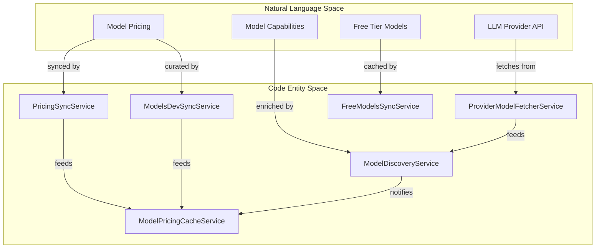
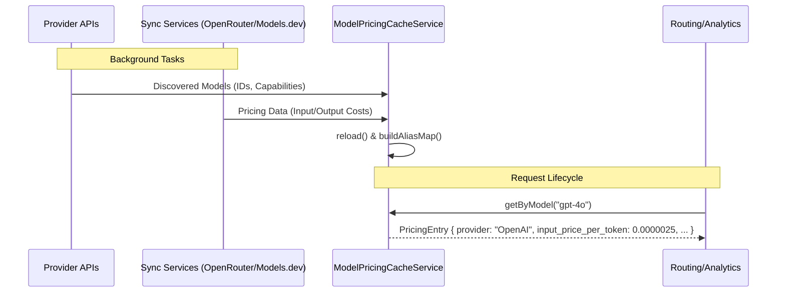

<!-- source: DeepWiki mcp.deepwiki.com · repo mnfst/manifest · page 4 Model Discovery and Pricing · fetched 2026-10-26 -->

# Model Discovery and Pricing

Relevant source files

The following files were used as context for generating this wiki page:

- [packages/backend/src/database/database-seeder.service.spec.ts](packages/backend/src/database/database-seeder.service.spec.ts)
- [packages/backend/src/database/database-seeder.service.ts](packages/backend/src/database/database-seeder.service.ts)
- [packages/backend/src/database/models-dev-sync.service.spec.ts](packages/backend/src/database/models-dev-sync.service.spec.ts)
- [packages/backend/src/database/models-dev-sync.service.ts](packages/backend/src/database/models-dev-sync.service.ts)
- [packages/backend/src/database/pricing-sync.service.spec.ts](packages/backend/src/database/pricing-sync.service.spec.ts)
- [packages/backend/src/database/pricing-sync.service.ts](packages/backend/src/database/pricing-sync.service.ts)
- [packages/backend/src/model-discovery/filter-non-chat-models.spec.ts](packages/backend/src/model-discovery/filter-non-chat-models.spec.ts)
- [packages/backend/src/model-discovery/known-model-prices.spec.ts](packages/backend/src/model-discovery/known-model-prices.spec.ts)
- [packages/backend/src/model-discovery/known-model-prices.ts](packages/backend/src/model-discovery/known-model-prices.ts)
- [packages/backend/src/model-discovery/model-fallback.spec.ts](packages/backend/src/model-discovery/model-fallback.spec.ts)
- [packages/backend/src/model-discovery/model-fallback.ts](packages/backend/src/model-discovery/model-fallback.ts)
- [packages/backend/src/model-discovery/provider-model-fetcher.service.spec.ts](packages/backend/src/model-discovery/provider-model-fetcher.service.spec.ts)
- [packages/backend/src/model-discovery/provider-model-fetcher.service.ts](packages/backend/src/model-discovery/provider-model-fetcher.service.ts)
- [packages/backend/src/model-prices/model-name-normalizer.spec.ts](packages/backend/src/model-prices/model-name-normalizer.spec.ts)
- [packages/backend/src/model-prices/model-name-normalizer.ts](packages/backend/src/model-prices/model-name-normalizer.ts)
- [packages/backend/src/model-prices/model-pricing-cache.service.spec.ts](packages/backend/src/model-prices/model-pricing-cache.service.spec.ts)
- [packages/backend/src/model-prices/model-pricing-cache.service.ts](packages/backend/src/model-prices/model-pricing-cache.service.ts)

Manifest maintains a comprehensive, real-time registry of LLM models and their associated costs. This system ensures that the [Scoring Engine](#3.1) has access to accurate metadata (like context window and capabilities) and that the [Analytics API](#5.1) can calculate precise inference costs. The system combines active discovery via provider APIs with synchronized pricing data from curated external sources.

## System Overview

The discovery and pricing architecture is divided into three primary pipelines:

1.  **Discovery Pipeline**: Actively queries configured LLM providers (OpenAI, Anthropic, Ollama, etc.) to identify which models are available for a specific API key or subscription.
2.  **Pricing Pipeline**: Synchronizes cost data from global sources (OpenRouter, models.dev) and normalizes model names to link discovered models with their market prices.
3.  **Free Models Pipeline**: Specifically tracks and exposes models available at zero cost across various providers to support the "Free" routing tier.

### Core Entity Mapping

The following diagram illustrates how natural language concepts map to specific code entities within the Manifest backend.

Sources: [packages/backend/src/model-discovery/provider-model-fetcher.service.ts:1-20](), [packages/backend/src/model-prices/model-pricing-cache.service.ts:36-52](), [packages/backend/src/database/pricing-sync.service.ts:32-44]()

---

## Model Discovery Pipeline

The discovery process is responsible for populating the system with models that are actually reachable by the user's credentials. It handles provider-specific API nuances, normalizes model identifiers, and filters out incompatible endpoints.

*   **Active Fetching**: The `ProviderModelFetcherService` [packages/backend/src/model-discovery/provider-model-fetcher.service.ts:1-20]() implements parsers for 12+ providers, including logic for OpenAI date-suffixed snapshots [packages/backend/src/model-discovery/provider-model-fetcher.service.ts:79-92]() and specialized subscription probes.
*   **Filtering**: Manifest uses a `UNIVERSAL_NON_CHAT_RE` [packages/backend/src/model-discovery/provider-model-fetcher.service.ts:101-102]() and provider-specific regex filters [packages/backend/src/model-discovery/provider-model-fetcher.service.ts:108-130]() to exclude non-chat models (TTS, Embeddings, Image Gen) from the routing pool.
*   **Discovery Orchestration**: The `ModelDiscoveryService` manages the lifecycle of discovering models across different providers and ensuring they are chat-compatible before adding them to the registry.

For details, see [Model Discovery Pipeline](#4.1).

Sources: [packages/backend/src/model-discovery/provider-model-fetcher.service.ts:143-155](), [packages/backend/src/model-discovery/provider-model-fetcher.service.spec.ts:18-42]()

---

## Pricing Synchronization

Pricing data is maintained in a high-performance in-memory cache, allowing for real-time cost estimation during request proxying.

*   **Multi-Source Sync**: The `PricingSyncService` [packages/backend/src/database/pricing-sync.service.ts:32-44]() fetches broad data from OpenRouter [packages/backend/src/database/pricing-sync.service.ts:29](), while `ModelsDevSyncService` provides curated pricing from `models.dev/api.json` [packages/backend/src/database/models-dev-sync.service.ts:69-70]().
*   **Normalization**: The `ModelPricingCacheService` uses `ModelNameNormalizer` [packages/backend/src/model-prices/model-name-normalizer.ts:1-16]() to ensure cost data is correctly mapped. This includes stripping provider prefixes [packages/backend/src/model-prices/model-name-normalizer.ts:66-73]() and date suffixes [packages/backend/src/model-prices/model-name-normalizer.ts:75-77]().
*   **Startup Seeding**: The `DatabaseSeederService` [packages/backend/src/database/database-seeder.service.ts:20-33]() ensures that initial credentials and demo data are present on startup for development and test environments when `SEED_DATA=true` [packages/backend/src/database/database-seeder.service.ts:36-37]().

For details, see [Pricing Synchronization](#4.2).

Sources: [packages/backend/src/model-prices/model-pricing-cache.service.ts:64-102](), [packages/backend/src/database/pricing-sync.service.ts:47-83](), [packages/backend/src/model-prices/model-name-normalizer.ts:128-161]()

---

## Free Models

Manifest includes a dedicated system for discovering and surfacing "Free" models, which are utilized by the routing tier to provide zero-cost inference when possible.

*   **Free Model Discovery**: The `FreeModelsSyncService` identifies models with zero pricing from provider catalogs and caches them for the frontend and routing logic.
*   **Tier Integration**: The `FreeModelsService` provides the underlying data used to assign models to the "Free" tier, often identifying models where `input_price_per_token` is zero [packages/backend/src/database/pricing-sync.service.ts:221-229]().

For details, see [Free Models](#4.3).

---

## Data Flow and Persistence

The relationship between discovery and pricing is orchestrated through the `ModelPricingCacheService`, which acts as the single source of truth for the rest of the application.

### Key Services
| Service | Responsibility | File Path |
| :--- | :--- | :--- |
| `ProviderModelFetcherService` | Low-level HTTP fetching and parsing of provider model lists. | [packages/backend/src/model-discovery/provider-model-fetcher.service.ts]() |
| `ModelPricingCacheService` | Aggregates pricing from all sources and provides a normalized lookup API. | [packages/backend/src/model-prices/model-pricing-cache.service.ts]() |
| `PricingSyncService` | Periodic synchronization with OpenRouter's model/pricing API. | [packages/backend/src/database/pricing-sync.service.ts]() |
| `ModelsDevSyncService` | Fetches curated model metadata and pricing from models.dev. | [packages/backend/src/database/models-dev-sync.service.ts]() |
| `DatabaseSeederService` | Initializes system data and demo credentials on startup. | [packages/backend/src/database/database-seeder.service.ts]() |

Sources: [packages/backend/src/model-prices/model-pricing-cache.service.ts:36-52](), [packages/backend/src/database/database-seeder.service.ts:33-58](), [packages/backend/src/database/models-dev-sync.service.ts:94-106]()

---

