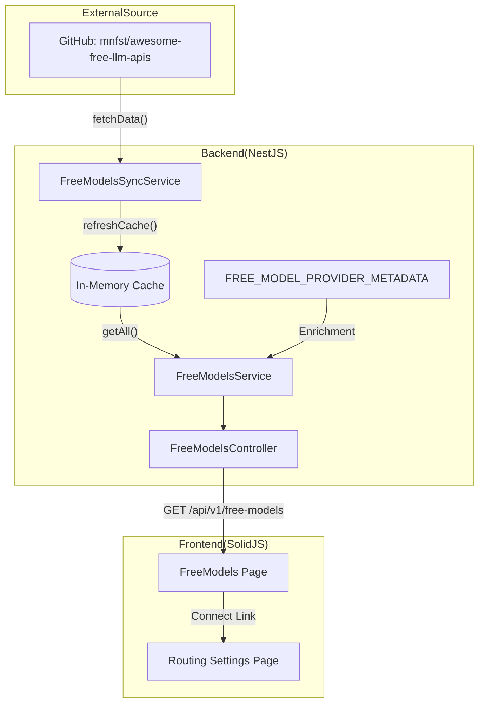
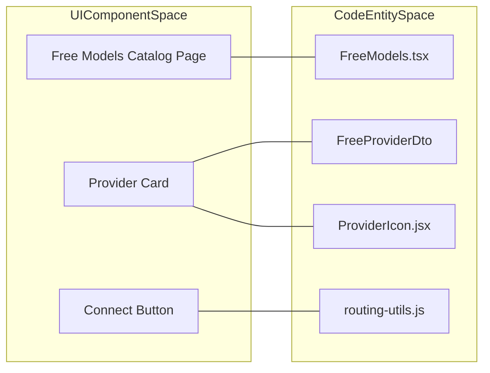

<!-- source: DeepWiki mcp.deepwiki.com · repo mnfst/manifest · page 4.3 Free Models · fetched 2026-10-26 -->

# Free Models

Relevant source files

The following files were used as context for generating this wiki page:

- [packages/frontend/public/icons/gemini.svg](packages/frontend/public/icons/gemini.svg)
- [packages/frontend/public/icons/groq.svg](packages/frontend/public/icons/groq.svg)
- [packages/frontend/src/components/CostByModelTable.tsx](packages/frontend/src/components/CostByModelTable.tsx)
- [packages/frontend/src/components/ModelPricesFilterBar.tsx](packages/frontend/src/components/ModelPricesFilterBar.tsx)
- [packages/frontend/src/pages/FreeModels.tsx](packages/frontend/src/pages/FreeModels.tsx)
- [packages/frontend/src/pages/Help.tsx](packages/frontend/src/pages/Help.tsx)
- [packages/frontend/src/pages/ModelPrices.tsx](packages/frontend/src/pages/ModelPrices.tsx)
- [packages/frontend/src/services/cursor-pagination.ts](packages/frontend/src/services/cursor-pagination.ts)
- [packages/frontend/src/services/pagination.ts](packages/frontend/src/services/pagination.ts)
- [packages/frontend/tests/components/ModelPricesFilterBar.test.tsx](packages/frontend/tests/components/ModelPricesFilterBar.test.tsx)
- [packages/frontend/tests/pages/FreeModels.test.tsx](packages/frontend/tests/pages/FreeModels.test.tsx)
- [packages/frontend/tests/pages/ModelPrices.test.tsx](packages/frontend/tests/pages/ModelPrices.test.tsx)

The Free Models feature in Manifest provides a discovery and integration layer for LLM providers that offer free-tier API access. It consists of a backend synchronization service that tracks available free models from a curated repository, a management service for querying this data, and a frontend interface that allows users to quickly connect these providers to their agents.

## Architecture and Data Flow

The free models system operates by periodically fetching a JSON catalog from an external repository and caching it in memory. This data is then enriched with local metadata (logos, tags, warnings) before being served to the frontend.

### System Components Diagram

The following diagram illustrates the flow from the external data source to the user's routing configuration.

"Free Models System Architecture"

Sources: [packages/frontend/src/pages/FreeModels.tsx:139-188](), [packages/frontend/src/services/api.js:6]()

## Backend Implementation

### FreeModelsSyncService
The `FreeModelsSyncService` (backend) is responsible for the lifecycle of the free models data. It implements `OnModuleInit` to fetch data immediately upon backend startup.

- **Data Source**: It fetches from a raw GitHub repository tracking free LLM APIs.
- **Caching**: Data is stored in an in-memory cache to ensure high performance for the dashboard.
- **Scheduling**: A Cron job refreshes the cache daily to keep the catalog up to date.

### FreeModelsService
This service acts as the transformation layer. It takes raw provider objects and maps them to `FreeProviderDto` objects used by the API.

- **Enrichment**: It joins the incoming data with local metadata to add UI-specific fields like `logo`, `tags`, and `warning` messages.
- **Model Normalization**: It maps model properties (context window, max output, modality) into a standardized format for the frontend.

### API Endpoints
The backend exposes the following endpoint for the frontend:
- `GET /api/v1/free-models`: Returns the list of enriched free providers and the `last_synced_at` timestamp [packages/frontend/src/services/api.js:6]().

## Frontend Integration

The Free Models page (`/agents/:agentName/free-models`) provides a catalog of providers [packages/frontend/src/pages/FreeModels.tsx:139-143](). Each provider card includes instructions on how to obtain an API key and a "Connect" button.

### Connection Logic
The `ConnectButton` component determines the destination based on whether the provider is a "built-in" Manifest provider or a generic OpenAI-compatible one [packages/frontend/src/pages/FreeModels.tsx:87-137]().

| Provider Type | Logic | Destination |
| :--- | :--- | :--- |
| **Built-in** | Matches `FREE_TO_BUILTIN` map | `/routing?provider={id}` [packages/frontend/src/pages/FreeModels.tsx:104-108]() |
| **Custom** | No built-in match (OpenAI-compatible) | `/routing?provider=custom&name={name}&baseUrl={url}&models={ids}` [packages/frontend/src/pages/FreeModels.tsx:109-112]() |

The `FREE_TO_BUILTIN` map ensures that popular providers like Google Gemini or Mistral AI use the dedicated provider modals instead of the generic custom form [packages/frontend/src/pages/FreeModels.tsx:69-85]().

### Code-to-Entity Mapping: Frontend UI

The following diagram maps UI components to their corresponding code entities and data structures.

"Frontend Free Models Component Mapping"

Sources: [packages/frontend/src/pages/FreeModels.tsx:1-135](), [packages/frontend/src/services/routing-utils.js:1-11](), [packages/frontend/src/components/ProviderIcon.jsx:3-4]()

## Routing Integration

Free models are integrated into the routing tier assignment. When a free model is connected, it appears in the routing configuration for the agent.

### Pricing Visualization
Free models are explicitly highlighted in the **Model Prices** table. The frontend uses `resolveDisplayName` to clean up model names and formats prices as `$0.00` or displays a dash if data is missing [packages/frontend/src/pages/ModelPrices.tsx:43-48](), [packages/frontend/src/pages/ModelPrices.tsx:94-95]().

- **Filtering**: Users can filter the pricing table to see only specific free providers or models using the `ModelPricesFilterBar` [packages/frontend/src/components/ModelPricesFilterBar.tsx:66-215]().
- **Sorting**: The pricing table allows sorting by input/output costs, which naturally floats free models to the top or bottom [packages/frontend/src/pages/ModelPrices.tsx:97-119]().
- **Display**: Model names are cleaned using a regex to remove "(free)" suffixes for display purposes [packages/frontend/src/pages/ModelPrices.tsx:95]().

### Local vs Cloud Restrictions
Certain free providers, specifically **Ollama**, are flagged as `localOnly` [packages/frontend/src/pages/FreeModels.tsx:115-118](). The frontend checks if the instance is self-hosted using `checkIsSelfHosted()` [packages/frontend/src/pages/FreeModels.tsx:90](). If the application is running in cloud mode (`app.manifest.build`), the "Connect" button for local-only providers is disabled with a tooltip explaining it is only available for self-hosted versions [packages/frontend/src/pages/FreeModels.tsx:121-135]().

### Analytics and Costs
In the **Cost by Model** table, free models are rendered with their respective provider icons and specific auth badges [packages/frontend/src/components/CostByModelTable.tsx:105-116](). 

- **Provider Resolution**: The table uses `resolveRowProvider` and `resolveRowProviderName` to identify the correct icon to display [packages/frontend/src/components/CostByModelTable.tsx:29-44]().
- **Visuals**: Since their `estimated_cost` is zero, they are visually distinguished from paid models in the cost distribution charts, often showing 0% share of total cost if only free models are used [packages/frontend/src/components/CostByModelTable.tsx:139-148]().

Sources: [packages/frontend/src/pages/FreeModels.tsx:69-137](), [packages/frontend/src/pages/ModelPrices.tsx:43-119](), [packages/frontend/src/components/CostByModelTable.tsx:29-148](), [packages/frontend/src/services/setup-status.js:8](), [packages/frontend/src/components/ModelPricesFilterBar.tsx:66-215]()

---

