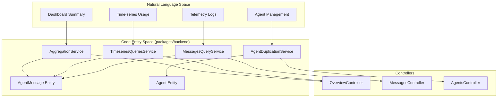
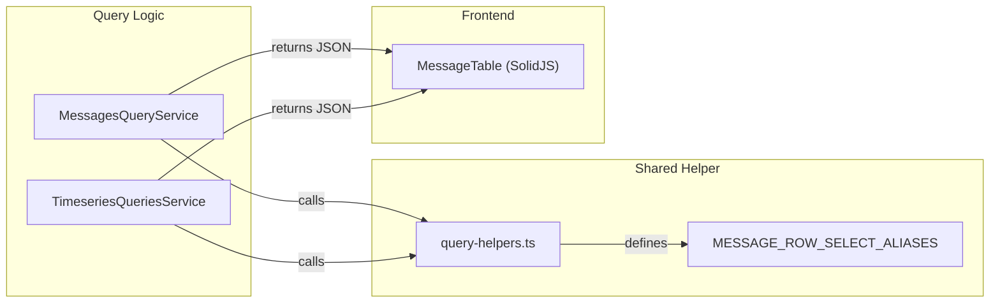
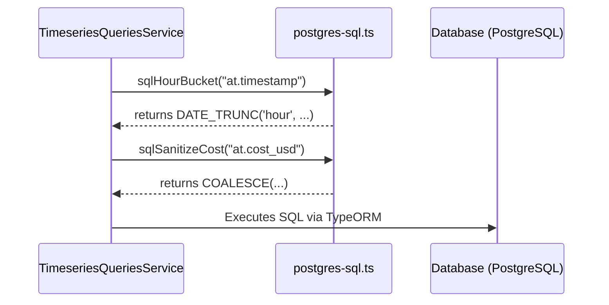

<!-- source: DeepWiki mcp.deepwiki.com · repo mnfst/manifest · page 5.1 Analytics API · fetched 2026-10-26 -->

# Analytics API

Relevant source files

The following files were used as context for generating this wiki page:

- [packages/backend/src/analytics/analytics.module.ts](packages/backend/src/analytics/analytics.module.ts)
- [packages/backend/src/analytics/controllers/messages.controller.spec.ts](packages/backend/src/analytics/controllers/messages.controller.spec.ts)
- [packages/backend/src/analytics/controllers/messages.controller.ts](packages/backend/src/analytics/controllers/messages.controller.ts)
- [packages/backend/src/analytics/services/agent-duplication.service.spec.ts](packages/backend/src/analytics/services/agent-duplication.service.spec.ts)
- [packages/backend/src/analytics/services/agent-duplication.service.ts](packages/backend/src/analytics/services/agent-duplication.service.ts)
- [packages/backend/src/analytics/services/aggregation.service.spec.ts](packages/backend/src/analytics/services/aggregation.service.spec.ts)
- [packages/backend/src/analytics/services/aggregation.service.ts](packages/backend/src/analytics/services/aggregation.service.ts)
- [packages/backend/src/analytics/services/messages-query.service.spec.ts](packages/backend/src/analytics/services/messages-query.service.spec.ts)
- [packages/backend/src/analytics/services/messages-query.service.ts](packages/backend/src/analytics/services/messages-query.service.ts)
- [packages/backend/src/analytics/services/query-helpers.spec.ts](packages/backend/src/analytics/services/query-helpers.spec.ts)
- [packages/backend/src/analytics/services/query-helpers.ts](packages/backend/src/analytics/services/query-helpers.ts)
- [packages/backend/src/analytics/services/timeseries-queries.service.spec.ts](packages/backend/src/analytics/services/timeseries-queries.service.spec.ts)
- [packages/backend/src/analytics/services/timeseries-queries.service.ts](packages/backend/src/analytics/services/timeseries-queries.service.ts)
- [packages/backend/src/common/dto/duplicate-agent.dto.ts](packages/backend/src/common/dto/duplicate-agent.dto.ts)
- [packages/backend/src/routing/routing-core/route-helpers.ts](packages/backend/src/routing/routing-core/route-helpers.ts)
- [packages/backend/test/agent-duplication.e2e-spec.ts](packages/backend/test/agent-duplication.e2e-spec.ts)
- [packages/backend/test/costs.e2e-spec.ts](packages/backend/test/costs.e2e-spec.ts)
- [packages/backend/test/messages.e2e-spec.ts](packages/backend/test/messages.e2e-spec.ts)
- [packages/frontend/src/components/DuplicateAgentModal.tsx](packages/frontend/src/components/DuplicateAgentModal.tsx)
- [packages/frontend/src/components/LimitRuleTable.tsx](packages/frontend/src/components/LimitRuleTable.tsx)
- [packages/frontend/src/pages/MessageLog.tsx](packages/frontend/src/pages/MessageLog.tsx)
- [packages/frontend/src/pages/Overview.tsx](packages/frontend/src/pages/Overview.tsx)
- [packages/frontend/src/services/api/analytics.ts](packages/frontend/src/services/api/analytics.ts)
- [packages/frontend/src/services/api/notifications.ts](packages/frontend/src/services/api/notifications.ts)
- [packages/frontend/tests/components/DuplicateAgentModal.test.tsx](packages/frontend/tests/components/DuplicateAgentModal.test.tsx)
- [packages/frontend/tests/pages/MessageLog.test.tsx](packages/frontend/tests/pages/MessageLog.test.tsx)
- [packages/frontend/tests/pages/Overview.test.tsx](packages/frontend/tests/pages/Overview.test.tsx)

The Analytics API provides a comprehensive suite of REST endpoints and services for monitoring LLM usage, costs, and performance. It powers the Manifest dashboard by aggregating telemetry data from the `AgentMessage` entity and providing time-series analysis, paginated message logs, and agent management capabilities.

## Architecture and Data Flow

The analytics system follows a layered architecture where controllers handle HTTP requests, services perform complex SQL aggregations using dialect-aware utilities, and the persistence layer interacts with PostgreSQL.

### System Components Mapping

The following diagram bridges the functional analytics concepts to their specific implementation classes in the codebase.

**Analytics Entity Mapping**

Sources: [packages/backend/src/analytics/analytics.module.ts:1-49](), [packages/backend/src/analytics/services/timeseries-queries.service.ts:27-34](), [packages/backend/src/analytics/services/agent-duplication.service.ts:34-39]()

## REST Endpoints

### Dashboard Overview
**Endpoint:** `GET /api/v1/overview`  
**Controller:** `OverviewController`  
Provides a summary of total tokens, costs, and message counts. It leverages the `AggregationService` to perform global or agent-specific sums over a defined time range, calculating trend percentages by comparing current data against previous intervals [packages/backend/src/analytics/services/aggregation.service.ts:52-94](). The frontend `Overview` component consumes this to render `ChartCard` and `CostByModelTable` components [packages/frontend/src/pages/Overview.tsx:188-191]().

### Time-series Data
**Endpoints:** `GET /api/v1/tokens`, `GET /api/v1/costs`  
**Service:** `TimeseriesQueriesService`  
Generates bucketed data for charts. The service dynamically calculates time intervals (hourly or daily) based on the requested range using `sqlHourBucket` and `sqlDateBucket` utilities [packages/backend/src/analytics/services/timeseries-queries.service.ts:36-81]().

### Telemetry Logs
**Endpoint:** `GET /api/v1/messages`  
**Service:** `MessagesQueryService`  
Returns paginated logs of all LLM calls. It supports advanced filtering by provider, service type, cost range, and agent [packages/backend/src/analytics/services/messages-query.service.ts:37-97](). The frontend `MessageLog` page uses `createCursorPagination` to manage the state of these paginated requests [packages/frontend/src/pages/MessageLog.tsx:138-177]().

| Feature | Implementation Detail |
| :--- | :--- |
| **Pagination** | Keyset-based cursor using a `timestamp\|id` string [packages/backend/src/analytics/services/messages-query.service.ts:186-196]() |
| **Caching** | `TtlCache` for total counts (30s) and distinct model lists (5m) [packages/backend/src/analytics/services/messages-query.service.ts:15-29]() |
| **Provider Inference** | Derived from stored `provider` column or inferred from model names via `inferProviderFromModel` [packages/backend/src/analytics/services/messages-query.service.ts:155-184]() |
| **Feedback** | Integrated via `MessagesController` to patch `feedback_rating` using `setMessageFeedback` [packages/backend/src/analytics/controllers/messages.controller.ts:48-56]() |

Sources: [packages/backend/src/analytics/services/messages-query.service.ts:37-184](), [packages/backend/src/analytics/services/timeseries-queries.service.ts:36-81](), [packages/frontend/src/pages/MessageLog.tsx:138-177]()

## Single Source of Truth for Message Projection

To ensure consistency between the backend API and the frontend `MessageTable`, the system uses `selectMessageRowColumns()` as the mandatory projection function for any query returning message rows.

**Message Projection Flow**

The `selectMessageRowColumns()` function ensures that critical fields like `routing_tier`, `specificity_category`, `cost`, and `feedback_rating` are always present and correctly aliased [packages/backend/src/analytics/services/query-helpers.ts:108-137](). This aligns with the `MESSAGE_ROW_SELECT_ALIASES` constant which serves as the downstream contract for the frontend [packages/backend/src/analytics/services/query-helpers.ts:83-107]().

Sources: [packages/backend/src/analytics/services/query-helpers.ts:83-137](), [packages/backend/src/analytics/services/timeseries-queries.service.ts:120-123]()

## SQL Utilities

Manifest primarily supports PostgreSQL. The `TimeseriesQueriesService` and `MessagesQueryService` use custom SQL utilities to handle database-specific aggregation logic.

**Dialect Execution Flow**

Sources: [packages/backend/src/common/utils/postgres-sql.ts:1-50](), [packages/backend/src/analytics/services/timeseries-queries.service.ts:10-15]()

### Key Postgres SQL Functions
*   **`sqlHourBucket` / `sqlDateBucket`**: Handles time-series grouping [packages/backend/src/analytics/services/timeseries-queries.service.ts:45-46]().
*   **`sqlSanitizeCost`**: Wraps cost columns to handle potential `NULL` or invalid data by treating them as `0` [packages/backend/src/analytics/services/timeseries-queries.service.ts:53-53]().
*   **`sqlCastFloat`**: Ensures numeric precision during aggregation [packages/backend/src/analytics/services/timeseries-queries.service.ts:118-118]().

Sources: [packages/backend/src/analytics/services/timeseries-queries.service.ts:43-57](), [packages/backend/src/common/utils/postgres-sql.ts:1-60]()

## Implementation Details

### Aggregation Service
The `AggregationService` performs heavy-lifting calculations for the dashboard. It uses parallelized TypeORM queries to fetch current and previous period data simultaneously [packages/backend/src/analytics/services/aggregation.service.ts:70-80]().
1.  **Token Summary**: Returns input, output, and total tokens with trend percentages [packages/backend/src/analytics/services/aggregation.service.ts:82-90]().
2.  **Cost Summary**: Aggregates `cost_usd` across messages using `sqlSanitizeCost` [packages/backend/src/analytics/services/aggregation.service.ts:42-50]().
3.  **Has Data**: Efficiently checks for the existence of any telemetry to toggle dashboard empty states [packages/backend/src/analytics/services/aggregation.service.ts:25-31]().

### Agent Duplication Service
The `AgentDuplicationService` enables cloning an agent's configuration (provider credentials, custom providers, tier assignments, specificity overrides) into a new agent entity.
*   **Preview**: Generates a summary of what will be copied and suggests a unique name [packages/backend/src/analytics/services/agent-duplication.service.ts:64-102]().
*   **Duplication**: Executes a transaction to clone the `Agent` and its associated relations, including remapping `CustomProvider` references in `UserProvider` rows [packages/backend/src/analytics/services/agent-duplication.service.ts:104-184]().
*   **Frontend Integration**: The `DuplicateAgentModal` component allows users to initiate this process from the dashboard [packages/frontend/src/components/DuplicateAgentModal.tsx:67-95]().

### Timeseries Queries Service
*   **`getCostByModel`**: Groups usage by model ID and `auth_type` to show share percentages and estimated costs [packages/backend/src/analytics/services/timeseries-queries.service.ts:128-166]().
*   **`getActiveSkills`**: Identifies which agent tools/skills are most frequently utilized by grouping by `skill_name` [packages/backend/src/analytics/services/timeseries-queries.service.ts:83-105]().
*   **`getRecentActivity`**: Returns the most recent messages using the standard `selectMessageRowColumns` projection [packages/backend/src/analytics/services/timeseries-queries.service.ts:107-126]().

Sources: [packages/backend/src/analytics/services/aggregation.service.ts:1-117](), [packages/backend/src/analytics/services/timeseries-queries.service.ts:83-166](), [packages/backend/src/analytics/services/agent-duplication.service.ts:64-184](), [packages/frontend/src/components/DuplicateAgentModal.tsx:18-95]()

---

