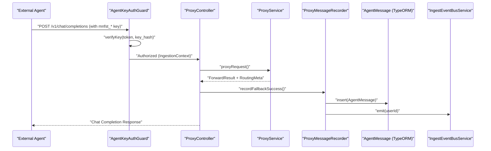
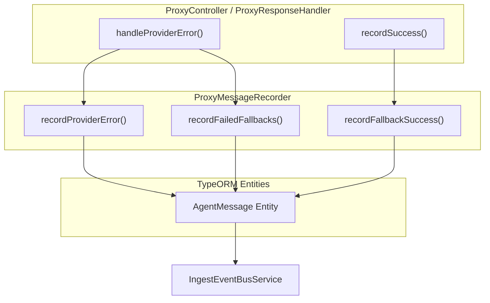

<!-- source: DeepWiki mcp.deepwiki.com · repo mnfst/manifest · page 5.2 OTLP Ingestion and SSE · fetched 2026-10-26 -->

# OTLP Ingestion and SSE

Relevant source files

The following files were used as context for generating this wiki page:

- [packages/backend/src/analytics/services/message-details.service.spec.ts](packages/backend/src/analytics/services/message-details.service.spec.ts)
- [packages/backend/src/analytics/services/message-details.service.ts](packages/backend/src/analytics/services/message-details.service.ts)
- [packages/backend/src/common/constants/cache.constants.spec.ts](packages/backend/src/common/constants/cache.constants.spec.ts)
- [packages/backend/src/common/constants/cache.constants.ts](packages/backend/src/common/constants/cache.constants.ts)
- [packages/backend/src/common/middleware/http-error-logger.middleware.spec.ts](packages/backend/src/common/middleware/http-error-logger.middleware.spec.ts)
- [packages/backend/src/common/middleware/http-error-logger.middleware.ts](packages/backend/src/common/middleware/http-error-logger.middleware.ts)
- [packages/backend/src/common/utils/cost-calculator.spec.ts](packages/backend/src/common/utils/cost-calculator.spec.ts)
- [packages/backend/src/common/utils/cost-calculator.ts](packages/backend/src/common/utils/cost-calculator.ts)
- [packages/backend/src/database/database.module.ts](packages/backend/src/database/database.module.ts)
- [packages/backend/src/database/migrations/1773800000000-FixNegativeCosts.spec.ts](packages/backend/src/database/migrations/1773800000000-FixNegativeCosts.spec.ts)
- [packages/backend/src/database/migrations/1773800000000-FixNegativeCosts.ts](packages/backend/src/database/migrations/1773800000000-FixNegativeCosts.ts)
- [packages/backend/src/database/migrations/1782000000000-RetuneSpecificityMiscategorizedIndex.spec.ts](packages/backend/src/database/migrations/1782000000000-RetuneSpecificityMiscategorizedIndex.spec.ts)
- [packages/backend/src/database/migrations/1782000000000-RetuneSpecificityMiscategorizedIndex.ts](packages/backend/src/database/migrations/1782000000000-RetuneSpecificityMiscategorizedIndex.ts)
- [packages/backend/src/entities/agent-message.entity.ts](packages/backend/src/entities/agent-message.entity.ts)
- [packages/backend/src/otlp/otlp-deprecated.controller.spec.ts](packages/backend/src/otlp/otlp-deprecated.controller.spec.ts)
- [packages/backend/src/otlp/otlp-deprecated.controller.ts](packages/backend/src/otlp/otlp-deprecated.controller.ts)
- [packages/backend/src/otlp/otlp.module.ts](packages/backend/src/otlp/otlp.module.ts)
- [packages/backend/src/public-stats/public-stats.controller.spec.ts](packages/backend/src/public-stats/public-stats.controller.spec.ts)
- [packages/backend/src/public-stats/public-stats.controller.ts](packages/backend/src/public-stats/public-stats.controller.ts)
- [packages/backend/src/public-stats/public-stats.module.ts](packages/backend/src/public-stats/public-stats.module.ts)
- [packages/backend/src/public-stats/public-stats.service.spec.ts](packages/backend/src/public-stats/public-stats.service.spec.ts)
- [packages/backend/src/public-stats/public-stats.service.ts](packages/backend/src/public-stats/public-stats.service.ts)
- [packages/backend/src/routing/proxy/__tests__/proxy-message-recorder.spec.ts](packages/backend/src/routing/proxy/__tests__/proxy-message-recorder.spec.ts)
- [packages/backend/src/routing/proxy/proxy-message-recorder.ts](packages/backend/src/routing/proxy/proxy-message-recorder.ts)
- [packages/backend/src/sse/sse.controller.spec.ts](packages/backend/src/sse/sse.controller.spec.ts)
- [packages/backend/src/sse/sse.controller.ts](packages/backend/src/sse/sse.controller.ts)
- [packages/backend/test/public-stats.e2e-spec.ts](packages/backend/test/public-stats.e2e-spec.ts)
- [packages/frontend/src/components/MessageDetails.tsx](packages/frontend/src/components/MessageDetails.tsx)
- [packages/frontend/src/components/MessageDetailsSections.tsx](packages/frontend/src/components/MessageDetailsSections.tsx)
- [packages/frontend/src/services/api/agents.ts](packages/frontend/src/services/api/agents.ts)
- [packages/frontend/src/services/api/messages.ts](packages/frontend/src/services/api/messages.ts)
- [packages/frontend/src/services/sse.ts](packages/frontend/src/services/sse.ts)
- [packages/frontend/src/styles/data.css](packages/frontend/src/styles/data.css)
- [packages/frontend/tests/components/MessageDetails.test.tsx](packages/frontend/tests/components/MessageDetails.test.tsx)
- [packages/frontend/tests/services/sse.test.ts](packages/frontend/tests/services/sse.test.ts)

Manifest provides an OpenTelemetry-compatible ingestion pipeline designed to receive telemetry data (traces, metrics, and logs) and real-time proxy events. This system bridges the gap between high-volume request processing and live dashboard updates using a combination of specialized controllers, background recorders, and Server-Sent Events (SSE).

## OTLP Ingestion Pipeline

The ingestion pipeline is responsible for receiving data from agents and the internal proxy, authenticating requests, and persisting telemetry for analytics. While the `OtlpController` (deprecated) is the historical entry point for standard OTLP traces [packages/backend/src/otlp/otlp-deprecated.controller.ts:15-16](), the `ProxyController` serves as the primary ingestion point for LLM-specific telemetry generated during request routing.

### Data Flow Architecture

The following diagram illustrates the flow from an external agent through the ingestion guards into the persistence layer.

**Ingestion Sequence Diagram**

Sources: [packages/backend/src/routing/proxy/proxy-message-recorder.ts:247-308](), [packages/backend/src/entities/agent-message.entity.ts:6-14](), [packages/backend/src/otlp/otlp-deprecated.controller.ts:15-40]()

### Authentication: AgentKeyAuthGuard
Authentication for OTLP and proxy endpoints is handled by the `AgentKeyAuthGuard`. It validates API keys with the `mnfst_` prefix.

- **Key Verification**: The guard checks the provided token against the `key_hash` stored in the `AgentApiKey` table.
- **Caching**: To minimize database overhead, the guard implements a 5-minute in-memory cache for validated keys.
- **Context Injection**: Upon successful authentication, the guard attaches an `IngestionContext` to the request, containing `tenantId`, `agentId`, `agentName`, and `userId` [packages/backend/src/otlp/interfaces/ingestion-context.interface.ts:7-12]().

Sources: [packages/backend/src/routing/proxy/proxy-message-recorder.ts:7-9](), [packages/backend/src/otlp/otlp.module.ts:1-20]()

## Proxy Message Recording

The `ProxyMessageRecorder` is the primary service for persisting telemetry logs into the `agent_messages` table [packages/backend/src/routing/proxy/proxy-message-recorder.ts:137-138](). It captures distinct states of a request lifecycle:

| Function | Purpose | Key Data Captured |
| :--- | :--- | :--- |
| `recordFallbackSuccess` | Log successful completions (primary or fallback) | Model, Tier, Tokens, Cost, Duration, Auth Type [packages/backend/src/routing/proxy/proxy-message-recorder.ts:311-375]() |
| `recordProviderError` | Log 4xx/5xx errors from providers | HTTP Status, Error Message, Trace ID, Rate Limit status [packages/backend/src/routing/proxy/proxy-message-recorder.ts:158-210]() |
| `recordFailedFallbacks` | Log intermediate failures in a fallback chain | Fallback Index, Primary Model, Error Body [packages/backend/src/routing/proxy/proxy-message-recorder.ts:212-245]() |

### Token and Cost Calculation
The recorder calculates the USD cost of every message in real-time by joining the usage data with the `ModelPricingCacheService` [packages/backend/src/routing/proxy/proxy-message-recorder.ts:139-139]().
- **Subscription Auth**: If `auth_type` is `subscription`, the cost is explicitly recorded as `0` [packages/backend/src/routing/proxy/proxy-message-recorder.ts:364-364]().
- **API Key Auth**: For `api_key` auth, it uses the `computeTokenCost` utility, multiplying input/output tokens by the cached per-token price [packages/backend/src/common/utils/cost-calculator.ts:1-15]().
- **Secret Scrubbing**: Before persisting error messages, the recorder uses `scrubSecrets` to redact API keys and bearer tokens from upstream error bodies [packages/backend/src/routing/proxy/proxy-message-recorder.ts:203-203]().

Sources: [packages/backend/src/routing/proxy/proxy-message-recorder.ts:130-375](), [packages/backend/src/common/utils/cost-calculator.ts:1-15](), [packages/backend/src/entities/agent-message.entity.ts:51-59]()

## Real-Time Updates (SSE)

Manifest uses Server-Sent Events (SSE) to provide live updates to the dashboard without polling.

### IngestEventBusService
The `IngestEventBusService` acts as an internal pub/sub mechanism. When the `ProxyMessageRecorder` finishes persisting a message to the database, it calls `this.eventBus.emit(ctx.userId)` [packages/backend/src/routing/proxy/proxy-message-recorder.ts:209-209](), [packages/backend/src/routing/proxy/proxy-message-recorder.ts:374-374]().

### SSE Implementation
The frontend connects to the SSE stream to receive live message events.
- **Backend Controller**: The `SseController` handles the `GET /api/v1/sse` endpoint, maintaining persistent connections for users [packages/backend/src/sse/sse.controller.ts:12-17]().
- **Frontend Service**: The `sse.ts` service manages the `EventSource` connection and event parsing [packages/frontend/src/services/sse.ts:1-20]().
- **Trigger**: The dashboard receives a "ping" whenever new telemetry is available, triggering a refresh of the "Recent Messages" and "Overview" components.

Sources: [packages/backend/src/sse/sse.controller.ts:1-25](), [packages/frontend/src/services/sse.ts:1-30](), [packages/backend/src/routing/proxy/proxy-message-recorder.ts:141-141]()

## Public Stats Endpoint

The `PublicStatsController` exposes aggregated, non-sensitive usage data for public consumption (e.g., the Manifest landing page).

### Data Aggregation Logic
The `PublicStatsService` performs SQL queries to generate:
- **Top Models**: Models sorted by 7-day token usage, excluding custom or unknown models [packages/backend/src/public-stats/public-stats.service.ts:122-151]().
- **Provider Daily Tokens**: 30-day time-series data of token usage and costs per provider [packages/backend/src/public-stats/public-stats.service.ts:159-182]().
- **Dialect Awareness**: The service uses `sqlDateBucket` to ensure date grouping works across different database engines [packages/backend/src/public-stats/public-stats.service.ts:161-161]().

Sources: [packages/backend/src/public-stats/public-stats.service.ts:58-182](), [packages/backend/src/public-stats/public-stats.module.ts:1-15]()

## Implementation Detail: ProxyMessageRecorder

The `ProxyMessageRecorder` serves as the bridge between the high-performance `ProxyController` and the database.

**Code Entity Space: Recording Logic**

### Key Logic
- **Error Truncation**: Error messages are truncated to 2,000 characters before insertion [packages/backend/src/routing/proxy/proxy-message-recorder.ts:203-203]().
- **Rate Limit Cooldown**: To prevent log spam, the recorder implements a 60-second cooldown per agent for recording 429 Rate Limit errors [packages/backend/src/routing/proxy/proxy-message-recorder.ts:183-195]().
- **Baseline Cost**: The recorder computes a `baseline_cost_usd` for comparison against actual costs to track savings [packages/backend/src/routing/proxy/proxy-message-recorder.ts:354-361]().

Sources: [packages/backend/src/routing/proxy/proxy-message-recorder.ts:130-375](), [packages/backend/src/entities/agent-message.entity.ts:14-140](), [packages/backend/src/analytics/services/message-details.service.ts:84-108]()

---

