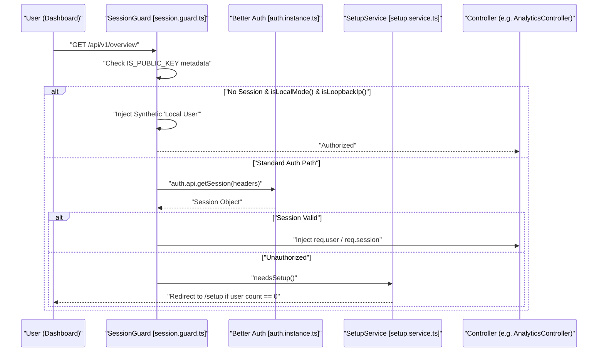
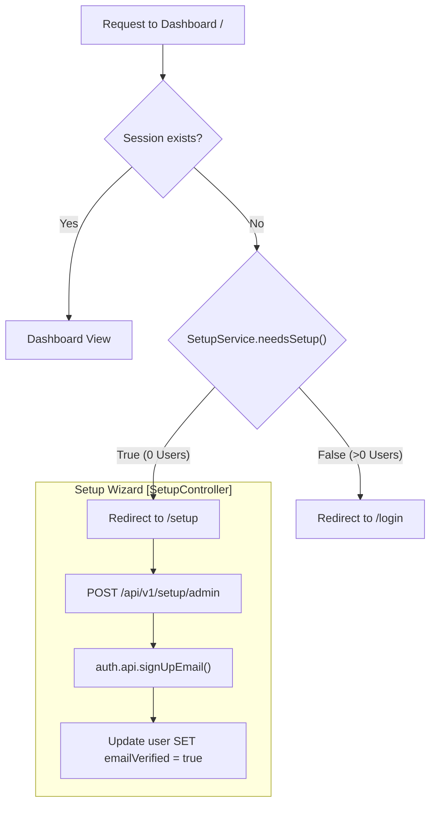

<!-- source: DeepWiki mcp.deepwiki.com · repo mnfst/manifest · page 6.1 Better Auth and Session Management · fetched 2026-10-26 -->

# Better Auth and Session Management

Relevant source files

The following files were used as context for generating this wiki page:

- [packages/backend/src/analytics/services/agent-analytics.service.spec.ts](packages/backend/src/analytics/services/agent-analytics.service.spec.ts)
- [packages/backend/src/auth/auth.instance.spec.ts](packages/backend/src/auth/auth.instance.spec.ts)
- [packages/backend/src/auth/auth.instance.ts](packages/backend/src/auth/auth.instance.ts)
- [packages/backend/src/common/guards/api-key.guard.spec.ts](packages/backend/src/common/guards/api-key.guard.spec.ts)
- [packages/backend/src/notifications/services/notification-rules.service.spec.ts](packages/backend/src/notifications/services/notification-rules.service.spec.ts)
- [packages/backend/src/notifications/services/notification-rules.service.ts](packages/backend/src/notifications/services/notification-rules.service.ts)
- [packages/backend/src/setup/setup.controller.spec.ts](packages/backend/src/setup/setup.controller.spec.ts)
- [packages/backend/src/setup/setup.controller.ts](packages/backend/src/setup/setup.controller.ts)
- [packages/backend/src/setup/setup.service.spec.ts](packages/backend/src/setup/setup.service.spec.ts)
- [packages/backend/src/setup/setup.service.ts](packages/backend/src/setup/setup.service.ts)
- [packages/backend/test/setup.e2e-spec.ts](packages/backend/test/setup.e2e-spec.ts)
- [packages/frontend/src/components/AuthGuard.tsx](packages/frontend/src/components/AuthGuard.tsx)
- [packages/frontend/src/components/ProviderApiKeyTab.tsx](packages/frontend/src/components/ProviderApiKeyTab.tsx)
- [packages/frontend/src/components/ProviderSelectContent.tsx](packages/frontend/src/components/ProviderSelectContent.tsx)
- [packages/frontend/src/layouts/AuthLayout.tsx](packages/frontend/src/layouts/AuthLayout.tsx)
- [packages/frontend/src/pages/Account.tsx](packages/frontend/src/pages/Account.tsx)
- [packages/frontend/src/pages/Login.tsx](packages/frontend/src/pages/Login.tsx)
- [packages/frontend/src/pages/Register.tsx](packages/frontend/src/pages/Register.tsx)
- [packages/frontend/src/pages/ResetPassword.tsx](packages/frontend/src/pages/ResetPassword.tsx)
- [packages/frontend/src/pages/Settings.tsx](packages/frontend/src/pages/Settings.tsx)
- [packages/frontend/src/pages/Workspace.tsx](packages/frontend/src/pages/Workspace.tsx)
- [packages/frontend/src/services/setup-status.ts](packages/frontend/src/services/setup-status.ts)
- [packages/frontend/tests/components/AuthGuard.test.tsx](packages/frontend/tests/components/AuthGuard.test.tsx)
- [packages/frontend/tests/components/CustomProviderForm.test.tsx](packages/frontend/tests/components/CustomProviderForm.test.tsx)
- [packages/frontend/tests/components/ProviderApiKeyTab.test.tsx](packages/frontend/tests/components/ProviderApiKeyTab.test.tsx)
- [packages/frontend/tests/pages/Account.test.tsx](packages/frontend/tests/pages/Account.test.tsx)
- [packages/frontend/tests/services/setup-status.test.ts](packages/frontend/tests/services/setup-status.test.ts)

This page documents the authentication and session management architecture of Manifest. The system employs a hybrid approach: a robust, multi-provider OAuth and email-based system for Cloud/Production deployments via **Better Auth**, and a zero-config loopback bypass for local development.

## Overview

Manifest's authentication strategy is determined by the environment configuration and the `isSelfHosted()` utility [packages/backend/src/setup/setup.service.ts:24-26]().

*   **Cloud Mode:** Utilizes [Better Auth](https://www.better-auth.com/) to manage users, sessions, and OAuth providers (Google, GitHub, Discord) [packages/backend/src/auth/auth.instance.ts:48-118](). It requires a PostgreSQL database for persistence [packages/backend/src/auth/auth.instance.ts:14-22]().
*   **Local/Self-Hosted Mode:** Optimized for Docker and local development. It provides an automated setup wizard flow and supports local LLM host detection (e.g., `host.docker.internal`) [packages/backend/src/setup/setup.service.ts:34-36]().

### Authentication Request Lifecycle

The following diagram illustrates how requests are authenticated and how the system transitions from "Natural Language" requirements to "Code Entities".

**Diagram: Authentication Flow and Code Mapping**

**Sources:** [packages/backend/src/setup/setup.service.ts:73-79](), [packages/backend/src/auth/auth.instance.ts:48-51]()

---

## Better Auth Configuration

The `auth.instance.ts` file exports the configured `auth` object used throughout the backend.

### Database Integration
Better Auth connects to PostgreSQL via the `pg` driver [packages/backend/src/auth/auth.instance.ts:14-22](). It uses the `DATABASE_URL` environment variable, defaulting to a standard local postgres string if unset [packages/backend/src/auth/auth.instance.ts:17-19]().

### Supported Providers
The instance supports the following authentication methods:
1.  **Email and Password:** Includes 8-character minimum length [packages/backend/src/auth/auth.instance.ts:63]() and mandatory email verification in production if an email provider is configured [packages/backend/src/auth/auth.instance.ts:64]().
2.  **Google OAuth:** Enabled via `GOOGLE_CLIENT_ID` and `GOOGLE_CLIENT_SECRET` [packages/backend/src/auth/auth.instance.ts:99-103]().
3.  **GitHub OAuth:** Enabled via `GITHUB_CLIENT_ID` and `GITHUB_CLIENT_SECRET` [packages/backend/src/auth/auth.instance.ts:104-109]().
4.  **Discord OAuth:** Enabled via `DISCORD_CLIENT_ID` and `DISCORD_CLIENT_SECRET` [packages/backend/src/auth/auth.instance.ts:110-115]().

### Security Features
*   **Trusted Origins:** Dynamically built based on `BETTER_AUTH_URL`, `CORS_ORIGIN`, and local ports to prevent CSRF [packages/backend/src/auth/auth.instance.ts:31-46]().
*   **Account Linking:** Enabled for trusted providers to prevent duplicate accounts for the same email address [packages/backend/src/auth/auth.instance.ts:55-60]().
*   **Secret Requirement:** The `BETTER_AUTH_SECRET` must be at least 32 characters in non-test environments [packages/backend/src/auth/auth.instance.ts:27-29]().

**Sources:** [packages/backend/src/auth/auth.instance.ts:1-118]()

---

## Setup Wizard Flow

On a fresh installation where no users exist in the database, Manifest enters a "Setup" state.

### SetupService and First Admin Creation
The `SetupService` handles the logic for detecting if setup is required and creating the initial administrative user [packages/backend/src/setup/setup.service.ts:15-154]().

1.  **Detection:** `needsSetup()` queries the `user` table; if the count is 0, the wizard is triggered [packages/backend/src/setup/setup.service.ts:73-79]().
2.  **Advisory Locking:** To prevent race conditions during the first-run setup, `createFirstAdmin` acquires a PostgreSQL session-level advisory lock using `SETUP_ADVISORY_LOCK_KEY` (9001) [packages/backend/src/setup/setup.service.ts:12](), [packages/backend/src/setup/setup.service.ts:102]().
3.  **User Creation:** It calls `auth.api.signUpEmail()` and then manually updates the user to `emailVerified = true` so the admin can log in immediately even without a configured SMTP server [packages/backend/src/setup/setup.service.ts:134-144]().
4.  **Recovery Branch:** If a previous setup attempt partially failed (user created but not verified), the service completes the verification step instead of throwing a conflict [packages/backend/src/setup/setup.service.ts:114-125]().

### Frontend Guards and Logic
The `GuestGuard` component in the SolidJS dashboard ensures that unauthenticated users are redirected to `/setup` if the system is uninitialized.

**Diagram: Setup State Logic**

**Sources:** [packages/backend/src/setup/setup.service.ts:73-144](), [packages/frontend/src/pages/Login.tsx:57-78]()

---

## Session Management Logic

The system distinguishes between user sessions (dashboard) and agent sessions (API).

### Dashboard Authentication
The dashboard uses `authClient` (Better Auth's client-side library) to manage the sign-in and sign-up flows [packages/frontend/src/pages/Login.tsx:57-60]().
*   **Login Flow:** `authClient.signIn.email()` is used for credential-based login [packages/frontend/src/pages/Login.tsx:57]().
*   **Registration Flow:** `authClient.signUp.email()` handles new user creation [packages/frontend/src/pages/Register.tsx:55-59]().
*   **Verification Resend:** If a user is not verified, they can trigger a resend via `authClient.sendVerificationEmail()` [packages/frontend/src/pages/Login.tsx:84-87]().
*   **Social Providers:** The login and register pages dynamically render social buttons based on the providers enabled in the backend environment [packages/frontend/src/pages/Login.tsx:27](), [packages/backend/src/setup/setup.service.ts:42-51]().

### Email Services
Better Auth is integrated with Manifest's internal email service for verification and password resets.
*   **Verification:** `VerifyEmailEmail` component is rendered and sent on sign-up [packages/backend/src/auth/auth.instance.ts:83-96]().
*   **Password Resets:** `ResetPasswordEmail` component handles the reset flow [packages/backend/src/auth/auth.instance.ts:65-78]().

Emails are rendered using `@react-email/render` and dispatched via the `sendEmail` utility [packages/backend/src/auth/auth.instance.ts:2-5]().

**Sources:** [packages/backend/src/auth/auth.instance.ts:61-97](), [packages/frontend/src/pages/Login.tsx:81-96](), [packages/frontend/src/pages/Register.tsx:55-59]()

---

## Summary of Differences

| Feature | Cloud Mode (`MANIFEST_MODE=cloud`) | Local/Self-Hosted Mode |
| :--- | :--- | :--- |
| **Auth Engine** | Better Auth [packages/backend/src/auth/auth.instance.ts:48]() | Better Auth [packages/backend/src/auth/auth.instance.ts:48]() |
| **Local LLM Host** | N/A | `host.docker.internal` or `localhost` [packages/backend/src/setup/setup.service.ts:34-36]() |
| **Verification** | Required in Production [packages/backend/src/auth/auth.instance.ts:64]() | Auto-verified during setup [packages/backend/src/setup/setup.service.ts:142]() |
| **Ollama Check** | N/A | Auto-probed during setup [packages/backend/src/setup/setup.service.ts:56-66]() |
| **Setup Wizard** | Used for first admin [packages/backend/src/setup/setup.service.ts:73]() | Primary initialization path [packages/backend/src/setup/setup.service.ts:73]() |

**Sources:** [packages/backend/src/auth/auth.instance.ts:1-118](), [packages/backend/src/setup/setup.service.ts:15-154](), [packages/frontend/src/pages/Login.tsx:10-28]()

---

