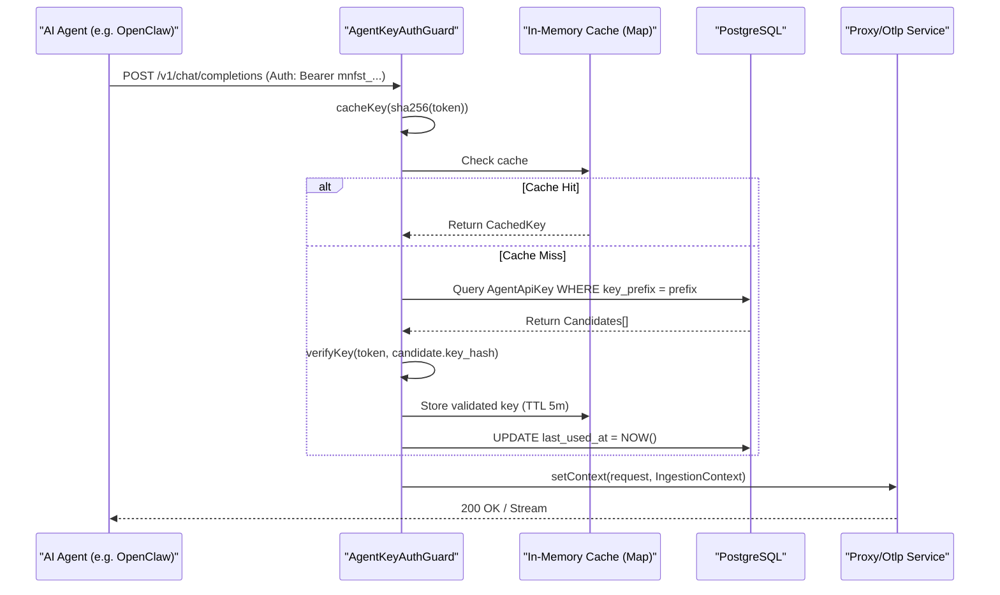

<!-- source: DeepWiki mcp.deepwiki.com · repo mnfst/manifest · page 6.2 Agent API Key Authentication · fetched 2026-10-26 -->

# Agent API Key Authentication

<details>
<summary>Relevant source files</summary>

The following files were used as context for generating this wiki page:

- [packages/backend/src/auth/session.guard.spec.ts](packages/backend/src/auth/session.guard.spec.ts)
- [packages/backend/src/auth/session.guard.ts](packages/backend/src/auth/session.guard.ts)
- [packages/backend/src/common/guards/api-key.guard.ts](packages/backend/src/common/guards/api-key.guard.ts)
- [packages/backend/src/common/utils/hash.util.spec.ts](packages/backend/src/common/utils/hash.util.spec.ts)
- [packages/backend/src/common/utils/hash.util.ts](packages/backend/src/common/utils/hash.util.ts)
- [packages/backend/src/common/utils/local-ip.ts](packages/backend/src/common/utils/local-ip.ts)
- [packages/backend/src/database/migrations/1771500000000-HashApiKeys.ts](packages/backend/src/database/migrations/1771500000000-HashApiKeys.ts)
- [packages/backend/src/database/migrations/1773900000000-AddKeyPrefixIndex.spec.ts](packages/backend/src/database/migrations/1773900000000-AddKeyPrefixIndex.spec.ts)
- [packages/backend/src/database/migrations/1773900000000-AddKeyPrefixIndex.ts](packages/backend/src/database/migrations/1773900000000-AddKeyPrefixIndex.ts)
- [packages/backend/src/main.ts](packages/backend/src/main.ts)
- [packages/backend/src/otlp/guards/agent-key-auth.guard.spec.ts](packages/backend/src/otlp/guards/agent-key-auth.guard.spec.ts)
- [packages/backend/src/otlp/guards/agent-key-auth.guard.ts](packages/backend/src/otlp/guards/agent-key-auth.guard.ts)
- [packages/backend/src/otlp/services/api-key.service.spec.ts](packages/backend/src/otlp/services/api-key.service.spec.ts)
- [packages/backend/src/otlp/services/api-key.service.ts](packages/backend/src/otlp/services/api-key.service.ts)
- [packages/backend/src/routing/oauth/openai-oauth.service.ts](packages/backend/src/routing/oauth/openai-oauth.service.ts)
- [packages/backend/src/routing/openai-oauth.service.spec.ts](packages/backend/src/routing/openai-oauth.service.spec.ts)
- [packages/backend/src/routing/proxy/proxy-error-sanitizer.spec.ts](packages/backend/src/routing/proxy/proxy-error-sanitizer.spec.ts)
- [packages/backend/src/routing/proxy/proxy-error-sanitizer.ts](packages/backend/src/routing/proxy/proxy-error-sanitizer.ts)
- [packages/frontend/src/services/api/core.ts](packages/frontend/src/services/api/core.ts)

</details>


Manifest implements a custom API key authentication system to secure communication between personal AI agents and the Manifest backend. This system is designed for high performance, utilizing in-memory caching and salted hashing via scrypt to validate requests with minimal latency.

## Implementation Overview

The authentication lifecycle revolves around the `AgentApiKey` entity and the `AgentKeyAuthGuard`. Every request to the proxy endpoints (`/v1/chat/completions`) or OTLP ingestion endpoints must include a valid Manifest API key.

### Key Characteristics
- **Prefix**: All keys use the `mnfst_` prefix for easy identification and secret scanning compatibility [[packages/backend/src/otlp/guards/agent-key-auth.guard.ts:18-18](), [packages/backend/src/otlp/guards/agent-key-auth.guard.ts:107-110](), [packages/backend/src/otlp/services/api-key.service.ts:11-11]()].
- **Hashing**: Keys are hashed using a Key Derivation Function (KDF) via `scrypt` (implemented in `hash.util.ts`). Only the first few characters are stored in plaintext as a `key_prefix` to optimize database lookups [[packages/backend/src/otlp/guards/agent-key-auth.guard.ts:155-172](), [packages/backend/src/otlp/services/api-key.service.ts:9-9]()].
- **Caching**: The `AgentKeyAuthGuard` maintains an in-memory `Map` of validated tokens to `CachedKey` objects with a 5-minute TTL to avoid redundant database hits [[packages/backend/src/otlp/guards/agent-key-auth.guard.ts:37-42]()].
- **Onboarding**: The `ApiKeyGeneratorService` orchestrates the creation of a new `Tenant`, `Agent`, and `AgentApiKey` in a single flow, ensuring a consistent setup for new integrations [[packages/backend/src/otlp/services/api-key.service.ts:30-84]()].

### Data Flow: Authentication Request
The following diagram illustrates how a request is authenticated when hitting a protected endpoint.

**Authentication Sequence**

**Sources:** [packages/backend/src/otlp/guards/agent-key-auth.guard.ts:86-116](), [packages/backend/src/otlp/guards/agent-key-auth.guard.ts:139-194]()

---

## Core Components

### AgentKeyAuthGuard
The central security gatekeeper. It extracts the token from the `Authorization` header and performs multi-stage validation.

- **Loopback Bypass**: In `development` mode, the guard allows unauthenticated requests from loopback IPs by automatically resolving a `devContext` [[packages/backend/src/otlp/guards/agent-key-auth.guard.ts:92-98](), [packages/backend/src/otlp/guards/agent-key-auth.guard.ts:131-137]()]. This facilitates local testing without needing to manage keys.
- **Context Injection**: Upon successful validation, it attaches an `IngestionContext` to the request object, providing the `tenantId`, `agentId`, `agentName`, and `userId` for downstream logic [[packages/backend/src/otlp/guards/agent-key-auth.guard.ts:127-129](), [packages/backend/src/otlp/guards/agent-key-auth.guard.ts:146-152]()].
- **Cache Management**: Automatically evicts expired entries using a 60-second cleanup timer and enforces a maximum cache size of 10,000 entries [[packages/backend/src/otlp/guards/agent-key-auth.guard.ts:42-44](), [packages/backend/src/otlp/guards/agent-key-auth.guard.ts:51-55]()].

**Sources:** [packages/backend/src/otlp/guards/agent-key-auth.guard.ts:35-55]()

### ApiKeyGeneratorService
This service handles the lifecycle of agent keys, including onboarding and rotation.

- **Agent Onboarding**: The `onboardAgent` method creates a `Tenant` (if it doesn't exist), an `Agent`, and generates the first `AgentApiKey` [[packages/backend/src/otlp/services/api-key.service.ts:30-84]()].
- **Key Rotation**: The `rotateKey` method deletes existing keys for an agent, clears the `AgentKeyAuthGuard` cache to prevent staleness, and generates a new key [[packages/backend/src/otlp/services/api-key.service.ts:116-143]()].
- **Secure Storage**: Keys are encrypted at rest using AES-256-GCM before being stored in the database [[packages/backend/src/otlp/services/api-key.service.ts:74-74](), [packages/backend/src/otlp/services/api-key.service.ts:133-133]()].

**Sources:** [packages/backend/src/otlp/services/api-key.service.ts:14-144]()

---

## Key Security Entities

The relationship between authentication logic and the database schema is defined by the following entities:

**Entity Mapping**
```mermaid
classDiagram
    class "AgentApiKey" {
        +string id
        +string key (Encrypted AES-256-GCM)
        +string key_hash (scrypt)
        +string key_prefix
        +datetime expires_at
        +datetime last_used_at
        +boolean is_active
    }
    class "Agent" {
        +string id
        +string name
        +string tenant_id
        +datetime deleted_at
    }
    class "Tenant" {
        +string id
        +string name
    }

    "AgentApiKey" --> "Agent" : "agent_id"
    "AgentApiKey" --> "Tenant" : "tenant_id"
    "Agent" --> "Tenant" : "tenant_id"
```
**Sources:** [packages/backend/src/otlp/services/api-key.service.ts:6-8](), [packages/backend/src/otlp/services/api-key.service.ts:71-81]()

---

## Technical Reference Table

| Feature | Implementation Detail | Source |
| :--- | :--- | :--- |
| **Token Prefix** | `mnfst_` | [packages/backend/src/otlp/guards/agent-key-auth.guard.ts:18-18]() |
| **KDF Hashing** | scrypt via `hash.util.ts` | [packages/backend/src/otlp/guards/agent-key-auth.guard.ts:17-17]() |
| **Encryption** | AES-256-GCM (for storage) | [packages/backend/src/otlp/services/api-key.service.ts:10-10]() |
| **Cache TTL** | 5 Minutes (300,000 ms) | [packages/backend/src/otlp/guards/agent-key-auth.guard.ts:42-42]() |
| **Cache Limit** | 10,000 Entries | [packages/backend/src/otlp/guards/agent-key-auth.guard.ts:43-43]() |
| **Min Key Length**| 12 characters | [packages/backend/src/otlp/guards/agent-key-auth.guard.ts:20-20]() |
| **Dev Bypass** | Loopback IP check | [packages/backend/src/otlp/guards/agent-key-auth.guard.ts:92-93]() |

**Sources:** [packages/backend/src/otlp/guards/agent-key-auth.guard.ts:1-55](), [packages/backend/src/otlp/services/api-key.service.ts:1-144]()

---

