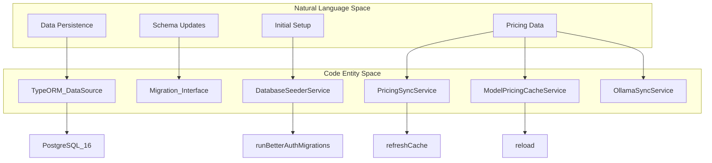
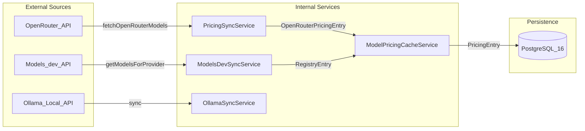

<!-- source: DeepWiki mcp.deepwiki.com · repo mnfst/manifest · page 7.2 Database Configuration and Migrations · fetched 2026-10-26 -->

# Database Configuration and Migrations

Relevant source files

The following files were used as context for generating this wiki page:

- [packages/backend/src/database/database-seeder.service.spec.ts](packages/backend/src/database/database-seeder.service.spec.ts)
- [packages/backend/src/database/database-seeder.service.ts](packages/backend/src/database/database-seeder.service.ts)
- [packages/backend/src/database/datasource.ts](packages/backend/src/database/datasource.ts)
- [packages/backend/src/database/migrations/1772960000000-PurgeNonCuratedModels.spec.ts](packages/backend/src/database/migrations/1772960000000-PurgeNonCuratedModels.spec.ts)
- [packages/backend/src/database/migrations/1772960000000-PurgeNonCuratedModels.ts](packages/backend/src/database/migrations/1772960000000-PurgeNonCuratedModels.ts)
- [packages/backend/src/database/migrations/1774000000000-WidenKeyHashColumn.spec.ts](packages/backend/src/database/migrations/1774000000000-WidenKeyHashColumn.spec.ts)
- [packages/backend/src/database/migrations/1774000000000-WidenKeyHashColumn.ts](packages/backend/src/database/migrations/1774000000000-WidenKeyHashColumn.ts)
- [packages/backend/src/database/migrations/1780000000000-DropComplexityRoutingFlag.spec.ts](packages/backend/src/database/migrations/1780000000000-DropComplexityRoutingFlag.spec.ts)
- [packages/backend/src/database/migrations/1780000000000-DropComplexityRoutingFlag.ts](packages/backend/src/database/migrations/1780000000000-DropComplexityRoutingFlag.ts)
- [packages/backend/src/database/migrations/1782200000000-AddAgentSoftDelete.spec.ts](packages/backend/src/database/migrations/1782200000000-AddAgentSoftDelete.spec.ts)
- [packages/backend/src/database/migrations/1782200000000-AddAgentSoftDelete.ts](packages/backend/src/database/migrations/1782200000000-AddAgentSoftDelete.ts)
- [packages/backend/src/database/migrations/1783000000000-AddModelRouteColumns.ts](packages/backend/src/database/migrations/1783000000000-AddModelRouteColumns.ts)
- [packages/backend/src/database/pricing-sync.service.spec.ts](packages/backend/src/database/pricing-sync.service.spec.ts)
- [packages/backend/src/database/pricing-sync.service.ts](packages/backend/src/database/pricing-sync.service.ts)
- [packages/backend/src/entities/agent-api-key.entity.ts](packages/backend/src/entities/agent-api-key.entity.ts)
- [packages/backend/src/entities/agent.entity.ts](packages/backend/src/entities/agent.entity.ts)
- [packages/backend/src/entities/api-key.entity.ts](packages/backend/src/entities/api-key.entity.ts)
- [packages/backend/src/entities/notification-log.entity.ts](packages/backend/src/entities/notification-log.entity.ts)
- [packages/backend/src/entities/notification-rule.entity.ts](packages/backend/src/entities/notification-rule.entity.ts)
- [packages/backend/src/entities/tenant.entity.ts](packages/backend/src/entities/tenant.entity.ts)
- [packages/backend/src/model-prices/model-name-normalizer.spec.ts](packages/backend/src/model-prices/model-name-normalizer.spec.ts)
- [packages/backend/src/model-prices/model-name-normalizer.ts](packages/backend/src/model-prices/model-name-normalizer.ts)
- [packages/backend/src/model-prices/model-pricing-cache.service.spec.ts](packages/backend/src/model-prices/model-pricing-cache.service.spec.ts)
- [packages/backend/src/model-prices/model-pricing-cache.service.ts](packages/backend/src/model-prices/model-pricing-cache.service.ts)

Manifest utilizes **PostgreSQL 16** as its primary and only fully supported database engine [packages/backend/src/database/datasource.ts:11-11](). While legacy versions supported SQLite (sql.js), the current architecture is optimized for PostgreSQL to ensure high-concurrency performance and multi-tenant reliability in both self-hosted Docker and cloud-managed environments.

## Data Persistence Strategy

The system relies on **TypeORM** as its Object-Relational Mapper (ORM) to abstract database interactions [packages/backend/src/database/datasource.ts:2-2](). The configuration is centralized in a `DataSource` instance that manages entity discovery and migration execution.

### Database Configuration (`datasource.ts`)
The `DataSource` is configured via environment variables, primarily `DATABASE_URL` [packages/backend/src/database/datasource.ts:5-8]().
*   **Entities**: Automatically loaded from the entity registry.
*   **Migrations**: Managed via a comprehensive list of versioned files in `packages/backend/src/database/migrations/`.

### Database Entity Space to Code Mapping
The following diagram illustrates how database management concepts map to specific NestJS services and TypeORM entities.

**Database Management Architecture**

Sources: [packages/backend/src/database/datasource.ts:4-16](), [packages/backend/src/database/database-seeder.service.ts:20-31](), [packages/backend/src/database/pricing-sync.service.ts:32-34]().

## Migration and Seeding

Manifest manages schema evolution through standard TypeORM migrations and handles initial data population through the `DatabaseSeederService`.

### Notable Migrations
The system includes several critical migrations to maintain data integrity and support new features:
*   **WidenKeyHashColumn**: Increases column width to support more robust hashing algorithms for API keys [packages/backend/src/database/migrations/1774000000000-WidenKeyHashColumn.ts:10-10]().
*   **PurgeNonCuratedModels**: Cleans up the local model catalog to focus on high-quality, verified models [packages/backend/src/database/migrations/1772960000000-PurgeNonCuratedModels.ts:10-10]().
*   **AddAgentSoftDelete**: Implements soft-deletion for agents by adding a `deleted_at` column and replacing the unique constraint on `(tenant_id, name)` with a partial unique index that only covers live rows [packages/backend/src/database/migrations/1782200000000-AddAgentSoftDelete.ts:10-32]().
*   **AddModelRouteColumns**: Purely additive migration that introduces `jsonb` route columns (`override_route`, `auto_assigned_route`, `fallback_routes`) to `tier_assignments`, `specificity_assignments`, and `header_tiers` with best-effort backfill logic [packages/backend/src/database/migrations/1783000000000-AddModelRouteColumns.ts:23-51]().
*   **DropComplexityRoutingFlag**: Removes the legacy complexity routing column once the new routing logic is authoritative [packages/backend/src/database/migrations/1780000000000-DropComplexityRoutingFlag.ts:6-6]().

### DatabaseSeederService
This service handles administrative setup and demo data population during the `onModuleInit` lifecycle [packages/backend/src/database/database-seeder.service.ts:33-58]().
*   **runBetterAuthMigrations()**: Automatically executes internal migrations required by the `Better Auth` framework by accessing `$context.runMigrations()` [packages/backend/src/database/database-seeder.service.ts:60-63]().
*   **seedAdminUser()**: Creates the default `admin@manifest.build` account using `auth.api.signUpEmail` if the user table is empty [packages/backend/src/database/database-seeder.service.ts:65-80]().
*   **seedApiKey()**: Seeds a well-known development API key (`dev-api-key-manifest-001`) for the admin user [packages/backend/src/database/database-seeder.service.ts:94-109]().
*   **seedTenantAndAgent()**: In `development` or `test` modes (controlled by `SEED_DATA=true`), it populates a demo organization, agent, and OTLP ingestion key [packages/backend/src/database/database-seeder.service.ts:123-160]().
*   **seedAgentMessages()**: Populates the dashboard with sample message logs via `seedAgentMessages` utility [packages/backend/src/database/database-seeder.service.ts:162-166]().

Sources: [packages/backend/src/database/database-seeder.service.ts:1-167](), [packages/backend/src/database/migrations/1782200000000-AddAgentSoftDelete.ts:10-32](), [packages/backend/src/database/migrations/1783000000000-AddModelRouteColumns.ts:23-51]().

## Pricing Data Synchronization

Manifest maintains a sophisticated pricing cache by aggregating data from multiple upstream sources and local providers.

**Pricing Data Flow**

Sources: [packages/backend/src/database/pricing-sync.service.ts:47-50](), [packages/backend/src/model-prices/model-pricing-cache.service.ts:35-43]().

### Synchronization Services
1.  **PricingSyncService**: Fetches global pricing from OpenRouter daily at 3 AM [packages/backend/src/database/pricing-sync.service.ts:46-49](). It filters for `isChatCompatible` models and validates that pricing is finite and non-negative [packages/backend/src/database/pricing-sync.service.ts:55-63]().
2.  **ModelPricingCacheService**: The central orchestrator. It loads OpenRouter data as a baseline and then overlays "curated" pricing from `ModelsDevSyncService`, which is the preferred source for native provider IDs [packages/backend/src/model-prices/model-pricing-cache.service.ts:67-93](). It also loads user-defined prices from the `custom_providers` table [packages/backend/src/model-prices/model-pricing-cache.service.ts:98-98]().
3.  **Normalization**: The `ModelNameNormalizer` provides strategies to resolve variant model names (e.g., `anthropic/claude-opus-4-6`) to canonical pricing entries by stripping prefixes, date suffixes, and handling known aliases like `deepseek-v3` → `deepseek-chat` [packages/backend/src/model-prices/model-name-normalizer.ts:5-16](). It uses `buildAliasMap` to create a lookup table of variants [packages/backend/src/model-prices/model-name-normalizer.ts:79-82]().

Sources: [packages/backend/src/database/pricing-sync.service.ts:1-137](), [packages/backend/src/model-prices/model-pricing-cache.service.ts:1-102](), [packages/backend/src/model-prices/model-name-normalizer.ts:1-44]().

---

