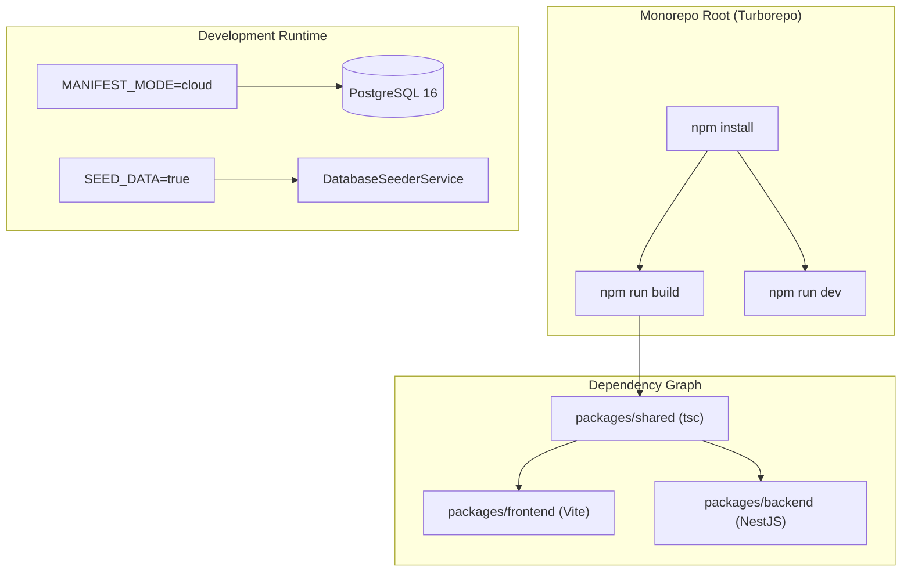
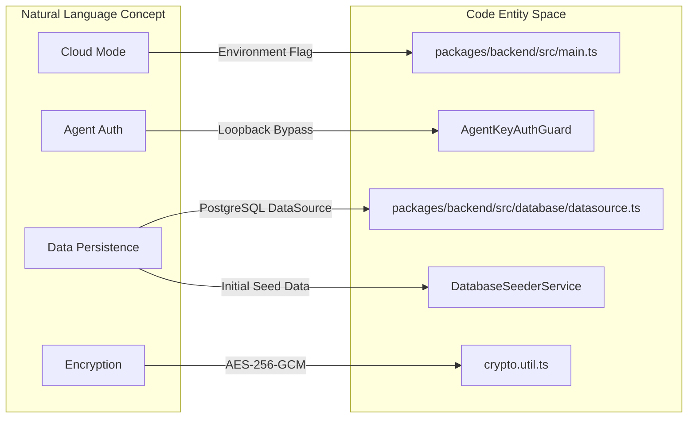
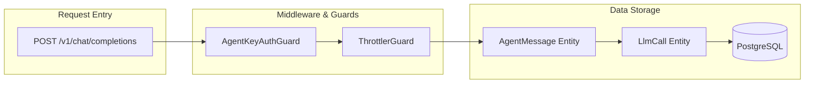

<!-- source: DeepWiki mcp.deepwiki.com · repo mnfst/manifest · page 8.1 Environment Setup · fetched 2026-10-26 -->

# Environment Setup

Relevant source files

The following files were used as context for generating this wiki page:

- [.changeset/README.md](.changeset/README.md)
- [.changeset/config.json](.changeset/config.json)
- [.github/dependabot.yml](.github/dependabot.yml)
- [.gitignore](.gitignore)
- [CLAUDE.md](CLAUDE.md)
- [CONTRIBUTING.md](CONTRIBUTING.md)
- [README.md](README.md)
- [package-lock.json](package-lock.json)
- [package.json](package.json)
- [packages/backend/.env.example](packages/backend/.env.example)
- [packages/backend/package.json](packages/backend/package.json)
- [packages/backend/src/common/common.module.ts](packages/backend/src/common/common.module.ts)
- [packages/backend/src/common/services/manifest-runtime.service.ts](packages/backend/src/common/services/manifest-runtime.service.ts)
- [packages/backend/src/config/app.config.spec.ts](packages/backend/src/config/app.config.spec.ts)
- [packages/backend/src/config/app.config.ts](packages/backend/src/config/app.config.ts)
- [packages/backend/src/routing/oauth/openai-oauth.controller.ts](packages/backend/src/routing/oauth/openai-oauth.controller.ts)
- [packages/backend/src/routing/openai-oauth.controller.spec.ts](packages/backend/src/routing/openai-oauth.controller.spec.ts)
- [packages/wingman/src/App.tsx](packages/wingman/src/App.tsx)
- [packages/wingman/src/profiles.ts](packages/wingman/src/profiles.ts)
- [turbo.json](turbo.json)

This page documents the requirements and procedures for setting up a local development environment for the Manifest monorepo. Manifest is a smart model router for personal AI agents, and its development environment is designed to simulate the cloud-managed production stack using Node.js 24 and PostgreSQL 16.

## Prerequisites

The Manifest development environment relies on the following core technologies:

| Requirement | Version | Role |
| :--- | :--- | :--- |
| **Node.js** | 24.x (LTS) | Primary runtime for Backend, Frontend, and Shared packages [CLAUDE.md:58](), [CONTRIBUTING.md:21]() |
| **npm** | 10.x | Package management and workspace orchestration [package.json:28](), [CONTRIBUTING.md:22]() |
| **Docker** | Latest | Running PostgreSQL and managing the primary distribution container [README.md:53](), [CLAUDE.md:18-20]() |
| **PostgreSQL** | 16 | Primary and only fully supported database for development and production [CONTRIBUTING.md:12](), [CLAUDE.md:56]() |

## Development Mode Requirements

Development must always be performed in `cloud` mode to ensure data integrity and feature parity with the production environment.

### MANIFEST_MODE=cloud Requirement
While Manifest historically supported a local SQLite mode, developers must now use `MANIFEST_MODE=cloud` (the default) during development [CLAUDE.md:13-15](). This is mandatory because:
1. **Concurrency**: Multiple concurrent development instances sharing one database cause cross-run data pollution and intermittent failures [CLAUDE.md:15-16]().
2. **Feature Parity**: Cloud mode uses the full Better Auth integration and PostgreSQL-specific features [CONTRIBUTING.md:12-13]().
3. **Deprecation**: SQLite/sql.js local mode and the legacy npm package are deprecated [README.md:61]().

### Fresh Database per Session
To prevent cross-instance conflicts and stale state, every development session should start with a pristine PostgreSQL database [CLAUDE.md:15-16]().

**Database Setup Workflow:**
1. Start the PostgreSQL container: `docker run -d --name postgres_db -e POSTGRES_USER=myuser -e POSTGRES_PASSWORD=mypassword -e POSTGRES_DB=mydatabase -p 5432:5432 postgres:16` [CLAUDE.md:19-20]().
2. Create a unique database for the session: `DB_NAME="manifest_$(openssl rand -hex 4)"` [CLAUDE.md:23-24]().
3. Update `DATABASE_URL` in `packages/backend/.env` with the new database string [CLAUDE.md:26-27]().
4. Set `SEED_DATA=true` in `.env` to ensure the database is populated on startup [CLAUDE.md:29-30]().

**Sources:** [CLAUDE.md:13-32](), [CONTRIBUTING.md:17-18](), [CONTRIBUTING.md:66-77]()

## Monorepo Build Pipeline

Manifest is organized as a monorepo using **npm workspaces** and **Turborepo** for task orchestration [package.json:29-35](), [CONTRIBUTING.md:24-26]().

### Project Structure
- `packages/shared`: Common TypeScript types and constants [package.json:30](), [CONTRIBUTING.md:30]().
- `packages/backend`: NestJS API server [package.json:32](), [CONTRIBUTING.md:31]().
- `packages/frontend`: SolidJS dashboard [package.json:31](), [CONTRIBUTING.md:32]().
- `packages/wingman`: Dev-only gateway tester (excluded from Docker/cloud) [package.json:34](), [CONTRIBUTING.md:33]().

### Core Commands
| Command | Action |
| :--- | :--- |
| `npm install` | Install dependencies for all workspaces [CONTRIBUTING.md:45](). |
| `npm run build` | Orchestrate production build via Turborepo [package.json:38](), [turbo.json:8-11](). |
| `npm run dev` | Start frontend and wingman in watch mode [package.json:37](), [turbo.json:4-7](). |
| `nest start --watch` | Start backend in watch mode (separate terminal) [CONTRIBUTING.md:98](). |

### Build Pipeline Logic
Titled: "Monorepo Task and Dependency Flow"

**Sources:** [package.json:29-38](), [turbo.json:1-19](), [CLAUDE.md:58-62](), [CONTRIBUTING.md:93-106]()

## Configuring Personal AI Agents for Development

To test routing logic against a local development server, personal AI agents must be configured to point to the local backend as a generic OpenAI-compatible provider.

### Testing with OpenClaw
OpenClaw integration is tested by pointing the agent at the local Manifest proxy directly. There are no longer first-party OpenClaw plugins in the Manifest repository [CLAUDE.md:9-10](), [CONTRIBUTING.md:132-136]().

**Configuration Steps:**
1. Build and start the backend on a specific port (e.g., 38238) [CLAUDE.md:40-42]().
2. Configure OpenClaw to use the dev server:
   - `openclaw config set models.providers.manifest '{"baseUrl":"http://localhost:38238/v1","api":"openai-completions","apiKey":"mnfst_YOUR_KEY","models":[{"id":"auto","name":"Manifest Auto"}]}'` [CLAUDE.md:45]().
3. Set the default model to `manifest/auto` [CLAUDE.md:46]().
4. Restart the gateway: `openclaw gateway restart` [CLAUDE.md:49]().

### Loopback Bypass (Auth)
In development, the `AgentKeyAuthGuard` implements a loopback bypass. If the request originates from a loopback address, the guard trusts the connection without requiring a valid `mnfst_*` API key [CLAUDE.md:52-53]().

### Natural Language to Code Entity Space
Titled: "System Requirements mapped to Implementation Entities"

**Sources:** [CLAUDE.md:52-53](), [CLAUDE.md:68-78](), [CLAUDE.md:99](), [CONTRIBUTING.md:118-136]()

## Backend Environment Configuration

The backend requires a `.env` file located at `packages/backend/.env`. Key variables include:

| Variable | Recommended Dev Value | Description |
| :--- | :--- | :--- |
| `PORT` | `3001` | The port the NestJS server listens on [packages/backend/.env.example:15](). |
| `BIND_ADDRESS` | `127.0.0.1` | Local bind address [packages/backend/.env.example:16](). |
| `DATABASE_URL` | `postgresql://...` | Connection string to the fresh session DB [packages/backend/.env.example:3](). |
| `BETTER_AUTH_SECRET` | `openssl rand -hex 32` | Secret for session management [packages/backend/.env.example:2](). |
| `SEED_DATA` | `true` | Auto-populates database on startup [packages/backend/.env.example:88](). |
| `MANIFEST_ENCRYPTION_KEY` | `openssl rand -hex 32` | Key for AES-256-GCM credential encryption [packages/backend/.env.example:11](). |

### Server Bootstrap Process
The `main.ts` file handles the initialization of the NestJS application. It configures security middleware such as `Helmet`, sets up the `ValidationPipe` for DTOs, and mounts the `Better Auth` instance for dashboard authentication [CLAUDE.md:68]().

### Request Flow to Entities
Titled: "Agent Request Lifecycle to Persistence"

**Sources:** [CLAUDE.md:68-88](), [CONTRIBUTING.md:13-14](), [packages/backend/src/config/app.config.ts:18-19]()

---

