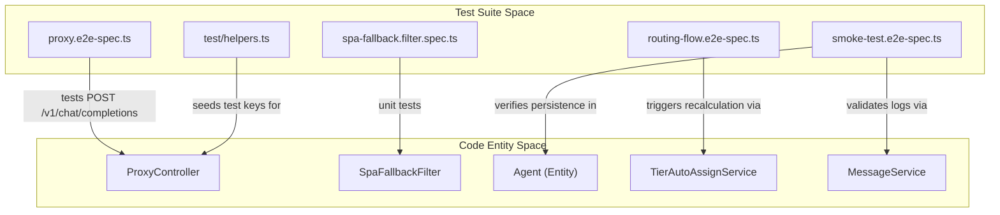
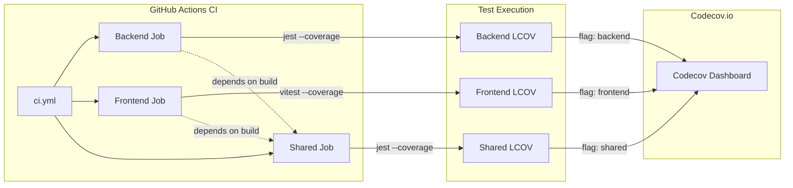

<!-- source: DeepWiki mcp.deepwiki.com · repo mnfst/manifest · page 8.2 Testing Infrastructure · fetched 2026-10-26 -->

# Testing Infrastructure

Relevant source files

The following files were used as context for generating this wiki page:

- [.github/workflows/ci.yml](.github/workflows/ci.yml)
- [.github/workflows/release.yml](.github/workflows/release.yml)
- [codecov.yml](codecov.yml)
- [packages/backend/src/app.module.ts](packages/backend/src/app.module.ts)
- [packages/backend/src/common/filters/spa-fallback.filter.spec.ts](packages/backend/src/common/filters/spa-fallback.filter.spec.ts)
- [packages/backend/src/common/filters/spa-fallback.filter.ts](packages/backend/src/common/filters/spa-fallback.filter.ts)
- [packages/backend/src/common/utils/frontend-path.spec.ts](packages/backend/src/common/utils/frontend-path.spec.ts)
- [packages/backend/src/common/utils/frontend-path.ts](packages/backend/src/common/utils/frontend-path.ts)
- [packages/backend/src/database/seed-messages.spec.ts](packages/backend/src/database/seed-messages.spec.ts)
- [packages/backend/src/database/seed-messages.ts](packages/backend/src/database/seed-messages.ts)
- [packages/backend/test/helpers.ts](packages/backend/test/helpers.ts)
- [packages/backend/test/model-prices.e2e-spec.ts](packages/backend/test/model-prices.e2e-spec.ts)
- [packages/backend/test/proxy.e2e-spec.ts](packages/backend/test/proxy.e2e-spec.ts)
- [packages/backend/test/routing-flow.e2e-spec.ts](packages/backend/test/routing-flow.e2e-spec.ts)
- [packages/backend/test/smoke-test.e2e-spec.ts](packages/backend/test/smoke-test.e2e-spec.ts)
- [packages/frontend/package.json](packages/frontend/package.json)

The Manifest testing infrastructure provides a multi-layered verification system across the monorepo, covering unit logic, integration behavior, and end-to-end (E2E) flows. The setup utilizes **Jest** for backend and shared package logic, **Vitest** for frontend components, and specialized E2E suites to validate the proxy pipeline, routing engine, and data ingestion.

## Test Orchestration and Runners

Manifest uses a workspace-aware testing strategy to run tests across the monorepo.

| Package | Test Runner | Purpose | Coverage Tool |
|:---|:---|:---|:---|
| `packages/backend` | Jest | Unit and E2E API/Proxy tests | `jest --coverage` |
| `packages/frontend` | Vitest | SolidJS component and service tests | `vitest --coverage` |
| `packages/shared` | Jest | Shared types and utility logic | `jest --coverage` |

### Cross-Package Execution
Tests are typically executed via `npm test` within specific workspaces. The CI pipeline orchestrates these runs to ensure that the `shared` package is built before backend or frontend tests execute, as they depend on its compiled output [.github/workflows/ci.yml:55-58]().

**Sources:** [.github/workflows/ci.yml:54-62](), [.github/workflows/ci.yml:106-110]().

---

## Backend Testing (NestJS & Jest)

The backend testing suite is divided into unit tests for services/controllers and E2E tests for the full application stack.

### Unit Tests
Unit tests use `@nestjs/testing` to create isolated modules. Dependencies are frequently mocked to focus on specific logic. For example, the `SpaFallbackFilter` is tested by mocking `fs` and `resolveFrontendDir` to verify it correctly handles SPA routing vs. API 404s [packages/backend/src/common/filters/spa-fallback.filter.spec.ts:3-15]().

### E2E Test Suites
E2E tests reside in `packages/backend/test/` and use `supertest` to perform HTTP requests against a running NestJS application instance. The `createTestApp` helper initializes a full `TestingModule` with a PostgreSQL database, dropping the schema and re-seeding it to ensure a clean state [packages/backend/test/helpers.ts:141-185]().

**Key E2E Test Coverage Areas:**
*   **Proxy Pipeline:** Validates `/v1/chat/completions` and `/v1/responses` authentication, header forwarding (e.g., `X-Manifest-Tier`), and error sanitization [packages/backend/test/proxy.e2e-spec.ts:68-180]().
*   **Routing Flow:** Validates that the scoring engine correctly classifies queries (e.g., "hi" vs. complex React components) and routes them to the appropriate model tier [packages/backend/test/routing-flow.e2e-spec.ts:148-195]().
*   **Smoke Test:** A sequential suite of 9 tests covering the entire lifecycle: auth, agent creation, data seeding, routing, and fallback chains [packages/backend/test/smoke-test.e2e-spec.ts:1-7]().
*   **Model Prices:** Validates the pricing synchronization and cache reload logic [packages/backend/test/model-prices.e2e-spec.ts]().

### Data Entity to Test Entity Mapping
This diagram shows how production code entities are exercised by specific test suites and helpers.

**Code to Test Mapping**

**Sources:** [packages/backend/test/proxy.e2e-spec.ts:68-70](), [packages/backend/src/common/filters/spa-fallback.filter.spec.ts:42-45](), [packages/backend/test/routing-flow.e2e-spec.ts:143-146](), [packages/backend/test/helpers.ts:182-186](), [packages/backend/test/smoke-test.e2e-spec.ts:137-140]().

---

## Database Seeding and Test Data

Manifest utilizes a combination of manual SQL seeding in tests and a deterministic data generator for large datasets.

### Test Application Lifecycle
The `createTestApp` function handles the bootstrap process for E2E tests:
1.  **Environment Setup:** Sets `NODE_ENV` to `test` and configures a `BETTER_AUTH_SECRET` [.github/workflows/ci.yml:43-46](), [packages/backend/test/helpers.ts:143-144]().
2.  **Mocking:** Overrides the `SessionGuard` with a `MockSessionGuard` to bypass dashboard authentication during tests [packages/backend/test/helpers.ts:119-139]().
3.  **Seeding:** Manually inserts a test `Tenant`, `Agent`, and `AgentApiKey` (hashed) into the PostgreSQL database to allow immediate API access [packages/backend/test/helpers.ts:182-200]().

### Deterministic Message Seeder
The `seedAgentMessages` utility generates realistic, time-series telemetry data for development and testing. It uses a `seededRandom` function to ensure that generated IDs, timestamps, and token counts are reproducible across runs [packages/backend/src/database/seed-messages.ts:12-15](). It generates ~4-8 messages per hour over a 7-day window, simulating realistic work-hour patterns [packages/backend/src/database/seed-messages.ts:41-50]().

**Sources:** [packages/backend/src/database/seed-messages.ts:17-90](), [packages/backend/test/helpers.ts:141-200]().

---

## Continuous Integration & Coverage

Manifest uses GitHub Actions and Codecov for automated quality assurance.

### CI Workflow (`ci.yml`)
The CI pipeline runs on every push to `main` and all pull requests. It executes the following matrix:
1.  **Linting:** Runs `npm run lint` across the monorepo [.github/workflows/ci.yml:22]().
2.  **Backend (PostgreSQL):** Spins up a `postgres:16` service and runs both unit and E2E tests with coverage [.github/workflows/ci.yml:24-62]().
3.  **Frontend:** Builds the SolidJS app and runs Vitest tests [.github/workflows/ci.yml:72-86]().
4.  **Shared:** Validates the shared utility package [.github/workflows/ci.yml:98-108]().

### Codecov Integration
Coverage reports are generated in `lcov` format and uploaded to Codecov with per-flag separation [.github/workflows/ci.yml:65-68](). The `codecov.yml` file maps these flags to specific directory paths to provide granular coverage insights [codecov.yml:13-22]().

**Infrastructure Flow**

**Sources:** [.github/workflows/ci.yml:12-117](), [codecov.yml:1-22]().

## Release Verification

During the release process, the `release.yml` workflow performs a version bump detection by comparing the `package.json` version between the `BEFORE_SHA` and `AFTER_SHA` of the push event [.github/workflows/release.yml:42-73](). This ensures that Docker tags and GitHub Releases are only created when a substantive version change has occurred, preventing clobbering of existing artifacts [.github/workflows/release.yml:52-58]().

**Sources:** [.github/workflows/release.yml:14-117]().

---

