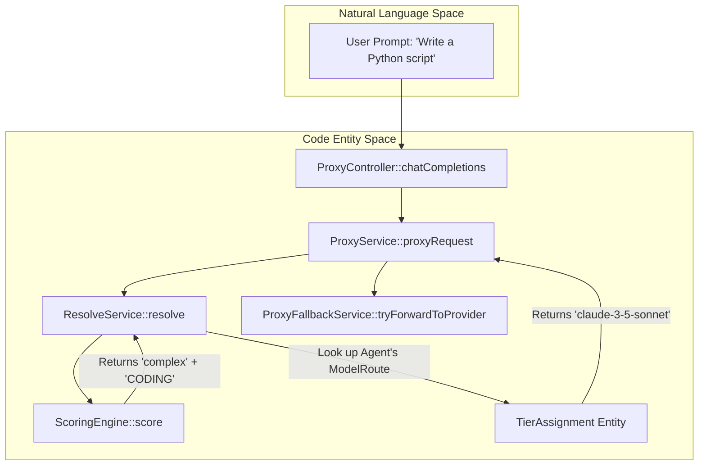
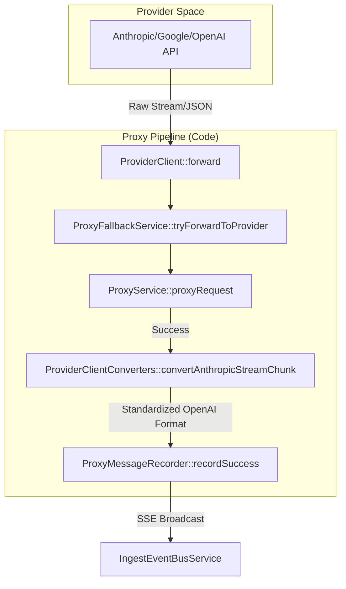

<!-- source: DeepWiki mcp.deepwiki.com · repo mnfst/manifest · page 9 Glossary · fetched 2026-10-26 -->

# Glossary

Relevant source files

The following files were used as context for generating this wiki page:

- [.changeset/README.md](.changeset/README.md)
- [.changeset/config.json](.changeset/config.json)
- [.changeset/copilot-codex-routing.md](.changeset/copilot-codex-routing.md)
- [.github/dependabot.yml](.github/dependabot.yml)
- [.gitignore](.gitignore)
- [CLAUDE.md](CLAUDE.md)
- [CONTRIBUTING.md](CONTRIBUTING.md)
- [README.md](README.md)
- [package-lock.json](package-lock.json)
- [package.json](package.json)
- [packages/backend/package.json](packages/backend/package.json)
- [packages/backend/src/common/constants/openai-models.ts](packages/backend/src/common/constants/openai-models.ts)
- [packages/backend/src/routing/proxy/__tests__/provider-client-converters.spec.ts](packages/backend/src/routing/proxy/__tests__/provider-client-converters.spec.ts)
- [packages/backend/src/routing/proxy/__tests__/provider-client.spec.ts](packages/backend/src/routing/proxy/__tests__/provider-client.spec.ts)
- [packages/backend/src/routing/proxy/__tests__/provider-endpoints.spec.ts](packages/backend/src/routing/proxy/__tests__/provider-endpoints.spec.ts)
- [packages/backend/src/routing/proxy/__tests__/proxy-response-handler.spec.ts](packages/backend/src/routing/proxy/__tests__/proxy-response-handler.spec.ts)
- [packages/backend/src/routing/proxy/__tests__/proxy.controller.spec.ts](packages/backend/src/routing/proxy/__tests__/proxy.controller.spec.ts)
- [packages/backend/src/routing/proxy/__tests__/proxy.service.spec.ts](packages/backend/src/routing/proxy/__tests__/proxy.service.spec.ts)
- [packages/backend/src/routing/proxy/chatgpt-adapter.spec.ts](packages/backend/src/routing/proxy/chatgpt-adapter.spec.ts)
- [packages/backend/src/routing/proxy/chatgpt-adapter.ts](packages/backend/src/routing/proxy/chatgpt-adapter.ts)
- [packages/backend/src/routing/proxy/provider-client-converters.ts](packages/backend/src/routing/proxy/provider-client-converters.ts)
- [packages/backend/src/routing/proxy/provider-client.ts](packages/backend/src/routing/proxy/provider-client.ts)
- [packages/backend/src/routing/proxy/provider-endpoints.ts](packages/backend/src/routing/proxy/provider-endpoints.ts)
- [packages/backend/src/routing/proxy/proxy-response-handler.ts](packages/backend/src/routing/proxy/proxy-response-handler.ts)
- [packages/backend/src/routing/proxy/proxy-types.ts](packages/backend/src/routing/proxy/proxy-types.ts)
- [packages/backend/src/routing/proxy/proxy.controller.ts](packages/backend/src/routing/proxy/proxy.controller.ts)
- [packages/backend/src/routing/proxy/proxy.service.ts](packages/backend/src/routing/proxy/proxy.service.ts)
- [packages/frontend/src/components/FallbackList.tsx](packages/frontend/src/components/FallbackList.tsx)
- [packages/frontend/src/components/ModelParamsDialog.tsx](packages/frontend/src/components/ModelParamsDialog.tsx)
- [packages/frontend/src/pages/RoutingTierCard.tsx](packages/frontend/src/pages/RoutingTierCard.tsx)
- [packages/frontend/src/styles/routing.css](packages/frontend/src/styles/routing.css)
- [packages/frontend/tests/components/FallbackList.test.tsx](packages/frontend/tests/components/FallbackList.test.tsx)
- [packages/frontend/tests/pages/RoutingTierCard.test.tsx](packages/frontend/tests/pages/RoutingTierCard.test.tsx)
- [packages/manifest/CHANGELOG.md](packages/manifest/CHANGELOG.md)
- [packages/manifest/package.json](packages/manifest/package.json)
- [packages/shared/__tests__/subscription.spec.ts](packages/shared/__tests__/subscription.spec.ts)
- [packages/shared/__tests__/thinking-defaults.spec.ts](packages/shared/__tests__/thinking-defaults.spec.ts)
- [packages/shared/src/index.ts](packages/shared/src/index.ts)
- [packages/shared/src/subscription/configs.ts](packages/shared/src/subscription/configs.ts)
- [packages/shared/src/thinking-defaults.ts](packages/shared/src/thinking-defaults.ts)
- [turbo.json](turbo.json)

This glossary defines technical terms, domain-specific jargon, and infrastructure concepts used within the Manifest codebase. It provides code pointers to implementations to assist onboarding engineers in navigating the monorepo.

## Routing Tiers and Scoring

Manifest categorizes LLM requests into "Tiers" based on complexity. This allows the system to route simple requests to inexpensive models (e.g., GPT-4o-mini) and complex reasoning tasks to high-end models (e.g., o1).

| Term | Definition | Code Pointer |
| :--- | :--- | :--- |
| **Tier** | A classification level for a request. Possible values: `simple`, `standard`, `complex`, `reasoning`. | [packages/backend/src/scoring/types.ts:12-12]() |
| **Scoring Engine** | The algorithm that analyzes message content, tool definitions, and history to assign a tier. | [packages/backend/src/routing/proxy/proxy.service.ts:145-151]() |
| **Tier Assignment** | The mapping of a specific Tier to a concrete Model and Provider for a given Agent. | [packages/backend/src/entities/tier-assignment.entity.ts:1-20]() |
| **Specificity Category** | A specialized classification (e.g., `CODING`, `TRADING`) that can override the general complexity tier. | [packages/backend/src/routing/proxy/proxy.service.ts:13-14]() |
| **Specificity Penalty** | A system that applies per-category weight penalties based on user-flagged miscategorizations to prevent over-routing. | [packages/manifest/CHANGELOG.md:21-31]() |
| **ModelRoute** | The structured shape `(provider, authType, model)` used as the primary identity for routing since version 6.0.0. | [packages/backend/src/routing/proxy/proxy-types.ts:22-30]() |
| **Param Defaults** | Per-assignment JSONB defaults (e.g., DeepSeek's thinking toggle) merged into the request body before forwarding. | [packages/manifest/CHANGELOG.md:19-21]() |

### Data Flow: Natural Language to Tier Assignment
The following diagram illustrates how a natural language request is transformed into a specific code-driven routing decision.

**Request Classification Flow**

Sources: [packages/backend/src/routing/proxy/proxy.controller.ts:172-207](), [packages/backend/src/routing/proxy/proxy.service.ts:118-176](), [packages/backend/src/routing/proxy/proxy-fallback.service.ts:157-172]()

---

## Agent Concepts

Manifest is built around "Agents," representing the identity of the software calling the LLM.

*   **Agent**: A logical entity representing an LLM application. It owns routing configuration, API keys, and logs. [packages/backend/src/entities/agent.entity.ts:1-15]().
*   **Agent API Key**: A credential prefixed with `mnfst_` used by agents to authenticate proxy requests. These are hashed using scrypt. [packages/backend/src/entities/agent-api-key.entity.ts:1-10](), [packages/backend/src/common/utils/hash.util.ts:98-98]().
*   **Ingestion Context**: A metadata object attached to requests containing the `agentId`, `tenantId`, and `agentName` resolved from the API key. [packages/backend/src/routing/proxy/proxy.controller.ts:62-67]().
*   **Session Momentum**: A mechanism that tracks recent tiers in a conversation to prevent "tier-jittering" (switching models too frequently in one chat). [packages/backend/src/routing/proxy/proxy.service.ts:101-110]().
*   **Wingman**: An in-dashboard gateway tester for contributors to impersonate various agent SDKs during development. [packages/manifest/CHANGELOG.md:62-63]().

---

## Proxy Internals

The proxy is the core of Manifest, acting as an OpenAI-compatible gateway.

*   **Fallback Chain**: A list of `fallback_routes` defined in the `TierAssignment`. If the primary model fails (e.g., 4xx/5xx), the proxy iterates through these. [packages/backend/src/routing/proxy/proxy.service.ts:112-112](), [packages/backend/src/routing/proxy/proxy-fallback.service.ts:181-190]().
*   **Responses API**: A specialized mode for models like `o1-pro` and `gpt-5-codex` that use the `/v1/responses` endpoint instead of `/v1/chat/completions`. [packages/backend/src/routing/proxy/provider-client.ts:169-175]().
*   **Thought Signature Cache**: Stores reasoning tokens for models like `o1` to maintain state across streamed chunks. [packages/backend/src/routing/proxy/thought-signature-cache.ts:1-10]().
*   **Thinking Block Cache**: A cache for Anthropic-style "thinking" blocks to ensure continuity in streaming. [packages/backend/src/routing/proxy/thinking-block-cache.ts:1-10]().
*   **Stream Warm-up**: A mechanism that verifies the provider starts delivering data before committing the response to the client. [packages/backend/src/routing/proxy/proxy.service.ts:32-37]().
*   **Proxy Rate Limiter**: Enforces concurrency (10 slots) and request-per-minute limits (200 req/60s). [packages/backend/src/routing/proxy/proxy.controller.ts:158-165]().

### Data Flow: Proxy Response Handling
This diagram shows how the system handles the response from an upstream provider and converts it for the client.

**Response Transformation**

Sources: [packages/backend/src/routing/proxy/proxy.controller.ts:172-207](), [packages/backend/src/routing/proxy/provider-client.ts:85-149](), [packages/backend/src/routing/proxy/proxy-message-recorder.ts:147-157]()

---

## Authentication and Provider Types

| Type | Description | Code Pointer |
| :--- | :--- | :--- |
| **API Key** | Standard `sk-...` style keys for direct provider access. | [packages/backend/src/routing/proxy/proxy-fallback.service.ts:19-20]() |
| **Subscription** | Credentials obtained via OAuth (OpenAI/MiniMax) or browser tokens for "Pro" accounts. | [packages/backend/src/routing/proxy/proxy.service.ts:165-166]() |
| **Custom Provider** | User-defined OpenAI/Anthropic-compatible endpoints with SSRF protection. | [packages/backend/src/routing/proxy/provider-client.ts:158-160]() |
| **OpenCode Go** | A subscription-based aggregator for models like Qwen, MiniMax, and Kimi. | [packages/backend/src/routing/proxy/provider-client.ts:181-187]() |
| **Loopback Bypass** | A development security exception allowing local connections to bypass `mnfst_` key requirements. | [CLAUDE.md:52-52]() |

---

## Infrastructure and Data Model

*   **Tenant**: The top-level multi-tenant entity that owns all other data. [packages/backend/src/entities/tenant.entity.ts:1-10]().
*   **Pricing Sync**: Background service fetching costs from OpenRouter and models.dev. [packages/backend/src/database/pricing-sync.service.ts:80-80]().
*   **Model Discovery**: The pipeline for querying provider APIs to find available chat models. [packages/backend/src/routing/routing-core/provider-model-fetcher.service.ts:1-20]().
*   **Limit Check**: Service that enforces hard cost/token limits and sends threshold alerts. [packages/backend/src/notifications/services/limit-check.service.ts:1-20]().
*   **Manifest Error Codes**: Stable `M###` error codes (e.g., `M100` for missing keys, `M200` for limits) embedded in proxy responses. [packages/backend/src/routing/proxy/proxy.service.ts:168-169]().

Sources: [README.md:38-70](), [CONTRIBUTING.md:9-15](), [CLAUDE.md:1-10](), [packages/backend/src/routing/proxy/proxy.service.ts:1-116](), [packages/backend/src/routing/proxy/provider-client.ts:1-189]()