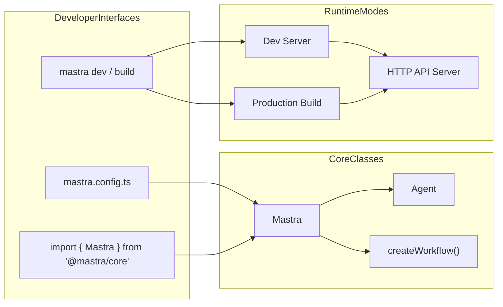

<!-- source: DeepWiki mcp.deepwiki.com · repo mastra-ai/mastra · page 1 Overview · fetched 2026-10-26 -->

# Overview

Relevant source files

The following files were used as context for generating this wiki page:

- [.claude/skills/mastra-docs/SKILL.md](.claude/skills/mastra-docs/SKILL.md)
- [.claude/skills/mastra-docs/references/DOC.md](.claude/skills/mastra-docs/references/DOC.md)
- [.claude/skills/mastra-docs/references/GUIDE_INTEGRATION.md](.claude/skills/mastra-docs/references/GUIDE_INTEGRATION.md)
- [.claude/skills/mastra-docs/references/REFERENCE.md](.claude/skills/mastra-docs/references/REFERENCE.md)
- [.claude/skills/mastra-docs/references/STYLEGUIDE.md](.claude/skills/mastra-docs/references/STYLEGUIDE.md)
- [.github/ISSUE_TEMPLATE/bug_report.yml](.github/ISSUE_TEMPLATE/bug_report.yml)
- [.github/ISSUE_TEMPLATE/config.yml](.github/ISSUE_TEMPLATE/config.yml)
- [.github/ISSUE_TEMPLATE/feature_request.yml](.github/ISSUE_TEMPLATE/feature_request.yml)
- [.github/ISSUE_TEMPLATE/integration_request.yml](.github/ISSUE_TEMPLATE/integration_request.yml)
- [.github/PULL_REQUEST_TEMPLATE.md](.github/PULL_REQUEST_TEMPLATE.md)
- [CONTRIBUTING.md](CONTRIBUTING.md)
- [DEVELOPMENT.md](DEVELOPMENT.md)
- [README.md](README.md)
- [auth/better-auth/package.json](auth/better-auth/package.json)
- [deployers/cloud/package.json](deployers/cloud/package.json)
- [docs/.oxfmtrc.json](docs/.oxfmtrc.json)
- [docs/AGENTS.md](docs/AGENTS.md)
- [docs/CONTRIBUTING.md](docs/CONTRIBUTING.md)
- [docs/package.json](docs/package.json)
- [docs/src/content/en/docs/agents/code-mode.mdx](docs/src/content/en/docs/agents/code-mode.mdx)
- [docs/src/content/en/reference/tools/create-code-mode.mdx](docs/src/content/en/reference/tools/create-code-mode.mdx)
- [e2e-tests/_local-registry-setup/pnpm-lock.yaml](e2e-tests/_local-registry-setup/pnpm-lock.yaml)
- [e2e-tests/_local-registry-setup/pnpm-workspace.yaml](e2e-tests/_local-registry-setup/pnpm-workspace.yaml)
- [e2e-tests/commonjs/template/package.json](e2e-tests/commonjs/template/package.json)
- [e2e-tests/experiment-worker/pnpm-lock.yaml](e2e-tests/experiment-worker/pnpm-lock.yaml)
- [e2e-tests/experiment-worker/pnpm-workspace.yaml](e2e-tests/experiment-worker/pnpm-workspace.yaml)
- [e2e-tests/monorepo/template/package.json](e2e-tests/monorepo/template/package.json)
- [e2e-tests/no-bundling/template/package.json](e2e-tests/no-bundling/template/package.json)
- [e2e-tests/pkg-outputs/pnpm-lock.yaml](e2e-tests/pkg-outputs/pnpm-lock.yaml)
- [e2e-tests/softwarefactory/pnpm-lock.yaml](e2e-tests/softwarefactory/pnpm-lock.yaml)
- [e2e-tests/softwarefactory/pnpm-workspace.yaml](e2e-tests/softwarefactory/pnpm-workspace.yaml)
- [examples/README.md](examples/README.md)
- [examples/agent-builder/package.json](examples/agent-builder/package.json)
- [examples/agent-builder/pnpm-lock.yaml](examples/agent-builder/pnpm-lock.yaml)
- [examples/agent/package.json](examples/agent/package.json)
- [examples/agent/pnpm-lock.yaml](examples/agent/pnpm-lock.yaml)
- [examples/agent/pnpm-workspace.yaml](examples/agent/pnpm-workspace.yaml)
- [examples/durable-agents/package.json](examples/durable-agents/package.json)
- [examples/durable-agents/pnpm-lock.yaml](examples/durable-agents/pnpm-lock.yaml)
- [examples/evals-with-memory/package.json](examples/evals-with-memory/package.json)
- [examples/evals-with-memory/pnpm-lock.yaml](examples/evals-with-memory/pnpm-lock.yaml)
- [examples/evals-with-memory/pnpm-workspace.yaml](examples/evals-with-memory/pnpm-workspace.yaml)
- [examples/voice-agent/pnpm-lock.yaml](examples/voice-agent/pnpm-lock.yaml)
- [package.json](package.json)
- [packages/agent-builder/integration-tests/package.json](packages/agent-builder/integration-tests/package.json)
- [packages/agent-builder/integration-tests/pnpm-lock.yaml](packages/agent-builder/integration-tests/pnpm-lock.yaml)
- [packages/core/package.json](packages/core/package.json)
- [packages/deployer/package.json](packages/deployer/package.json)
- [packages/mcp/integration-tests/package.json](packages/mcp/integration-tests/package.json)
- [packages/mcp/integration-tests/pnpm-lock.yaml](packages/mcp/integration-tests/pnpm-lock.yaml)
- [packages/mcp/integration-tests/pnpm-workspace.yaml](packages/mcp/integration-tests/pnpm-workspace.yaml)
- [packages/memory/integration-tests/package.json](packages/memory/integration-tests/package.json)
- [packages/memory/integration-tests/pnpm-lock.yaml](packages/memory/integration-tests/pnpm-lock.yaml)
- [packages/memory/integration-tests/pnpm-workspace.yaml](packages/memory/integration-tests/pnpm-workspace.yaml)
- [packages/playground/e2e/kitchen-sink/package.json](packages/playground/e2e/kitchen-sink/package.json)
- [packages/playground/e2e/kitchen-sink/pnpm-lock.yaml](packages/playground/e2e/kitchen-sink/pnpm-lock.yaml)
- [packages/playground/e2e/kitchen-sink/pnpm-workspace.yaml](packages/playground/e2e/kitchen-sink/pnpm-workspace.yaml)
- [packages/server/package.json](packages/server/package.json)
- [pnpm-lock.yaml](pnpm-lock.yaml)
- [pnpm-workspace.yaml](pnpm-workspace.yaml)
- [scripts/gh-dane-command/index.ts](scripts/gh-dane-command/index.ts)
- [scripts/gh-dane-command/package.json](scripts/gh-dane-command/package.json)
- [server-adapters/express/package.json](server-adapters/express/package.json)
- [server-adapters/fastify/package.json](server-adapters/fastify/package.json)
- [server-adapters/hono/package.json](server-adapters/hono/package.json)
- [server-adapters/koa/package.json](server-adapters/koa/package.json)
- [templates/weather-agent/README.md](templates/weather-agent/README.md)
- [templates/weather-agent/package.json](templates/weather-agent/package.json)
- [voice/azure/package.json](voice/azure/package.json)
- [voice/gladia/package.json](voice/gladia/package.json)
- [voice/murf/package.json](voice/murf/package.json)
- [voice/murf/src/index.ts](voice/murf/src/index.ts)
- [voice/speechify/package.json](voice/speechify/package.json)

## Purpose and Scope

This document provides a high-level introduction to the Mastra framework, an AI application development platform for building agent-based systems, workflows, and tools. It covers the framework's architecture, package organization, and how the major systems interconnect.

For detailed information about specific subsystems, see:
- Package organization and dependencies → [Monorepo Structure and Package Organization](#1.1)
- High-level system architecture → [System Architecture Overview](#1.2)
- Core configuration and initialization → [Mastra Core and Configuration](#2)
- Agent execution → [Agent System](#3)
- Workflow orchestration → [Workflow System](#4)
- Model providers → [Model Provider System](#5)
- Memory architecture → [Memory and Storage Architecture](#7)
- Development and deployment → [CLI and Development Tools](#8)

Sources: [packages/core/package.json:1-165](), [packages/server/package.json:1-157](), [packages/deployer/package.json:1-165]()

## What is Mastra?

Mastra is a TypeScript-based framework for building production AI applications. It provides:

- **Agent execution engine**: LLM integration, tool calling, and memory management.
- **Workflow system**: Multi-step processes with state management, suspend/resume, and durability.
- **Model provider abstraction**: Supporting numerous providers and models through a unified interface.
- **Memory architecture**: Working memory, observational memory, and semantic recall.
- **Development tools**: CLI (`mastra`), hot-reload dev server, and deployment to multiple platforms.
- **API server**: HTTP endpoints (via `hono`) and client SDKs for browser and Node.js environments.

Sources: [packages/core/package.json:1-165](), [packages/server/package.json:1-157](), [packages/deployer/package.json:1-165]()

## Monorepo Structure

The Mastra codebase is organized as a pnpm monorepo using `pnpm workspaces` and `turbo`.

### Monorepo Organization
The following diagram maps the high-level system categories to their physical locations in the repository.

### Monorepo Layout Diagram

```mermaid
graph TB
    Root["mastra-turbo<br/>(monorepo root)"]
    
    Root --> Packages["packages/<br/>Core framework packages"]
    Root --> ClientSDKs["client-sdks/<br/>JS and React SDKs"]
    Root --> Deployers["deployers/<br/>Platform deployers"]
    Root --> Stores["stores/<br/>Storage adapters"]
    Root --> Voice["voice/<br/>Voice & Speech providers"]
    Root --> Examples["examples/<br/>Sample applications"]
    Root --> AgentSDKs["agent-sdks/<br/>External SDK Wrappers"]
    Root --> Workspaces["workspaces/<br/>Filesystem & Sandbox providers"]
    Root --> Mastracode["mastracode/<br/>Software Factory"]
    Root --> ServerAdapters["server-adapters/<br/>Framework-specific server integrations"]
    Root --> Integrations["integrations/<br/>Third-party tool integrations"]
    Root --> Auth["auth/<br/>Authentication providers"]
    Root --> Observability["observability/<br/>Tracing & Metrics"]
    Root --> Channels["channels/<br/>Agent communication channels"]
    Root --> Pubsub["pubsub/<br/>Event system"]
    Root --> Signals["signals/<br/>Agent signal providers"]
    Root --> Workflows["workflows/<br/>Workflow engines"]
    
    Packages --> Core["@mastra/core<br/>Agent, Workflow, Memory"]
    Packages --> CLI["mastra<br/>CLI commands"]
    Packages --> Server["@mastra/server<br/>API routes & handlers"]
    Packages --> Deployer["@mastra/deployer<br/>Build & bundle system"]
    Packages --> MCP["@mastra/mcp<br/>MCP client & server"]
    Packages --> RAG["@mastra/rag<br/>Document processing"]
    Packages --> AgentBuilder["@mastra/agent-builder<br/>Agent templating"]
    Packages --> Editor["@mastra/editor<br/>CMS-style editor"]
    Packages --> SchemaCompat["@mastra/schema-compat<br/>Schema compatibility"]
    Packages --> BackgroundTasks["@mastra/background-tasks<br/>Background task management"]
    Packages --> Browser["@mastra/browser<br/>Browser automation"]
    Packages --> Datasets["@mastra/datasets<br/>Evaluation datasets"]
    Packages --> Evals["@mastra/evals<br/>Evaluation system"]
    Packages --> Memory["@mastra/memory<br/>Memory system"]
    Packages --> ObservabilityCore["@mastra/observability<br/>Core observability"]
    Packages --> Scheduler["@mastra/scheduler<br/>Scheduling system"]
    Packages --> Tool["@mastra/tool<br/>Tool definitions"]
    Packages --> AgentController["@mastra/agent-controller<br/>Interactive agent sessions"]

    ClientSDKs --> ClientJS["@mastra/client-js<br/>HTTP client"]
    ClientSDKs --> React["@mastra/react<br/>React hooks & components"]
    ClientSDKs --> AISDK["@mastra/ai-sdk<br/>AI SDK adapter"]
    
    AgentSDKs --> Claude["@mastra/claude<br/>Claude SDK Agent"]
    AgentSDKs --> Cursor["@mastra/cursor<br/>Cursor SDK Agent"]
    AgentSDKs --> OpenAI["@mastra/openai<br/>OpenAI SDK Agent"]
    
    Deployers --> Cloud["@mastra/deployer-cloud<br/>Cloud deployer"]
    
    Stores --> PG["@mastra/pg<br/>PostgreSQL"]
    Stores --> LibSQL["@mastra/libsql<br/>LibSQL/SQLite"]
    Stores --> Upstash["@mastra/upstash<br/>Upstash Redis/Kafka"]
    
    Voice --> ElevenLabs["@mastra/voice-elevenlabs"]
    Voice --> Deepgram["@mastra/voice-deepgram"]

    Workspaces --> E2B["@mastra/e2b<br/>Sandbox"]
    Workspaces --> S3["@mastra/s3<br/>Filesystem"]
    Workspaces --> Railway["@mastra/railway<br/>Sandbox"]
    Workspaces --> Mesa["@mastra/mesa<br/>Filesystem"]
    Workspaces --> Apple["@mastra/apple-container<br/>Sandbox"]
    Workspaces --> CodeMode["@mastra/code-mode<br/>Isolated code execution"]

    Mastracode --> SDK["mastracode/sdk<br/>Harness SDK"]
    Mastracode --> TUI["mastracode/tui<br/>Terminal UI"]
    Mastracode --> Factory["mastracode/factory<br/>Software Factory server"]
    Mastracode --> FactoryUI["mastracode/factory-ui<br/>Factory UI"]
    Mastracode --> MastraFactory["mastracode/mastra-factory<br/>Factory scaffolding"]

    ServerAdapters --> Hono["@mastra/hono<br/>Hono adapter"]
    ServerAdapters --> Express["@mastra/express<br/>Express adapter"]
    ServerAdapters --> Fastify["@mastra/fastify<br/>Fastify adapter"]
    ServerAdapters --> Koa["@mastra/koa<br/>Koa adapter"]
    ServerAdapters --> NestJS["@mastra/nestjs<br/>NestJS adapter"]
    ServerAdapters --> NextJS["@mastra/nextjs<br/>Next.js adapter"]
    ServerAdapters --> TanStackStart["@mastra/tanstack-start<br/>TanStack Start adapter"]

    Integrations --> BrightData["@mastra/brightdata"]
    Integrations --> Perplexity["@mastra/perplexity"]
    Integrations --> Tavily["@mastra/tavily"]
    Integrations --> Parallel["@mastra/parallel"]
    Integrations --> OpenCode["@mastra/opencod"]
    Integrations --> LiveKit["@mastra/livekit"]
    Integrations --> Connect["@mastra/connect<br/>Platform connections"]

    Auth --> Auth0["@mastra/auth0"]
    Auth --> BetterAuth["@mastra/better-auth"]
    Auth --> Clerk["@mastra/clerk"]
    Auth --> Firebase["@mastra/firebase"]
    Auth --> Google["@mastra/google"]
    Auth --> Neon["@mastra/neon"]
    Auth --> Okta["@mastra/okta"]
    Auth --> Supabase["@mastra/supabase"]
    Auth --> WorkOS["@mastra/workos"]
    Auth --> StudioCloud["@mastra/studio-cloud"]

    Observability --> Braintrust["@mastra/braintrust"]
    Observability --> Langfuse["@mastra/langfuse"]
    Observability --> Langsmith["@mastra/langsmith"]
    Observability --> Datadog["@mastra/datadog"]
    Observability --> Arize["@mastra/arize"]
    Observability --> Sentry["@mastra/sentry"]
    Observability --> PostHog["@mastra/posthog"]
    Observability --> Laminar["@mastra/laminar"]
    Observability --> Arthur["@mastra/arthur"]
    Observability --> DeepEval["@mastra/deepeval"]
    Observability --> OTel["@mastra/otel"]

    Channels --> Slack["@mastra/slack"]
    Channels --> Telegram["@mastra/telegram"]
    Channels --> Discord["@mastra/discord"]

    Pubsub --> Redis["@mastra/redis"]
    Pubsub --> Valkey["@mastra/valkey"]
    Pubsub --> GoogleCloudPubSub["@mastra/google-cloud-pubsub"]

    Signals --> GitHub["@mastra/github-signals"]

    Workflows --> Inngest["@mastra/inngest<br/>Inngest durability"]
    Workflows --> Temporal["@mastra/temporal<br/>Temporal durability"]
```

Sources: [pnpm-workspace.yaml:1-34](), [packages/core/package.json:1-165](), [packages/deployer/package.json:1-165](), [packages/server/package.json:1-157](), [server-adapters/fastify/package.json:1-72](), [server-adapters/hono/package.json:1-76](), [server-adapters/koa/package.json:1-74](), [server-adapters/express/package.json:1-77](), [deployers/cloud/package.json:1-72]()

## Core Package Dependencies

The dependency graph shows how packages relate to each other:

| Package | Description | Key Dependencies |
|---------|-------------|------------------|
| `@mastra/core` | Framework core (Agent, Workflow, Tools, Memory) | `zod`, `hono` [packages/core/package.json:115]() |
| `mastra` (CLI) | Development server, build commands | `@mastra/core`, `@mastra/deployer`, `commander` [package.json:38]() |
| `@mastra/server` | HTTP API layer with handlers | `@mastra/core`, `hono` [packages/server/package.json:112](), [packages/server/package.json:155]() |
| `@mastra/deployer` | Build system and platform abstraction | `@mastra/server`, `rollup`, `esbuild` [packages/deployer/package.json:101](), [packages/deployer/package.json:111](), [packages/deployer/package.json:118]() |
| `@mastra/client-js` | Client SDK for HTTP API | `jose`, `@mastra/core` [packages/memory/integration-tests/pnpm-lock.yaml:31]() |
| `@mastra/playground-ui` | Studio UI components | `@mastra/react`, `@tanstack/react-query`, `zustand` |
| `@mastra/mcp` | Model Context Protocol client/server | `@mastra/core`, `@modelcontextprotocol/sdk` [packages/memory/integration-tests/pnpm-lock.yaml:35]() |
| `@mastra/rag` | RAG system and document processing | `@mastra/core`, `@mastra/memory` |

Sources: [packages/core/package.json:1-165](), [packages/server/package.json:1-157](), [packages/deployer/package.json:1-165](), [package.json:1-114](), [packages/memory/integration-tests/pnpm-lock.yaml:1-195]()

## Framework Entry Points

Mastra is accessed via configuration files, the CLI, or direct library imports.

### Framework Entry Points Flow

Sources: [packages/core/package.json:6-82](), [packages/server/package.json:11-93](), [package.json:38]()

## System Architecture Map

The following diagram bridges natural language concepts with their corresponding code entities in the codebase.

### System Architecture Code Entity Map

```mermaid
graph TB
    subgraph "UserConfiguration"
        ConfigFile["mastra.config.ts"]
    end
    
    subgraph "CoreAbstractions"
        Mastra["Mastra<br/>(packages/core/src/mastra.ts)"]
        
        Mastra --> Agents["agents: Map<Agent><br/>(packages/core/src/agent/agent.ts)"]
        Mastra --> Workflows["workflows: Map<Workflow><br/>(packages/core/src/workflow/workflow.ts)"]
        Mastra --> Memory["memory: MastraMemory<br/>(packages/memory/src/memory.ts)"]
        Mastra --> Storage["storage: MastraCompositeStore<br/>(packages/memory/src/storage/composite.ts)"]
    end
    
    subgraph "AgentExecution"
        AgentClass["Agent<br/>(packages/core/src/agent/agent.ts)"]
        AgentClass --> Stream["agent.stream()<br/>(packages/core/src/agent/agent.ts)"]
        AgentClass --> Generate["agent.generate()<br/>(packages/core/src/agent/agent.ts)"]
        AgentClass --> Controller["AgentController<br/>(packages/core/src/agent-controller/agent-controller.ts)"]
    end
    
    subgraph "WorkflowExecution"
        CreateWF["createWorkflow()<br/>(packages/core/src/workflow/workflow.ts)"]
        CreateWF --> Engine["ExecutionEngine<br/>(packages/core/src/workflow/execution-engine.ts)"]
        CreateWF --> Temporal["TemporalExecutionEngine<br/>(workflows/temporal/src/temporal-execution-engine.ts)"]
    end
    
    subgraph "APIServer"
        CreateServer["createHonoServer()<br/>(packages/server/src/server.ts)"]
        CreateServer --> AgentHandlers["agents.ts<br/>(packages/server/src/server/handlers/agents.ts)"]
        CreateServer --> WorkflowHandlers["workflows.ts<br/>(packages/server/src/server/handlers/workflows.ts)"]
        CreateServer --> MemoryHandlers["memory.ts<br/>(packages/server/src/server/handlers/memory.ts)"]
    end
    
    subgraph "CLICommands"
        CLIBin["mastra CLI<br/>(packages/cli/src/cli.ts)"]
        CLIBin --> DevCmd["dev command<br/>(packages/cli/src/commands/dev.ts)"]
        CLIBin --> BuildCmd["build command<br/>(packages/cli/src/commands/build.ts)"]
        CLIBin --> DeployCmd["deploy command<br/>(packages/cli/src/commands/deploy.ts)"]
    end
    
    ConfigFile --> Mastra
    Agents --> AgentClass
    Workflows --> CreateWF
    Mastra --> CreateServer
    CLIBin --> CreateServer
```

Sources: [packages/core/package.json:6-232](), [packages/server/package.json:13-93](), [package.json:38](), [packages/core/src/agent/agent.ts:1-162]()

## Key Framework Concepts

### Mastra Instance
The `Mastra` class is the central orchestrator that wires together all subsystems. It is configured via a `Config` object and provides registration for agents, workflows, and tools.
Sources: [packages/core/package.json:1-165]()

### Agent System
Agents combine an LLM, tools, and memory into an execution unit. They support streaming and non-streaming responses, tool approval, and structured output via schemas. The system also supports `SubAgents` and `SDKAgents` (like `ClaudeSDKAgent`, `CursorSDKAgent`, and `OpenAISDKAgent`) to bridge external agent SDKs into the Mastra runtime. Interactive sessions are managed via the `AgentController`.
Sources: [packages/core/package.json:54-61](), [packages/core/package.json:84-92]()

### Workflow System
Workflows orchestrate multi-step processes with state management. They support conditional branching, parallel execution, and durable execution via engines like `InngestExecutionEngine` or `TemporalExecutionEngine`.
Sources: [packages/core/package.json:234-239]()

### Model Provider System
The framework abstracts over LLM providers through a unified interface. It uses a registry for model discovery and supports unified model IDs like `"openai/gpt-4o"`.
Sources: [packages/memory/integration-tests/pnpm-lock.yaml:54-83]()

## Development and Deployment

Mastra provides a comprehensive CLI for the full development lifecycle:
- **`create-mastra`**: Scaffolding new projects from templates.
- **`mastra dev`**: Local development server with hot reloading and Studio UI. [package.json:65]()
- **`mastra build`**: Bundling the application using `rollup` and `esbuild` for target environments. [package.json:42]()
- **`mastra deploy`**: Deploying to platforms like Cloudflare Workers, Vercel, or Netlify using dedicated deployer packages.
- **`mastra studio`**: Launches the Playground UI for agent/workflow debugging.

Sources: [package.json:38-65](), [packages/deployer/package.json:86-87]()

## Next Steps

For deeper exploration of specific subsystems:

- Monorepo Structure and Package Organization → [Monorepo Structure and Package Organization](#1.1)
- System Architecture Overview → [System Architecture Overview](#1.2)
- Core configuration → [Mastra Core and Configuration](#2)
- Agent system → [Agent System](#3)
- Workflow system → [Workflow System](#4)
- Model providers → [Model Provider System](#5)
- Tool system → [Tool System](#6)
- Memory and storage → [Memory and Storage Architecture](#7)
- CLI and development → [CLI and Development Tools](#8)
- Server and API → [Server and API Layer](#9)
- Client SDKs → [Client SDK and UI Components](#10)

---

