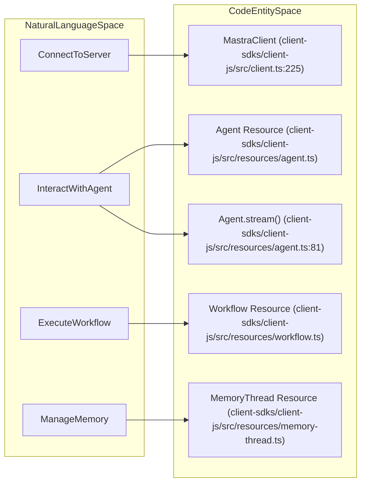
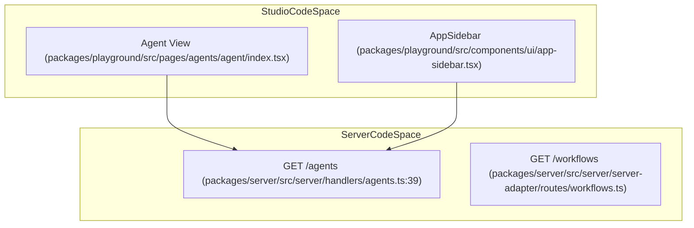
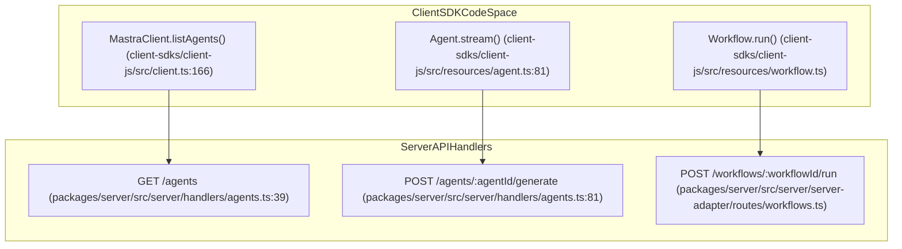

<!-- source: DeepWiki mcp.deepwiki.com · repo mastra-ai/mastra · page 10 Client SDK and UI Components · fetched 2026-10-26 -->

# Client SDK and UI Components

Relevant source files

The following files were used as context for generating this wiki page:

- [.changeset/fluffy-hornets-switch.md](.changeset/fluffy-hornets-switch.md)
- [client-sdks/client-js/CHANGELOG.md](client-sdks/client-js/CHANGELOG.md)
- [client-sdks/client-js/package.json](client-sdks/client-js/package.json)
- [client-sdks/client-js/src/client.ts](client-sdks/client-js/src/client.ts)
- [client-sdks/client-js/src/index.ts](client-sdks/client-js/src/index.ts)
- [client-sdks/client-js/src/resources/agent.client-tools.test.ts](client-sdks/client-js/src/resources/agent.client-tools.test.ts)
- [client-sdks/client-js/src/resources/agent.test.ts](client-sdks/client-js/src/resources/agent.test.ts)
- [client-sdks/client-js/src/resources/agent.ts](client-sdks/client-js/src/resources/agent.ts)
- [client-sdks/client-js/src/resources/observability.test.ts](client-sdks/client-js/src/resources/observability.test.ts)
- [client-sdks/client-js/src/resources/observability.ts](client-sdks/client-js/src/resources/observability.ts)
- [client-sdks/client-js/src/route-types.generated.ts](client-sdks/client-js/src/route-types.generated.ts)
- [client-sdks/client-js/src/types.ts](client-sdks/client-js/src/types.ts)
- [client-sdks/client-js/src/utils/ai-sdk-v4/ai-sdk-v4.test.ts](client-sdks/client-js/src/utils/ai-sdk-v4/ai-sdk-v4.test.ts)
- [client-sdks/client-js/src/utils/ai-sdk-v4/data-stream-parts.ts](client-sdks/client-js/src/utils/ai-sdk-v4/data-stream-parts.ts)
- [client-sdks/client-js/src/utils/ai-sdk-v4/fix-json.ts](client-sdks/client-js/src/utils/ai-sdk-v4/fix-json.ts)
- [client-sdks/client-js/src/utils/ai-sdk-v4/index.ts](client-sdks/client-js/src/utils/ai-sdk-v4/index.ts)
- [client-sdks/client-js/src/utils/ai-sdk-v4/parse-partial-json.ts](client-sdks/client-js/src/utils/ai-sdk-v4/parse-partial-json.ts)
- [client-sdks/react/src/agent/hooks.test.ts](client-sdks/react/src/agent/hooks.test.ts)
- [client-sdks/react/src/agent/hooks.ts](client-sdks/react/src/agent/hooks.ts)
- [docs/src/content/en/reference/client-js/agents.mdx](docs/src/content/en/reference/client-js/agents.mdx)
- [packages/cli/src/commands/api/route-metadata.generated.ts](packages/cli/src/commands/api/route-metadata.generated.ts)
- [packages/server/src/server/handlers/agent.test.ts](packages/server/src/server/handlers/agent.test.ts)
- [packages/server/src/server/handlers/agents.test.ts](packages/server/src/server/handlers/agents.test.ts)
- [packages/server/src/server/handlers/agents.ts](packages/server/src/server/handlers/agents.ts)
- [packages/server/src/server/handlers/observability-new-endpoints.ts](packages/server/src/server/handlers/observability-new-endpoints.ts)
- [packages/server/src/server/handlers/observability-shared.ts](packages/server/src/server/handlers/observability-shared.ts)
- [packages/server/src/server/handlers/observability-storage-schemas.ts](packages/server/src/server/handlers/observability-storage-schemas.ts)
- [packages/server/src/server/handlers/observability.test.ts](packages/server/src/server/handlers/observability.test.ts)
- [packages/server/src/server/handlers/observability.ts](packages/server/src/server/handlers/observability.ts)
- [packages/server/src/server/handlers/system.test.ts](packages/server/src/server/handlers/system.test.ts)
- [packages/server/src/server/handlers/system.ts](packages/server/src/server/handlers/system.ts)
- [packages/server/src/server/schemas/agents.ts](packages/server/src/server/schemas/agents.ts)
- [packages/server/src/server/schemas/system.ts](packages/server/src/server/schemas/system.ts)
- [packages/server/src/server/server-adapter/routes/agents.ts](packages/server/src/server/server-adapter/routes/agents.ts)
- [packages/server/src/server/server-adapter/routes/observability.ts](packages/server/src/server/server-adapter/routes/observability.ts)

This document covers the client-side libraries and user interfaces for consuming Mastra APIs. For server-side API implementation details, see [Server and API Layer](#9). For authentication and authorization patterns, see [Authentication System](#13).

## Overview

Mastra provides several client-side packages to facilitate interaction with the server:

- **`@mastra/client-js`**: Core TypeScript client SDK with resource-based API access for Agents, Workflows, Memory, and more. It uses a `BaseResource` class pattern to handle requests, retries, and error management. [client-sdks/client-js/src/client.ts:225-236](), [client-sdks/client-js/src/resources/base.ts]()
- **`@mastra/react`**: React hooks and context providers for seamless integration into React applications. Exposes hooks such as `useAgent` (via `MastraChatProps` logic), `useMemory`, and the `MastraReactProvider`. [client-sdks/react/src/agent/hooks.ts:164-179]()
- **`@mastra/playground-ui`**: A comprehensive UI component library used to build Mastra Studio and customizable AI interfaces. It includes UI primitives, complex elements, and icons.
- **`@mastra/ai-sdk`**: An adapter package to bridge Mastra streaming APIs to Vercel AI SDK hooks like `useChat`. It provides streaming transformers to translate Mastra streams into AI SDK compatible formats. [client-sdks/ai-sdk/src/transformers.ts:196-203]()

All client SDKs communicate with the Mastra server via REST and support streaming operations using Server-Sent Events (SSE). The client JS SDK implements retry/backoff and error handling logic. [client-sdks/client-js/src/types.ts:108-127]()

---

## JavaScript Client SDK

The `MastraClient` class is the primary interface for interacting with Mastra APIs. It extends a `BaseResource` class that manages HTTP requests, retries, backoff, and error processing. [client-sdks/client-js/src/client.ts:225]()

### MastraClient Initialization

Clients instantiate the SDK via the constructor, passing `ClientOptions` to configure server URL, API prefix, retry settings, and optional custom fetch implementations. [client-sdks/client-js/src/client.ts:230-236]()

| Option | Type | Description |
|--------|------|-------------|
| `baseUrl` | `string` | Base URL for all API requests. [client-sdks/client-js/src/types.ts:109]() |
| `apiPrefix` | `string` | API route prefix (default `/api`). [client-sdks/client-js/src/types.ts:111]() |
| `retries` | `number` | Number of retry attempts for failed requests. [client-sdks/client-js/src/types.ts:113]() |
| `backoffMs` | `number` | Initial retry backoff time in milliseconds. [client-sdks/client-js/src/types.ts:115]() |
| `headers` | `Record<string,string>` | Custom HTTP headers for requests. [client-sdks/client-js/src/types.ts:119]() |
| `fetch` | `typeof fetch` | Override fetch for custom environments. [client-sdks/client-js/src/types.ts:125]() |

For details, see [JavaScript Client SDK](#10.1).

### Client SDK Natural Language to Code Entity Space Bridge

**Sources**: [client-sdks/client-js/src/client.ts:225](), [client-sdks/client-js/src/types.ts:108-127](), [client-sdks/client-js/src/resources/agent.ts:81]()

---

## Agent Client Operations

The `Agent` resource encapsulates all interactions with agents: [client-sdks/client-js/src/resources/agent.ts]()

- **`generate`**: Requests a full agent response. [docs/src/content/en/reference/client-js/agents.mdx:48-53]()
- **`stream`**: Streams agent output incrementally using SSE. [docs/src/content/en/reference/client-js/agents.mdx:81-86]()
- **`sendMessage()`**: Sends user input to an active agent run or idle memory thread. [docs/src/content/en/reference/client-js/agents.mdx:163-177]()
- **`queueMessage()`**: Queues input for the next thread turn. [docs/src/content/en/reference/client-js/agents.mdx:184-194]()
- **`sendSignal()`**: Sends lower-level signals (e.g., reactive triggers). [docs/src/content/en/reference/client-js/agents.mdx:238-239]()

The client supports executing "client-side tools" by intercepting server responses, executing local code, and recursively continuing the agent loop via `executeClientToolWithObservability`. [client-sdks/client-js/src/resources/agent.ts:176-189]()

For details, see [Agent Client Operations](#10.2).

---

## Workflow Client Operations

The `Workflow` resource allows clients to trigger and observe multi-step processes: [client-sdks/client-js/src/client.ts:75]()

- **`run()`**: Initiates a workflow run. [client-sdks/client-js/src/resources/workflow.ts]()
- **`getStatus()`**: Queries results of a workflow run. [client-sdks/client-js/src/resources/workflow.ts]()
- **`cancel()`**: Aborts a running workflow. [client-sdks/client-js/src/resources/workflow.ts]()

For details, see [Workflow Client Operations](#10.3).

---

## Memory Client Operations

Clients manage context using the `MemoryThread` resource: [client-sdks/client-js/src/client.ts:72]()

- **`listThreads()`**: List threads scoped by resources. [client-sdks/client-js/src/client.ts:164]()
- **`getMessages()`**: Retrieve messages within a thread. [client-sdks/client-js/src/client.ts:159]()
- **`saveMessages()`**: Persist new messages. [client-sdks/client-js/src/client.ts:155]()
- **`deleteThread()`**: Remove a thread and its history. [client-sdks/client-js/src/client.ts:165]()

For details, see [Memory Client Operations](#10.4).

---

## React SDK and Hooks

The `@mastra/react` package provides React-specific integration:

- **`MastraReactProvider`**: Injects `MastraClient` context. [client-sdks/react/src/agent/hooks.ts:20]()
- **`useAgent` logic**: Handles message accumulation, signal echos, and task extraction from streams. [client-sdks/react/src/agent/hooks.ts:10-25]()
- **`resolveInitialMessages`**: Normalizes persisted messages for UI rendering, including tool approval states and stripping transient UI keys like `clientMessageId`. [client-sdks/react/src/agent/hooks.ts:86-158]()

For details, see [React SDK and Hooks](#10.5).

---

## Studio UI and Playground

Mastra Studio is built on `@mastra/playground-ui`, providing tools for building and debugging. It uses route metadata to discover available endpoints. [packages/cli/src/commands/api/route-metadata.generated.ts:4-31]()

### Studio Architecture Bridge

**Sources**: [packages/cli/src/commands/api/route-metadata.generated.ts:4-31](), [packages/server/src/server/handlers/agents.ts:39]()

---

## Editor System (MastraEditor) and Stored Overrides

The editor system enables runtime editing and versioning of AI entities: [client-sdks/client-js/src/types.ts:11]()

- **Namespaces**: CRUD for `StoredAgent`, `StoredWorkflow`, `StoredPromptBlock`, and `StoredScorer`. [client-sdks/client-js/src/client.ts:17-21]()
- **Versioning**: Server routes resolve versions via `versionId` or `status` (draft/published) and ensure sub-agents inherit the correct version status via `ensureDefaultVersionStatus`. [packages/server/src/server/handlers/agents.ts:128-138]()

For details, see [Editor System (MastraEditor) and Stored Overrides](#10.7).

---

## AI SDK Adapter and Chat Routes

The `@mastra/ai-sdk` package bridges Mastra to Vercel AI SDK: [client-sdks/ai-sdk/src/chat-route.ts:16]()

- **`extractV6NativeApprovals`**: Extracts tool approval responses from AI SDK v6 message history for resumption. [client-sdks/ai-sdk/src/chat-route.ts:46-78]()
- **`toAISdkStream`**: Transforms Mastra `ChunkType` streams into AI SDK compatible formats, handling text deltas, tool calls, and finish reasons. [client-sdks/ai-sdk/src/chat-route.ts:122-133](), [client-sdks/ai-sdk/src/transformers.ts:21-29]()

For details, see [AI SDK Adapter and Chat Routes](#10.8).

---

# Summary Diagram: Client-Server Interaction

**Sources**: [client-sdks/client-js/src/client.ts:166](), [packages/server/src/server/handlers/agents.ts:81](), [packages/cli/src/commands/api/route-metadata.generated.ts:81-120](), [client-sdks/client-js/src/resources/agent.ts:81]()

---

# References

- Client SDK Types: [client-sdks/client-js/src/types.ts:1-214]()
- Agent Client Resource: [client-sdks/client-js/src/resources/agent.ts:1-212]()
- AI SDK Transformers: [client-sdks/ai-sdk/src/transformers.ts:196-258]()
- React Hooks Logic: [client-sdks/react/src/agent/hooks.ts:10-157]()
- Generated API Metadata: [packages/cli/src/commands/api/route-metadata.generated.ts:1-310]()

---

