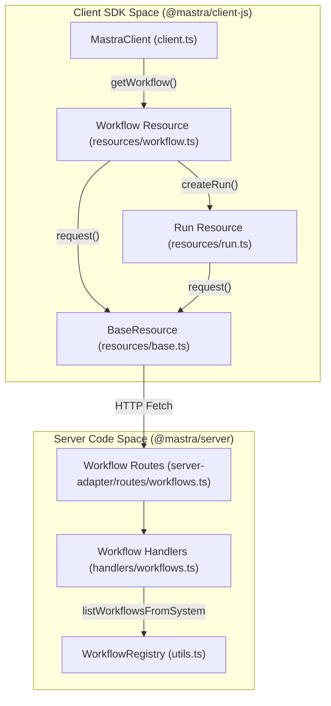
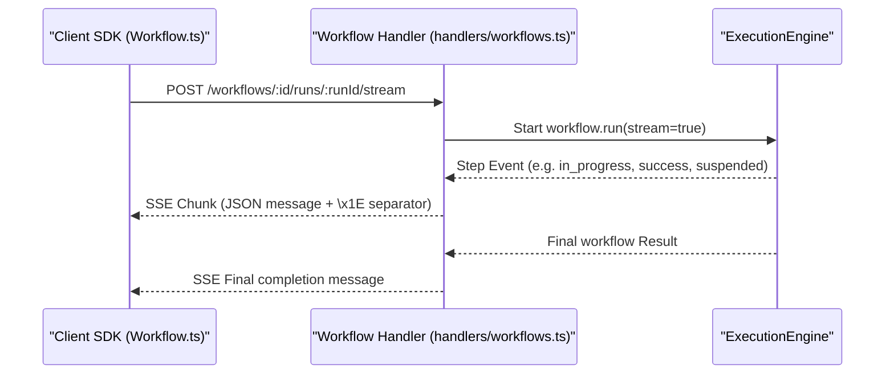

<!-- source: DeepWiki mcp.deepwiki.com · repo mastra-ai/mastra · page 10.3 Workflow Client Operations · fetched 2026-10-26 -->

# Workflow Client Operations

<details>
<summary>Relevant source files</summary>

The following files were used as context for generating this wiki page:

- [client-sdks/ai-sdk/src/__tests__/chat-route-credential-headers.test.ts](client-sdks/ai-sdk/src/__tests__/chat-route-credential-headers.test.ts)
- [deployers/cloud/src/utils/execa.ts](deployers/cloud/src/utils/execa.ts)
- [docs/src/content/en/docs/workflows/time-travel.mdx](docs/src/content/en/docs/workflows/time-travel.mdx)
- [docs/src/content/en/reference/client-js/workflows.mdx](docs/src/content/en/reference/client-js/workflows.mdx)
- [docs/src/content/en/reference/streaming/workflows/resumeStream.mdx](docs/src/content/en/reference/streaming/workflows/resumeStream.mdx)
- [docs/src/content/en/reference/workflows/run-methods/restart.mdx](docs/src/content/en/reference/workflows/run-methods/restart.mdx)
- [docs/src/content/en/reference/workflows/run-methods/resume.mdx](docs/src/content/en/reference/workflows/run-methods/resume.mdx)
- [docs/src/content/en/reference/workflows/run-methods/start.mdx](docs/src/content/en/reference/workflows/run-methods/start.mdx)
- [docs/src/content/en/reference/workflows/run-methods/timeTravel.mdx](docs/src/content/en/reference/workflows/run-methods/timeTravel.mdx)
- [docs/src/content/en/reference/workflows/workflow-methods/foreach.mdx](docs/src/content/en/reference/workflows/workflow-methods/foreach.mdx)
- [e2e-tests/deployers/template/cloudflare/src/mastra/index.ts](e2e-tests/deployers/template/cloudflare/src/mastra/index.ts)
- [packages/agent-builder/integration-tests/src/agent-template-behavior.test.ts](packages/agent-builder/integration-tests/src/agent-template-behavior.test.ts)
- [packages/agent-builder/integration-tests/src/workflow-builder-integration.test.ts](packages/agent-builder/integration-tests/src/workflow-builder-integration.test.ts)
- [packages/core/src/workflows/concurrent-time-travel.test.ts](packages/core/src/workflows/concurrent-time-travel.test.ts)
- [packages/core/src/workflows/evented/concurrent-time-travel.test.ts](packages/core/src/workflows/evented/concurrent-time-travel.test.ts)
- [packages/deployer/src/build/analyze/constants.ts](packages/deployer/src/build/analyze/constants.ts)
- [packages/deployer/src/deploy/log.ts](packages/deployer/src/deploy/log.ts)
- [packages/deployer/src/validator/custom-resolver.ts](packages/deployer/src/validator/custom-resolver.ts)
- [packages/deployer/src/validator/validate.test.ts](packages/deployer/src/validator/validate.test.ts)
- [packages/deployer/src/validator/validate.ts](packages/deployer/src/validator/validate.ts)
- [packages/server/src/server/agent-builder-ee-static-imports.test.ts](packages/server/src/server/agent-builder-ee-static-imports.test.ts)
- [packages/server/src/server/handlers/agent-builder.test.ts](packages/server/src/server/handlers/agent-builder.test.ts)
- [packages/server/src/server/handlers/authorship.ts](packages/server/src/server/handlers/authorship.ts)
- [packages/server/src/server/handlers/editor-builder.test.ts](packages/server/src/server/handlers/editor-builder.test.ts)
- [packages/server/src/server/handlers/editor-builder.ts](packages/server/src/server/handlers/editor-builder.ts)
- [packages/server/src/server/handlers/error.test.ts](packages/server/src/server/handlers/error.test.ts)
- [packages/server/src/server/handlers/error.ts](packages/server/src/server/handlers/error.ts)
- [packages/server/src/server/handlers/mcp.ts](packages/server/src/server/handlers/mcp.ts)
- [packages/server/src/server/handlers/tool-schema-overrides.ts](packages/server/src/server/handlers/tool-schema-overrides.ts)
- [packages/server/src/server/handlers/tools.test.ts](packages/server/src/server/handlers/tools.test.ts)
- [packages/server/src/server/handlers/tools.ts](packages/server/src/server/handlers/tools.ts)
- [packages/server/src/server/handlers/utils.test.ts](packages/server/src/server/handlers/utils.test.ts)
- [packages/server/src/server/handlers/utils.ts](packages/server/src/server/handlers/utils.ts)
- [packages/server/src/server/handlers/workflow-builder.test.ts](packages/server/src/server/handlers/workflow-builder.test.ts)
- [packages/server/src/server/handlers/workflow-builder.ts](packages/server/src/server/handlers/workflow-builder.ts)
- [packages/server/src/server/handlers/workflows.restart.test.ts](packages/server/src/server/handlers/workflows.restart.test.ts)
- [packages/server/src/server/handlers/workflows.test.ts](packages/server/src/server/handlers/workflows.test.ts)
- [packages/server/src/server/handlers/workflows.ts](packages/server/src/server/handlers/workflows.ts)
- [packages/server/src/server/schemas/editor-builder.ts](packages/server/src/server/schemas/editor-builder.ts)
- [packages/server/src/server/schemas/workflows.ts](packages/server/src/server/schemas/workflows.ts)
- [packages/server/src/server/server-adapter/mcp-auth.ts](packages/server/src/server/server-adapter/mcp-auth.ts)
- [packages/server/src/server/server-adapter/routes/editor-builder.ts](packages/server/src/server/server-adapter/routes/editor-builder.ts)
- [packages/server/src/server/utils.ts](packages/server/src/server/utils.ts)
- [packages/server/src/server/utils/resolve-builder-model-policy.ts](packages/server/src/server/utils/resolve-builder-model-policy.ts)

</details>


## Purpose and Scope

This document covers client-side workflow operations provided by the `@mastra/client-js` package. It details how the JavaScript SDK interacts with the Mastra server to list workflows, manage execution runs, handle streaming updates, and perform advanced operations such as durable execution monitoring and builder-assisted workflow generation.

For workflow definition and orchestration concepts, see [Workflow System](). For server-side workflow API endpoints, see [Workflow API Endpoints]().

**Sources:** [client-sdks/client-js/src/resources/workflow.ts:21-27](), [packages/server/src/server/handlers/workflows.ts:45-51]()

## Client-Server Architecture

The workflow client operates as a resource-based wrapper over HTTP endpoints. It leverages the `BaseResource` class for common functionality such as request construction, handling retries with exponential backoff, and base URL management. The primary entry point is the `MastraClient` class, which exposes the `Workflow` and `Run` resources to clients.

### Workflow Client-Server Entity Mapping



**Sources:** [client-sdks/client-js/src/resources/workflow.ts:21-27](), [client-sdks/client-js/src/resources/run.ts:24-31](), [packages/server/src/server/utils.ts:181-205](), [packages/server/src/server/handlers/workflows.ts:114-159]()

---

## Listing and Retrieving Workflows

### Listing All Workflows

The `MastraClient` provides a top-level method to retrieve all workflows registered on the server. This is useful for UI components like Studio or dashboards to discover available workflows.

```typescript
const workflows = await client.listWorkflows({
  requestContext: { tenantId: '123' },
  partial: 'true'
});
```

| Parameter | Type | Description |
| :-------- | :--- | :---------- |
| `requestContext` | `RequestContext` | Optional context used for dynamic workflow resolution and multi-tenancy. |
| `partial` | `string` | If `'true'`, returns pruned workflow details (e.g., limited schemas and step details) for improved performance. |

The server-side handler `LIST_WORKFLOWS_ROUTE` attempts to locate workflows in the `mastra.listWorkflows()` map. If `partial` is true, it prunes root-level schemas and steps, returning only `stepCount`.

**Sources:** [packages/server/src/server/handlers/workflows.ts:165-208](), [client-sdks/client-js/src/client.ts:243-247]()

### Workflow Details and Schemas

The `Workflow` resource fetches detailed metadata about a workflow, including its steps and schemas. Schemas are serialized to maintain complex data types across the wire.

| Method | Return Type | Description |
| :----- | :---------- | :---------- |
| `details()` | `Promise<GetWorkflowResponse>` | Retrieves full workflow info including the serialized step graph via `/workflows/:workflowId`. |
| `getSchema()` | `Promise<{inputSchema, outputSchema}>` | Parses encoded input and output schemas into standard JSON objects. |

**Sources:** [client-sdks/client-js/src/resources/workflow.ts:34-36](), [client-sdks/client-js/src/resources/workflow.ts:142-153](), [packages/server/src/server/utils.ts:156-179]()

---

## Workflow Run Management

### Creating and Starting Runs

Workflow execution is managed through the `Run` resource. You can create a run first, which returns a run ID, and subsequently start or control the run lifecycle.

Creating a run separately allows associating additional metadata such as `resourceId` before execution begins, facilitating audit trails and multi-tenant resource ownership.

```typescript
const workflow = client.getWorkflow('my-workflow');
const run = await workflow.createRun({ resourceId: 'user-1' });
const result = await run.startAsync({ inputData: { query: 'hello' } });
```

The `Workflow.createRun()` method calls the `/workflows/:workflowId/create-run` endpoint. The resulting `Run` class exposes various controls like `startAsync()`, `resume()`, and `cancel()`.

**Sources:** [client-sdks/client-js/src/resources/workflow.ts:160-181](), [client-sdks/client-js/src/resources/run.ts:179-202](), [docs/src/content/en/reference/client-js/workflows.mdx:57-75]()

### Run Filtering and Pagination

The `runs()` method in the `Workflow` resource supports sophisticated filtering and pagination to observe workflow executions:

| Parameter | Type | Description |
| :-------- | :--- | :---------- |
| `fromDate` / `toDate` | `Date` | Filter runs by creation time window. |
| `page` / `perPage` | `number` | Pagination controls for large run result sets. |
| `resourceId` | `string` | Filter executions by associated resource for security/auditing. |
| `status` | `WorkflowRunStatus` | Filter by execution status (e.g., `success`, `failed`, `suspended`). |

The client uses `URLSearchParams` to pass these filters to the `/workflows/:workflowId/runs` endpoint.

**Sources:** [client-sdks/client-js/src/resources/workflow.ts:44-89](), [packages/server/src/server/schemas/workflows.ts:117-122]()

---

## Streaming Workflow Execution

Mastra supports streaming workflow execution results, enabling clients to receive incremental updates on run progress, step transitions, and suspensions.

### Streaming Protocol and Implementation

- The client calls the streaming endpoint: `POST /workflows/:id/runs/:runId/stream`.
- Server employs an `ExecutionEngine` that emits step events asynchronously.
- Server wraps events into SSE (Server-Sent Events) using a record separator (ASCII RS, `\x1E`) to delimit JSON messages.
- The client processes this stream progressively using `createRecordSeparatorJsonTransform`.

### Workflow Streaming Sequence Diagram



Key implementation points:

- `RECORD_SEPARATOR` (`\x1E`) is used to separate streaming JSON objects in the HTTP response body. [client-sdks/client-js/src/resources/workflow.ts:19]()
- Server processing uses `cacheRunStream` to buffer and handle workflow event chunks for replay history. [packages/server/src/server/handlers/workflows.ts:72-106]()
- The client SDK uses `createRecordSeparatorJsonTransform` to pipe the response body into a readable stream of objects. [client-sdks/client-js/src/resources/run.ts:33-35]()

**Sources:** [client-sdks/client-js/src/resources/workflow.ts:19](), [packages/server/src/server/handlers/workflows.ts:72-106](), [client-sdks/client-js/src/resources/run.ts:33-35](), [docs/src/content/en/reference/client-js/workflows.mdx:190-206]()

---

## Suspend and Resume Operations

Workflows support suspension to await external inputs, approvals, or asynchronous events. The client can synchronize with this state and resume execution.

### Resuming Suspended Workflows

- To resume, the client calls the `Run.resume()` method, specifying:
  - The suspended step ID.
  - `resumeData`: data payload that satisfies the step requirements (e.g., approval response).
  - Optional `forEachIndex` targeting a specific iteration in loops.

Example:

```typescript
const run = await workflow.createRun({ runId: 'run-123' });
await run.resume({
  step: 'approval-step',
  resumeData: { approved: true },
  forEachIndex: 0, // Optional, for steps with .forEach()
});
```

The server handler `RESUME_WORKFLOW_ROUTE` validates the request using `resumeBodySchema` and instructs the workflow to continue.

**Sources:** [client-sdks/client-js/src/resources/run.ts:145-172](), [packages/server/src/server/schemas/workflows.ts:161-168](), [docs/src/content/en/reference/client-js/workflows.mdx:150-173]()

### Cancelling Workflow Runs

The `Run.cancel()` method allows stopping a workflow run. This sends an abort signal to currently executing steps and prevents subsequent steps from running.

```typescript
const run = await workflow.createRun({ runId: existingRunId });
const result = await run.cancel();
// Returns: { message: 'Workflow run canceled' }
```

Steps within a workflow can listen for the `abortSignal` to perform cleanup or gracefully exit.

**Sources:** [client-sdks/client-js/src/resources/run.ts:119-123](), [client-sdks/client-js/src/resources/run.ts:58-118](), [docs/src/content/en/reference/client-js/workflows.mdx:175-189]()

---

## Advanced Workflow Operations

### Time Travel

The `Run.timeTravel()` method allows re-executing a workflow from a specific step, using either stored snapshot data or custom context. This is useful for debugging, testing individual steps, or recovering from errors without re-running the entire workflow.

```typescript
const run = await workflow.createRun();
const result = await run.timeTravel({
  step: 'step2',
  inputData: { value: 10 },
});
```

Parameters for `timeTravel()` include:
- `step`: The target step to start execution from (step instance, ID, or array for nested steps).
- `inputData`: Input for the target step.
- `resumeData`: Data for resuming if the workflow was suspended.
- `initialState`: Initial workflow-level state.
- `context`: Execution context for steps before the target step.

The server-side `TIME_TRAVEL_WORKFLOW_ROUTE` handles these requests. Errors like `WORKFLOW_TIME_TRAVEL_ALREADY_CLAIMED` or `WORKFLOW_TIME_TRAVEL_RUN_RUNNING` can occur if concurrent calls or an active run conflict.

**Sources:** [docs/src/content/en/docs/workflows/time-travel.mdx:10-20](), [docs/src/content/en/reference/workflows/run-methods/timeTravel.mdx:10-21](), [packages/server/src/server/handlers/workflows.ts:1400-1440](), [packages/server/src/server/handlers/error.ts:54-60]()

### Restarting Workflow Runs

The `Run.restart()` method allows restarting a workflow run from its beginning, optionally with new input data or initial state. This is useful for re-attempting a failed run or re-executing a completed run with different parameters.

```typescript
const run = await workflow.createRun({ runId: existingRunId });
const result = await run.restart({
  inputData: { newParam: 'value' },
  initialState: { counter: 0 },
});
```

The server-side `RESTART_WORKFLOW_ROUTE` handles these requests.

**Sources:** [packages/server/src/server/handlers/workflows.ts:1350-1398]()

---

## Agent Builder Workflow Operations

Mastra provides specialized workflow operations for the `@mastra/agent-builder` system. These allow for template merging and guided code changes via client SDK resources.

### AgentBuilder Resource

The `AgentBuilder` class (extending `BaseResource`) provides specific methods for builder actions like `merge-template`:

| Method | Endpoint | Purpose |
| :----- | :------- | :------ |
| `startAsync` | `POST /agent-builder/:actionId/start-async` | Runs builder action and waits for completion. |
| `stream` | `POST /agent-builder/:actionId/stream` | Streams builder progress (e.g., validation results, branch names). |
| `createRun` | `POST /agent-builder/:actionId/create-run` | Initializes a new builder action execution. |

**Sources:** [client-sdks/client-js/src/resources/agent-builder.ts:29-35](), [client-sdks/client-js/src/resources/agent-builder.ts:89-108](), [packages/server/src/server/handlers/agent-builder.ts:182-202]()

---

## Summary of Client Methods for Workflows

| Resource | Method | Endpoint | Purpose |
| :------- | :----- | :------- | :------ |
| `MastraClient` | `listWorkflows` | `GET /workflows` | Discover available workflows. |
| `Workflow` | `details` | `GET /workflows/:id` | Get workflow metadata and step graph. |
| `Workflow` | `createRun` | `POST /workflows/:id/create-run` | Initialize a new workflow run. |
| `Workflow` | `runs` | `GET /workflows/:id/runs` | List filtered runs with pagination. |
| `Workflow` | `runById` | `GET /workflows/:id/runs/:runId` | Retrieve a specific run’s details. |
| `Workflow` | `deleteRunById` | `DELETE /workflows/:id/runs/:runId` | Deletes a specific workflow run. |
| `Run` | `startAsync` | `POST /workflows/:id/start-async?runId=:runId` | Start execution and await result. |
| `Run` | `resume` | `POST /workflows/:id/resume?runId=:runId` | Resume a suspended step. |
| `Run` | `cancel` | `POST /workflows/:id/runs/:runId/cancel` | Cancel a running workflow. |
| `Run` | `timeTravel` | `POST /workflows/:id/time-travel?runId=:runId` | Re-execute from a specific step. |
| `Run` | `restart` | `POST /workflows/:id/restart?runId=:runId` | Restart a workflow run from the beginning. |

**Sources:** [client-sdks/client-js/src/resources/workflow.ts:34-136](), [client-sdks/client-js/src/resources/run.ts:109-172](), [docs/src/content/en/reference/client-js/workflows.mdx:175-189]()

---

