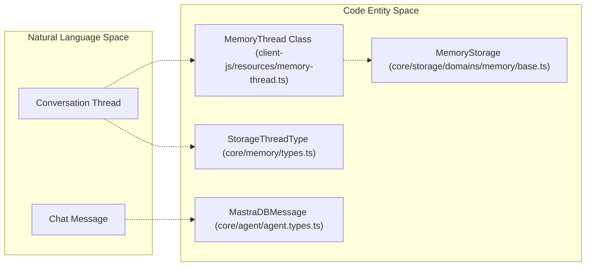

<!-- source: DeepWiki mcp.deepwiki.com · repo mastra-ai/mastra · page 10.4 Memory Client Operations · fetched 2026-10-26 -->

# Memory Client Operations

Relevant source files

The following files were used as context for generating this wiki page:

- [packages/core/src/storage/domains/memory/base.ts](packages/core/src/storage/domains/memory/base.ts)
- [packages/core/src/storage/domains/memory/inmemory.ts](packages/core/src/storage/domains/memory/inmemory.ts)
- [packages/core/src/storage/types.ts](packages/core/src/storage/types.ts)
- [packages/server/src/server/handlers/memory.test.ts](packages/server/src/server/handlers/memory.test.ts)
- [packages/server/src/server/handlers/memory.ts](packages/server/src/server/handlers/memory.ts)
- [packages/server/src/server/schemas/memory.test.ts](packages/server/src/server/schemas/memory.test.ts)
- [packages/server/src/server/schemas/memory.ts](packages/server/src/server/schemas/memory.ts)
- [stores/dsql/src/storage/domains/memory/index.ts](stores/dsql/src/storage/domains/memory/index.ts)
- [stores/dsql/src/storage/domains/memory/save-timestamps.test.ts](stores/dsql/src/storage/domains/memory/save-timestamps.test.ts)
- [stores/dsql/src/storage/domains/workflows/index.ts](stores/dsql/src/storage/domains/workflows/index.ts)
- [stores/libsql/src/storage/domains/memory/index.ts](stores/libsql/src/storage/domains/memory/index.ts)
- [stores/mongodb/src/storage/domains/memory/index.ts](stores/mongodb/src/storage/domains/memory/index.ts)
- [stores/mssql/src/storage/domains/workflows/index.ts](stores/mssql/src/storage/domains/workflows/index.ts)
- [stores/mysql/src/storage/domains/memory/index.ts](stores/mysql/src/storage/domains/memory/index.ts)
- [stores/oracledb/src/storage/domains/workflows/index.ts](stores/oracledb/src/storage/domains/workflows/index.ts)
- [stores/pg/src/storage/domains/memory/index.ts](stores/pg/src/storage/domains/memory/index.ts)
- [stores/spanner/src/storage/domains/memory/index.ts](stores/spanner/src/storage/domains/memory/index.ts)
- [stores/spanner/src/storage/domains/memory/list-messages-where.test.ts](stores/spanner/src/storage/domains/memory/list-messages-where.test.ts)
- [stores/spanner/src/storage/domains/workflows/index.ts](stores/spanner/src/storage/domains/workflows/index.ts)
- [stores/spanner/src/storage/domains/workflows/update-workflow-state.test.ts](stores/spanner/src/storage/domains/workflows/update-workflow-state.test.ts)

## Purpose and Scope

This page documents the client-side operations for the memory subsystem in the Mastra JavaScript/TypeScript client SDK (`@mastra/client-js`). It covers the functionalities exposed by the `MastraClient` class related to memory and the `MemoryThread` resource class, which manages conversation threads, message retrieval, saving, thread cloning, and deletion.

While this page focuses on client API usage, the memory system backend integrates potentially complex memory processors such as **Observational Memory (OM)** and **Semantic Recall**. These background systems maintain long-term memory while keeping context windows small by replacing raw message history with dense observations. [docs/src/content/en/docs/memory/observational-memory.mdx:12-18]()

---

## Client Memory Architecture Overview

The memory client interface is split into two main access patterns:

- **MastraClient Methods:** For global or cross-thread operations such as listing threads or creating threads. [client-sdks/client-js/src/client.ts:243-305]()
- **MemoryThread Instances:** Resource objects scoped to a single conversation thread for thread-specific message and thread metadata operations. [client-sdks/client-js/src/resources/agent.ts:1-3718]()

Both layers perform HTTP requests to the server's `/api/memory` endpoints using an underlying common request utility in `BaseResource`. [client-sdks/client-js/src/resources/base.ts:20-101]() Memory client operations may optionally use an `agentId` to resolve memory configuration state and processing pipelines based on the agent's context. If `agentId` is omitted, direct storage access occurs with reduced features. [packages/server/src/server/handlers/memory.ts:210-227]()

### Memory Client Data Flow Diagram

```mermaid
graph TB
    subgraph "Client SDK Layer"
        MastraClient["MastraClient (client.ts)"]
        MemoryThread["MemoryThread (memory-thread.ts)"]
        
        MastraClient -->|getMemoryThread| MemoryThread
        MastraClient -->|listMemoryThreads| API_LIST_THREADS
        MastraClient -->|createMemoryThread| API_CREATE_THREAD
        MastraClient -->|getMemoryStatus| API_GET_MEMORY_STATUS
        MastraClient -->|getWorkingMemory| API_GET_WORKING_MEMORY
        MastraClient -->|updateWorkingMemory| API_UPDATE_WORKING_MEMORY
        MastraClient -->|saveMessageToMemory| API_SAVE_MESSAGES
    end
    
    subgraph "Request Layer"
        BaseResourceRequest["BaseResource.request()"]
        MastraClient --> BaseResourceRequest
        MemoryThread --> BaseResourceRequest
    end
    
    subgraph "Server Endpoints"
        API_ROOT["/api/memory/*"]
        API_LIST_THREADS["GET /api/memory/threads"]
        API_GET_THREAD_BY_ID["GET /api/memory/threads/:threadId"]
        API_LIST_MESSAGES["GET /api/memory/threads/:threadId/messages"]
        API_DELETE_MESSAGES["POST /api/memory/messages/delete"]
        API_CLONE_THREAD["POST /api/memory/threads/:threadId/clone"]
        API_GET_WORKING_MEMORY["GET /api/memory/working-memory"]
        API_UPDATE_WORKING_MEMORY["POST /api/memory/working-memory"]
        API_GET_MEMORY_STATUS["GET /api/memory/status"]
        API_SAVE_MESSAGES["POST /api/memory/messages"]
        API_CREATE_THREAD["POST /api/memory/threads"]
        API_UPDATE_THREAD["PUT /api/memory/threads/:threadId"]
        API_DELETE_THREAD["DELETE /api/memory/threads/:threadId"]
    end
    
    BaseResourceRequest --> API_ROOT
    API_ROOT --> API_LIST_THREADS
    API_ROOT --> API_GET_THREAD_BY_ID
    API_ROOT --> API_LIST_MESSAGES
    API_ROOT --> API_DELETE_MESSAGES
    API_ROOT --> API_CLONE_THREAD
    API_ROOT --> API_GET_WORKING_MEMORY
    API_ROOT --> API_UPDATE_WORKING_MEMORY
    API_ROOT --> API_GET_MEMORY_STATUS
    API_ROOT --> API_SAVE_MESSAGES
    API_ROOT --> API_CREATE_THREAD
    API_ROOT --> API_UPDATE_THREAD
    API_ROOT --> API_DELETE_THREAD
    
    subgraph "Server-side Memory Resolution"
        GetMemoryFromContext["getMemoryFromContext() (memory.ts)"]
    end
    
    API_LIST_THREADS --> GetMemoryFromContext
    API_GET_THREAD_BY_ID --> GetMemoryFromContext
    API_LIST_MESSAGES --> GetMemoryFromContext
    API_DELETE_MESSAGES --> GetMemoryFromContext
    API_CLONE_THREAD --> GetMemoryFromContext
    API_GET_WORKING_MEMORY --> GetMemoryFromContext
    API_UPDATE_WORKING_MEMORY --> GetMemoryFromContext
    API_GET_MEMORY_STATUS --> GetMemoryFromContext
    API_SAVE_MESSAGES --> GetMemoryFromContext
    API_CREATE_THREAD --> GetMemoryFromContext
    API_UPDATE_THREAD --> GetMemoryFromContext
    API_DELETE_THREAD --> GetMemoryFromContext
```

**Sources:**  
- [client-sdks/client-js/src/resources/base.ts:20-101]()
- [client-sdks/client-js/src/resources/agent.ts:1-3718]()
- [packages/server/src/server/handlers/memory.ts:210-227]()
- [packages/server/src/server/handlers/memory.ts:231-2309]()

---

## MastraClient Memory Methods

`MastraClient` provides asynchronous methods to work with memory threads, messages, and configuration on the global level or scoped by agent.

### 1. `listMemoryThreads(params?)`

Retrieve a paginated list of memory threads optionally filtered by parameters like `resourceId`, `agentId`, or metadata. [client-sdks/client-js/src/client.ts:243-261]() This method corresponds to the `GET /api/memory/threads` endpoint. [packages/server/src/server/handlers/memory.ts:240-300]()

| Parameter | Type | Description |
| :-------- | :--- | :---------- |
| `resourceId` | `string?` | Filter threads by resource ID |
| `metadata` | `Record<string, unknown>?` | Filter threads by metadata |
| `agentId` | `string?` | Agent ID to scope memory config |
| `page` | `number?` | Zero-based page number |
| `perPage` | `number?` | Number of threads per page |
| `orderBy` | `{ field: 'createdAt' \| 'updatedAt', direction: 'ASC' \| 'DESC' }?` | Order results by creation or update time. |

**Sources:**
- [client-sdks/client-js/src/client.ts:243-261]()
- [packages/server/src/server/handlers/memory.ts:240-300]()
- [packages/server/src/server/schemas/memory.ts:227-260]()

### 2. `createMemoryThread(params)`

Creates a new conversation thread with optional title and metadata. [client-sdks/client-js/src/client.ts:263-277]() This maps to the `POST /api/memory/threads` endpoint. [packages/server/src/server/handlers/memory.ts:1000-1039]()

| Parameter | Type | Required | Description |
| :-------- | :--- | :------- | :---------- |
| `agentId` | `string` | Yes | Agent ID to derive memory config |
| `resourceId` | `string` | Yes | Resource (e.g., user) identifier |
| `title` | `string?` | No | Thread title |
| `metadata` | `Record<string, any>?` | No | Custom metadata for the thread |

**Sources:**
- [client-sdks/client-js/src/client.ts:263-277]()
- [packages/server/src/server/handlers/memory.ts:1000-1039]()
- [packages/server/src/server/schemas/memory.ts:500-504]()

### 3. `getMemoryStatus(agentId)`

Retrieves the current status of the memory system, including **Observational Memory** buffering and reflection status for a given agent. [client-sdks/client-js/src/client.ts:279-291]() This calls the `GET /api/memory/status` endpoint. [packages/server/src/server/handlers/memory.ts:302-360]()

**Sources:**
- [client-sdks/client-js/src/client.ts:279-291]()
- [packages/server/src/server/handlers/memory.ts:302-360]()
- [packages/server/src/server/schemas/memory.ts:210-213]()

---

### Working Memory Operations

Working memory maintains persistent scoped state (e.g., user preferences or long-term facts) often structured via a `WorkingMemoryTemplate`. [packages/core/src/memory/memory.ts:86-100]()

- `getWorkingMemory({ agentId, threadId, resourceId? })` fetches current persisted working memory text. [client-sdks/client-js/src/client.ts:293-311]() This maps to `GET /api/memory/working-memory`. [packages/server/src/server/handlers/memory.ts:700-749]()
- `updateWorkingMemory({ agentId, threadId, workingMemory, resourceId? })` updates the working memory content. [client-sdks/client-js/src/client.ts:313-333]() This maps to `POST /api/memory/working-memory`. [packages/server/src/server/handlers/memory.ts:751-809]()

**Sources:**
- [client-sdks/client-js/src/client.ts:293-333]()
- [packages/server/src/server/handlers/memory.ts:700-809]()
- [packages/server/src/server/schemas/memory.ts:360-363]()
- [packages/server/src/server/schemas/memory.ts:530-534]()

---

### Message Operations

#### `saveMessageToMemory(params)`

Save messages explicitly into memory storage for persistence without triggering an agent run. [client-sdks/client-js/src/client.ts:335-352]() This calls the `POST /api/memory/messages` endpoint. [packages/server/src/server/handlers/memory.ts:811-870]()

| Parameter | Type | Description |
| :-------- | :--- | :---------- |
| `agentId` | `string` | Agent ID for memory resolution |
| `messages` | `MastraMessage[]` | Array of messages to save |
| `threadId` | `string` | The ID of the thread to save messages to. |
| `resourceId` | `string?` | Optional resource ID associated with the messages. |

**Sources:**
- [client-sdks/client-js/src/client.ts:335-352]()
- [client-sdks/client-js/src/types.ts:115-116]()
- [packages/server/src/server/handlers/memory.ts:811-870]()
- [packages/server/src/server/schemas/memory.ts:506-511]()

---

## MemoryThread Resource Class

The `MemoryThread` class offers methods to manage a single memory thread's metadata and messages. You obtain instances via `MastraClient.getMemoryThread()`. [client-sdks/client-js/src/client.ts:354-361]()

### Memory Entity Mapping Diagram

**Sources:**  
- [client-sdks/client-js/src/resources/agent.ts:1-3718]()  
- [packages/core/src/agent/message-list.ts:2-2]()
- [packages/core/src/memory/types.ts:5-5]()
- [packages/core/src/storage/types.ts:36-36]()
- [packages/core/src/storage/domains/memory/base.ts:43-43]()

---

### Thread Metadata Operations

#### `get()`
Fetch thread metadata including title, `resourceId`, and custom metadata. [client-sdks/client-js/src/resources/agent.ts:62-66]() This calls `GET /api/memory/threads/:threadId`. [packages/server/src/server/handlers/memory.ts:365-425]()

#### `update(params)`
Update thread properties like title and metadata. [client-sdks/client-js/src/resources/agent.ts:74-83]() This calls `PUT /api/memory/threads/:threadId`. [packages/server/src/server/handlers/memory.ts:1041-1089]()

#### `delete()`
Delete the thread and all related messages. [client-sdks/client-js/src/resources/agent.ts:91-99]() This calls `DELETE /api/memory/threads/:threadId`. [packages/server/src/server/handlers/memory.ts:1091-1130]()

**Sources:**
- [client-sdks/client-js/src/resources/agent.ts:62-99]()
- [packages/server/src/server/handlers/memory.ts:365-425]()
- [packages/server/src/server/handlers/memory.ts:1041-1130]()
- [packages/server/src/server/schemas/memory.ts:513-517]()

---

### Message Operations

#### `listMessages(params?)`
Get messages for the thread with pagination and ordering. [client-sdks/client-js/src/resources/agent.ts:107-128]() This calls `GET /api/memory/threads/:threadId/messages`. [packages/server/src/server/handlers/memory.ts:430-499]()

#### `deleteMessages(messageIds)`
Delete specific messages by their IDs. [client-sdks/client-js/src/resources/agent.ts:137-153]() This calls `POST /api/memory/messages/delete`. [packages/server/src/server/handlers/memory.ts:1132-1189]()

**Sources:**
- [client-sdks/client-js/src/resources/agent.ts:107-153]()
- [packages/server/src/server/handlers/memory.ts:430-499]()
- [packages/server/src/server/handlers/memory.ts:1132-1189]()
- [packages/server/src/server/schemas/memory.ts:300-307]()
- [packages/server/src/server/schemas/memory.ts:536-540]()

---

### Thread Cloning

Clone a thread to create a copy for branching or experiment workflows. Supports options for limiting message count and specifying clone metadata. [client-sdks/client-js/src/resources/agent.ts:161-190]() This calls `POST /api/memory/threads/:threadId/clone`. [packages/server/src/server/handlers/memory.ts:1191-1249]()

| Parameter | Type | Description |
| :-------- | :--- | :---------- |
| `newThreadId` | `string?` | Optional custom thread ID for the clone |
| `title` | `string?` | Optional new title for the cloned thread |
| `options.messageLimit` | `number?` | Limit number of cloned messages |
| `options.metadata` | `Record<string, unknown>?` | Optional metadata for the cloned thread |

**Sources:**
- [client-sdks/client-js/src/resources/agent.ts:161-190]()
- [packages/server/src/server/handlers/memory.ts:1191-1249]()
- [packages/server/src/server/schemas/memory.ts:542-547]()

---

## Security and Tenancy

Memory operations enforce access control via the `RequestContext` and the server-side `enforceThreadAccess` utility. [packages/server/src/server/handlers/memory.ts:73-74]()

- **Tenancy:** `resourceId` (often a User ID) is used to partition memory and validate ownership. [packages/server/src/server/handlers/memory.ts:70-74]()
- **FGA Integration:** If Fine-Grained Authorization is enabled via `MastraFGAPermissions`, the server filters threads based on user permissions (`MEMORY_READ`, `MEMORY_DELETE`). [packages/server/src/server/handlers/memory.ts:106-126]()
- **Context Encoding:** The client serializes the `RequestContext` into a base64 string for transmission as a query parameter. [client-sdks/client-js/src/client.ts:222-222]()

**Sources:**
- [packages/server/src/server/handlers/memory.ts:70-74]()
- [packages/server/src/server/handlers/memory.ts:106-126]()
- [client-sdks/client-js/src/client.ts:222-222]()

---

## Summary Table of Key Memory Client Methods

| Method | Class | Description |
| :----- | :---- | :---------- |
| `listMemoryThreads` | `MastraClient` | List threads by resource/agent filter |
| `createMemoryThread` | `MastraClient` | Create a new conversation thread |
| `getMemoryStatus` | `MastraClient` | Get agent's memory system status (OM/Buffering) |
| `updateWorkingMemory` | `MastraClient` | Update persistent working memory text |
| `saveMessageToMemory` | `MastraClient` | Explicitly persist messages to storage |
| `getMemoryThread` | `MastraClient` | Factory for `MemoryThread` resource instance |
| `get` | `MemoryThread` | Fetch thread metadata |
| `update` | `MemoryThread` | Update thread title and metadata |
| `delete` | `MemoryThread` | Delete a thread and its messages |
| `listMessages` | `MemoryThread` | Paginated message retrieval for a thread |
| `deleteMessages` | `MemoryThread` | Remove specific messages from a thread |
| `clone` | `MemoryThread` | Create a copy of the thread for branching |

**Sources:**
- [client-sdks/client-js/src/client.ts:243-361]()
- [client-sdks/client-js/src/resources/agent.ts:1-3718]()

---

