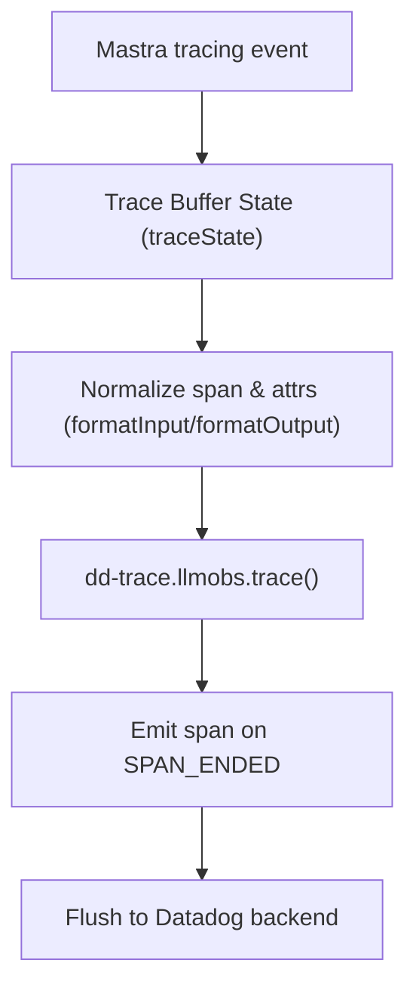
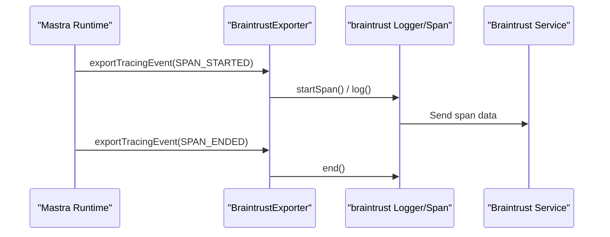
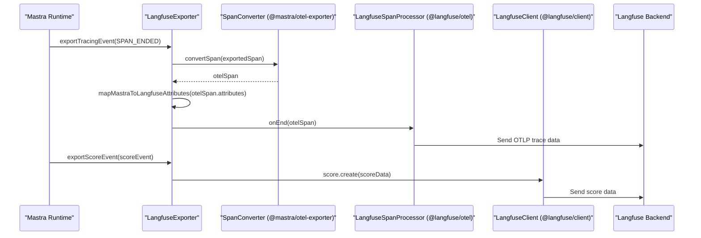
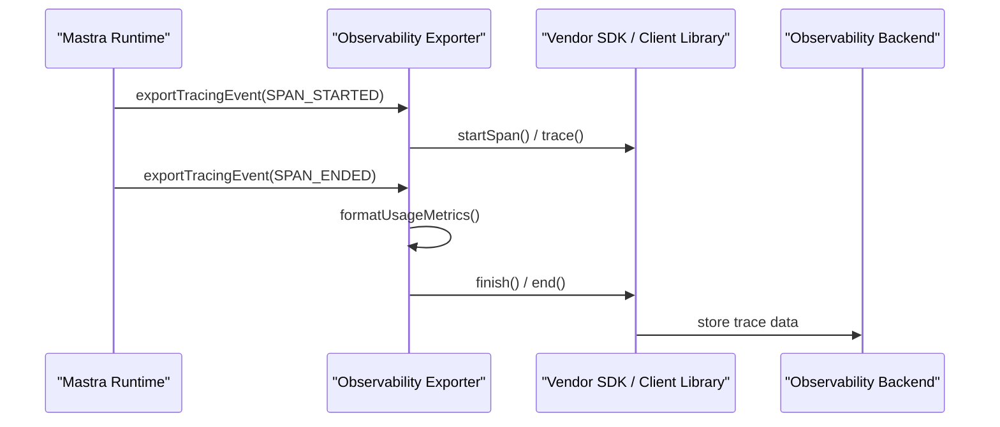
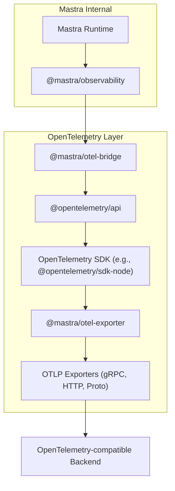

<!-- source: DeepWiki mcp.deepwiki.com · repo mastra-ai/mastra · page 11.2 Observability Integration and Exporters · fetched 2026-10-26 -->

# Observability Integration and Exporters

<details>
<summary>Relevant source files</summary>

The following files were used as context for generating this wiki page:

- [.changeset/lazy-rooms-beam.md](.changeset/lazy-rooms-beam.md)
- [docs/src/content/en/integrations/observability/langfuse.mdx](docs/src/content/en/integrations/observability/langfuse.mdx)
- [docs/src/content/en/reference/observability/tracing/exporters/langfuse.mdx](docs/src/content/en/reference/observability/tracing/exporters/langfuse.mdx)
- [observability/arize/CHANGELOG.md](observability/arize/CHANGELOG.md)
- [observability/arize/package.json](observability/arize/package.json)
- [observability/arthur/CHANGELOG.md](observability/arthur/CHANGELOG.md)
- [observability/arthur/package.json](observability/arthur/package.json)
- [observability/laminar/CHANGELOG.md](observability/laminar/CHANGELOG.md)
- [observability/laminar/package.json](observability/laminar/package.json)
- [observability/langfuse/CHANGELOG.md](observability/langfuse/CHANGELOG.md)
- [observability/langfuse/README.md](observability/langfuse/README.md)
- [observability/langfuse/package.json](observability/langfuse/package.json)
- [observability/langfuse/src/helpers.ts](observability/langfuse/src/helpers.ts)
- [observability/langfuse/src/index.ts](observability/langfuse/src/index.ts)
- [observability/langfuse/src/session-correlation.test.ts](observability/langfuse/src/session-correlation.test.ts)
- [observability/langfuse/src/tracing.converter.test.ts](observability/langfuse/src/tracing.converter.test.ts)
- [observability/langfuse/src/tracing.test.ts](observability/langfuse/src/tracing.test.ts)
- [observability/langfuse/src/tracing.ts](observability/langfuse/src/tracing.ts)
- [observability/mastra/src/features.ts](observability/mastra/src/features.ts)
- [observability/otel-bridge/CHANGELOG.md](observability/otel-bridge/CHANGELOG.md)
- [observability/otel-bridge/package.json](observability/otel-bridge/package.json)
- [observability/otel-exporter/CHANGELOG.md](observability/otel-exporter/CHANGELOG.md)
- [observability/otel-exporter/package.json](observability/otel-exporter/package.json)
- [observability/sentry/CHANGELOG.md](observability/sentry/CHANGELOG.md)
- [observability/sentry/package.json](observability/sentry/package.json)
- [packages/core/src/features/index.ts](packages/core/src/features/index.ts)
- [packages/memory/src/processors/observational-memory/tracing.test.ts](packages/memory/src/processors/observational-memory/tracing.test.ts)
- [packages/memory/src/processors/observational-memory/tracing.ts](packages/memory/src/processors/observational-memory/tracing.ts)

</details>


This page documents the Mastra framework's observability integration, focusing on vendor-specific exporters, span types, and the underlying data flow. Mastra uses a structured telemetry system to capture execution traces for agents, workflows, and tools, enabling developers to export this data to third-party platforms like Braintrust, Langfuse, Langsmith, Datadog, Arize, Sentry, PostHog, Laminar, and Arthur.

---

## System Overview

Mastra's observability system is architected with a provider-agnostic core that defines standard span types and attributes used throughout the framework. The observability system manages the lifecycle of spans representing different operations such as agent runs, model calls, tool executions, and workflow steps. These spans are then transformed and dispatched by exporter implementations specific to each observability vendor.

### Span Types and Hierarchy

Mastra defines a comprehensive `SpanType` enumeration to categorize various AI and workflow operations, allowing exporters to map internal span information to relevant vendor-specific semantic types or constructs.

| Category | Span Types | Purpose |
|---|---|---|
| **Agent** | `AGENT_RUN`, `PROCESSOR_RUN` | Root agent execution and processing of input/output |
| **Model** | `MODEL_GENERATION`, `MODEL_STEP`, `MODEL_CHUNK`, `MODEL_INFERENCE` | LLM API calls, step execution, stream chunks, and raw inference calls |
| **Workflow** | `WORKFLOW_RUN`, `WORKFLOW_STEP`, `WORKFLOW_CONDITIONAL`, `WORKFLOW_LOOP`, `WORKFLOW_SLEEP` | Workflow orchestration and control flow constructs |
| **Tools** | `TOOL_CALL`, `MCP_TOOL_CALL`, `PROVIDER_TOOL_CALL`, `CLIENT_TOOL_CALL` | Local, MCP-based, provider-executed, and client-side tool executions |
| **Evaluation**| `SCORER_RUN`, `SCORER_STEP` | Evaluation scorer runs and individual scorer steps |
| **RAG** | `RAG_INGESTION`, `RAG_EMBEDDING`, `RAG_VECTOR_OPERATION`, `RAG_ACTION` | Document ingestion, embedding, vector indexing, and related RAG actions |

Each span type carries metadata attributes tailored for its purpose, such as token usage details for model spans or instruction and prompt data for agent runs.
Sources: [observability/langfuse/src/tracing.test.ts:1-2]()

---

### Natural Language to Code Entity Mapping

To clarify the linkage between domain concepts and implementation artifacts, the following diagram illustrates key system components that relate human-understandable observability aspects to their corresponding code entities in Mastra observability layers.

#### Diagram: Observability Entity Mapping
```mermaid
graph TD
    subgraph "NaturalLanguageSpace"
        ["User triggers Agent/Workflow"]
        ["LLM Generation"]
        ["Tool Execution"]
        ["Workflow Execution"]
        ["Evaluation Scoring"]
    end

    subgraph "CodeEntitySpace"
        MastraClass["Mastra Class (@mastra/core)"]
        ObservabilitySys["Observability System (@mastra/observability)"]
        SpanTypeEnum["SpanType Enum (core/observability/types/core.ts)"]
        TrackingExporterClass["TrackingExporter (@mastra/observability)"]
        BaseExporterClass["BaseExporter (@mastra/observability)"]
        BraintrustExporterClass["BraintrustExporter (observability/braintrust/src/tracing.ts)"]
        DatadogExporterClass["DatadogExporter (observability/datadog/src/tracing.ts)"]
        LangsmithExporterClass["LangsmithExporter (observability/langsmith/src/tracing.ts)"]
        LangfuseExporterClass["LangfuseExporter (observability/langfuse/src/tracing.ts)"]
        ArizeExporterPkg["@mastra/arize (observability/arize/package.json)"]
        OtelExporterPkg["@mastra/otel-exporter (observability/otel-exporter/package.json)"]
        OtelBridgePkg["@mastra/otel-bridge (observability/otel-bridge/package.json)"]
        LaminarExporterPkg["@mastra/laminar (observability/laminar/package.json)"]
        ArthurExporterPkg["@mastra/arthur (observability/arthur/package.json)"]
        SentryExporterPkg["@mastra/sentry (observability/sentry/package.json)"]
    end

    ["User triggers Agent/Workflow"] --> MastraClass
    MastraClass --> ObservabilitySys
    ObservabilitySys --> SpanTypeEnum
    ObservabilitySys --> TrackingExporterClass
    TrackingExporterClass --> BaseExporterClass
    BaseExporterClass --> BraintrustExporterClass
    BaseExporterClass --> DatadogExporterClass
    BaseExporterClass --> LangsmithExporterClass
    BaseExporterClass --> LangfuseExporterClass
    BaseExporterClass --> ArizeExporterPkg
    BaseExporterClass --> LaminarExporterPkg
    BaseExporterClass --> ArthurExporterPkg
    BaseExporterClass --> SentryExporterPkg
    ObservabilitySys --> OtelExporterPkg
    ObservabilitySys --> OtelBridgePkg
```
Sources:
[observability/arize/package.json:34-40](),
[observability/arthur/package.json:34-42](),
[observability/langfuse/package.json:34-38](),
[observability/laminar/package.json:34-41](),
[observability/otel-bridge/package.json:34-38](),
[observability/otel-exporter/package.json:34-54](),
[observability/sentry/package.json:34-36]()

---

## Vendor Integrations and Exporters

Mastra includes a set of specialized exporters for different observability vendors. These exporters receive the framework’s standardized spans and convert them to vendor-specific formats, ensuring seamless telemetry ingestion.

### Datadog Integration

The `DatadogExporter` integrates with Datadog’s LLM Observability product by emitting spans using the `dd-trace` library.

- **Span Mapping:** Translates Mastra span types to Datadog span kinds, such as `AGENT_RUN` → `agent`, and `MODEL_INFERENCE` → `llm`.
- **Initialization:** The exporter handles its configuration by reading the ML app name, API key, site, and environment variables. It initializes the `dd-trace` tracer via internal setup.
- **Trace State Management:** Maintains internal state to buffer spans and ensure proper parent-child relationships before emission.
- **Metadata Normalization:** Flattens metadata into searchable Datadog tags, supporting both agent and agentless modes.

#### Diagram: DatadogExporter Flow

Sources:
[docs/src/content/en/reference/observability/tracing/exporters/datadog.mdx:1-20]()

---

### Braintrust Integration

The `BraintrustExporter` streams Mastra telemetry to Braintrust for advanced tracing and evaluation.

- **Thread Reconstruction:** Uses `reconstructThreadOutput` to build a cohesive view of agentic workflows from disparate spans.
- **Integration Modes:** Supports receiving injected `braintrustLogger` instances or creates one lazily using `initLogger`.
- **Span Mapping:** Maps Mastra span types to Braintrust span types like `'llm'`, `'tool'`, and `'function'`.
- **Score Submission:** Automatically exports scoring events to Braintrust logs using `logFeedback`.

#### Diagram: Braintrust Exporter Sequence

Sources:
[observability/langfuse/src/tracing.test.ts:157-188]()

---

### Langfuse Integration

The `@mastra/langfuse` package provides the `LangfuseExporter` for integrating with Langfuse. It leverages the official `@langfuse/otel` span processor and `@langfuse/client` for comprehensive observability.

- **Configuration:** The `LangfuseExporter` is configured with `publicKey`, `secretKey`, `baseUrl`, and optional `additionalHeaders`, `realtime` mode, `flushAt`, `flushInterval`, `environment`, and `release` parameters [observability/langfuse/src/tracing.ts:41-62](). These can be provided directly or via environment variables (`LANGFUSE_PUBLIC_KEY`, `LANGFUSE_SECRET_KEY`, `LANGFUSE_BASE_URL`, `LANGFUSE_TRACING_ENVIRONMENT`, `LANGFUSE_RELEASE`) [observability/langfuse/src/tracing.ts:77-80]().
- **Span Processing:** It uses `LangfuseSpanProcessor` from `@langfuse/otel` to handle span lifecycle events (`onStart`, `onEnd`) [observability/langfuse/src/tracing.ts:101-114]().
- **Span Conversion:** Mastra's internal `AnyExportedSpan` objects are converted to OpenTelemetry-compatible spans using `SpanConverter` from `@mastra/otel-exporter` [observability/langfuse/src/tracing.ts:128-133]().
- **Attribute Mapping:** A crucial step involves mapping Mastra-specific attributes (e.g., `mastra.metadata.*`) to Langfuse's expected `langfuse.*` namespace to ensure proper interpretation by the Langfuse OTLP endpoint [observability/langfuse/src/tracing.ts:157-161]().
- **Client Access:** The exporter exposes a `client` getter to provide direct access to the `LangfuseClient` instance for advanced features like prompt management, evaluations, and datasets [observability/langfuse/src/tracing.ts:173-175]().
- **Score Submission:** It handles `ScoreEvent`s, submitting them to Langfuse via `client.score.create` [observability/langfuse/src/tracing.ts:181-185]().

#### Diagram: Langfuse Exporter Flow

Sources:
[observability/langfuse/package.json:34-38](),
[observability/langfuse/src/tracing.ts:41-62](),
[observability/langfuse/src/tracing.ts:77-80](),
[observability/langfuse/src/tracing.ts:101-114](),
[observability/langfuse/src/tracing.ts:128-133](),
[observability/langfuse/src/tracing.ts:157-161](),
[observability/langfuse/src/tracing.ts:173-175](),
[observability/langfuse/src/tracing.ts:181-185]()

### Langsmith Integration

The `@mastra/langsmith` package utilizes the official `langsmith` SDK to export traces and evaluation data. The `LangsmithExporter` handles complex metadata mapping and token usage tracking.

### Arize, Arthur, and Laminar

These exporters focus on OpenInference semantic conventions and OTLP protocols:
- **Arize:** Uses `@arizeai/openinference-genai` and OTLP proto exporters [observability/arize/package.json:35-39]().
- **Arthur:** Exports traces using OpenInference semantic conventions [observability/arthur/package.json:4-36]().
- **Laminar:** Provides tracing and scoring export via OTLP [observability/laminar/package.json:4-37]().

### Sentry Integration

The `@mastra/sentry` package provides the `SentryExporter` for integrating with Sentry. It leverages the `@sentry/node` SDK to capture errors and performance data [observability/sentry/package.json:36](). The exporter also utilizes `@mastra/otel-exporter` for span conversion [observability/sentry/package.json:35]().

---

## Data Flow and Span Lifecycle

The observability system captures lifecycle events for spans generated by Mastra runs:

1. Spans are created when agents, workflows, models, or tools start execution.
2. Events (`SPAN_STARTED`, `SPAN_ENDED`, and scoring events) are published to exporters via `exportTracingEvent`.
3. Exporters transform span data using formatters (e.g., `convertAISDKMessage`, `serializeToolResult`).
4. Metrics like token usage are formatted via `formatUsageMetrics`.

#### Diagram: Exporter Event Processing Flow

Sources:
[observability/langfuse/src/tracing.test.ts:136-188]()

---

## Implementation Details

### OpenTelemetry Bridge and Exporter

The `@mastra/otel-exporter` package serves as the backbone for OTLP-based integrations. It supports OTLP traces and logs using gRPC, HTTP, or Proto protocols [observability/otel-exporter/package.json:4-53](). The `@mastra/otel-bridge` package provides a bridge for standard OpenTelemetry instrumentation to interact with Mastra's observability system [observability/otel-bridge/package.json:2-38]().

#### Diagram: OpenTelemetry Bridge and Exporter Architecture

Sources:
[observability/otel-bridge/package.json:2-38](),
[observability/otel-exporter/package.json:4-53]()

---

# Summary Table of Observability Exporters

| Vendor | Package | Key Features | Integration Notes |
|---|---|---|---|
| Braintrust | `@mastra/braintrust` | Thread reconstruction, feedback scoring | Supports `logger.traced()` integration |
| Langfuse | `@mastra/langfuse` | OTLP export, v5 SDK | Bridge to `@mastra/otel-exporter` |
| Langsmith | `@mastra/langsmith` | Official SDK integration | Native Langsmith tracing |
| Datadog | `@mastra/datadog` | LLM Observability kinds, agentless mode | Uses `dd-trace` |
| Arize | `@mastra/arize` | OpenInference conventions | OTLP Proto export |
| Arthur | `@mastra/arthur` | OpenInference conventions | OTLP Proto export |
| Laminar | `@mastra/laminar` | Tracing + Scoring export | OTLP Proto export |
| Sentry | `@mastra/sentry` | Error tracking, performance monitoring | Uses `@sentry/node` SDK |

Sources:
[observability/arize/package.json:1-7](),
[observability/arthur/package.json:1-7](),
[observability/langfuse/package.json:1-7](),
[observability/laminar/package.json:1-7](),
[observability/otel-exporter/package.json:1-7](),
[observability/sentry/package.json:1-7]()

---

