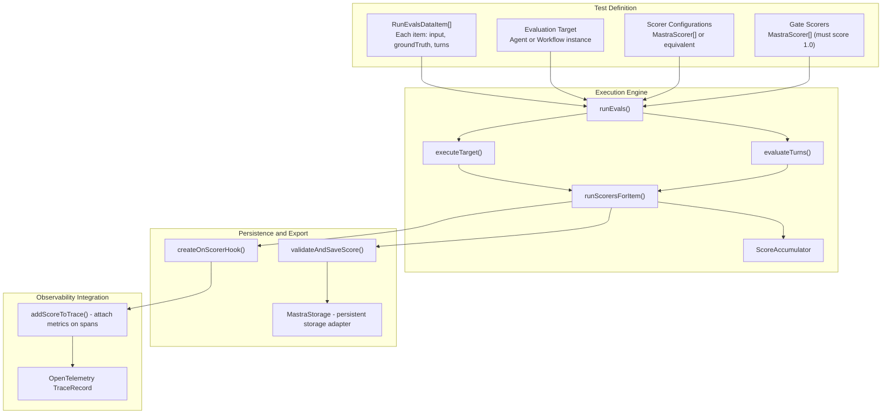
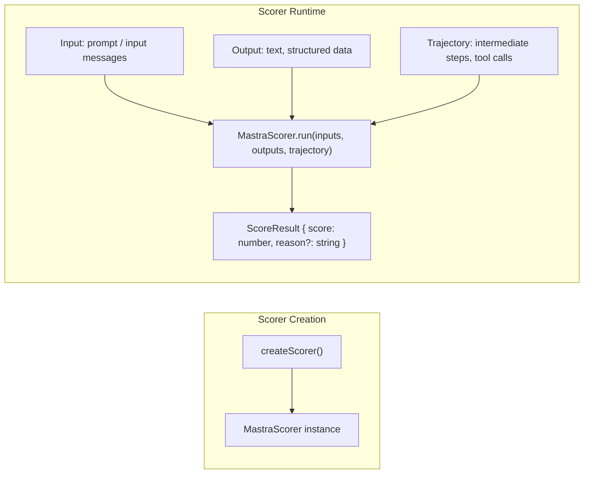
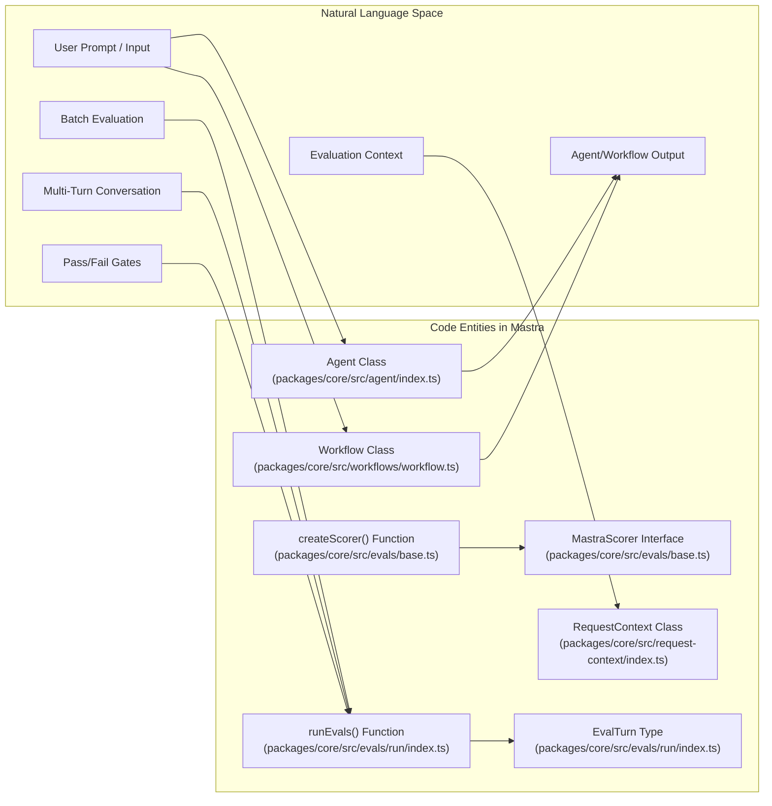
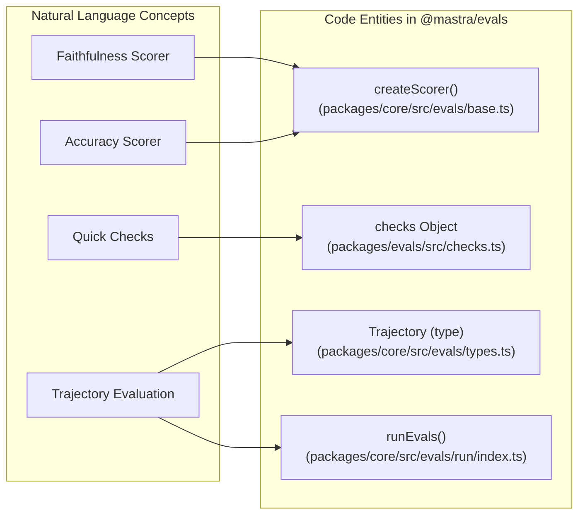

<!-- source: DeepWiki mcp.deepwiki.com · repo mastra-ai/mastra · page 11.3 Evaluation System and Scorers · fetched 2026-10-26 -->

# Evaluation System and Scorers

<details>
<summary>Relevant source files</summary>

The following files were used as context for generating this wiki page:

- [docs/src/content/en/docs/evals/custom-scorers.mdx](docs/src/content/en/docs/evals/custom-scorers.mdx)
- [docs/src/content/en/docs/evals/evals-with-memory.mdx](docs/src/content/en/docs/evals/evals-with-memory.mdx)
- [docs/src/content/en/docs/evals/running-in-ci.mdx](docs/src/content/en/docs/evals/running-in-ci.mdx)
- [docs/src/content/en/docs/evals/vitest-integration.mdx](docs/src/content/en/docs/evals/vitest-integration.mdx)
- [docs/src/content/en/docs/workflows/agents-and-tools.mdx](docs/src/content/en/docs/workflows/agents-and-tools.mdx)
- [docs/src/content/en/reference/evals/create-scorer.mdx](docs/src/content/en/reference/evals/create-scorer.mdx)
- [docs/src/content/en/reference/evals/mastra-scorer.mdx](docs/src/content/en/reference/evals/mastra-scorer.mdx)
- [docs/src/content/en/reference/evals/scorer-utils.mdx](docs/src/content/en/reference/evals/scorer-utils.mdx)
- [docs/src/content/en/reference/evals/trajectory-accuracy.mdx](docs/src/content/en/reference/evals/trajectory-accuracy.mdx)
- [examples/agent/src/mastra/agents/capitals.eval.test.ts](examples/agent/src/mastra/agents/capitals.eval.test.ts)
- [examples/agent/vitest.config.ts](examples/agent/vitest.config.ts)
- [examples/evals-with-memory/.gitignore](examples/evals-with-memory/.gitignore)
- [examples/evals-with-memory/README.md](examples/evals-with-memory/README.md)
- [examples/evals-with-memory/src/dataset.ts](examples/evals-with-memory/src/dataset.ts)
- [examples/evals-with-memory/src/runeval-global.ts](examples/evals-with-memory/src/runeval-global.ts)
- [examples/evals-with-memory/src/runeval-per-item.ts](examples/evals-with-memory/src/runeval-per-item.ts)
- [examples/evals-with-memory/src/shared.ts](examples/evals-with-memory/src/shared.ts)
- [packages/_internal-core/src/request-context/index.ts](packages/_internal-core/src/request-context/index.ts)
- [packages/core/src/agent/__tests__/delegation-memory-inheritance.test.ts](packages/core/src/agent/__tests__/delegation-memory-inheritance.test.ts)
- [packages/core/src/agent/__tests__/structured-output-tool-calls.test.ts](packages/core/src/agent/__tests__/structured-output-tool-calls.test.ts)
- [packages/core/src/agent/__tests__/utils.test.ts](packages/core/src/agent/__tests__/utils.test.ts)
- [packages/core/src/agent/utils.test.ts](packages/core/src/agent/utils.test.ts)
- [packages/core/src/agent/utils.ts](packages/core/src/agent/utils.ts)
- [packages/core/src/evals/base.test.ts](packages/core/src/evals/base.test.ts)
- [packages/core/src/evals/base.ts](packages/core/src/evals/base.ts)
- [packages/core/src/evals/types.test.ts](packages/core/src/evals/types.test.ts)
- [packages/core/src/evals/types.ts](packages/core/src/evals/types.ts)
- [packages/core/src/loop/loop.test.ts](packages/core/src/loop/loop.test.ts)
- [packages/core/src/request-context/index.test.ts](packages/core/src/request-context/index.test.ts)
- [packages/core/src/request-context/index.ts](packages/core/src/request-context/index.ts)
- [packages/evals/src/scorers/code/trajectory/index.test.ts](packages/evals/src/scorers/code/trajectory/index.test.ts)
- [packages/evals/src/scorers/code/trajectory/index.ts](packages/evals/src/scorers/code/trajectory/index.ts)
- [packages/evals/src/scorers/llm/trajectory/index.ts](packages/evals/src/scorers/llm/trajectory/index.ts)
- [packages/evals/src/scorers/utils.test.ts](packages/evals/src/scorers/utils.test.ts)
- [packages/evals/src/scorers/utils.ts](packages/evals/src/scorers/utils.ts)
- [packages/evals/src/vitest/expect-evals.test.ts](packages/evals/src/vitest/expect-evals.test.ts)
- [packages/evals/src/vitest/expect-evals.ts](packages/evals/src/vitest/expect-evals.ts)
- [packages/playground/src/domains/datasets/components/datasets-list/no-datasets-info.tsx](packages/playground/src/domains/datasets/components/datasets-list/no-datasets-info.tsx)
- [packages/playground/src/domains/datasets/components/empty-datasets-table.tsx](packages/playground/src/domains/datasets/components/empty-datasets-table.tsx)
- [packages/playground/src/domains/experiments/components/no-experiments-info.tsx](packages/playground/src/domains/experiments/components/no-experiments-info.tsx)
- [packages/server/src/server/constants.test.ts](packages/server/src/server/constants.test.ts)
- [packages/server/src/server/constants.ts](packages/server/src/server/constants.ts)
- [server-adapters/hono/src/__tests__/agent-scopes-security.test.ts](server-adapters/hono/src/__tests__/agent-scopes-security.test.ts)

</details>


## Purpose and Scope

The Mastra evaluation system provides facilities for automated quality assessment of agent and workflow output. It supports structured evaluation definitions leveraging prebuilt and custom scorers that analyze output text, tool usage trajectories, and workflow execution paths. In tandem with the observability framework, evaluations generate actionable metrics and trace-level telemetry for monitoring and improvement.

This page documents the key packages and components in the evaluation system, including:

- `@mastra/core/evals` — core evaluation execution types, primary runner functions, and scorer interfaces.
- `@mastra/evals` — prebuilt NLP and LLM-based scorers, utilities to extract and evaluate trajectories.
- Scorer lifecycle, input/output handling, and the persistence mechanism for scores.
- Integration of custom metrics and trajectory-based evaluation for agent run correctness and efficiency.

Sources: [docs/src/content/en/docs/evals/overview.mdx:9-15]()

---

## Package Structure and Exports

| Package / Export Path | Description | Key Exports and Contents |
| :-------------------- | :---------- | :----------------------- |
| `@mastra/core/evals` | Core evaluation logic | `createScorer`, `ScorerJudgeConfig`, `ScorerRun`, `MastraScorer` interface, `runEvals` |
| `@mastra/evals` | Prebuilt scorers and utilities | LLM/NLP scorers for faithfulness, bias, toxicity; `extractTrajectory` utilities |
| `@mastra/evals/scorers/prebuilt` | Concrete scorer implementations | Prebuilt LLM-judge scorers, relevance, hallucination, tool usage scorers |
| `@mastra/evals/scorers/utils` | Utilities for trajectory extraction and scoring | Trajectory extraction functions for workflows and agents |
| `@mastra/evals/checks` | Quick, deterministic assertions on text and tool usage | `checks.calledTool`, `checks.includes`, `checks.noToolErrors` |
| `@mastra/rag` | Vector RAG-specific evaluation extensions | `rerankWithScorer` helper integrating evaluator with RAG reranking |

Sources: [packages/core/src/evals/base.ts:141-155]()

---

## Evaluation System Architecture

The evaluation system flows through several core components, depicted below:

Title: Evaluation Data Flow and Component Interaction


- **Data inputs** include test data items with inputs, ground truths, and optionally `turns` for multi-turn conversations, the agent or workflow target under test, and the set of scorer definitions.
- The **evaluation engine** runs the target for each test item, then applies scoring logic (`runScorersForItem`), accumulating results progressively (`ScoreAccumulator`).
- Results are persisted to storage via `validateAndSaveScore` and optionally emitted as metrics on observability traces.

Sources: [packages/core/src/evals/run/index.ts:11-29](), [packages/core/src/evals/run/index.ts:50-102](), [packages/core/src/evals/run/index.ts:168-175]()

---

## Scorer Interface and Lifecycle

Mastra scorers are defined using the `createScorer` helper, producing instances conforming to `MastraScorer`. Each scorer has a unique identifier and a lifecycle method `run` which accepts inputs, outputs, and optionally the full execution trajectory.

Title: Scorer Lifecycle and Execution Path


- The `run` method returns a numeric score (commonly between 0 and 1) and an optional explanatory reason string [packages/core/src/evals/types.ts:114-118]().
- Input and output types are flexible: string text, model messages array, or structured workflow input/output objects.
- The trajectory argument enables scorers to evaluate correctness and efficiency of multi-step execution [packages/core/src/evals/types.ts:49-53]().

Sources: [packages/core/src/evals/base.ts:145-167](), [packages/core/src/evals/types.ts:114-118](), [packages/core/src/evals/types.ts:49-53]()

### `createScorer` Options

The `createScorer` function [packages/core/src/evals/base.ts:348-348]() takes a configuration object with the following properties:

| Property | Type | Optional | Description |
| :------- | :--- | :------- | :---------- |
| `id` | `string` | No | Unique identifier for the scorer [packages/core/src/evals/base.ts:162-162](). |
| `name` | `string` | Yes | Name of the scorer. Defaults to `id` [packages/core/src/evals/base.ts:163-163](). |
| `description` | `string` | No | Description of what the scorer does [packages/core/src/evals/base.ts:164-164](). |
| `judge` | `ScorerJudgeConfig` | Yes | Optional judge configuration for LLM-as-judge for evaluation steps [packages/core/src/evals/base.ts:165-165](). |
| `type` | `keyof ScorerTypeShortcuts` | Yes | Type specification for input/output (e.g., 'agent', 'trajectory') [packages/core/src/evals/base.ts:62-70](). |
| `prepareRun` | `Function` | Yes | Transforms the scorer run data before the `SCORER_RUN` span is created [packages/core/src/evals/base.ts:172-174](). |

Sources: [packages/core/src/evals/base.ts:62-70](), [packages/core/src/evals/base.ts:162-174]()

### `ScorerJudgeConfig`

The `judge` property allows configuring an LLM-as-judge for evaluation steps. This configuration enables the judge agent to use tools, memory, and processors.

| Property | Type | Optional | Description |
| :------- | :------- | :------- | :---------- |
| `model` | `MastraModelConfig` | No | The LLM model instance to use for evaluation [packages/core/src/evals/base.ts:82-82](). |
| `instructions` | `string` | No | System prompt/instructions for the LLM [packages/core/src/evals/base.ts:83-83](). |
| `tools` | `ToolsInput` | Yes | Optional tools the judge agent may call while evaluating [packages/core/src/evals/base.ts:90-90](). |
| `memory` | `MastraMemory` | Yes | Optional memory instance for the internal judge agent [packages/core/src/evals/base.ts:92-92](). |
| `inputProcessors` | `InputProcessorOrWorkflow[]` | Yes | Input processors applied to the internal judge agent [packages/core/src/evals/base.ts:110-110](). |
| `outputProcessors` | `OutputProcessorOrWorkflow[]` | Yes | Output processors applied to the judge's output [packages/core/src/evals/base.ts:115-115](). |
| `errorProcessors` | `ErrorProcessorOrWorkflow[]` | Yes | Error processors for the internal judge agent (V2+) [packages/core/src/evals/base.ts:122-122](). |
| `maxSteps` | `number` | Yes | Optional maximum number of agentic loop iterations for the internal judge [packages/core/src/evals/base.ts:104-104](). |
| `requestContext` | `RequestContext<any>` | Yes | Optional request context forwarded to the judge agent execution [packages/core/src/evals/base.ts:147-147](). |

Sources: [packages/core/src/evals/base.ts:81-148]()

---

## Experiments and Batch Evaluation

Mastra supports orchestrating batch experiments that evaluate datasets with multiple scorers running on agents or workflows.

- **`runExperiment`** executes all items in a dataset concurrently (up to `maxConcurrency`) against a specified target (agent or workflow).
- **`runEvals`** is the primary entry point for multi-turn evaluations and per-turn assertions.
- **`DataItem`** represents a single test case with `input`, `groundTruth`, and optional metadata.
- **`RunEvalsResult`** provides the final results including `scores`, `summary`, and `verdict`.

### Tool Mocking in Experiments
Experiments support `toolMocks` to simulate tool outputs during agent evaluation. The `unmockedToolPolicy` determines whether unmocked tools are allowed to execute.

Sources: [packages/core/src/evals/run/index.ts:39-85](), [packages/core/src/evals/run/index.ts:142-166](), [packages/core/src/evals/run/index.ts:168-168]()

---

## Code Entity Space Mapping

This diagram bridges concept names in natural language to the concrete code entities involved in evaluation:

Title: Natural Language Space to Code Entity Space Mapping


**Explanation:**
- The `Agent` and `Workflow` classes produce the outputs that are scored.
- `createScorer()` [packages/core/src/evals/base.ts:348-348]() is the factory for `MastraScorer`.
- `runEvals()` [packages/core/src/evals/run/index.ts:168-168]() handles batch execution of datasets and complex multi-turn scenarios using `EvalTurn`.

Sources: [packages/core/src/evals/base.ts:348-348](), [packages/core/src/evals/run/index.ts:50-57](), [packages/core/src/evals/run/index.ts:168-168]()

---

## Custom Evaluation Metrics

The `createScorer` API allows developers to define custom evaluation logic using native JavaScript or LLM-based steps.

```typescript
import { createScorer } from '@mastra/core/evals'
import { z } from 'zod/v4';

const customScorer = createScorer({
  id: 'my-custom-scorer',
  description: 'Evaluates responses based on custom criteria',
})
  .preprocess({
    description: 'Extract key phrases',
    createPrompt: ({ run }) => `Extract key phrases from: ${run.inputData.inputMessages[0]?.content}`,
    outputSchema: z.object({ keyPhrases: z.array(z.string()) }),
  })
  .generateScore(({ run, results }) => {
    const response = run.output[0]?.content;
    const hasKeyPhrase = results.preprocessStepResult.keyPhrases.some(phrase => response.includes(phrase));
    return hasKeyPhrase ? 1.0 : 0.0;
  });
```

Sources: [packages/core/src/evals/base.ts:348-430](), [packages/core/src/evals/base.test.ts:167-210]()

---

## Mapping Natural Language Scorers to Code Entities

Title: Scorer Domain Mapping


Sources: [packages/core/src/evals/base.ts:348-348](), [packages/core/src/evals/types.ts:49-51](), [packages/core/src/evals/run/index.ts:168-168]()

---

