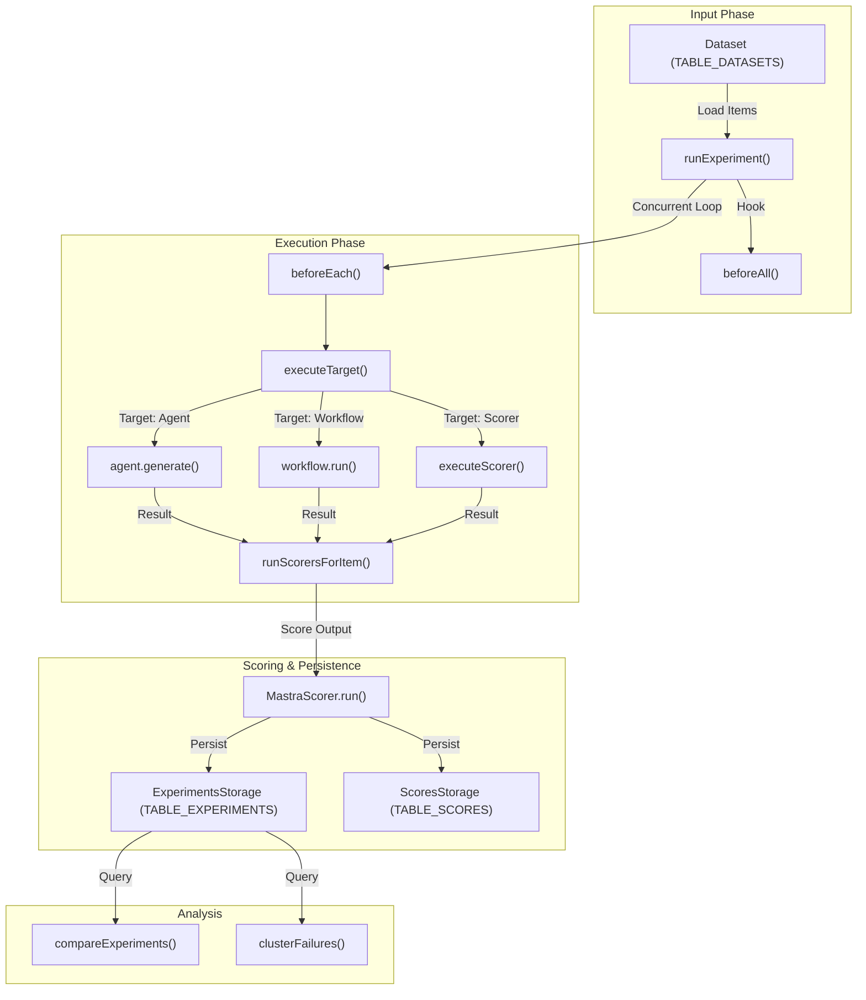
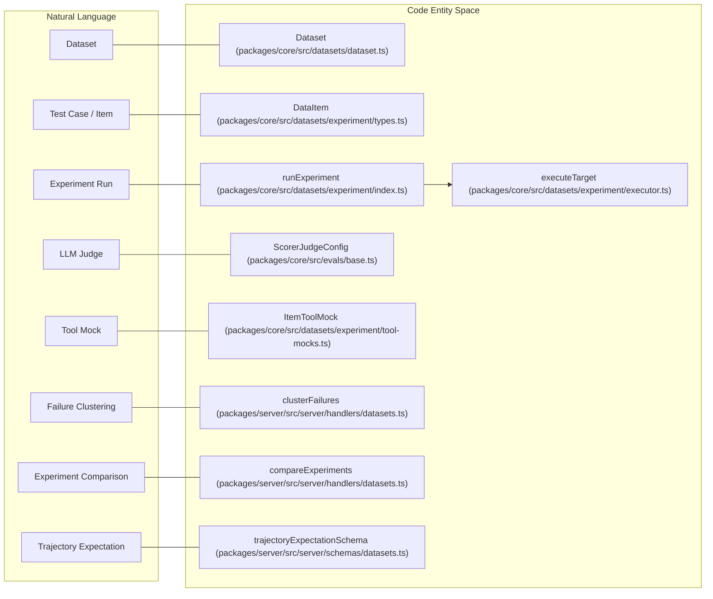

<!-- source: DeepWiki mcp.deepwiki.com · repo mastra-ai/mastra · page 11.4 Datasets and Experiments · fetched 2026-10-26 -->

# Datasets and Experiments

Relevant source files

The following files were used as context for generating this wiki page:

- [client-sdks/client-js/src/client.test.ts](client-sdks/client-js/src/client.test.ts)
- [client-sdks/client-js/src/resources/memory-thread.test.ts](client-sdks/client-js/src/resources/memory-thread.test.ts)
- [client-sdks/client-js/src/resources/memory-thread.ts](client-sdks/client-js/src/resources/memory-thread.ts)
- [packages/core/src/agent/__tests__/dynamic-memory.test.ts](packages/core/src/agent/__tests__/dynamic-memory.test.ts)
- [packages/core/src/agent/__tests__/instructions.test.ts](packages/core/src/agent/__tests__/instructions.test.ts)
- [packages/core/src/agent/__tests__/workspace-tool-context.test.ts](packages/core/src/agent/__tests__/workspace-tool-context.test.ts)
- [packages/core/src/datasets/__tests__/dataset.test.ts](packages/core/src/datasets/__tests__/dataset.test.ts)
- [packages/core/src/datasets/dataset.ts](packages/core/src/datasets/dataset.ts)
- [packages/core/src/datasets/experiment/__tests__/runExperiment.test.ts](packages/core/src/datasets/experiment/__tests__/runExperiment.test.ts)
- [packages/core/src/datasets/experiment/__tests__/scorer-trajectory.test.ts](packages/core/src/datasets/experiment/__tests__/scorer-trajectory.test.ts)
- [packages/core/src/datasets/experiment/index.ts](packages/core/src/datasets/experiment/index.ts)
- [packages/core/src/datasets/experiment/item.ts](packages/core/src/datasets/experiment/item.ts)
- [packages/core/src/datasets/experiment/scorer.ts](packages/core/src/datasets/experiment/scorer.ts)
- [packages/core/src/datasets/experiment/types.ts](packages/core/src/datasets/experiment/types.ts)
- [packages/core/src/datasets/manager.ts](packages/core/src/datasets/manager.ts)
- [packages/core/src/evals/flush-before-trace-read.test.ts](packages/core/src/evals/flush-before-trace-read.test.ts)
- [packages/core/src/evals/flush-before-trace-read.ts](packages/core/src/evals/flush-before-trace-read.ts)
- [packages/core/src/storage/domains/datasets/__tests__/datasets.test.ts](packages/core/src/storage/domains/datasets/__tests__/datasets.test.ts)
- [packages/core/src/storage/domains/datasets/inmemory.ts](packages/core/src/storage/domains/datasets/inmemory.ts)
- [packages/core/src/storage/domains/experiments/inmemory.ts](packages/core/src/storage/domains/experiments/inmemory.ts)
- [packages/playground-ui/src/ds/components/DataPanel/data-panel-close-button.tsx](packages/playground-ui/src/ds/components/DataPanel/data-panel-close-button.tsx)
- [packages/playground-ui/src/ds/components/DataPanel/data-panel-content.tsx](packages/playground-ui/src/ds/components/DataPanel/data-panel-content.tsx)
- [packages/playground-ui/src/ds/components/DataPanel/data-panel-header.tsx](packages/playground-ui/src/ds/components/DataPanel/data-panel-header.tsx)
- [packages/playground-ui/src/ds/components/DataPanel/data-panel-heading.tsx](packages/playground-ui/src/ds/components/DataPanel/data-panel-heading.tsx)
- [packages/playground-ui/src/ds/components/DataPanel/data-panel-next-prev-nav.tsx](packages/playground-ui/src/ds/components/DataPanel/data-panel-next-prev-nav.tsx)
- [packages/playground-ui/src/ds/components/DataPanel/data-panel-root.tsx](packages/playground-ui/src/ds/components/DataPanel/data-panel-root.tsx)
- [packages/playground-ui/src/ds/components/DataPanel/data-panel.stories.tsx](packages/playground-ui/src/ds/components/DataPanel/data-panel.stories.tsx)
- [packages/playground-ui/src/ds/components/DataPanel/data-panel.test.tsx](packages/playground-ui/src/ds/components/DataPanel/data-panel.test.tsx)
- [packages/playground-ui/src/ds/components/DataPanel/data-panel.tsx](packages/playground-ui/src/ds/components/DataPanel/data-panel.tsx)
- [packages/playground-ui/src/ds/components/DataPanel/index.ts](packages/playground-ui/src/ds/components/DataPanel/index.ts)
- [packages/playground/e2e/tests/datasets/item-review-panels-layout.spec.ts](packages/playground/e2e/tests/datasets/item-review-panels-layout.spec.ts)
- [packages/playground/src/domains/experiments/__tests__/experiment-crumb.msw.test.tsx](packages/playground/src/domains/experiments/__tests__/experiment-crumb.msw.test.tsx)
- [packages/playground/src/domains/experiments/__tests__/experiment-item-route.msw.test.tsx](packages/playground/src/domains/experiments/__tests__/experiment-item-route.msw.test.tsx)
- [packages/playground/src/domains/experiments/__tests__/experiment-page-lookup.msw.test.tsx](packages/playground/src/domains/experiments/__tests__/experiment-page-lookup.msw.test.tsx)
- [packages/playground/src/domains/experiments/__tests__/fixtures/experiment-item-route.ts](packages/playground/src/domains/experiments/__tests__/fixtures/experiment-item-route.ts)
- [packages/playground/src/domains/experiments/components/__tests__/experiment-kpis.test.tsx](packages/playground/src/domains/experiments/components/__tests__/experiment-kpis.test.tsx)
- [packages/playground/src/domains/experiments/components/__tests__/experiment-result-panel.test.tsx](packages/playground/src/domains/experiments/components/__tests__/experiment-result-panel.test.tsx)
- [packages/playground/src/domains/experiments/components/__tests__/experiment-results-list.test.tsx](packages/playground/src/domains/experiments/components/__tests__/experiment-results-list.test.tsx)
- [packages/playground/src/domains/experiments/components/__tests__/experiment-results-section.msw.test.tsx](packages/playground/src/domains/experiments/components/__tests__/experiment-results-section.msw.test.tsx)
- [packages/playground/src/domains/experiments/components/__tests__/fixtures/experiment-results.ts](packages/playground/src/domains/experiments/components/__tests__/fixtures/experiment-results.ts)
- [packages/playground/src/domains/experiments/components/__tests__/fixtures/experiment-usage.ts](packages/playground/src/domains/experiments/components/__tests__/fixtures/experiment-usage.ts)
- [packages/playground/src/domains/experiments/components/__tests__/rerun-experiment-button.msw.test.tsx](packages/playground/src/domains/experiments/components/__tests__/rerun-experiment-button.msw.test.tsx)
- [packages/playground/src/domains/experiments/components/comparison/item-metrics.tsx](packages/playground/src/domains/experiments/components/comparison/item-metrics.tsx)
- [packages/playground/src/domains/experiments/components/comparison/score-reason-hover-card.tsx](packages/playground/src/domains/experiments/components/comparison/score-reason-hover-card.tsx)
- [packages/playground/src/domains/experiments/components/experiment-item-panel.tsx](packages/playground/src/domains/experiments/components/experiment-item-panel.tsx)
- [packages/playground/src/domains/experiments/components/experiment-item-side-panel.tsx](packages/playground/src/domains/experiments/components/experiment-item-side-panel.tsx)
- [packages/playground/src/domains/experiments/components/experiment-kpis.tsx](packages/playground/src/domains/experiments/components/experiment-kpis.tsx)
- [packages/playground/src/domains/experiments/components/experiment-result-detail.tsx](packages/playground/src/domains/experiments/components/experiment-result-detail.tsx)
- [packages/playground/src/domains/experiments/components/experiment-result-panel.tsx](packages/playground/src/domains/experiments/components/experiment-result-panel.tsx)
- [packages/playground/src/domains/experiments/components/experiment-results-list.tsx](packages/playground/src/domains/experiments/components/experiment-results-list.tsx)
- [packages/playground/src/domains/experiments/components/experiment-score-panel.tsx](packages/playground/src/domains/experiments/components/experiment-score-panel.tsx)
- [packages/playground/src/domains/experiments/components/rerun-experiment-button.tsx](packages/playground/src/domains/experiments/components/rerun-experiment-button.tsx)
- [packages/playground/src/domains/experiments/experiment-crumb.tsx](packages/playground/src/domains/experiments/experiment-crumb.tsx)
- [packages/playground/src/domains/experiments/hooks/use-experiment-result-usage.ts](packages/playground/src/domains/experiments/hooks/use-experiment-result-usage.ts)
- [packages/playground/src/domains/review/components/dataset-review.tsx](packages/playground/src/domains/review/components/dataset-review.tsx)
- [packages/playground/src/pages/experiments/experiment/index.tsx](packages/playground/src/pages/experiments/experiment/index.tsx)
- [packages/playground/src/pages/experiments/review-queue/index.tsx](packages/playground/src/pages/experiments/review-queue/index.tsx)
- [packages/playground/src/pages/experiments/review-queue/review-queue-page.msw.test.tsx](packages/playground/src/pages/experiments/review-queue/review-queue-page.msw.test.tsx)
- [packages/server/src/server/handlers/datasets.test.ts](packages/server/src/server/handlers/datasets.test.ts)
- [packages/server/src/server/handlers/datasets.ts](packages/server/src/server/handlers/datasets.ts)
- [packages/server/src/server/schemas/datasets.ts](packages/server/src/server/schemas/datasets.ts)
- [stores/_test-utils/src/domains/datasets/index.ts](stores/_test-utils/src/domains/datasets/index.ts)
- [stores/_test-utils/src/domains/experiments/index.ts](stores/_test-utils/src/domains/experiments/index.ts)
- [stores/libsql/src/storage/domains/datasets/index.ts](stores/libsql/src/storage/domains/datasets/index.ts)
- [stores/libsql/src/storage/domains/experiments/index.ts](stores/libsql/src/storage/domains/experiments/index.ts)
- [stores/mongodb/src/storage/domains/datasets/index.ts](stores/mongodb/src/storage/domains/datasets/index.ts)
- [stores/mongodb/src/storage/domains/experiments/index.ts](stores/mongodb/src/storage/domains/experiments/index.ts)
- [stores/mongodb/src/storage/index.ts](stores/mongodb/src/storage/index.ts)
- [stores/mysql/src/storage/domains/datasets/index.ts](stores/mysql/src/storage/domains/datasets/index.ts)
- [stores/mysql/src/storage/domains/experiments/index.ts](stores/mysql/src/storage/domains/experiments/index.ts)
- [stores/pg/src/storage/domains/datasets/index.ts](stores/pg/src/storage/domains/datasets/index.ts)
- [stores/pg/src/storage/domains/experiments/index.ts](stores/pg/src/storage/domains/experiments/index.ts)
- [stores/spanner/src/storage/domains/datasets/index.ts](stores/spanner/src/storage/domains/datasets/index.ts)
- [stores/spanner/src/storage/domains/experiments/index.ts](stores/spanner/src/storage/domains/experiments/index.ts)

Datasets and Experiments in Mastra provide the infrastructure for systematic evaluation of AI systems. This system allows developers to create curated test sets (Datasets), execute them against AI targets like Agents or Workflows (Experiments), and quantitatively measure performance using scoring functions.

---

## Overview

The evaluation framework bridges the gap between raw model outputs and actionable performance metrics. It supports dataset lifecycle management, concurrent experiment execution, LLM-as-judge scoring, and diagnostic analysis such as failure clustering.

### Core Concepts

- **Dataset**: A collection of evaluation items stored in a database (e.g., PostgreSQL, LibSQL) [packages/core/src/datasets/dataset.ts:40-52]().
- **Dataset Item**: A single test case containing `input`, optional `groundTruth`, and `metadata` [packages/core/src/datasets/experiment/types.ts:20-69]().
- **Experiment**: A managed run where a `Target` (Agent, Workflow, or Scorer) processes a Dataset's items [packages/core/src/datasets/experiment/index.ts:121-147]().
- **Scorer**: A logic unit (code or LLM-based) that evaluates a target's output against a ground truth or criteria [packages/core/src/evals/base.ts:146-169]().
- **Trajectory**: The sequence of steps, tool calls, and thoughts an agent takes, which can be scored independently of the final answer [packages/core/src/evals/types.ts:5-10]().

**Sources:**
- [packages/core/src/datasets/dataset.ts:40-52]()
- [packages/core/src/datasets/experiment/types.ts:20-69]()
- [packages/core/src/datasets/experiment/index.ts:121-147]()
- [packages/core/src/evals/base.ts:146-169]()
- [packages/core/src/evals/types.ts:5-10]()

---

## Dataset Management

Datasets are managed via the `Dataset` class, which provides an abstraction over lazy-loaded storage domains for datasets and experiments [packages/core/src/datasets/dataset.ts:40-116]().

### Item CRUD and Versioning
Datasets support adding individual items or batching payloads. When items are added, they are persisted to the configured `DatasetsStorage` [packages/core/src/datasets/dataset.ts:227-280]().
- **Input/Ground Truth Schemas**: Datasets can enforce Zod-based schemas for their items, which are normalized to JSON Schema for storage compatibility [packages/core/src/datasets/dataset.ts:184-199]().
- **Tenancy**: All operations support `DatasetTenancyFilters` to ensure resource isolation in multi-tenant environments [packages/core/src/datasets/dataset.ts:126-138]().
- **Item Sources**: Dataset items can track their origin (e.g., `csv`, `json`, `trace`, `llm`, `experiment-result`, `candidate-screener`) via the `source` field [packages/server/src/server/schemas/datasets.ts:175-182]().

**Sources:**
- [packages/core/src/datasets/dataset.ts:40-116]()
- [packages/core/src/datasets/dataset.ts:126-138]()
- [packages/core/src/datasets/dataset.ts:184-199]()
- [packages/core/src/datasets/dataset.ts:227-280]()
- [packages/server/src/server/schemas/datasets.ts:175-182]()

---

## Experiment Execution Flow

The `runExperiment` function is the primary entry point for evaluation. It orchestrates the concurrent execution of dataset items against a target [packages/core/src/datasets/experiment/index.ts:121-183]().

### Execution Lifecycle
1. **Setup**: Resolves the target (Agent/Workflow) and scorers from the Mastra registry [packages/core/src/datasets/experiment/scorer.ts:39-58]().
2. **Hooks**: Executes `beforeAll` and `beforeEach` lifecycle hooks for environment seeding [packages/core/src/datasets/experiment/index.ts:143-146]().
3. **Target Execution**: The `executeTarget` function dispatches the item input to the specific target type [packages/core/src/datasets/experiment/executor.ts:7-9]().
   - **Agent Targets**: Calls `agent.generate()` or `agent.stream()`. Supports `toolMocks` to simulate tool outputs without real execution [packages/core/src/datasets/experiment/index.ts:41-42]().
   - **Workflow Targets**: Triggers a workflow run and tracks the step execution path [packages/core/src/datasets/experiment/types.ts:40-49]().
   - **Scorer Targets**: Directly executes a scorer, typically for LLM-as-judge calibration [packages/core/src/datasets/experiment/executor.ts:69-104]().
4. **Scoring**: Once the target completes, `runScorersForItem` executes the associated scorers [packages/core/src/datasets/experiment/scorer.ts:174-191]().
5. **Persistence**: Results and scores are saved to the `ExperimentsStorage` and `ScoresStorage` domains [packages/core/src/datasets/experiment/index.ts:149-150]().

### Tool Mocking
For agents, experiments support `ItemToolMock`. This allows developers to test agent logic by providing static responses for specific tool calls, preventing expensive or side-effect-heavy API calls during evaluation [packages/core/src/datasets/experiment/tool-mocks.ts:18-19](). The `unmockedToolPolicy` can be configured to `fail`, `warn`, or `allow` calls to tools not explicitly mocked [packages/core/src/datasets/experiment/tool-mocks.ts:19]().

**Sources:**
- [packages/core/src/datasets/experiment/index.ts:121-183]()
- [packages/core/src/datasets/experiment/scorer.ts:39-58]()
- [packages/core/src/datasets/experiment/tool-mocks.ts:18-19]()
- [packages/core/src/datasets/experiment/tool-mocks.ts:19]()
- [packages/core/src/datasets/experiment/executor.ts:7-9]()
- [packages/core/src/datasets/experiment/executor.ts:69-104]()
- [packages/core/src/datasets/experiment/scorer.ts:174-191]()

---

## Scoring and Evaluation Logic

Scorers are defined using `MastraScorer`, which supports both functional steps and LLM-as-judge steps [packages/core/src/evals/base.ts:146-169]().

### Scorer Types
- **Agent Scorer**: Evaluates the `input` and `output` of an agent run [packages/core/src/evals/base.ts:60-64]().
- **Trajectory Scorer**: Inspects the internal steps (thoughts, tool calls) taken by the agent using `expectedTrajectory` [packages/core/src/evals/types.ts:5-10](). The `TrajectoryExpectation` schema defines the expected sequence and properties of steps, including tool calls, model generations, and workflow steps [packages/server/src/server/schemas/datasets.ts:141-172]().
- **Step Scorers**: Evaluate specific steps within a workflow or agent trajectory, allowing for granular feedback [packages/core/src/datasets/experiment/scorer.ts:2-3]().

### LLM-as-Judge Configuration
LLM-based scorers use a `ScorerJudgeConfig` to define the model and instructions [packages/core/src/evals/base.ts:80-132](). They support:
- **Structured Output**: Ensuring the judge returns a valid score and reason using JSON fallback mechanisms [packages/core/src/agent/utils.ts:6-6]().
- **Error Processors**: Retrying transient LLM failures (e.g., rate limits) using specialized error handlers [packages/core/src/evals/base.ts:113-118]().

**Sources:**
- [packages/core/src/evals/base.ts:60-64]()
- [packages/core/src/evals/base.ts:80-132]()
- [packages/core/src/evals/base.ts:146-169]()
- [packages/core/src/evals/types.ts:5-10]()
- [packages/core/src/datasets/experiment/scorer.ts:2-3]()
- [packages/core/src/agent/utils.ts:6-6]()
- [packages/server/src/server/schemas/datasets.ts:141-172]()

---

## Technical Diagrams

### Experiment Data Flow
Title: Dataset Experiment Execution Pipeline

**Sources:**
- [packages/core/src/datasets/experiment/index.ts:121-200]()
- [packages/core/src/datasets/experiment/executor.ts:69-104]()
- [packages/core/src/storage/constants.ts:5-12]()
- [packages/core/src/storage/constants.ts:31-38]()

---

### Code Entity Mapping
Title: Natural Language to Code Entity Mapping

**Sources:**
- [packages/core/src/datasets/dataset.ts]()
- [packages/core/src/datasets/experiment/index.ts]()
- [packages/core/src/datasets/experiment/types.ts]()
- [packages/core/src/evals/base.ts]()
- [packages/core/src/datasets/experiment/tool-mocks.ts]()
- [packages/core/src/datasets/experiment/executor.ts]()
- [packages/server/src/server/handlers/datasets.ts]()
- [packages/server/src/server/schemas/datasets.ts]()

---

## Result Analysis and Storage

After execution, experiments provide diagnostic tools to identify systemic issues.

- **Storage Domains**: The system uses specialized domains for persistence, including `DatasetsPG`, `ExperimentsPG`, and `ScoresPG` for PostgreSQL [stores/pg/src/storage/domains/datasets/index.ts:86-101]() and `DatasetsLibSQL` for LibSQL [stores/libsql/src/storage/domains/datasets/index.ts:60-68](). Other storage providers like MongoDB, Spanner, and MySQL also implement the `DatasetsStorage` interface [stores/mongodb/src/storage/domains/datasets/index.ts](), [stores/spanner/src/storage/domains/datasets/index.ts](), [stores/mysql/src/storage/domains/datasets/index.ts]().
- **Table Structure**: Data is organized into tables like `mastra_datasets`, `mastra_experiments`, and `mastra_experiment_results` [packages/core/src/storage/constants.ts:31-38]().
- **Observability Integration**: Every experiment result is linked to traces and spans, allowing developers to inspect low-level OpenTelemetry data via the `TABLE_SPANS` and `TABLE_TRACES` storage [packages/core/src/storage/constants.ts:8-11]().
- **Failure Clustering**: The API provides an endpoint `/datasets/:datasetId/experiments/:experimentId/cluster-failures` to group similar failures, aiding in debugging and identifying common issues [packages/server/src/server/schemas/datasets.ts:38]().
- **Experiment Comparison**: The API supports comparing two experiments via `/datasets/:datasetId/compare-experiments`, which can highlight performance regressions or improvements [packages/server/src/server/schemas/datasets.ts:32]().

**Sources:**
- [stores/pg/src/storage/domains/datasets/index.ts:86-101]()
- [stores/libsql/src/storage/domains/datasets/index.ts:60-68]()
- [stores/mongodb/src/storage/domains/datasets/index.ts]()
- [stores/spanner/src/storage/domains/datasets/index.ts]()
- [stores/mysql/src/storage/domains/datasets/index.ts]()
- [packages/core/src/storage/constants.ts:8-11]()
- [packages/core/src/storage/constants.ts:31-38]()
- [packages/server/src/server/schemas/datasets.ts:38]()
- [packages/server/src/server/schemas/datasets.ts:32]()

---

