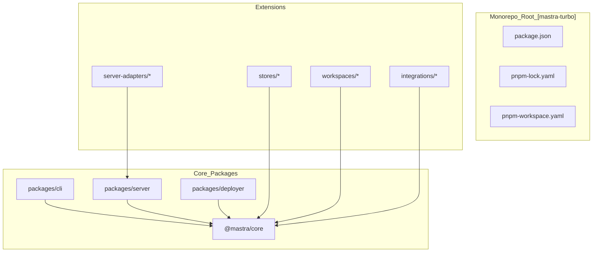
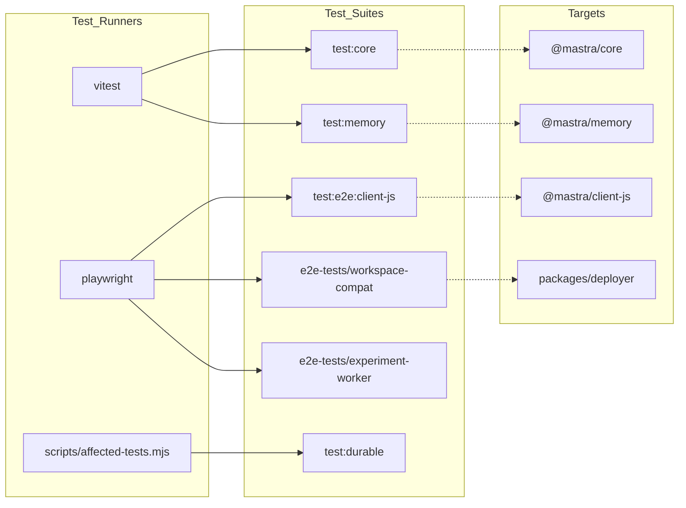
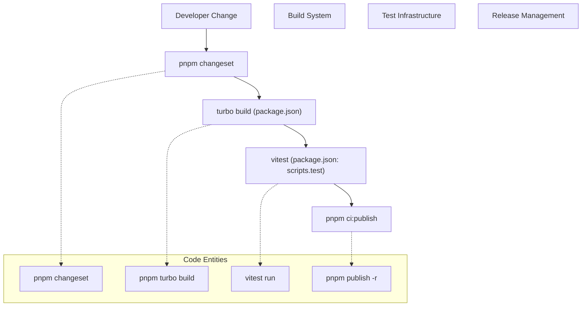
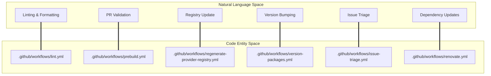

<!-- source: DeepWiki mcp.deepwiki.com · repo mastra-ai/mastra · page 12 Build, Test, and CI/CD · fetched 2026-10-26 -->

# Build, Test, and CI/CD

Relevant source files

The following files were used as context for generating this wiki page:

- [.changeset/node-security-2026-10-22.md](.changeset/node-security-2026-10-22.md)
- [.github/actions/app-auth/action.yaml](.github/actions/app-auth/action.yaml)
- [.github/actions/setup-pnpm-node/action.yaml](.github/actions/setup-pnpm-node/action.yaml)
- [.github/labeler.yml](.github/labeler.yml)
- [.github/workflows/backport-auto.yml](.github/workflows/backport-auto.yml)
- [.github/workflows/changed-test-gate-labeler.yml](.github/workflows/changed-test-gate-labeler.yml)
- [.github/workflows/changed-test-gate.yml](.github/workflows/changed-test-gate.yml)
- [.github/workflows/cron-alpha-publish.yml](.github/workflows/cron-alpha-publish.yml)
- [.github/workflows/e2e-docs.yml](.github/workflows/e2e-docs.yml)
- [.github/workflows/e2e-tests.yml](.github/workflows/e2e-tests.yml)
- [.github/workflows/issue-pending-release.yml](.github/workflows/issue-pending-release.yml)
- [.github/workflows/issue-triage.yml](.github/workflows/issue-triage.yml)
- [.github/workflows/labeler.yml](.github/workflows/labeler.yml)
- [.github/workflows/lint-docs.yml](.github/workflows/lint-docs.yml)
- [.github/workflows/lint.yml](.github/workflows/lint.yml)
- [.github/workflows/major-version-check.yml](.github/workflows/major-version-check.yml)
- [.github/workflows/mastracode-e2e.yml](.github/workflows/mastracode-e2e.yml)
- [.github/workflows/npm-publish.yml](.github/workflows/npm-publish.yml)
- [.github/workflows/prebuild.yml](.github/workflows/prebuild.yml)
- [.github/workflows/regenerate-provider-registry.yml](.github/workflows/regenerate-provider-registry.yml)
- [.github/workflows/renovate.yml](.github/workflows/renovate.yml)
- [.github/workflows/secrets.test-workspaces.yml](.github/workflows/secrets.test-workspaces.yml)
- [.github/workflows/sync-templates.yml](.github/workflows/sync-templates.yml)
- [.github/workflows/sync_renovate-changesets.yml](.github/workflows/sync_renovate-changesets.yml)
- [.github/workflows/test-combined-stores.yml](.github/workflows/test-combined-stores.yml)
- [.github/workflows/test-suite.yml](.github/workflows/test-suite.yml)
- [.github/workflows/test-workspaces.yml](.github/workflows/test-workspaces.yml)
- [.github/workflows/trigger-cloud-tests.yml](.github/workflows/trigger-cloud-tests.yml)
- [.github/workflows/version-packages.yml](.github/workflows/version-packages.yml)
- [.github/workflows/vitest-all.yml](.github/workflows/vitest-all.yml)
- [auth/better-auth/package.json](auth/better-auth/package.json)
- [e2e-tests/_local-registry-setup/pnpm-lock.yaml](e2e-tests/_local-registry-setup/pnpm-lock.yaml)
- [e2e-tests/_local-registry-setup/pnpm-workspace.yaml](e2e-tests/_local-registry-setup/pnpm-workspace.yaml)
- [e2e-tests/commonjs/template/package.json](e2e-tests/commonjs/template/package.json)
- [e2e-tests/experiment-worker/pnpm-lock.yaml](e2e-tests/experiment-worker/pnpm-lock.yaml)
- [e2e-tests/experiment-worker/pnpm-workspace.yaml](e2e-tests/experiment-worker/pnpm-workspace.yaml)
- [e2e-tests/monorepo/template/package.json](e2e-tests/monorepo/template/package.json)
- [e2e-tests/no-bundling/template/package.json](e2e-tests/no-bundling/template/package.json)
- [e2e-tests/pkg-outputs/pnpm-lock.yaml](e2e-tests/pkg-outputs/pnpm-lock.yaml)
- [e2e-tests/softwarefactory/pnpm-lock.yaml](e2e-tests/softwarefactory/pnpm-lock.yaml)
- [e2e-tests/softwarefactory/pnpm-workspace.yaml](e2e-tests/softwarefactory/pnpm-workspace.yaml)
- [examples/agent-builder/package.json](examples/agent-builder/package.json)
- [examples/agent-builder/pnpm-lock.yaml](examples/agent-builder/pnpm-lock.yaml)
- [examples/agent/package.json](examples/agent/package.json)
- [examples/agent/pnpm-lock.yaml](examples/agent/pnpm-lock.yaml)
- [examples/agent/pnpm-workspace.yaml](examples/agent/pnpm-workspace.yaml)
- [examples/durable-agents/package.json](examples/durable-agents/package.json)
- [examples/durable-agents/pnpm-lock.yaml](examples/durable-agents/pnpm-lock.yaml)
- [examples/evals-with-memory/package.json](examples/evals-with-memory/package.json)
- [examples/evals-with-memory/pnpm-lock.yaml](examples/evals-with-memory/pnpm-lock.yaml)
- [examples/evals-with-memory/pnpm-workspace.yaml](examples/evals-with-memory/pnpm-workspace.yaml)
- [examples/voice-agent/pnpm-lock.yaml](examples/voice-agent/pnpm-lock.yaml)
- [observability/_examples/otel-bridge/agent-hub/.nvmrc](observability/_examples/otel-bridge/agent-hub/.nvmrc)
- [package.json](package.json)
- [packages/agent-builder/integration-tests/package.json](packages/agent-builder/integration-tests/package.json)
- [packages/agent-builder/integration-tests/pnpm-lock.yaml](packages/agent-builder/integration-tests/pnpm-lock.yaml)
- [packages/mcp/integration-tests/package.json](packages/mcp/integration-tests/package.json)
- [packages/mcp/integration-tests/pnpm-lock.yaml](packages/mcp/integration-tests/pnpm-lock.yaml)
- [packages/mcp/integration-tests/pnpm-workspace.yaml](packages/mcp/integration-tests/pnpm-workspace.yaml)
- [packages/memory/integration-tests/package.json](packages/memory/integration-tests/package.json)
- [packages/memory/integration-tests/pnpm-lock.yaml](packages/memory/integration-tests/pnpm-lock.yaml)
- [packages/memory/integration-tests/pnpm-workspace.yaml](packages/memory/integration-tests/pnpm-workspace.yaml)
- [packages/playground/e2e/kitchen-sink/package.json](packages/playground/e2e/kitchen-sink/package.json)
- [packages/playground/e2e/kitchen-sink/pnpm-lock.yaml](packages/playground/e2e/kitchen-sink/pnpm-lock.yaml)
- [packages/playground/e2e/kitchen-sink/pnpm-workspace.yaml](packages/playground/e2e/kitchen-sink/pnpm-workspace.yaml)
- [pnpm-lock.yaml](pnpm-lock.yaml)
- [pnpm-workspace.yaml](pnpm-workspace.yaml)
- [scripts/pr-test-gate/index.ts](scripts/pr-test-gate/index.ts)
- [templates/template-organization-intelligence/.node-version](templates/template-organization-intelligence/.node-version)
- [templates/template-security-incident-triage/.nvmrc](templates/template-security-incident-triage/.nvmrc)
- [voice/azure/package.json](voice/azure/package.json)
- [voice/gladia/package.json](voice/gladia/package.json)
- [voice/murf/package.json](voice/murf/package.json)
- [voice/murf/src/index.ts](voice/murf/src/index.ts)
- [voice/speechify/package.json](voice/speechify/package.json)
- [workspaces/e2b/src/utils/template.test.ts](workspaces/e2b/src/utils/template.test.ts)
- [workspaces/e2b/src/utils/template.ts](workspaces/e2b/src/utils/template.ts)

This document presents a high-level overview of the Mastra framework's build, test, and continuous integration and deployment (CI/CD) infrastructure. It covers the monorepo tooling strategies, testing frameworks, CI workflows, release management, provider registry maintenance, and codemod automation. Each major area links to child pages for detailed technical guidance.

---

## Monorepo Configuration and Tooling

Mastra employs a **pnpm workspace-based monorepo** architecture to manage its numerous packages cohesively. Build orchestration is provided by **Turborepo (turbo)**, which schedules and parallelizes tasks like `build`, `test`, `lint`, and `typecheck` across packages [package.json:33-111](), respecting dependency graphs and allowing optimized incremental builds.

The repository uses a centralized dependency catalog in the `pnpm-lock.yaml` to enforce consistent versions for critical libraries such as `zod`, `typescript`, and `vitest` [pnpm-lock.yaml:7-51](). The project is organized into functional groups including core packages, client SDKs, server adapters, and integrations [pnpm-workspace.yaml:1-34]().

For in-depth documentation, see [Monorepo Configuration and Tooling](#12.1).

**Monorepo Dependency Architecture**

Sources: [pnpm-workspace.yaml:1-34](), [pnpm-lock.yaml:7-51]()

---

## Testing Infrastructure

Mastra uses **Vitest** as the primary testing framework. The infrastructure supports unit, integration, and end-to-end (E2E) testing, with specialized logic to detect "affected tests" based on source changes [package.json:98]().

- **Unit Tests**: Cover core logic, executed via package-specific scripts like `vitest run` [package.json:70](). The `test-suite.yml` workflow shards unit tests across multiple runners for efficiency [.github/workflows/test-suite.yml:36-44]().
- **Integration Tests**: Focus on subsystems like `memory`, `mcp`, and `rag`. Specific suites exist for `test:memory` [package.json:76](), `test:mcp` [package.json:79](), and `test:rag` [package.json:80]().
- **Durable Execution Tests**: Specialized suites for `durable:core` and `durable:inngest` [package.json:89-91]().
- **E2E Tests**: Validate client SDKs (`test:e2e:client-js`) and playground environments via Playwright [package.json:97](). The `e2e-tests/` directory contains various E2E test suites, including `monorepo` templates and `experiment-worker` tests [pnpm-workspace.yaml:31-34]().

For full details, see [Testing Infrastructure](#12.2).

**Testing Flow and Entity Association**

Sources: [package.json:70-97](), [pnpm-workspace.yaml:31-34](), [packages/memory/integration-tests/package.json:5-6](), [packages/mcp/integration-tests/package.json:5-6](), [.github/workflows/test-suite.yml:36-44]()

---

## GitHub Actions and CI Workflows

Mastra leverages **GitHub Actions** to automate quality assurance and deployment.

- **Quality Assurance**: The `lint.yml` workflow runs `pnpm lint` and validates build outputs, including checks for generated files and type validation for `mastracode/sdk` [.github/workflows/lint.yml:1-7](), [package.json:100-101]().
- **Prebuild & Affected Tests**: The `prebuild.yml` workflow detects code changes, builds affected packages, and computes affected test files to optimize CI time [.github/workflows/prebuild.yml:86-107]().
- **Publishing**: Automated publishing to npm is managed via `npm-publish.yml`, supporting `prerelease`, `stable`, and `snapshot` modes. It also uploads `studio` and `factory` assets to R2 buckets [.github/workflows/npm-publish.yml:10-20](), [.github/workflows/npm-publish.yml:132-175]().
- **Registry Maintenance**: The `regenerate-provider-registry.yml` workflow automates the updates of the model catalog and associated documentation [.github/workflows/regenerate-provider-registry.yml:1-10]().
- **Issue Triage**: The `issue-triage.yml` workflow automatically labels new issues and can notify Slack channels [.github/workflows/issue-triage.yml:1-6](), [.github/workflows/issue-triage.yml:40-52]().
- **Dependency Updates**: Renovate bot is configured via `renovate.json` and managed by `renovate.yml` to keep dependencies up-to-date, with specific rules for AI provider SDKs, observability providers, and database clients [.github/workflows/renovate.yml:1-27]().

For detailed steps, see [GitHub Actions and CI Workflows](#12.3).

Sources: [.github/workflows/lint.yml:1-7](), [package.json:100-101](), [.github/workflows/npm-publish.yml:10-20](), [.github/workflows/npm-publish.yml:132-175](), [.github/workflows/prebuild.yml:86-107](), [.github/workflows/regenerate-provider-registry.yml:1-10](), [.github/workflows/issue-triage.yml:1-6](), [.github/workflows/issue-triage.yml:40-52](), [.github/workflows/renovate.yml:1-27]()

---

## Release Management with Changesets

Mastra uses **Changesets** to manage versioning and changelogs across the monorepo.

- **Workflow**: Developers use `pnpm changeset` to document changes [package.json:38](). The `check-changeset-packages.mjs` script validates changeset packages and rejects unknown or ignored ones [.github/workflows/lint.yml:89-90]().
- **Pre-release Mode**: The framework supports alpha/beta tags via `.changeset/pre.json` [pnpm-lock.yaml:158-160](). The `npm-publish.yml` workflow verifies this state before publishing prereleases [.github/workflows/npm-publish.yml:75-91]().
- **CI Integration**: The `version-packages.yml` workflow handles the actual bumping of versions and generating changelogs.
- **Publishing**: Managed via `pnpm ci:publish` which triggers `pnpm publish -r` [package.json:41]().
- **Backporting**: The `backport-auto.yml` workflow automatically backports PRs labeled `cherry` to other branches [.github/workflows/sync_renovate-changesets.yml:1-10]().

For comprehensive docs, see [Release Management with Changesets](#12.4).

Sources: [package.json:38](), [package.json:41](), [pnpm-lock.yaml:158-160](), [.github/workflows/lint.yml:89-90](), [.github/workflows/npm-publish.yml:75-91](), [.github/workflows/sync_renovate-changesets.yml:1-10]()

---

## Provider Registry Maintenance

The framework maintains a registry of over 90 AI providers and thousands of models.

- **Registry Maintenance**: Automated workflows update the `provider-registry.json` and `provider-types.generated.d.ts` files.
- **Type Generation**: The `@mastra/core` package's `generate:model-router` script is responsible for generating these files, ensuring framework model IDs remain type-safe [packages/core/package.json:264]().
- **Automation**: The `regenerate-provider-registry.yml` workflow runs every 6 hours to keep the registry and documentation up-to-date, committing changes and creating a patch changeset if updates are detected [.github/workflows/regenerate-provider-registry.yml:7-9](), [.github/workflows/regenerate-provider-registry.yml:77-128]().

For detailed procedures, see [Provider Registry Maintenance](#12.5).

Sources: [.github/workflows/regenerate-provider-registry.yml:1-10](), [packages/core/package.json:264](), [.github/workflows/regenerate-provider-registry.yml:7-9](), [.github/workflows/regenerate-provider-registry.yml:77-128]()

---

## Codemod and Migration Tooling

Mastra provides `@mastra/codemod` to facilitate framework upgrades and breaking changes.

- **Automation**: Enables automated migrations for framework users.
- **v1 Support**: Includes specific transforms for moving to the v1 API architecture [packages/codemod/package.json:10]().

For full instructions, see [Codemod and Migration Tooling](#12.6).

Sources: [packages/codemod/package.json:10]()

---

## Documentation Site and Content Pipeline

The `docs/` site is a critical part of the Mastra project, providing reference material, guides, and integration details.

- **Content Structure**: Content is organized under `docs/src/content/en/` with categories like `models`, `integrations`, and `course`.
- **Sidebars**: Navigation is managed through sidebar configurations.
- **Vercel Routing/Redirects**: The documentation site is deployed on Vercel, utilizing its routing and redirect capabilities.
- **Style Linting**: `Vale` is used for style linting to ensure consistent tone and grammar across the documentation. The `lint-docs.yml` workflow enforces this [docs/vale.ini](), [.github/workflows/lint-docs.yml:1-5]().
- **Remark Plugins**: Markdown processing is enhanced with `remark` plugins for features like code highlighting and content transformation.
- **Contribution Workflow**: The `check-deleted-pages.js` script helps maintain documentation integrity by detecting deleted pages [scripts/check-deleted-pages.js]().

For detailed information, see [Documentation Site and Content Pipeline](#12.7).

Sources: [docs/vale.ini](), [.github/workflows/lint-docs.yml:1-5](), [scripts/check-deleted-pages.js]()

---

# Diagrams Bridging Natural Language to Code Entities

## Diagram 1: Build and Release Lifecycle

Sources: [package.json:38](), [package.json:41](), [package.json:70]()

---

## Diagram 2: CI/CD Workflow Mapping

Sources: [.github/workflows/lint.yml:1-7](), [.github/workflows/prebuild.yml:1-6](), [.github/workflows/regenerate-provider-registry.yml:1-5](), [.github/workflows/version-packages.yml:1-5](), [.github/workflows/issue-triage.yml:1-6](), [.github/workflows/renovate.yml:1-27]()

---

In summary, the Mastra build and test infrastructure is a coordinated system using **pnpm workspaces** and **Turborepo** for modular development, **Vitest** for comprehensive testing, and **GitHub Actions** for automation.

For further technical depth, visit the individual subpages:
- [Monorepo Configuration and Tooling](#12.1)
- [Testing Infrastructure](#12.2)
- [GitHub Actions and CI Workflows](#12.3)
- [Release Management with Changesets](#12.4)
- [Provider Registry Maintenance](#12.5)
- [Codemod and Migration Tooling](#12.6)
- [Documentation Site and Content Pipeline](#12.7)

---

