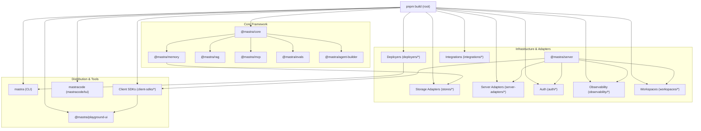

<!-- source: DeepWiki mcp.deepwiki.com · repo mastra-ai/mastra · page 12.1 Monorepo Configuration and Tooling · fetched 2026-10-26 -->

# Monorepo Configuration and Tooling

Relevant source files

The following files were used as context for generating this wiki page:

- [auth/better-auth/package.json](auth/better-auth/package.json)
- [e2e-tests/_local-registry-setup/pnpm-lock.yaml](e2e-tests/_local-registry-setup/pnpm-lock.yaml)
- [e2e-tests/_local-registry-setup/pnpm-workspace.yaml](e2e-tests/_local-registry-setup/pnpm-workspace.yaml)
- [e2e-tests/commonjs/template/package.json](e2e-tests/commonjs/template/package.json)
- [e2e-tests/experiment-worker/pnpm-lock.yaml](e2e-tests/experiment-worker/pnpm-lock.yaml)
- [e2e-tests/experiment-worker/pnpm-workspace.yaml](e2e-tests/experiment-worker/pnpm-workspace.yaml)
- [e2e-tests/monorepo/template/package.json](e2e-tests/monorepo/template/package.json)
- [e2e-tests/no-bundling/template/package.json](e2e-tests/no-bundling/template/package.json)
- [e2e-tests/pkg-outputs/pnpm-lock.yaml](e2e-tests/pkg-outputs/pnpm-lock.yaml)
- [e2e-tests/softwarefactory/pnpm-lock.yaml](e2e-tests/softwarefactory/pnpm-lock.yaml)
- [e2e-tests/softwarefactory/pnpm-workspace.yaml](e2e-tests/softwarefactory/pnpm-workspace.yaml)
- [examples/agent-builder/package.json](examples/agent-builder/package.json)
- [examples/agent-builder/pnpm-lock.yaml](examples/agent-builder/pnpm-lock.yaml)
- [examples/agent/package.json](examples/agent/package.json)
- [examples/agent/pnpm-lock.yaml](examples/agent/pnpm-lock.yaml)
- [examples/agent/pnpm-workspace.yaml](examples/agent/pnpm-workspace.yaml)
- [examples/durable-agents/package.json](examples/durable-agents/package.json)
- [examples/durable-agents/pnpm-lock.yaml](examples/durable-agents/pnpm-lock.yaml)
- [examples/evals-with-memory/package.json](examples/evals-with-memory/package.json)
- [examples/evals-with-memory/pnpm-lock.yaml](examples/evals-with-memory/pnpm-lock.yaml)
- [examples/evals-with-memory/pnpm-workspace.yaml](examples/evals-with-memory/pnpm-workspace.yaml)
- [examples/voice-agent/pnpm-lock.yaml](examples/voice-agent/pnpm-lock.yaml)
- [package.json](package.json)
- [packages/agent-builder/integration-tests/package.json](packages/agent-builder/integration-tests/package.json)
- [packages/agent-builder/integration-tests/pnpm-lock.yaml](packages/agent-builder/integration-tests/pnpm-lock.yaml)
- [packages/mcp/integration-tests/package.json](packages/mcp/integration-tests/package.json)
- [packages/mcp/integration-tests/pnpm-lock.yaml](packages/mcp/integration-tests/pnpm-lock.yaml)
- [packages/mcp/integration-tests/pnpm-workspace.yaml](packages/mcp/integration-tests/pnpm-workspace.yaml)
- [packages/memory/integration-tests/package.json](packages/memory/integration-tests/package.json)
- [packages/memory/integration-tests/pnpm-lock.yaml](packages/memory/integration-tests/pnpm-lock.yaml)
- [packages/memory/integration-tests/pnpm-workspace.yaml](packages/memory/integration-tests/pnpm-workspace.yaml)
- [packages/playground/e2e/kitchen-sink/package.json](packages/playground/e2e/kitchen-sink/package.json)
- [packages/playground/e2e/kitchen-sink/pnpm-lock.yaml](packages/playground/e2e/kitchen-sink/pnpm-lock.yaml)
- [packages/playground/e2e/kitchen-sink/pnpm-workspace.yaml](packages/playground/e2e/kitchen-sink/pnpm-workspace.yaml)
- [pnpm-lock.yaml](pnpm-lock.yaml)
- [pnpm-workspace.yaml](pnpm-workspace.yaml)
- [voice/azure/package.json](voice/azure/package.json)
- [voice/gladia/package.json](voice/gladia/package.json)
- [voice/murf/package.json](voice/murf/package.json)
- [voice/murf/src/index.ts](voice/murf/src/index.ts)
- [voice/speechify/package.json](voice/speechify/package.json)

## Purpose and Scope

This document covers the monorepo configuration, package organization, dependency management strategies, and build tooling for the Mastra framework. It details how `pnpm` workspaces, Turbo, changesets, and other tools coordinate to manage a complex multi-package repository.

For information about individual package build configurations, see their respective sections. For CI/CD workflows and release processes, see [12.3]() and [12.4]().

## Workspace Structure

The Mastra monorepo uses `pnpm` workspaces with packages organized into functional directories. The root `package.json` is named `mastra-turbo` and declares `"private": true` to mark the project as a private monorepo workspace [package.json:1-36]().

The workspace configuration is mapped in `pnpm-workspace.yaml` and reflected in the root `pnpm-lock.yaml` which manages the graph for all packages.

**Workspace Directory Mapping to Package Names**

```mermaid
graph TB
    pnpmWorkspace["pnpm Workspaces<br/>Directory Structure"]
    
    subgraph "packages/*"
        pkgCore["packages/core<br/>→ @mastra/core"]
        pkgCLI["packages/cli<br/>→ mastra"]
        pkgServer["packages/server<br/>→ @mastra/server"]
        pkgDeployer["packages/deployer<br/>→ @mastra/deployer"]
        pkgMemory["packages/memory<br/>→ @mastra/memory"]
        pkgRAG["packages/rag<br/>→ @mastra/rag"]
        pkgMCP["packages/mcp<br/>→ @mastra/mcp"]
        pkgPlaygroundUI["packages/playground-ui<br/>→ @mastra/playground-ui"]
        pkgEvals["packages/evals<br/>→ @mastra/evals"]
        pkgAgentBuilder["packages/agent-builder<br/>→ @mastra/agent-builder"]
        pkgMcpDocs["packages/mcp-docs-server<br/>→ @mastra/mcp-docs-server"]
    end
    
    subgraph "client-sdks/*"
        clientJS["client-sdks/client-js<br/>→ @mastra/client-js"]
        clientReact["client-sdks/react<br/>→ @mastra/react"]
    end
    
    subgraph "Internal & Experimental"
        pkgPlayground["packages/playground<br/>→ @internal/playground"]
        mastracodeSDK["mastracode/sdk<br/>→ @mastra/code-sdk"]
        mastracodeTUI["mastracode/tui<br/>→ mastracode"]
    end
    
    pnpmWorkspace --> pkgCore
    pnpmWorkspace --> pkgCLI
    pnpmWorkspace --> pkgServer
    pnpmWorkspace --> pkgDeployer
    pnpmWorkspace --> pkgMemory
    pnpmWorkspace --> pkgRAG
    pnpmWorkspace --> pkgMCP
    pnpmWorkspace --> pkgPlaygroundUI
    pnpmWorkspace --> pkgEvals
    pnpmWorkspace --> pkgAgentBuilder
    pnpmWorkspace --> pkgMcpDocs
    pnpmWorkspace --> clientJS
    pnpmWorkspace --> clientReact
    pnpmWorkspace --> pkgPlayground
    pnpmWorkspace --> mastracodeSDK
    pnpmWorkspace --> mastracodeTUI
```

**Sources:** [pnpm-workspace.yaml:1-34](), [packages/memory/integration-tests/pnpm-lock.yaml:1-49](), [packages/playground/e2e/kitchen-sink/pnpm-lock.yaml:1-40](), [packages/mcp/integration-tests/pnpm-lock.yaml:1-37](), [packages/agent-builder/integration-tests/pnpm-lock.yaml:1-43]()

## Package Categories and Naming

The monorepo organizes packages into several categories based on their function and directory namespaces. The `pnpm-workspace.yaml` file defines the directories included in the workspace [pnpm-workspace.yaml:1-34]().

| Category | Directory Pattern | Example Package Name | Representative Build Script |
| :---------------- | :---------------------- | :-------------------------- | :------------------------------------ |
| Core Framework | `packages/*` | `@mastra/core` | `build:packages` [package.json:40]() |
| CLI Tools | `packages/cli` | `mastra` | `build:cli` [package.json:44]() |
| Client SDKs | `client-sdks/*` | `@mastra/client-js` | `build:clients` [package.json:55]() |
| Storage Adapters | `stores/*` | `@mastra/pg`, `@mastra/libsql` | `build:combined-stores` [package.json:41]() |
| Deployers | `deployers/*` | `@mastra/deployer-cloud` | `build:deployers` [package.json:42]() |
| Server Adapters | `server-adapters/*` | `@mastra/hono`, `@mastra/express` | `build:server-adapters` [package.json:38]() |
| Observability | `observability/*` | `@mastra/observability` | `build:observability` [package.json:58]() |
| Integrations | `integrations/*` | `@mastra/slack` | `build:integrations` [package.json:39]() |
| Workspaces | `workspaces/*` | `@mastra/e2b`, `@mastra/docker` | `build:workspaces` [package.json:64]() |
| Mastracode | `mastracode/*` | `mastracode/sdk`, `mastracode/tui` | `build:mastracode` [package.json:59]() |
| Embedders | `embedders/*` | `@mastra/fastembed` | N/A |
| Agent SDKs | `agent-sdks/*` | `@mastra/openai-sdk` | N/A |
| Voice | `voice/*` | `@mastra/voice` | N/A |
| Workflows | `workflows/*` | `@mastra/workflow-builder` | N/A |
| Signals | `signals/*` | `@mastra/github-signals` | N/A |
| PubSub | `pubsub/*` | `@mastra/redis-pubsub` | N/A |
| Auth | `auth/*` | `@mastra/auth-clerk` | `build:auth` [package.json:62]() |

**Sources:** [pnpm-workspace.yaml:1-34](), [package.json:38-64]()

## Dependency Management

### pnpm Catalog for Version Pinning

Mastra uses `pnpm`'s catalog feature to define centralized dependency version mappings. Dependencies with the `catalog:` protocol in package manifests resolve to consistent versions declared in the root `pnpm-workspace.yaml` [pnpm-workspace.yaml:39-53]().

Common dependencies like `vitest`, `zod`, and `react` are kept in sync across packages via the `catalog` section [pnpm-workspace.yaml:39-53](). A secondary `ts6` catalog is used for specific TypeScript versions [pnpm-workspace.yaml:55-57]().

| Dependency | Version in Catalog |
| :--- | :--- |
| `@vitest/coverage-v8` | `4.1.11` [pnpm-workspace.yaml:43]() |
| `@vitest/ui` | `4.1.11` [pnpm-workspace.yaml:44]() |
| `date-fns` | `4.4.0` [pnpm-workspace.yaml:45]() |
| `lucide-react` | `^1.37.0` [pnpm-workspace.yaml:46]() |
| `react` | `^19.2.5` [pnpm-workspace.yaml:47]() |
| `react-dom` | `^19.2.5` [pnpm-workspace.yaml:48]() |
| `typescript` | `^7.0.2` [pnpm-workspace.yaml:49]() |
| `vitest` | `4.1.11` [pnpm-workspace.yaml:50]() |
| `zod` | `^4.6.7` [pnpm-workspace.yaml:51]() |
| `tsx` | `^4.23.1` [pnpm-workspace.yaml:52]()
| `oxfmt` | `0.59.0` [pnpm-workspace.yaml:53]()

**Sources:** [pnpm-workspace.yaml:39-57]()

### Dependency Overrides and Patches

To enforce secure and compatible versions across the monorepo, `pnpm` uses `patchedDependencies` and `packageExtensions` in `pnpm-workspace.yaml` to apply patches or explicitly declare missing dependencies [pnpm-workspace.yaml:64-152]().

Notable `patchedDependencies` include:

| Dependency | Patch File | Purpose |
| :--- | :--- | :--- |
| `@changesets/get-dependents-graph@2.1.4` | `patches/@changesets__get-dependents-graph@2.1.4.patch` [pnpm-workspace.yaml:66]() | Custom changesets behavior |
| `@earendil-works/pi-tui@0.80.6` | `patches/@earendil-works__pi-tui@0.80.6.patch` [pnpm-workspace.yaml:67]() | TUI library adjustments |
| `zod-to-ts@2.1.0` | `patches/zod-to-ts@2.1.0.patch` [pnpm-workspace.yaml:72]() | TypeScript compatibility |

`packageExtensions` are used to declare missing runtime dependencies for certain packages, especially when `enableGlobalVirtualStore: true` prevents hoisting from resolving them implicitly [pnpm-workspace.yaml:74-152](). For example, `@modelcontextprotocol/server-filesystem` explicitly declares `zod` as a dependency [pnpm-workspace.yaml:77-79]().

**Sources:** [pnpm-workspace.yaml:64-152]()

## Build System Architecture

### Turbo Build Orchestration

The Mastra monorepo employs Turborepo to orchestrate builds with caching and dependency-aware execution. The root `package.json` defines build scripts scoped to subsets of the workspace using filters [package.json:37-64]().

**Key Build Scripts and Filtering**

| Script Name | Purpose |
| :--- | :--- |
| `build` | Build all main workspace packages (excludes examples/docs/explorations) [package.json:42]() |
| `build:core` | Build `@mastra/core` framework package [package.json:47]() |
| `build:server` | Build `@mastra/server` package [package.json:46]() |
| `build:cli` | Build the `mastra` CLI package [package.json:44]() |
| `build:clients` | Build the client SDK packages [package.json:55]() |
| `build:auth` | Build authentication-related packages [package.json:62]() |
| `build:observability` | Build observability packages [package.json:63]() |
| `build:workspaces` | Build workspace-related packages [package.json:64]() |

**Sources:** [package.json:37-64]()

## Versioning and Release Management

Mastra uses `@changesets/cli` for version management and automated changelog generation [package.json:6,39]().

- The `changeset` script is a wrapper around `changeset` CLI [package.json:38-39]().
- Publishing is via the `ci:publish` script that runs `pnpm publish -r` [package.json:41]() to publish all packages.

**Sources:** [package.json:6,38-41]()

## Testing Infrastructure

Testing is executed per-package using Vitest. The root `package.json` defines various test scripts, many of which use `pnpm --filter` to target specific packages or groups of packages [package.json:70-95]().

**Test Commands and Targets**

| Command | Target | Description |
| :--- | :--- | :--- |
| `test` | All packages | Runs `vitest run` [package.json:70]() |
| `test:watch` | All packages | Runs `vitest watch` [package.json:71]() |
| `test:core` | `@mastra/core` | Runs core unit tests [package.json:76]() |
| `test:server` | `@mastra/server` | Runs server tests [package.json:75]() |
| `test:durable` | Durable execution | Tests core and inngest durable agents [package.json:82-85]() |
| `test:e2e:client-js` | `client-js-e2e-tests-*` | Runs client JS E2E tests [package.json:90]() |
| `affected-tests` | Changed packages | Runs tests only for packages affected by recent changes [package.json:91]() |

**Sources:** [package.json:70-95]()

## Code Quality and Linting

Mastra enforces code quality with tooling integrated into Turbo:

- **Linting** is parallelized by Turbo, targeting all packages except examples, docs, and explorations [package.json:100-101](). The `lint:oxlint` script runs `oxlint` [package.json:102]().
- **Formatting** uses `oxfmt` for fast formatting checks across the monorepo [package.json:103,113-114]().
- **Git Hooks** are managed by Husky triggering `lint-staged` on commits [package.json:15-16,99]().
- **Type Checking** is performed across the monorepo using `tsc-files` [package.json:105]().

**Sources:** [package.json:15-16,99-114]()

## Runtime and Engine Requirements

The monorepo enforces specific versions to ensure uniform developer environment:

- **Node.js** version requirements are typically defined in individual package `package.json` files under the `engines` field.
- **pnpm** is the required package manager, enforced by the `preinstall` script using `npx only-allow pnpm` [package.json:104]().
- The `enableGlobalVirtualStore: true` setting in `pnpm-workspace.yaml` optimizes disk space and installation times by sharing a single virtual store across the monorepo [pnpm-workspace.yaml:37]().

**Sources:** [package.json:104](), [pnpm-workspace.yaml:37]()

---

## Diagram: Monorepo Package Dependency Graph Bridging Natural Language to Code Entities

This diagram maps major Mastra systems and categories to their representative packages, helping link conceptual names from natural language to code entities in the monorepo.

```mermaid
graph TD
    AgentSystem["Agent System"]
    WorkflowSystem["Workflow System"]
    ToolSystem["Tool System"]
    MemoryStorage["Memory & Storage"]
    CLI["CLI Tooling"]
    ServerAPI["Server & API Layer"]
    ClientSDKs["Client SDKs & UI"]
    DeployerSystem["Deployment System"]
    AuthSystem["Authentication System"]
    ObservabilitySystem["Observability"]
    MastracodeSystem["MastraCode & Factory"]

    AgentSystem --> pkgCore["@mastra/core (packages/core)"]
    WorkflowSystem --> pkgCore
    ToolSystem --> pkgCore
    MemoryStorage --> pkgMemory["@mastra/memory (packages/memory)"]
    MemoryStorage --> pkgRAG["@mastra/rag (packages/rag)"]
    CLI --> pkgCLI["mastra (packages/cli)"]
    ServerAPI --> pkgServer["@mastra/server (packages/server)"]
    ClientSDKs --> clientJS["@mastra/client-js (client-sdks/client-js)"]
    ClientSDKs --> clientReact["@mastra/react (client-sdks/react)"]
    ClientSDKs --> playgroundUI["@mastra/playground-ui (packages/playground-ui)"]
    DeployerSystem --> pkgDeployer["@mastra/deployer (deployers/*)"]
    AuthSystem --> authPkg["@mastra/auth (auth/*)"]
    ObservabilitySystem --> observabilityPkg["@mastra/observability (observability/*)"]
    MastracodeSystem --> mastracodeSDK["@mastra/code-sdk (mastracode/sdk)"]
    MastracodeSystem --> mastracodeFactory["@mastra/factory (mastracode/factory)"]

    classDef keyEntity fill:#fff,stroke:#000,stroke-width:1px,font-weight:bold
    class AgentSystem,WorkflowSystem,ToolSystem,MemoryStorage,CLI,ServerAPI,ClientSDKs,DeployerSystem,AuthSystem,ObservabilitySystem,MastracodeSystem keyEntity
```

**Sources:** [pnpm-workspace.yaml:1-34]()

---

## Diagram: Monorepo Build Pipeline with Turbo and Package Interdependencies

Shows how Turbo orchestrates builds among core, infrastructure, and distribution layers, reflecting dependencies and build script groupings.

**Sources:** [package.json:37-64]()

---

# Summary

The Mastra framework maintains a modular monorepo architecture organized into functional groupings covering core runtime, SDKs, storage, and tooling.

- `pnpm` workspaces drive package management, leveraging `catalog` for central version pinning and `patchedDependencies`/`packageExtensions` for global dependency control and compatibility.
- Turborepo optimizes build orchestration, allowing selective rebuilds with fine-grained package filters.
- Changesets govern versioning and coordinated releases across interdependent packages.
- Strict Node.js and `pnpm` version requirements, along with comprehensive linting and type-checking, ensure uniform environments and high code quality for contributors.

**Sources:** [package.json:1-114](), [pnpm-workspace.yaml:1-190]()

---

