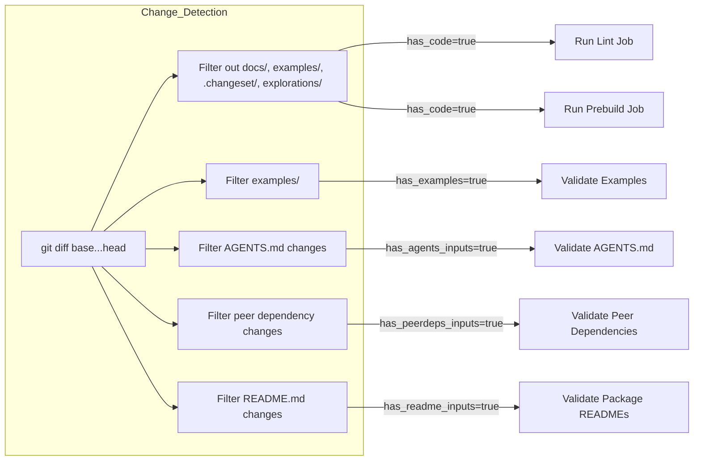
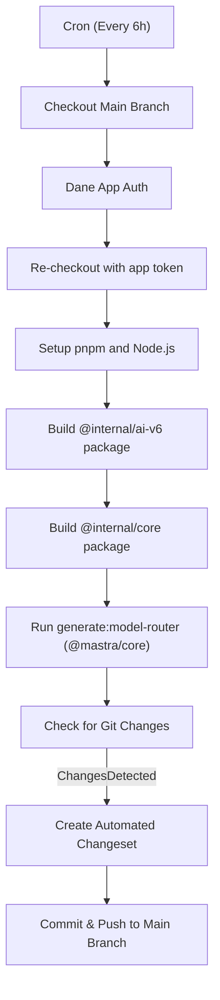
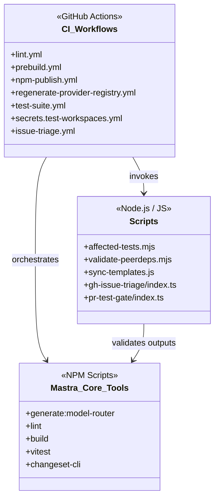

<!-- source: DeepWiki mcp.deepwiki.com · repo mastra-ai/mastra · page 12.3 GitHub Actions and CI Workflows · fetched 2026-10-26 -->

# GitHub Actions and CI Workflows

Relevant source files

The following files were used as context for generating this wiki page:

- [.changeset/node-security-2026-10-22.md](.changeset/node-security-2026-10-22.md)
- [.github/actions/app-auth/action.yaml](.github/actions/app-auth/action.yaml)
- [.github/actions/setup-pnpm-node/action.yaml](.github/actions/setup-pnpm-node/action.yaml)
- [.github/labeler.yml](.github/labeler.yml)
- [.github/workflows/backport-auto.yml](.github/workflows/backport-auto.yml)
- [.github/workflows/changed-test-gate-labeler.yml](.github/workflows/changed-test-gate-labeler.yml)
- [.github/workflows/changed-test-gate.yml](.github/workflows/changed-test-gate.yml)
- [.github/workflows/cron-alpha-publish.yml](.github/workflows/cron-alpha-publish.yml)
- [.github/workflows/e2e-docs.yml](.github/workflows/e2e-docs.yml)
- [.github/workflows/e2e-tests.yml](.github/workflows/e2e-tests.yml)
- [.github/workflows/issue-pending-release.yml](.github/workflows/issue-pending-release.yml)
- [.github/workflows/issue-triage.yml](.github/workflows/issue-triage.yml)
- [.github/workflows/labeler.yml](.github/workflows/labeler.yml)
- [.github/workflows/lint-docs.yml](.github/workflows/lint-docs.yml)
- [.github/workflows/lint.yml](.github/workflows/lint.yml)
- [.github/workflows/major-version-check.yml](.github/workflows/major-version-check.yml)
- [.github/workflows/mastracode-e2e.yml](.github/workflows/mastracode-e2e.yml)
- [.github/workflows/npm-publish.yml](.github/workflows/npm-publish.yml)
- [.github/workflows/prebuild.yml](.github/workflows/prebuild.yml)
- [.github/workflows/regenerate-provider-registry.yml](.github/workflows/regenerate-provider-registry.yml)
- [.github/workflows/renovate.yml](.github/workflows/renovate.yml)
- [.github/workflows/secrets.test-workspaces.yml](.github/workflows/secrets.test-workspaces.yml)
- [.github/workflows/sync-templates.yml](.github/workflows/sync-templates.yml)
- [.github/workflows/sync_renovate-changesets.yml](.github/workflows/sync_renovate-changesets.yml)
- [.github/workflows/test-combined-stores.yml](.github/workflows/test-combined-stores.yml)
- [.github/workflows/test-suite.yml](.github/workflows/test-suite.yml)
- [.github/workflows/test-workspaces.yml](.github/workflows/test-workspaces.yml)
- [.github/workflows/trigger-cloud-tests.yml](.github/workflows/trigger-cloud-tests.yml)
- [.github/workflows/version-packages.yml](.github/workflows/version-packages.yml)
- [.github/workflows/vitest-all.yml](.github/workflows/vitest-all.yml)
- [observability/_examples/otel-bridge/agent-hub/.nvmrc](observability/_examples/otel-bridge/agent-hub/.nvmrc)
- [scripts/pr-test-gate/index.ts](scripts/pr-test-gate/index.ts)
- [templates/template-organization-intelligence/.node-version](templates/template-organization-intelligence/.node-version)
- [templates/template-security-incident-triage/.nvmrc](templates/template-security-incident-triage/.nvmrc)
- [workspaces/e2b/src/utils/template.test.ts](workspaces/e2b/src/utils/template.test.ts)
- [workspaces/e2b/src/utils/template.ts](workspaces/e2b/src/utils/template.ts)

This page documents the continuous integration (CI) and continuous deployment (CD) workflows for the Mastra monorepo, focusing on automated testing, code quality checks, versioning, packaging, and publishing processes. The setup uses GitHub Actions extensively, integrated with `pnpm` workspaces and Turborepo for efficient multi-package build orchestration.

---

## CI/CD Pipeline Architecture

Mastra's CI/CD pipeline consists of multiple coordinated workflows running on GitHub Actions. These workflows trigger automatically on pull requests (PRs), merges to the `main` branch, or if manually dispatched. They cover quality checks, building, testing, versioning, publishing, and repository maintenance.

### Workflow Event Flow Diagram

```mermaid
graph TD
    subgraph "Pull_Request_Events"
        PR_Open["PR Opened/Sync"] --> QA["Quality Assurance (.github/workflows/lint.yml)"]
        QA --> Lint["Lint & Format"]
        QA --> BuildCheck["Validate Build Outputs"]
        QA --> PkgCheck["Validate package.json"]
        PR_Open --> Prebuild["Prebuild (.github/workflows/prebuild.yml)"]
        PR_Open --> ChangedTestGateLabeler["Changed Test Gate Labeler (.github/workflows/changed-test-gate-labeler.yml)"]
    end

    subgraph "Post-Build_Verification"
        Prebuild --> TestSuite["Unit & E2E Tests (.github/workflows/test-suite.yml)"]
        Prebuild --> StoreTests["Combined Store Tests (.github/workflows/test-combined-stores.yml)"]
        Prebuild --> WorkspaceTests["Workspace Cloud Tests (.github/workflows/secrets.test-workspaces.yml)"]
        Prebuild --> MastracodeE2E["MastraCode E2E Tests (.github/workflows/mastracode-e2e.yml)"]
        Prebuild --> E2EDocs["E2E Docs (.github/workflows/e2e-docs.yml)"]
        Prebuild --> E2ETests["E2E Tests (.github/workflows/e2e-tests.yml)"]
        Prebuild --> TriggerCloudTests["Trigger Cloud Tests (.github/workflows/trigger-cloud-tests.yml)"]
        ChangedTestGateLabeler --> ChangedTestGate["Changed Test Gate (.github/workflows/changed-test-gate.yml)"]
    end

    subgraph "Release_Management"
        MainPush["Push to main"] --> Versioning["Version Packages (.github/workflows/version-packages.yml)"]
        Versioning --> ReleasePR["Create Release PR (Changesets)"]
        ManualRelease["Manual Dispatch"] --> StableRelease["Stable Release (npm-publish.yml)"]
        StableRelease --> NPMPublish["Publish to npm"]
        MainPush --> CronAlphaPublish["Cron Alpha Publish (.github/workflows/cron-alpha-publish.yml)"]
        CronAlphaPublish --> Prerelease["Prerelease (npm-publish.yml)"]
        Prerelease --> NPMPublish
        PR_Closed["PR Closed (main)"] --> Backport["Backport PRs (.github/workflows/backport-auto.yml)"]
    end

    subgraph "Maintenance"
        Cron["Cron/Schedule"] --> Regen["Regenerate Providers & Docs (.github/workflows/regenerate-provider-registry.yml)"]
        Regen --> Commit["Commit to main"]
        Cron --> Renovate["Renovate (.github/workflows/renovate.yml)"]
        Renovate --> SyncRenovateChangesets["Sync Renovate Changesets (.github/workflows/sync_renovate-changesets.yml)"]
        PushMain["Push to main"] --> SyncTemplates["Sync Templates (.github/workflows/sync-templates.yml)"]
        IssueOpened["Issue Opened"] --> IssueTriage["Issue Triage (.github/workflows/issue-triage.yml)"]
        IssueOpened --> IssuePendingRelease["Issue Pending Release (.github/workflows/issue-pending-release.yml)"]
        PR_Opened["PR Opened"] --> Labeler["Labeler (.github/workflows/labeler.yml)"]
        PR_Opened --> MajorVersionCheck["Major Version Check (.github/workflows/major-version-check.yml)"]
    end
```

This layout visualizes how different types of GitHub events (PRs, pushes, schedules, manual triggers) route through specialized workflows covering the entire lifecycle from code submission to stable release.

**Sources:**
[.github/workflows/lint.yml:1-10]()
[.github/workflows/prebuild.yml:1-10]()
[.github/workflows/npm-publish.yml:1-32]()
[.github/workflows/regenerate-provider-registry.yml:1-11]()
[.github/workflows/test-suite.yml:1-12]()
[.github/workflows/secrets.test-workspaces.yml:1-8]()
[.github/workflows/mastracode-e2e.yml:1-8]()
[.github/workflows/e2e-docs.yml:1-8]()
[.github/workflows/e2e-tests.yml:1-8]()
[.github/workflows/trigger-cloud-tests.yml:1-8]()
[.github/workflows/changed-test-gate-labeler.yml:1-8]()
[.github/workflows/changed-test-gate.yml:1-10]()
[.github/workflows/version-packages.yml:1-8]()
[.github/workflows/cron-alpha-publish.yml:1-8]()
[.github/workflows/backport-auto.yml:1-10]()
[.github/workflows/renovate.yml:1-26]()
[.github/workflows/sync_renovate-changesets.yml:1-8]()
[.github/workflows/sync-templates.yml:1-8]()
[.github/workflows/issue-triage.yml:1-5]()
[.github/workflows/issue-pending-release.yml:1-8]()
[.github/workflows/labeler.yml:1-8]()
[.github/workflows/major-version-check.yml:1-8]()

---

## Quality Assurance and Build Validation

### Change Detection

Change detection scripts optimize CI execution by determining if code changes, example changes, or test-relevant changes have occurred, and conditionally running related workflows. This reduces wasteful runs when only documentation or unrelated files change.

Change detection is implemented with shell snippets in the workflows. The `changes` job in `lint.yml` [.github/workflows/lint.yml:15-66]() and `prebuild.yml` [.github/workflows/prebuild.yml:15-63]() uses `git diff --name-only` to identify changed files and sets outputs like `has_code`, `has_examples`, `has_agents_inputs`, `has_peerdeps_inputs`, and `has_readme_inputs`. The `affected-tests` job in `prebuild.yml` [.github/workflows/prebuild.yml:87-107]() further refines this by using a custom `scripts/affected-tests.mjs` script to determine specific test files that need to be run [.github/workflows/prebuild.yml:155]().

### Validation Tasks Overview

| Task | Workflow / Command | Description |
|---|---|---|
| Linting | `pnpm lint` | Static analysis and code formatting verification [.github/workflows/lint.yml:210]() |
| Prebuild | `pnpm turbo build` | Builds all code (excluding docs/examples) with caching [.github/workflows/prebuild.yml:83]() |
| Bundle Validation | `pnpm turbo --filter ./mastracode/sdk check` and `bash .github/scripts/check-clean-worktree.bash` | Validates that build outputs are correct, types are checked, and no generated files are uncommitted [.github/workflows/lint.yml:240-245]() |
| Peer Dependency Check | `node .github/scripts/validate-peerdeps.mjs` | Ensures peer dependencies are compatible [.github/workflows/lint.yml:284]() |
| AGENTS.md Validation | `node .github/scripts/validate-agents-md.mjs` | Validates agent documentation format [.github/workflows/lint.yml:244]() |
| Test Gate | `Changed Test Gate` | Ensures external contributors add tests for their changes [.github/workflows/changed-test-gate.yml:1-115]() |
| Changeset Validation | `pnpm changeset-cli status --since origin/main` | Checks for valid changesets and package associations [.github/workflows/lint.yml:105-107]() |
| Docs Linting | `pnpm lint:docs` | Lints documentation files for style and correctness [.github/workflows/lint-docs.yml:200]() |
| Redirects Validation | `node .github/scripts/validate-redirects.js` | Ensures documentation redirects are valid [.github/workflows/lint-docs.yml:145]() |
| Deleted Pages Check | `node .github/scripts/check-deleted-pages.js` | Verifies that deleted documentation pages are handled correctly [.github/workflows/lint-docs.yml:71]() |

**Sources:**
[.github/workflows/lint.yml:15-66]()
[.github/workflows/prebuild.yml:15-63]()
[.github/workflows/prebuild.yml:87-107]()
[.github/workflows/prebuild.yml:155]()
[.github/workflows/lint.yml:210]()
[.github/workflows/prebuild.yml:83]()
[.github/workflows/lint.yml:240-245]()
[.github/workflows/lint.yml:284]()
[.github/workflows/lint.yml:244]()
[.github/workflows/changed-test-gate.yml:1-115]()
[.github/workflows/lint.yml:105-107]()
[.github/workflows/lint-docs.yml:200]()
[.github/workflows/lint-docs.yml:145]()
[.github/workflows/lint-docs.yml:71]()

---

## Automated Testing Suites

Mastra's testing infrastructure is extensive and layered to maintain robust code integrity throughout development.

### Test Execution Matrix

| Test Category | Invocation Method / Workflow | Coverage Area |
|---|---|---|
| Unit Tests | `test-suite.yml` -> `unit-test` | Unit logic across packages, sharded for parallel execution [.github/workflows/test-suite.yml:33-41]() |
| Affected Unit Tests | `test-suite.yml` -> `affected-unit-test` | Runs only tests impacted by specific PR changes [.github/workflows/test-suite.yml:93-95]() |
| E2E Tests | `test-suite.yml` -> `e2e-test` | End-to-end tests for individual packages [.github/workflows/test-suite.yml:151-160]() |
| Changed Test Gate | `changed-test-gate.yml` | Validates new tests against the base branch to ensure they pass [.github/workflows/changed-test-gate.yml:139-155]() |
| Workspace Cloud Tests | `secrets.test-workspaces.yml` | Tests related to workspace functionality, triggered by `Prebuild` completion [.github/workflows/secrets.test-workspaces.yml:1-8]() |
| MastraCode E2E Tests | `mastracode-e2e.yml` | End-to-end tests for the MastraCode TUI and SDK, triggered by `Prebuild` completion [.github/workflows/mastracode-e2e.yml:1-8]() |
| E2E Docs | `e2e-docs.yml` | End-to-end tests for documentation generation and integrity, triggered by `Prebuild` completion [.github/workflows/e2e-docs.yml:1-8]() |
| E2E Tests (General) | `e2e-tests.yml` | General E2E tests, triggered by `Prebuild` completion [.github/workflows/e2e-tests.yml:1-8]() |
| Combined Stores Tests | `test-combined-stores.yml` | Tests for various storage integrations, triggered by `Prebuild` completion [.github/workflows/test-combined-stores.yml:1-8]() |
| Vitest All | `vitest-all.yml` | Comprehensive Vitest run for all projects, typically on `main` branch pushes [.github/workflows/vitest-all.yml:1-8]() |

Testing uses `vitest` as the primary test runner, as seen in package configurations [packages/core/package.json:265]() and [packages/server/package.json:107](). The `affected-tests` job in `prebuild.yml` [.github/workflows/prebuild.yml:87-107]() leverages the `scripts/affected-tests.mjs` script to calculate a ratio of changed files. If the ratio of affected tests exceeds 50%, a full test run is triggered via the `run_full` output [.github/workflows/prebuild.yml:167]().

**Sources:**
[.github/workflows/prebuild.yml:87-107]()
[.github/workflows/prebuild.yml:167]()
[.github/workflows/test-suite.yml:33-160]()
[.github/workflows/changed-test-gate.yml:139-155]()
[.github/workflows/secrets.test-workspaces.yml:1-8]()
[.github/workflows/mastracode-e2e.yml:1-8]()
[.github/workflows/e2e-docs.yml:1-8]()
[.github/workflows/e2e-tests.yml:1-8]()
[.github/workflows/test-combined-stores.yml:1-8]()
[.github/workflows/vitest-all.yml:1-8]()
[packages/core/package.json:265]()
[packages/server/package.json:107]()

---

## Release Management and Publishing

Mastra manages package versioning and publishing using Changesets for semantic versioning and GitHub Actions workflows managing automated and manual releases.

### Publishing Workflow

Publishing supports multiple release types, controlled by manually or automatically triggered workflows:

| Release Type | Trigger | Tag/Versioning Behavior | Key Steps |
|---|---|---|---|
| Prerelease | Push to main with version commit | Publishes with `alpha` tag [.github/workflows/npm-publish.yml:118]() | Builds packages, publishes to NPM alpha tag [.github/workflows/npm-publish.yml:121]() |
| Stable Release | Manual trigger (`workflow_dispatch`) | Publishes with `latest` tag [.github/workflows/npm-publish.yml:200]() | Versions packages, publishes stable release [.github/workflows/npm-publish.yml:216-231]() |
| Snapshot | Manual trigger | Custom tags for testing [.github/workflows/npm-publish.yml:18]() | Snapshot builds for experimental/QA versions |

Additional workflow steps handle:
- **Studio Asset Deployment:** Uploading Studio UI and factory build artifacts to Cloudflare R2 buckets (staging and production) [.github/workflows/npm-publish.yml:132-175](). The `upload-studio-r2.yml` workflow also handles this for specific CLI versions [.github/workflows/upload-studio-r2.yml:1-30]().
- **OIDC Provenance:** Verifying OIDC using npm's provenance feature for secure releases [.github/workflows/npm-publish.yml:123]().
- **Backporting:** Automated cherry-picking of merged PRs from `main` to other branches via the `cherry` label [.github/workflows/backport-auto.yml:1-54]().
- **Release Issue Notification:** Notifies linked issues when an alpha release is available [.github/workflows/npm-publish.yml:180-192]().

**Sources:**
[.github/workflows/npm-publish.yml:1-231]()
[.github/workflows/npm-publish.yml:118-123]()
[.github/workflows/npm-publish.yml:132-175]()
[.github/workflows/upload-studio-r2.yml:1-30]()
[.github/workflows/backport-auto.yml:1-54]()
[.github/workflows/npm-publish.yml:180-192]()

---

## Automated Maintenance Workflows

### Provider Registry Regeneration

Mastra maintains an autogenerated model/provider catalog. This workflow regenerates the catalog and documentation every 6 hours [.github/workflows/regenerate-provider-registry.yml:9]().

The workflow builds `@internal/ai-v6` [.github/workflows/regenerate-provider-registry.yml:60]() and `@internal/core` [.github/workflows/regenerate-provider-registry.yml:67]() before running the `generate:model-router` script [.github/workflows/regenerate-provider-registry.yml:70]().

### Dependency Updates with Renovate

The `renovate.yml` workflow [.github/workflows/renovate.yml:1-117]() runs on a schedule to keep dependencies up-to-date. The `renovate.json` configuration groups updates into categories like "AI provider SDKs" [.renovate.json:96-112](), "Observability providers" [.renovate.json:114-129](), and "Database clients" [.renovate.json:131-161](). The `sync_renovate-changesets.yml` workflow [.github/workflows/sync_renovate-changesets.yml:1-61]() automatically creates changesets for Renovate PRs to ensure proper versioning.

### Template Synchronization

The `sync-templates.yml` workflow [.github/workflows/sync-templates.yml:1-55]() triggers on changes to the `templates/` directory [.github/workflows/sync-templates.yml:8](). It uses a custom script `node .github/scripts/sync-templates.js` [.github/workflows/sync-templates.yml:55]() to propagate changes from the monorepo to standalone template repositories.

### Issue Triage

The `issue-triage.yml` workflow [.github/workflows/issue-triage.yml:1-52]() automatically labels newly opened or reopened issues. It uses a Node.js script `scripts/gh-issue-triage/index.ts` to apply labels and potentially notify Slack [.github/workflows/issue-triage.yml:42]().

### Labeler

The `labeler.yml` workflow [.github/workflows/labeler.yml:1-20]() automatically applies labels to pull requests based on the files changed, using the configuration in `.github/labeler.yml` [.github/labeler.yml:1-5]().

**Sources:**
[.github/workflows/regenerate-provider-registry.yml:1-135]()
[.github/workflows/regenerate-provider-registry.yml:60]()
[.github/workflows/regenerate-provider-registry.yml:67]()
[.github/workflows/regenerate-provider-registry.yml:70]()
[.github/workflows/renovate.yml:1-117]()
[.renovate.json:96-112]()
[.renovate.json:114-129]()
[.renovate.json:131-161]()
[.github/workflows/sync_renovate-changesets.yml:1-61]()
[.github/workflows/sync-templates.yml:1-55]()
[.github/workflows/sync-templates.yml:8]()
[.github/workflows/sync-templates.yml:55]()
[.github/workflows/issue-triage.yml:1-52]()
[.github/workflows/issue-triage.yml:42]()
[.github/workflows/labeler.yml:1-20]()
[.github/labeler.yml:1-5]()

---

## CI Configuration and Optimization

### Shared Environment Setup

Mastra uses a custom composite action `setup-pnpm-node` [.github/actions/setup-pnpm-node/action.yaml:1-117]() to standardize the environment:
- **Node.js:** Set to version `24.22.1` [.github/actions/setup-pnpm-node/action.yaml:32]().
- **pnpm Store Management:** Includes a robust `reset-store` step that detects and fixes corrupt SQLite store indexes [.github/actions/setup-pnpm-node/action.yaml:47-107]().
- **Turbo Caching:** Turborepo remote caching is configured using `TURBO_TOKEN` and `TURBO_TEAM` secrets [.github/workflows/prebuild.yml:55-57]().

### Code Entity Space Bridge

**Sources:**
[.github/actions/setup-pnpm-node/action.yaml:1-117]()
[.github/actions/setup-pnpm-node/action.yaml:32]()
[.github/actions/setup-pnpm-node/action.yaml:47-107]()
[.github/workflows/prebuild.yml:55-57]()
[.github/workflows/sync-templates.yml:55]()
[.github/workflows/issue-triage.yml:42]()
[scripts/affected-tests.mjs]()
[scripts/pr-test-gate/index.ts]()
[packages/core/src/affected-tests-resolution.test.ts]()

---

