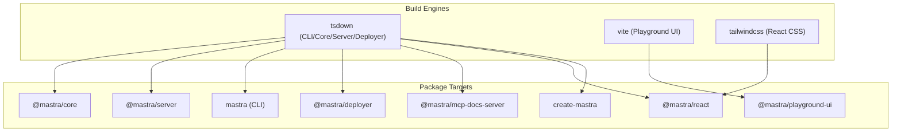

<!-- source: DeepWiki mcp.deepwiki.com · repo mastra-ai/mastra · page 12.4 Release Management with Changesets · fetched 2026-10-26 -->

# Release Management with Changesets

<details>
<summary>Relevant source files</summary>

The following files were used as context for generating this wiki page:

- [.changeset/pre.json](.changeset/pre.json)
- [client-sdks/react/CHANGELOG.md](client-sdks/react/CHANGELOG.md)
- [client-sdks/react/package.json](client-sdks/react/package.json)
- [deployers/cloud/CHANGELOG.md](deployers/cloud/CHANGELOG.md)
- [explorations/longmemeval/CHANGELOG.md](explorations/longmemeval/CHANGELOG.md)
- [explorations/longmemeval/package.json](explorations/longmemeval/package.json)
- [integrations/opencode/CHANGELOG.md](integrations/opencode/CHANGELOG.md)
- [integrations/opencode/package.json](integrations/opencode/package.json)
- [packages/cli/CHANGELOG.md](packages/cli/CHANGELOG.md)
- [packages/cli/package.json](packages/cli/package.json)
- [packages/core/CHANGELOG.md](packages/core/CHANGELOG.md)
- [packages/create-mastra/CHANGELOG.md](packages/create-mastra/CHANGELOG.md)
- [packages/create-mastra/package.json](packages/create-mastra/package.json)
- [packages/deployer/CHANGELOG.md](packages/deployer/CHANGELOG.md)
- [packages/mcp-docs-server/CHANGELOG.md](packages/mcp-docs-server/CHANGELOG.md)
- [packages/mcp-docs-server/package.json](packages/mcp-docs-server/package.json)
- [packages/playground-ui/CHANGELOG.md](packages/playground-ui/CHANGELOG.md)
- [packages/playground-ui/package.json](packages/playground-ui/package.json)
- [packages/playground/CHANGELOG.md](packages/playground/CHANGELOG.md)
- [packages/playground/package.json](packages/playground/package.json)
- [packages/server/CHANGELOG.md](packages/server/CHANGELOG.md)

</details>


## Purpose and Scope

This document provides a detailed technical overview of the release management system employed in the Mastra monorepo using the [Changesets](https://github.com/changesets/changesets) tool. It explains the workflow for maintaining package versions, orchestrating changelog generation, and automating publishing to npm registries. The approach supports Mastra’s large-scale monorepo architecture containing core libraries, CLI tools, deployers, and integrations.

---

## Changesets System Overview

Mastra adopts Changesets as the central mechanism for precise version control and release coordination across its packages. The Changesets approach revolves around developers explicitly declaring version increment intentions per change via changeset files.

**Core Attributes of the Changesets system:**

-   **Atomic Change Declaration:** Each pull request includes a dedicated changeset file that specifies the type of version bump required—patch, minor, or major.
-   **Custom CLI Wrapper:** The monorepo uses an internal CLI wrapper `@internal/changeset-cli` to invoke Changesets, mapped to the root `changeset` script [packages/_changeset-cli/package.json:34]().
-   **Prerelease Management:** The system supports alpha releases, tracked in `.changeset/pre.json`, which maintains the current prerelease state, tags (e.g., "alpha"), and initial versions for all packages in the workspace [`.changeset/pre.json:1-190`]().
-   **Package Organization:** The monorepo structure groups packages into core libraries, CLI tools, deployers, client SDKs, storage adapters, and integrations. For example, core logic resides in `@mastra/core` [packages/core/package.json:2-3]() and the main CLI in `mastra` [packages/cli/package.json:2-3]().

Sources:
- [`.changeset/pre.json:1-190`]()
- [packages/_changeset-cli/package.json:34]()
- [packages/core/package.json:2-3]()
- [packages/cli/package.json:2-3]()

---

## Release Workflows

Mastra’s release lifecycle integrates manual developer inputs with automated CI/CD workflows mediated by GitHub Actions and the custom Changesets CLI tool.

### Versioning Strategy

Mastra manages a large number of packages that often require synchronized versioning to maintain compatibility. The release state for an active prerelease cycle is captured in `.changeset/pre.json`, which lists pending changesets like `attention-touch-events` or `fast-zebras-burn` [`.changeset/pre.json:1-190`]() (Note: The provided `pre.json` snippet does not show these specific pending changesets, but rather `initialVersions`).

**Steps in the release versioning flow:**

1.  **Create Changeset:** Developers generate a markdown file in the `.changeset/` directory to describe their changes and specify the version bump.
2.  **Prerelease Mode:** When in "pre" mode (e.g., "alpha"), Changesets tracks the `initialVersions` of every package, such as `mastra` at `1.35.0` and `@mastra/core` at `1.79.0` [`.changeset/pre.json:86-90`]().
3.  **CI Versioning:** The `changeset version` command (typically run in CI) consumes the `.md` files, updates `package.json` versions, and updates `CHANGELOG.md` files.
4.  **Publish Packages:** Packages are built and published to the registry using `pnpm publish -r` [packages/cli/package.json:27](). For instance, the `@mastra/playground-ui` package uses `vite build` to prepare its `dist` folder before publication [packages/playground-ui/package.json:150]().

Sources:
- [`.changeset/pre.json:1-190`]()
- [`.changeset/pre.json:86-90`]()
- [packages/cli/package.json:27]()
- [packages/playground-ui/package.json:150]()

### Release Build Pipeline

The monorepo’s build system provides granular control over which package groups are built before release using Turbo. Packages use specific build scripts like `tsdown`, `vite`, or `rollup`.


**Diagram: Build Tooling Mapped to Monorepo Packages**

- `@mastra/core` uses `tsdown` for library bundling [packages/core/package.json:302]().
- `@mastra/playground-ui` uses `vite` for component bundling [packages/playground-ui/package.json:150]().
- `create-mastra` uses `tsdown` for its CLI build [packages/create-mastra/package.json:15]().
- `@mastra/deployer` uses `tsdown` for its library build [packages/deployer/package.json:85]().
- `@mastra/mcp-docs-server` uses `tsdown` for its CLI build [packages/mcp-docs-server/package.json:24]().
- `@mastra/react` uses `tsdown` for its JS build [client-sdks/react/package.json:65]() and `tailwindcss` for CSS [client-sdks/react/package.json:66]().

Sources:
- [packages/core/package.json:302]()
- [packages/playground-ui/package.json:150]()
- [packages/create-mastra/package.json:15]()
- [packages/deployer/package.json:85]()
- [packages/mcp-docs-server/package.json:24]()
- [client-sdks/react/package.json:65]()
- [client-sdks/react/package.json:66]()

---

## Release Management Components

### Monorepo Dependency Resolution

The monorepo manages dependencies centrally using `pnpm` catalogs. This ensures that every package in the monorepo uses the exact same version of common libraries.

| Dependency | Catalog Version | Usage Example |
| :--- | :--- | :--- |
| `vitest` | `catalog:` | Testing in `@mastra/playground-ui` [packages/playground-ui/package.json:152]() |
| `zod` | `^3.25.0` | Schema validation in `@mastra/playground-ui` [packages/playground-ui/package.json:214]() |
| `react` | `catalog:` | UI components in `@mastra/playground-ui` [packages/playground-ui/package.json:224]() |
| `tsx` | `catalog:` | Script execution in `@mastra/mcp-docs-server` [packages/mcp-docs-server/package.json:54]() |

Sources:
- [packages/playground-ui/package.json:152]()
- [packages/playground-ui/package.json:214]()
- [packages/playground-ui/package.json:224]()
- [packages/mcp-docs-server/package.json:54]()

### Release Flow: Natural Language to Code Entities

The following diagram bridges the release process concepts to the specific code entities and files that implement them.

```mermaid
graph LR
    subgraph "Natural Language Space"
        "Declare Change"
        "Start Alpha Cycle"
        "Apply Version Bumps"
        "Prepare Distribution"
        "Publish to NPM"
    end

    subgraph "Code Entity Space"
        CHANGESET_FILE[".changeset/*.md"]
        PRE_JSON[".changeset/pre.json"]
        PKG_JSON["package.json (version)"]
        CHANGELOG_MD["CHANGELOG.md"]
        DIST_FOLDER["dist/ (via build script)"]
        NPM_REGISTRY["NPM Registry"]
    end

    "Declare Change" -- "creates" --> CHANGESET_FILE
    "Start Alpha Cycle" -- "configures" --> PRE_JSON
    CHANGESET_FILE -- "processed by 'changeset version'" --> PKG_JSON
    CHANGESET_FILE -- "processed by 'changeset version'" --> CHANGELOG_MD
    PRE_JSON -- "influences versioning" --> PKG_JSON
    PKG_JSON -- "read by build scripts" --> DIST_FOLDER
    DIST_FOLDER -- "published by 'pnpm publish -r'" --> NPM_REGISTRY
    CHANGELOG_MD -- "included in package" --> NPM_REGISTRY
```
**Diagram: Release Process Entities**

Sources:
- [`.changeset/pre.json:1-4`]()
- [packages/cli/package.json:3]()
- [packages/cli/package.json:27]()

---

## CHANGELOG and Package Integrity

Each package in the Mastra monorepo maintains its own `CHANGELOG.md` file, which is automatically updated by the Changesets tooling during release. The `files` array in each package’s `package.json` ensures the changelog is included in the published npm bundle.

-   **CLI Package:** The `mastra` CLI package includes `dist` [packages/cli/package.json:22]() and its `CHANGELOG.md` is implicitly managed by Changesets, as seen in [packages/cli/CHANGELOG.md:1]().
-   **Playground UI Package:** `@mastra/playground-ui` includes `dist`, `theme.css`, `components.css`, `sources.css`, and `theme` [packages/playground-ui/package.json:9-15](). Its `CHANGELOG.md` is also managed by Changesets, as seen in [packages/playground-ui/CHANGELOG.md:1]().
-   **Create Mastra Package:** `create-mastra` includes `dist` [packages/create-mastra/package.json:11]() and its `CHANGELOG.md` is managed by Changesets, as seen in [packages/create-mastra/CHANGELOG.md:1]().
-   **MCP Docs Server Package:** `@mastra/mcp-docs-server` includes `dist`, `.docs`, and `README.md` [packages/mcp-docs-server/package.json:9-13](). Its `CHANGELOG.md` is also managed by Changesets, as seen in [packages/mcp-docs-server/CHANGELOG.md:1]().
-   **React SDK Package:** `@mastra/react` includes `dist` [client-sdks/react/package.json:74]() and its `CHANGELOG.md` is managed by Changesets, as seen in [client-sdks/react/CHANGELOG.md:1]().
-   **OpenCode Integration Package:** `@mastra/opencode` includes `dist` [integrations/opencode/package.json:9]() and its `CHANGELOG.md` is managed by Changesets, as seen in [integrations/opencode/CHANGELOG.md:1]().

Sources:
- [packages/cli/package.json:22]()
- [packages/cli/CHANGELOG.md:1]()
- [packages/playground-ui/package.json:9-15]()
- [packages/playground-ui/CHANGELOG.md:1]()
- [packages/create-mastra/package.json:11]()
- [packages/create-mastra/CHANGELOG.md:1]()
- [packages/mcp-docs-server/package.json:9-13]()
- [packages/mcp-docs-server/CHANGELOG.md:1]()
- [client-sdks/react/package.json:74]()
- [client-sdks/react/CHANGELOG.md:1]()
- [integrations/opencode/package.json:9]()
- [integrations/opencode/CHANGELOG.md:1]()

---

