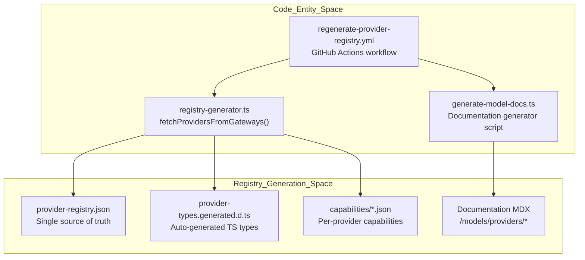
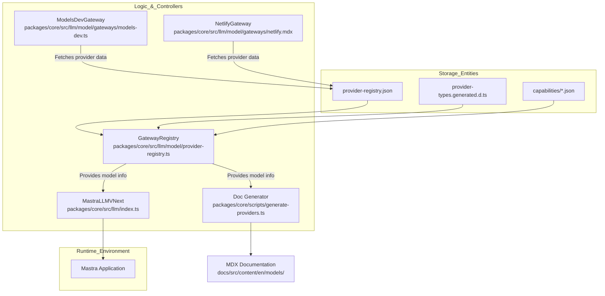

<!-- source: DeepWiki mcp.deepwiki.com · repo mastra-ai/mastra · page 12.5 Provider Registry Maintenance · fetched 2026-10-26 -->

# Provider Registry Maintenance

<details>
<summary>Relevant source files</summary>

The following files were used as context for generating this wiki page:

- [docs/src/content/en/models/gateways/custom-gateways.mdx](docs/src/content/en/models/gateways/custom-gateways.mdx)
- [docs/src/content/en/models/gateways/index.mdx](docs/src/content/en/models/gateways/index.mdx)
- [docs/src/content/en/models/gateways/netlify.mdx](docs/src/content/en/models/gateways/netlify.mdx)
- [docs/src/content/en/models/gateways/openrouter.mdx](docs/src/content/en/models/gateways/openrouter.mdx)
- [docs/src/content/en/models/gateways/vercel.mdx](docs/src/content/en/models/gateways/vercel.mdx)
- [docs/src/content/en/models/index.mdx](docs/src/content/en/models/index.mdx)
- [docs/src/content/en/models/providers/edenai.mdx](docs/src/content/en/models/providers/edenai.mdx)
- [docs/src/content/en/models/providers/index.mdx](docs/src/content/en/models/providers/index.mdx)
- [docs/src/content/en/models/providers/kilo.mdx](docs/src/content/en/models/providers/kilo.mdx)
- [docs/src/content/en/models/providers/nano-gpt.mdx](docs/src/content/en/models/providers/nano-gpt.mdx)
- [docs/src/content/en/models/providers/opencode.mdx](docs/src/content/en/models/providers/opencode.mdx)
- [docs/src/content/en/reference/core/mastra-model-gateway.mdx](docs/src/content/en/reference/core/mastra-model-gateway.mdx)
- [mastracode/sdk/src/agents/mastracode-gateway-thinking.test.ts](mastracode/sdk/src/agents/mastracode-gateway-thinking.test.ts)
- [mastracode/sdk/src/providers/thinking-request.ts](mastracode/sdk/src/providers/thinking-request.ts)
- [mastracode/sdk/src/thinking.test.ts](mastracode/sdk/src/thinking.test.ts)
- [mastracode/tui/e2e/tui/think-picker-per-model.ts](mastracode/tui/e2e/tui/think-picker-per-model.ts)
- [packages/core/scripts/generate-providers.ts](packages/core/scripts/generate-providers.ts)
- [packages/core/src/llm/index.ts](packages/core/src/llm/index.ts)
- [packages/core/src/llm/model/capabilities/edenai.json](packages/core/src/llm/model/capabilities/edenai.json)
- [packages/core/src/llm/model/capabilities/kilo.json](packages/core/src/llm/model/capabilities/kilo.json)
- [packages/core/src/llm/model/capabilities/nano-gpt.json](packages/core/src/llm/model/capabilities/nano-gpt.json)
- [packages/core/src/llm/model/capabilities/openrouter.json](packages/core/src/llm/model/capabilities/openrouter.json)
- [packages/core/src/llm/model/capabilities/vercel.json](packages/core/src/llm/model/capabilities/vercel.json)
- [packages/core/src/llm/model/gateways/base.ts](packages/core/src/llm/model/gateways/base.ts)
- [packages/core/src/llm/model/gateways/index.ts](packages/core/src/llm/model/gateways/index.ts)
- [packages/core/src/llm/model/gateways/models-dev.e2e.test.ts](packages/core/src/llm/model/gateways/models-dev.e2e.test.ts)
- [packages/core/src/llm/model/gateways/models-dev.test.ts](packages/core/src/llm/model/gateways/models-dev.test.ts)
- [packages/core/src/llm/model/gateways/models-dev.ts](packages/core/src/llm/model/gateways/models-dev.ts)
- [packages/core/src/llm/model/index.ts](packages/core/src/llm/model/index.ts)
- [packages/core/src/llm/model/provider-options.ts](packages/core/src/llm/model/provider-options.ts)
- [packages/core/src/llm/model/provider-registry.json](packages/core/src/llm/model/provider-registry.json)
- [packages/core/src/llm/model/provider-registry.test.ts](packages/core/src/llm/model/provider-registry.test.ts)
- [packages/core/src/llm/model/provider-registry.ts](packages/core/src/llm/model/provider-registry.ts)
- [packages/core/src/llm/model/provider-types.generated.d.ts](packages/core/src/llm/model/provider-types.generated.d.ts)
- [packages/core/src/llm/model/registry-generator.test.ts](packages/core/src/llm/model/registry-generator.test.ts)
- [packages/core/src/llm/model/registry-generator.ts](packages/core/src/llm/model/registry-generator.ts)

</details>


This document describes how to add/update model providers, regenerate types, and maintain the provider registry. The provider registry is the central source of truth for all AI model providers, their configurations, and available models. It currently supports **218+ providers** and **8174+ models**, allowing unified access via Mastra's model router [docs/src/content/en/models/index.mdx:13-15]().

---

## Provider Registry Architecture

The provider registry system centrally manages provider metadata, ensures type safety, and supports dynamic model routing with gateway integrations.

### System Overview

The provider registry maintenance involves several key components spanning both data artifacts and executable scripts:



- **`provider-registry.json`**: The canonical JSON file that lists all providers, their base URLs, API key requirements, and model arrays [packages/core/src/llm/model/provider-registry.json:1-181]().
- **`provider-types.generated.d.ts`**: TypeScript file generated from the registry JSON for type-safe coding with model strings [packages/core/src/llm/model/provider-types.generated.d.ts:1-10]().
- **Documentation MDX files**: Auto-generated documentation pages for each provider and gateway displayed on the Mastra docs site [docs/src/content/en/models/index.mdx:6-8]().

The generation and update processes are orchestrated by scripts that fetch new provider data (especially from gateways like OpenRouter, Vercel, and Netlify), merge it, generate types, and trigger doc regeneration.

**Sources:**
[packages/core/src/llm/model/provider-registry.json:1-181](),
[packages/core/src/llm/model/provider-types.generated.d.ts:1-10](),
[docs/src/content/en/models/index.mdx:6-8]()

---

### Runtime Data Flow and Synchronization

At runtime and during development, Mastra ensures model and provider information is synchronized:



- The `GatewayRegistry` [packages/core/src/llm/model/provider-registry.ts:10-15]() is responsible for loading and managing provider data, including capabilities.
- `ModelsDevGateway` [packages/core/src/llm/model/gateways/models-dev.ts:118-122]() and `NetlifyGateway` [docs/src/content/en/models/gateways/netlify.mdx:1-10]() are examples of gateways that fetch and process provider information.
- In development, the model list auto-re-fetches every hour by default, keeping the local environment in sync with registry updates [docs/src/content/en/models/index.mdx:161-164]().
- This behavior can be disabled by setting `MASTRA_AUTO_REFRESH_PROVIDERS=false` [docs/src/content/en/models/index.mdx:164]().
- Users specify models using the `"provider/model-name"` format, which Mastra routes based on the registry [docs/src/content/en/models/index.mdx:29]().
- Capabilities like `imageInput`, `audioInput`, `videoInput`, `toolUsage`, and `reasoning` are resolved by `GatewayRegistry` using the `capabilities/*.json` files [packages/core/src/llm/model/capabilities/openrouter.json:1-210](), [packages/core/src/llm/model/capabilities/nano-gpt.json:1-191](), [packages/core/src/llm/model/capabilities/kilo.json:1-254]().

**Sources:**
[packages/core/src/llm/model/provider-registry.ts:10-15](),
[docs/src/content/en/models/index.mdx:29](),
[docs/src/content/en/models/index.mdx:161-164](),
[packages/core/src/llm/model/gateways/models-dev.ts:118-122](),
[docs/src/content/en/models/gateways/netlify.mdx:1-10](),
[packages/core/src/llm/model/capabilities/openrouter.json:1-210](),
[packages/core/src/llm/model/capabilities/nano-gpt.json:1-191](),
[packages/core/src/llm/model/capabilities/kilo.json:1-254]()

---

## Provider Configuration Schema

Each provider entry in `provider-registry.json` conforms to a schema that includes the API endpoint, the environment variable for the API key, and the list of supported models.

| Field | Description | Example |
| :--- | :--- | :--- |
| `url` | The base API endpoint | `https://api.kilo.ai/api/gateway` [packages/core/src/llm/model/provider-registry.json:4]() |
| `apiKeyEnvVar` | Env var name for the key | `KILO_API_KEY` [packages/core/src/llm/model/provider-registry.json:5]() |
| `apiKeyHeader` | Header name for auth | `Authorization` [packages/core/src/llm/model/provider-registry.json:6]() |
| `name` | Human-readable name | `Kilo Gateway` [packages/core/src/llm/model/provider-registry.json:7]() |
| `models` | Array of model IDs | `["aion-labs/aion-2.0", ...]` [packages/core/src/llm/model/provider-registry.json:8-181]() |

**Sources:**
[packages/core/src/llm/model/provider-registry.json:1-181]()

---

## Type Generation System

To provide strong typing for providers and models, Mastra generates TypeScript types automatically from the JSON registry.

### Generated Types

The `provider-types.generated.d.ts` file exports a `ProviderModelsMap` [packages/core/src/llm/model/provider-types.generated.d.ts:10](). This mapping allows for IDE autocomplete when a developer is configuring an agent:

```typescript
// Example of generated type-safe mapping [packages/core/src/llm/model/provider-types.generated.d.ts:11-21]
export type ProviderModelsMap = {
  readonly kilo: readonly [
    'aion-labs/aion-2.0',
    'aion-labs/aion-3.0',
    // ...
  ];
  // ...
};
```

This ensures that the `model` field in the `Agent` constructor is type-checked against the actual available models in the registry [docs/src/content/en/models/index.mdx:157-158]().

**Sources:**
[packages/core/src/llm/model/provider-types.generated.d.ts:1-197](),
[docs/src/content/en/models/index.mdx:157-158]()

---

## Documentation Maintenance

Maintaining documentation that reflects the current model landscape is automated via the `generate-model-docs.ts` script.

### Documentation Artifacts

- **Main Index (`docs/src/content/en/models/index.mdx`)**: Summarizes the total count of providers and models (8174 models from 218 providers) [docs/src/content/en/models/index.mdx:13-15]().
- **Gateway Pages**: Document models accessible through aggregators like OpenRouter [docs/src/content/en/models/gateways/openrouter.mdx:10-15](), Vercel [docs/src/content/en/models/gateways/vercel.mdx:10-15](), and Kilo [docs/src/content/en/models/providers/kilo.mdx:8-12]() [docs/src/content/en/models/gateways/index.mdx:21-68]().
- **Provider Pages**: Individual MDX files for each provider, such as OpenCode [docs/src/content/en/models/providers/opencode.mdx:1-10]() or NanoGPT [docs/src/content/en/models/providers/nano-gpt.mdx:1-10](), which include detailed model tables with context window and cost information [docs/src/content/en/models/providers/opencode.mdx:46-59](), [docs/src/content/en/models/providers/nano-gpt.mdx:46-59]().

**Sources:**
[docs/src/content/en/models/index.mdx:13-15](),
[docs/src/content/en/models/providers/opencode.mdx:1-59](),
[docs/src/content/en/models/providers/kilo.mdx:8-12](),
[docs/src/content/en/models/gateways/openrouter.mdx:10-15](),
[docs/src/content/en/models/gateways/vercel.mdx:10-15](),
[docs/src/content/en/models/gateways/index.mdx:21-68](),
[docs/src/content/en/models/providers/nano-gpt.mdx:1-59]()

---

## Maintenance Procedures

### Adding or Updating a Provider

1.  **Update Source**: If the provider is part of a gateway (e.g., OpenRouter), it will be picked up automatically by the `regenerate-provider-registry` workflow.
    *   The `ModelsDevGateway` [packages/core/src/llm/model/gateways/models-dev.ts:118-122]() fetches data from `https://models.dev/api.json` [packages/core/src/llm/model/gateways/models-dev.ts:133]().
    *   `PROVIDER_OVERRIDES` [packages/core/src/llm/model/gateways/models-dev.ts:96-116]() can be used to adjust specific provider configurations that differ from `models.dev` data.
    *   `EXCLUDED_PROVIDERS` [packages/core/src/llm/model/gateways/base.ts:1-10]() lists providers that should be ignored during the fetch.
2.  **Manual Addition**: For direct providers not covered by existing gateways, add the entry to `provider-registry.json` following the existing schema [packages/core/src/llm/model/provider-registry.json:2-21]().
3.  **Regenerate Types**: The `registry-generator.ts` script [packages/core/src/llm/model/registry-generator.ts:1-10]() is responsible for generating `provider-types.generated.d.ts` [packages/core/src/llm/model/registry-generator.ts:10-15](). This is typically run as part of the CI workflow.
4.  **Update Docs**: The `generate-model-docs.ts` script [packages/core/scripts/generate-providers.ts:1-10]() updates the MDX files in the `docs/` directory [docs/src/content/en/models/index.mdx:6-7](). This is also part of the CI workflow.

### Gateway Integration

Mastra distinguishes between direct providers and gateways. Gateways like OpenRouter [docs/src/content/en/models/gateways/openrouter.mdx:10-15](), Vercel [docs/src/content/en/models/gateways/vercel.mdx:10-15](), and Kilo [docs/src/content/en/models/providers/kilo.mdx:8-12]() aggregate hundreds of models. When adding a model via a gateway, ensure the prefix matches the gateway's expected routing (e.g., `openrouter/anthropic/claude-haiku-4.5`) [docs/src/content/en/models/gateways/openrouter.mdx:99]().

**Sources:**
[packages/core/src/llm/model/provider-registry.json:1-181](),
[packages/core/src/llm/model/gateways/models-dev.ts:96-133](),
[packages/core/src/llm/model/gateways/base.ts:1-10](),
[packages/core/src/llm/model/registry-generator.ts:1-15](),
[docs/src/content/en/models/gateways/openrouter.mdx:1-100](),
[docs/src/content/en/models/providers/kilo.mdx:1-12](),
[docs/src/content/en/models/vercel.mdx:1-10](),
[packages/core/scripts/generate-providers.ts:1-10]()

---

