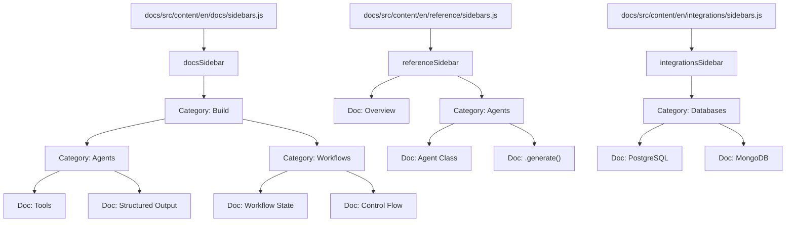

<!-- source: DeepWiki mcp.deepwiki.com · repo mastra-ai/mastra · page 12.7 Documentation Site and Content Pipeline · fetched 2026-10-26 -->

# Documentation Site and Content Pipeline

<details>
<summary>Relevant source files</summary>

The following files were used as context for generating this wiki page:

- [.changeset/funny-forks-brush.md](.changeset/funny-forks-brush.md)
- [.changeset/jolly-baths-bet.md](.changeset/jolly-baths-bet.md)
- [.changeset/purple-crabs-lick.md](.changeset/purple-crabs-lick.md)
- [.claude/skills/mastra-docs/SKILL.md](.claude/skills/mastra-docs/SKILL.md)
- [.claude/skills/mastra-docs/references/DOC.md](.claude/skills/mastra-docs/references/DOC.md)
- [.claude/skills/mastra-docs/references/GUIDE_INTEGRATION.md](.claude/skills/mastra-docs/references/GUIDE_INTEGRATION.md)
- [.claude/skills/mastra-docs/references/REFERENCE.md](.claude/skills/mastra-docs/references/REFERENCE.md)
- [.claude/skills/mastra-docs/references/STYLEGUIDE.md](.claude/skills/mastra-docs/references/STYLEGUIDE.md)
- [.github/ISSUE_TEMPLATE/bug_report.yml](.github/ISSUE_TEMPLATE/bug_report.yml)
- [.github/ISSUE_TEMPLATE/config.yml](.github/ISSUE_TEMPLATE/config.yml)
- [.github/ISSUE_TEMPLATE/feature_request.yml](.github/ISSUE_TEMPLATE/feature_request.yml)
- [.github/ISSUE_TEMPLATE/integration_request.yml](.github/ISSUE_TEMPLATE/integration_request.yml)
- [.github/PULL_REQUEST_TEMPLATE.md](.github/PULL_REQUEST_TEMPLATE.md)
- [CONTRIBUTING.md](CONTRIBUTING.md)
- [DEVELOPMENT.md](DEVELOPMENT.md)
- [README.md](README.md)
- [docs/.oxfmtrc.json](docs/.oxfmtrc.json)
- [docs/AGENTS.md](docs/AGENTS.md)
- [docs/CONTRIBUTING.md](docs/CONTRIBUTING.md)
- [docs/package.json](docs/package.json)
- [docs/src/content/en/docs/agents/code-mode.mdx](docs/src/content/en/docs/agents/code-mode.mdx)
- [docs/src/content/en/docs/connections/mcp.mdx](docs/src/content/en/docs/connections/mcp.mdx)
- [docs/src/content/en/docs/guides/mcp-authentication-authorization.mdx](docs/src/content/en/docs/guides/mcp-authentication-authorization.mdx)
- [docs/src/content/en/docs/sidebars.js](docs/src/content/en/docs/sidebars.js)
- [docs/src/content/en/integrations/deploy/neon.mdx](docs/src/content/en/integrations/deploy/neon.mdx)
- [docs/src/content/en/integrations/file-storage/amazon-s3.mdx](docs/src/content/en/integrations/file-storage/amazon-s3.mdx)
- [docs/src/content/en/integrations/file-storage/neon.mdx](docs/src/content/en/integrations/file-storage/neon.mdx)
- [docs/src/content/en/integrations/file-storage/vercel-files.mdx](docs/src/content/en/integrations/file-storage/vercel-files.mdx)
- [docs/src/content/en/integrations/sidebars.js](docs/src/content/en/integrations/sidebars.js)
- [docs/src/content/en/reference/sidebars.js](docs/src/content/en/reference/sidebars.js)
- [docs/src/content/en/reference/tools/create-code-mode.mdx](docs/src/content/en/reference/tools/create-code-mode.mdx)
- [docs/src/content/en/reference/tools/mcp-client.mdx](docs/src/content/en/reference/tools/mcp-client.mdx)
- [docs/src/content/en/reference/tools/mcp-server.mdx](docs/src/content/en/reference/tools/mcp-server.mdx)
- [docs/vercel.json](docs/vercel.json)
- [docs/vercel.redirects.json](docs/vercel.redirects.json)
- [examples/README.md](examples/README.md)
- [packages/core/src/mastra/remove-tool.test.ts](packages/core/src/mastra/remove-tool.test.ts)
- [packages/core/src/mcp/index.ts](packages/core/src/mcp/index.ts)
- [packages/core/src/mcp/types.ts](packages/core/src/mcp/types.ts)
- [packages/core/src/workspace/filesystem/mount.ts](packages/core/src/workspace/filesystem/mount.ts)
- [packages/mcp-registry-registry/package.json](packages/mcp-registry-registry/package.json)
- [packages/mcp/src/__fixtures__/graceful-shutdown-host.ts](packages/mcp/src/__fixtures__/graceful-shutdown-host.ts)
- [packages/mcp/src/client/client.test.ts](packages/mcp/src/client/client.test.ts)
- [packages/mcp/src/client/client.ts](packages/mcp/src/client/client.ts)
- [packages/mcp/src/client/configuration.test.ts](packages/mcp/src/client/configuration.test.ts)
- [packages/mcp/src/client/configuration.ts](packages/mcp/src/client/configuration.ts)
- [packages/mcp/src/client/index.ts](packages/mcp/src/client/index.ts)
- [packages/mcp/src/client/input-schema-blob-worker.test.ts](packages/mcp/src/client/input-schema-blob-worker.test.ts)
- [packages/mcp/src/client/input-schema-meta-schema.ts](packages/mcp/src/client/input-schema-meta-schema.ts)
- [packages/mcp/src/client/input-schema-test-cases.ts](packages/mcp/src/client/input-schema-test-cases.ts)
- [packages/mcp/src/client/process-hooks.test.ts](packages/mcp/src/client/process-hooks.test.ts)
- [packages/mcp/src/client/serializable-tool-definitions.test.ts](packages/mcp/src/client/serializable-tool-definitions.test.ts)
- [packages/mcp/src/client/types.ts](packages/mcp/src/client/types.ts)
- [packages/mcp/src/server/__tests__/dynamic-tools.test.ts](packages/mcp/src/server/__tests__/dynamic-tools.test.ts)
- [packages/mcp/src/server/__tests__/server-fga.test.ts](packages/mcp/src/server/__tests__/server-fga.test.ts)
- [packages/mcp/src/server/index.ts](packages/mcp/src/server/index.ts)
- [packages/mcp/src/server/server.test.ts](packages/mcp/src/server/server.test.ts)
- [packages/mcp/src/server/server.ts](packages/mcp/src/server/server.ts)
- [packages/playground-ui/src/domains/workspace/components/mount-icon.tsx](packages/playground-ui/src/domains/workspace/components/mount-icon.tsx)
- [packages/server/src/server/handlers/workspace.test.ts](packages/server/src/server/handlers/workspace.test.ts)
- [packages/server/src/server/handlers/workspace.ts](packages/server/src/server/handlers/workspace.ts)
- [scripts/gh-dane-command/index.ts](scripts/gh-dane-command/index.ts)
- [scripts/gh-dane-command/package.json](scripts/gh-dane-command/package.json)
- [stores/s3vectors/package.json](stores/s3vectors/package.json)
- [templates/weather-agent/README.md](templates/weather-agent/README.md)
- [templates/weather-agent/package.json](templates/weather-agent/package.json)
- [voice/aws-nova-sonic/CHANGELOG.md](voice/aws-nova-sonic/CHANGELOG.md)
- [voice/aws-nova-sonic/package.json](voice/aws-nova-sonic/package.json)
- [workspaces/agentcore/CHANGELOG.md](workspaces/agentcore/CHANGELOG.md)
- [workspaces/agentcore/README.md](workspaces/agentcore/README.md)
- [workspaces/agentcore/package.json](workspaces/agentcore/package.json)
- [workspaces/agentcore/src/index.ts](workspaces/agentcore/src/index.ts)
- [workspaces/agentcore/src/provider.test.ts](workspaces/agentcore/src/provider.test.ts)
- [workspaces/s3/README.md](workspaces/s3/README.md)
- [workspaces/s3/package.json](workspaces/s3/package.json)
- [workspaces/s3/src/blob-store/index.ts](workspaces/s3/src/blob-store/index.ts)
- [workspaces/s3/src/filesystem/index.integration.test.ts](workspaces/s3/src/filesystem/index.integration.test.ts)
- [workspaces/s3/src/filesystem/index.test.ts](workspaces/s3/src/filesystem/index.test.ts)
- [workspaces/s3/src/filesystem/index.ts](workspaces/s3/src/filesystem/index.ts)
- [workspaces/s3/src/provider.ts](workspaces/s3/src/provider.ts)

</details>


This page details the structure, tooling, and workflow for the Mastra documentation site, located in the `docs/` directory of the monorepo. It covers content organization, sidebar generation, Vercel routing, style linting with Vale, remark plugins for content enhancement, and the contribution process.

## Content Structure

The documentation content is organized into several top-level directories within `docs/src/content/en/`:

*   **`docs/`**: Contains conceptual guides, how-to articles, and overviews of Mastra features. Examples include `docs/agents/overview.mdx` [docs/src/content/en/docs/agents/overview.mdx:1-6]() and `docs/workflows/overview.mdx` [docs/src/content/en/docs/workflows/overview.mdx:1-6]().
*   **`reference/`**: Houses API reference documentation, detailing classes, functions, and configuration options.
*   **`models/`**: Specific documentation related to model providers and gateways.
*   **`integrations/`**: Documentation for integrating Mastra with various third-party services and frameworks.
*   **`guides/`**: Longer-form guides and tutorials.
*   **`course/`**: Content for structured learning paths.

Each content file is typically an MDX file (`.mdx`), allowing for a mix of Markdown and React components. Frontmatter at the beginning of each file defines metadata like `title` and `description` [docs/src/content/en/docs/agents/overview.mdx:2-3]().

Sources: [docs/src/content/en/docs/agents/overview.mdx:1-6](), [docs/src/content/en/docs/workflows/overview.mdx:1-6]()

## Sidebars

The navigation sidebars are defined in JavaScript files within the respective content directories. Docusaurus uses these files to generate the hierarchical navigation.

*   **`docs/src/content/en/docs/sidebars.js`**: Defines the main documentation sidebar [docs/src/content/en/docs/sidebars.js:15-16](). It uses `type: 'category'` to create collapsible sections like "Agents" and "Workflows" [docs/src/content/en/docs/sidebars.js:37-42](), and `type: 'doc'` for individual pages [docs/src/content/en/docs/sidebars.js:20-22](). The `customProps: { contextualSidebar: true }` property is used to indicate that a category might have a contextual sidebar [docs/src/content/en/docs/sidebars.js:43-45]().
*   **`docs/src/content/en/reference/sidebars.js`**: Defines the sidebar specifically for the API reference section [docs/src/content/en/reference/sidebars.js:8-9](). This sidebar often lists individual classes and functions, such as `AcpAgent` and `createACPTool()` under the "ACP" category [docs/src/content/en/reference/sidebars.js:17-22]().
*   **`docs/src/content/en/integrations/sidebars.js`**: Defines the sidebar for the integrations section.

### Sidebar Generation Logic

The `sidebars.js` files use a Docusaurus-specific configuration object (`SidebarsConfig`) [docs/src/content/en/docs/sidebars.js:15](). Categories can be `collapsed` or `collapsible` [docs/src/content/en/docs/sidebars.js:30-31](). The `items` array within a category defines its children, which can be other categories or individual document links [docs/src/content/en/docs/sidebars.js:34-35]().

**Sidebar Structure Diagram**


Sources: [docs/src/content/en/docs/sidebars.js:1-251](), [docs/src/content/en/reference/sidebars.js:1-162](), [docs/src/content/en/integrations/sidebars.js]()

## Vercel Routing and Redirects

The `docs/vercel.json` file [docs/vercel.json:1-229]() and `docs/vercel.redirects.json` file [docs/vercel.redirects.json:1-225]() define routing and redirection rules for the Vercel deployment of the documentation site. These are crucial for maintaining permalinks and guiding users to updated content.

The `redirects` array contains objects with `source`, `destination`, and `permanent` properties [docs/vercel.json:17-21](). A `permanent: true` redirect indicates a 308 Permanent Redirect, which is cached by browsers and search engines.

**Example Redirects:**
*   `/docs/workspace/overview` redirects to `/docs/sandbox/overview` [docs/vercel.json:30-33]().
*   `/docs/agents/channels` redirects to `/docs/channels` [docs/vercel.json:49-52]().
*   Older version paths like `/docs/v1/:path*` are redirected to their current counterparts `/docs/:path*` [docs/vercel.json:157-160]().

The `scripts/generate-vercel-redirects.mjs` script [docs/package.json:23]() is responsible for generating these redirect configurations, likely from a more human-readable source or by consolidating rules.

Sources: [docs/vercel.json:1-229](), [docs/vercel.redirects.json:1-225](), [docs/package.json:23]()

## Vale Style Linting

Vale is used for prose linting to enforce writing style and consistency across the documentation.

*   **Configuration**: Vale's configuration is typically found in a `.vale.ini` file (not provided in snippets, but implied by usage).
*   **Execution**: The `lint:vale` script [docs/package.json:28]() runs Vale against specific content directories: `src/content/en/docs`, `src/content/en/integrations`, and `src/content/en/reference`.
*   **AI-specific linting**: `lint:vale:ai` [docs/package.json:29]() is a specialized command that sets `minAlertLevel=error` and `output=line`, likely for stricter checks on AI-related content.
*   **Download**: The `vale:download` script [docs/package.json:25]() handles downloading the Vale executable.
*   **Synchronization**: `vale:sync` [docs/package.json:26]() is used to synchronize Vale's configuration or rules.

Sources: [docs/package.json:25-29]()

## Remark Plugins

Remark is a Markdown processor used in Docusaurus. The documentation site leverages several remark plugins to enhance content rendering and functionality.

*   **`@docusaurus/remark-plugin-npm2yarn`**: This plugin automatically converts `npm` commands to `yarn` commands (and vice-versa) in code blocks, providing flexibility for users [docs/package.json:50]().
*   **Custom Plugins**: The `docs/package.json` lists `hast-util-select`, `hast-util-to-mdast`, `rehype-parse`, `rehype-remark`, `remark-stringify`, `unified`, and `unist-util-visit` as dependencies [docs/package.json:72-73, 83-87, 116](). These are common building blocks for creating custom Remark/Rehype plugins, suggesting that the documentation might have bespoke content transformations or validations. For example, the `Inject` component used in `docs/src/content/en/docs/agents/code-mode.mdx` [docs/src/content/en/docs/agents/code-mode.mdx]() likely relies on a custom remark plugin to embed partial MDX files.

Sources: [docs/package.json:50](), [docs/package.json:72-73, 83-87, 116](), [docs/src/content/en/docs/agents/code-mode.mdx]()

## Contribution Workflow

Contributing to the documentation involves several steps and tools to ensure quality and consistency.

1.  **Content Creation/Modification**: Write or edit `.mdx` files in the appropriate content directory (e.g., `docs/src/content/en/docs/agents/code-mode.mdx` [docs/src/content/en/docs/agents/code-mode.mdx]()).
2.  **Local Development**: Use `pnpm dev` [docs/package.json:10]() to start the Docusaurus development server and preview changes locally.
3.  **Sidebar Updates**: If new pages are added or existing ones moved, update the relevant `sidebars.js` file (e.g., `docs/src/content/en/docs/sidebars.js` [docs/src/content/en/docs/sidebars.js:1-251]()) to ensure they appear in navigation.
4.  **Linting and Formatting**:
    *   **Prose Linting**: Run `pnpm lint:vale` [docs/package.json:28]() to check for style and grammar issues. The `lint:prose` command [docs/package.json:31]() combines Vale and Remark linting.
    *   **Code Formatting**: Use `pnpm format:oxfmt` and `pnpm format:mdx` [docs/package.json:39-41]() to format code and MDX files. `oxfmt-mdx` is specifically used for MDX files [docs/package.json:41]().
5.  **Validation Scripts**: The `validate` script [docs/package.json:22]() runs several checks:
    *   `validate:frontmatter`: Ensures frontmatter is correctly structured.
    *   `validate:reference-sidebar`: Checks the sorting of the reference sidebar.
    *   `validate:sidebar-docs`: Validates the main documentation sidebar.
    *   `validate:sidebar-new-tags`: Checks for new tags in sidebars.
6.  **Testing**: Run `pnpm test` [docs/package.json:33]() for unit tests, and `pnpm test:e2e` [docs/package.json:35]() for end-to-end tests, which might include checks for documentation pages.
7.  **Vercel Redirects**: If URLs change, update the Vercel redirects. The `generate-vercel-redirects` script [docs/package.json:23]() might assist in this.
8.  **Changesets**: For any significant changes, a changeset file should be created following the guidelines in `CONTRIBUTING.md` [CONTRIBUTING.md]() and `docs/CONTRIBUTING.md` [docs/CONTRIBUTING.md]().

**Contribution Workflow Diagram**
```mermaid
graph TD
    A[Start: Edit/Create .mdx] --> B{Update sidebars.js?};
    B -- Yes --> C[Update sidebars.js];
    B -- No --> D[Run pnpm dev];
    C --> D;
    D --> E[Preview Changes Locally];
    E --> F[Run pnpm lint:prose];
    F --> G[Run pnpm format];
    G --> H[Run pnpm validate];
    H --> I{All checks pass?};
    I -- No --> J[Fix Issues];
    J --> F;
    I -- Yes --> K[Update Vercel Redirects (if needed)];
    K --> L[Create Changeset];
    L --> M[Submit PR];
```

Sources: [docs/package.json:10](), [docs/package.json:22-23](), [docs/package.json:28-29](), [docs/package.json:31](), [docs/package.json:33](), [docs/package.json:35](), [docs/package.json:39-41](), [docs/src/content/en/docs/agents/code-mode.mdx](), [docs/src/content/en/docs/sidebars.js:1-251](), [CONTRIBUTING.md](), [docs/CONTRIBUTING.md]()

---

