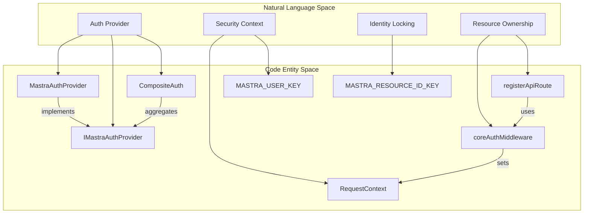
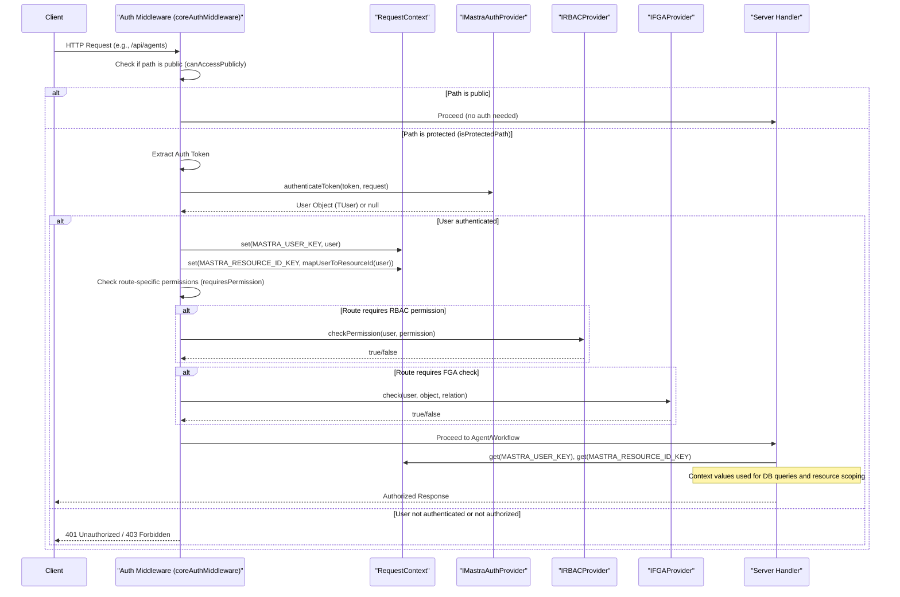

<!-- source: DeepWiki mcp.deepwiki.com · repo mastra-ai/mastra · page 13 Authentication System · fetched 2026-10-26 -->

# Authentication System

Relevant source files

The following files were used as context for generating this wiki page:

- [.changeset/sp5-host-only-studio-cookie.md](.changeset/sp5-host-only-studio-cookie.md)
- [auth/studio/src/index.test.ts](auth/studio/src/index.test.ts)
- [auth/studio/src/index.ts](auth/studio/src/index.ts)
- [auth/studio/src/session-cookie-scope.test.ts](auth/studio/src/session-cookie-scope.test.ts)
- [mastracode/factory-ui/src/ui/domains/auth/services/auth.ts](mastracode/factory-ui/src/ui/domains/auth/services/auth.ts)
- [mastracode/factory/src/auth-seam.test.ts](mastracode/factory/src/auth-seam.test.ts)
- [mastracode/factory/src/auth.test.ts](mastracode/factory/src/auth.test.ts)
- [mastracode/factory/src/auth.ts](mastracode/factory/src/auth.ts)
- [packages/_internals/auth/src/session/index.ts](packages/_internals/auth/src/session/index.ts)
- [packages/server/src/server/handlers/auth.test.ts](packages/server/src/server/handlers/auth.test.ts)
- [packages/server/src/server/handlers/auth.ts](packages/server/src/server/handlers/auth.ts)

The Mastra authentication system provides a comprehensive framework for securing AI agents, workflows, and API endpoints. It supports diverse authentication methods including token and credential-based auth, session management, Single Sign-On (SSO), and Role-Based Access Control (RBAC). Additionally, it enables fine-grained authorization with resource-level permission checks, facilitating safe multi-tenant operations for memory, threads, and execution contexts.

Authentication integrates deeply with the Mastra server middleware, providing customizable protection and authorization on specific API routes. A core component of this system is the `RequestContext`, which propagates security identities (like `resourceId` and `threadId`) throughout the agent and tool execution pipeline [docs/src/content/en/docs/server/request-context.mdx:10-16]().

This page serves as a high-level overview of Mastra's authentication concepts, architecture, and integrations. For detailed technical documentation, see the child pages:

- [Auth Provider Architecture](#13.1) — Details the base classes, interfaces, RBAC/FGA models, and server middleware integration.
- [Auth Provider Integrations](#13.2) — Documents supported auth provider packages (Auth0, Better Auth, Clerk, Supabase, etc.), configuration patterns, and environment variables.

---

## Core Architecture

Mastra abstracts authentication through the `IMastraAuthProvider` interface [packages/_internals/auth/src/provider.ts:10](). The system leverages `RequestContext` to ensure that security-sensitive identifiers are protected from client-side hijacking by giving precedence to server-derived values [docs/src/content/en/docs/server/middleware.mdx:161-179]().

### Authentication Flow Overview
1. **Request Interception**: The server middleware inspects incoming API requests [docs/src/content/en/docs/server/middleware.mdx:19-20]().
2. **Token Verification**: The configured auth provider validates tokens or credentials using `authenticateToken` [packages/server/src/server/handlers/auth.test.ts:34](). The raw token can be stored in the context using reserved keys for downstream forwarding to services like MCP servers.
3. **Identity Injection**: On successful authentication, the server sets reserved keys in the `RequestContext`. Specifically, `resourceId` and `threadId` are used to lock execution to a specific tenant or conversation [docs/src/content/en/docs/server/middleware.mdx:161-179]().
4. **Effective ID Resolution**: Handlers resolve the final ID, ensuring the server-set context value always overrides any client-provided body parameters [packages/server/src/server/auth/helpers.ts:18-22]().
5. **Ownership Validation**: The system validates that requested resources (like memory threads) belong to the authenticated `resourceId` [docs/src/content/en/docs/server/middleware.mdx:153-159]().

### Code Entity Mapping: Authentication & Context

**Sources:** [packages/_internals/auth/src/provider.ts:10](), [packages/_internals/auth/src/provider.ts:1](), [packages/_internals/auth/src/composite.ts:1](), [packages/server/src/server/constants.ts:24](), [packages/server/src/server/constants.ts:25](), [packages/server/src/server/server-adapter/routes/route-builder.ts:10]().

---

## Server Integration & Security Utilities

Authentication enforcement is handled by the Mastra server layer, which uses specialized utilities to ensure that agentic operations remain within their authorized boundaries.

| Utility / Component | Package | Implementation Role |
| :--- | :--- | :--- |
| **`MastraAuthProvider`** | `@mastra/core` | Base class for all authentication providers [packages/_internals/auth/src/provider.ts:1](). |
| **`IMastraAuthProvider`** | `@mastra/core` | Interface defining the contract for authentication providers [packages/_internals/auth/src/provider.ts:10](). |
| **`CompositeAuth`** | `@mastra/core` | Aggregates multiple `IMastraAuthProvider` instances, allowing a request to be authenticated by any configured provider [packages/_internals/auth/src/composite.ts:1](). |
| **`RequestContext`** | `@mastra/core` | Type-safe registry for auth data propagated to Agents and Tools [docs/src/content/en/docs/server/request-context.mdx:10-16](). |
| **`Auth Handlers`** | `@mastra/server` | Hono-based endpoints for login, callback, and session management [packages/server/src/server/handlers/auth.ts:10-17](). |
| **`Auth Helpers`** | `@mastra/server` | Utilities for token parsing and session validation, including `isProtectedPath` and `canAccessPublicly` [packages/server/src/server/auth/helpers.ts:188-191](). |
| **`registerApiRoute`** | `@mastra/core` | Function to define custom API routes, including `requiresAuth` and `requiresPermission` options for RBAC/FGA [packages/server/src/server/server-adapter/routes/route-builder.ts:10](). |

### Security Validation Flow

**Sources:** [packages/server/src/server/auth/helpers.ts:188-191](), [packages/server/src/server/auth/helpers.ts:178-186](), [packages/_internals/auth/src/provider.ts:10](), [packages/_internals/auth/src/types.ts:1](), [packages/_internals/auth/src/types.ts:7](), [packages/server/src/server/auth/helpers.ts:10](), [packages/server/src/server/constants.ts:24](), [packages/server/src/server/constants.ts:25](), [packages/server/src/server/server-adapter/routes/route-builder.ts:10]().

---

## Subsystems and Details

### Auth Provider Architecture
The Mastra authentication framework centers on the `MastraAuthProvider` base class [packages/_internals/auth/src/provider.ts:1](). This abstract class provides the foundational methods for `authenticateToken` and `authorizeUser` [packages/server/src/server/handlers/auth.test.ts:34-35](). The system supports multi-tenant isolation by requiring a resolvable resource ID for memory operations via the `mapUserToResourceId` method [docs/src/content/en/docs/server/middleware.mdx:161-179](). It also supports fine-grained access control (FGA) through the `RequestContext` propagation into tools and agents [packages/_internals/auth/src/types.ts:7-8](). The `ISessionProvider` interface [packages/_internals/auth/src/session/index.ts:20-37]() defines methods for session management, including `getSessionIdFromRequest`, `getSessionHeaders`, and `getClearSessionHeaders`. A new optional method `getLegacySessionClearCookies()` [packages/_internals/auth/src/session/index.ts:35-37]() has been added to handle expiring older session cookies, particularly for `__Host-wos-session` and `wos-session` cookies [auth/studio/src/index.ts:91-94](), [auth/studio/src/session-cookie-scope.test.ts:51-59]().

For detailed coverage, see the child page [Auth Provider Architecture](#13.1).

### Auth Provider Integrations
Mastra supports a rich ecosystem of authentication providers, including specialized packages like `@mastra/auth-better-auth` which provides self-hosted authentication capabilities. The `MastraAuthStudio` provider [auth/studio/src/index.ts:161-162]() is specifically designed for Mastra Studio deployed instances, proxying authentication through the shared API and handling session cookies with host-only scoping for enhanced security [auth/studio/src/index.ts:151-159](), [auth/studio/src/session-cookie-scope.test.ts:43-49]().

Available integrations include:
- **Better Auth**: Self-hosted auth with Kysely support.
- **SaaS Providers**: Auth0, Clerk, Firebase, Okta, Supabase, and WorkOS.
- **Cloud/Studio**: Native authentication for Mastra Cloud and Studio.

Details on configuration patterns and environment variables for each provider are documented in the child page [Auth Provider Integrations](#13.2).

---

## RequestContext and Security
The `RequestContext` class is the primary vehicle for security context propagation [docs/src/content/en/docs/server/request-context.mdx:10-16](). When defining agents or tools, the schema allows for strict typing of the authentication and tenant data available during execution [packages/server/src/server/server.test-d.ts:29-32](). This ensures that an agent cannot access memory threads or files belonging to a different `resourceId` unless explicitly permitted by the security policy [docs/src/content/en/docs/server/middleware.mdx:153-159]().

**Sources:** [docs/src/content/en/docs/server/request-context.mdx:10-16](), [docs/src/content/en/docs/server/middleware.mdx:153-159](), [packages/server/src/server/server.test-d.ts:29-32]().

---

