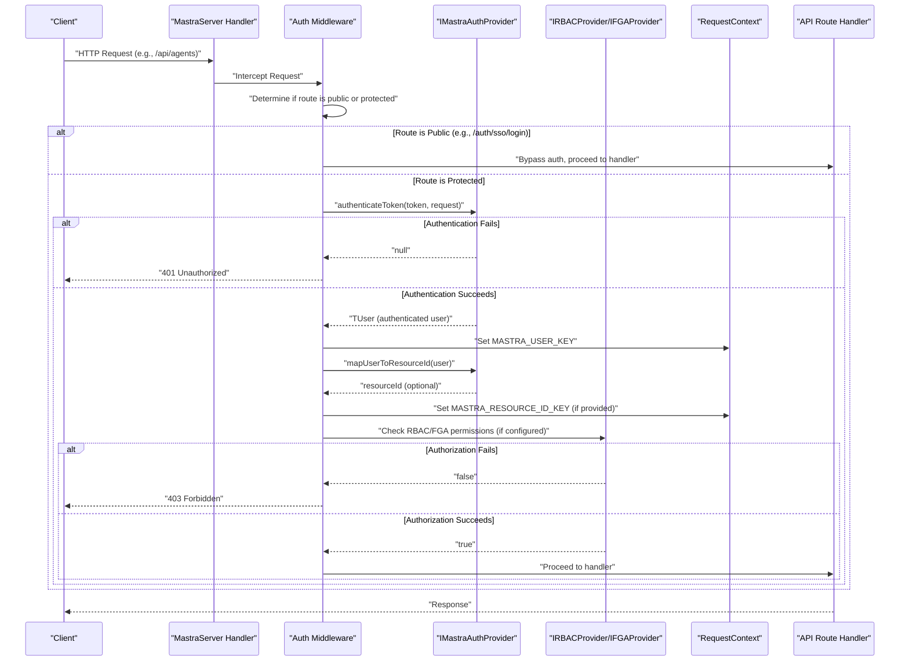

<!-- source: DeepWiki mcp.deepwiki.com · repo mastra-ai/mastra · page 13.1 Auth Provider Architecture · fetched 2026-10-26 -->

# Auth Provider Architecture

Relevant source files

The following files were used as context for generating this wiki page:

- [.changeset/sp5-host-only-studio-cookie.md](.changeset/sp5-host-only-studio-cookie.md)
- [auth/studio/src/index.test.ts](auth/studio/src/index.test.ts)
- [auth/studio/src/index.ts](auth/studio/src/index.ts)
- [auth/studio/src/session-cookie-scope.test.ts](auth/studio/src/session-cookie-scope.test.ts)
- [docs/src/content/en/reference/configuration.mdx](docs/src/content/en/reference/configuration.mdx)
- [docs/src/content/en/reference/server/register-api-route.mdx](docs/src/content/en/reference/server/register-api-route.mdx)
- [e2e-tests/_local-registry-setup/package.json](e2e-tests/_local-registry-setup/package.json)
- [e2e-tests/_local-registry-setup/prepare.js](e2e-tests/_local-registry-setup/prepare.js)
- [e2e-tests/_local-registry-setup/publish-ci-registry.js](e2e-tests/_local-registry-setup/publish-ci-registry.js)
- [e2e-tests/_local-registry-setup/publish-roots.js](e2e-tests/_local-registry-setup/publish-roots.js)
- [e2e-tests/_local-registry-setup/publish.js](e2e-tests/_local-registry-setup/publish.js)
- [e2e-tests/commonjs/setup.ts](e2e-tests/commonjs/setup.ts)
- [e2e-tests/create-mastra/create-mastra.test.ts](e2e-tests/create-mastra/create-mastra.test.ts)
- [e2e-tests/create-mastra/setup.ts](e2e-tests/create-mastra/setup.ts)
- [e2e-tests/deployers/setup.ts](e2e-tests/deployers/setup.ts)
- [e2e-tests/no-bundling/setup.ts](e2e-tests/no-bundling/setup.ts)
- [e2e-tests/type-check/setup.ts](e2e-tests/type-check/setup.ts)
- [e2e-tests/type-check/template/core/agent-message-input.test-d.ts](e2e-tests/type-check/template/core/agent-message-input.test-d.ts)
- [e2e-tests/type-check/template/core/auth.test-d.ts](e2e-tests/type-check/template/core/auth.test-d.ts)
- [e2e-tests/type-check/template/package.json](e2e-tests/type-check/template/package.json)
- [e2e-tests/type-check/template/tsconfig.exact-optional.json](e2e-tests/type-check/template/tsconfig.exact-optional.json)
- [e2e-tests/type-check/template/tsconfig.mcp.json](e2e-tests/type-check/template/tsconfig.mcp.json)
- [e2e-tests/type-check/template/vitest.config.ts](e2e-tests/type-check/template/vitest.config.ts)
- [e2e-tests/type-check/template/vitest.mcp.config.ts](e2e-tests/type-check/template/vitest.mcp.config.ts)
- [e2e-tests/type-check/test.ts](e2e-tests/type-check/test.ts)
- [mastracode/factory-ui/src/ui/domains/auth/services/auth.ts](mastracode/factory-ui/src/ui/domains/auth/services/auth.ts)
- [mastracode/factory/src/auth-seam.test.ts](mastracode/factory/src/auth-seam.test.ts)
- [mastracode/factory/src/auth.test.ts](mastracode/factory/src/auth.test.ts)
- [mastracode/factory/src/auth.ts](mastracode/factory/src/auth.ts)
- [packages/_internals/auth/src/provider/index.ts](packages/_internals/auth/src/provider/index.ts)
- [packages/_internals/auth/src/session/index.ts](packages/_internals/auth/src/session/index.ts)
- [packages/_types-builder/AGENTS.md](packages/_types-builder/AGENTS.md)
- [packages/auth/src/index.ts](packages/auth/src/index.ts)
- [packages/core/src/agent/message-list/types.ts](packages/core/src/agent/message-list/types.ts)
- [packages/core/src/server/auth.test.ts](packages/core/src/server/auth.test.ts)
- [packages/core/src/server/auth.ts](packages/core/src/server/auth.ts)
- [packages/core/src/server/composite-auth.ts](packages/core/src/server/composite-auth.ts)
- [packages/core/src/server/index.ts](packages/core/src/server/index.ts)
- [packages/core/src/server/server.test-d.ts](packages/core/src/server/server.test-d.ts)
- [packages/core/src/server/server.test.ts](packages/core/src/server/server.test.ts)
- [packages/core/src/server/types.ts](packages/core/src/server/types.ts)
- [packages/server/src/server/handlers/auth.test.ts](packages/server/src/server/handlers/auth.test.ts)
- [packages/server/src/server/handlers/auth.ts](packages/server/src/server/handlers/auth.ts)

The Mastra authentication system provides a comprehensive, extensible framework to handle user authentication, authorization, and session management within Mastra-based AI applications. This architecture harmonizes diverse auth providers, supports Role-Based Access Control (RBAC) and Fine-Grained Authorization (FGA), and integrates seamlessly with the Mastra server middleware to protect API routes and resources.

## Purpose and Scope

This page documents the core abstractions for authentication in Mastra, including the `MastraAuthProvider` base class and specialized interfaces. It elucidates the RBAC model integration and describes how authentication and authorization interplay with the Mastra server middleware. The page also details how FGA (Fine-Grained Authorization) is resolved for built-in and custom routes.

## Core Abstractions

### MastraAuthProvider Base Class

`IMastraAuthProvider` is the interface foundation for authentication providers in Mastra. It defines the essential methods required to authenticate users and authorize access:

- `authenticateToken(token: string, request: Request): Promise<TUser | null>`
  Validates an auth token from the request and returning a user object or `null` if invalid.
- `authorizeUser(user: TUser, request: Request): Promise<boolean>`
  Determines if an authenticated user is authorized to perform the current request.

In the server implementation, the system checks if a configured auth object has the `authenticateToken` method to identify it as a valid provider [packages/server/src/server/handlers/auth.ts:85-107](). The `MastraAuthProvider` class itself is defined in `@internal/auth/provider` [packages/_internals/auth/src/provider/index.ts:1-1]().

**Sources:** [packages/server/src/server/handlers/auth.ts:11-19](), [packages/server/src/server/handlers/auth.ts:85-107](), [packages/_internals/auth/src/provider/index.ts:1-1]()

### Specialized Provider Interfaces

Mastra delineates capabilities through specific provider interfaces imported from `@mastra/core/auth` and `@mastra/core/auth/ee`:

- **`IUserProvider`**: Interface defining methods for retrieving user profile or attributes post authentication [packages/server/src/server/handlers/auth.ts:12-17]().
- **`ICredentialsProvider`**: For username/password or similar credential-based login flows, supporting methods like `signIn` and `signUp` [packages/server/src/server/handlers/auth.ts:15-17]().
- **`ISSOProvider`**: For Single Sign-On flows, managing login URLs and OAuth/SAML callbacks [packages/server/src/server/handlers/auth.ts:14-17]().
- **`IRBACProvider`**: Handles Role-Based Access Control semantics for users via roles and permissions [packages/server/src/server/handlers/auth.ts:18-18]().
- **`IFGAProvider`**: Supports Fine-Grained Authorization, a relationship- and resource-level permission model for complex access control scenarios [packages/server/src/server/handlers/auth.ts:18-18]().

These interfaces are checked using type guard functions like `isSSOProvider`, `isUserProvider`, `isCredentialsProvider`, etc., defined in [packages/core/src/server/index.ts:35-41]().

**Sources:** [packages/server/src/server/handlers/auth.ts:11-18](), [packages/core/src/server/index.ts:35-41]()

## Server Middleware Integration

Authentication and authorization are integrated into the Mastra server middleware stack. The server provides handlers to detect available auth capabilities, initiate SSO login flows, and handle OAuth callbacks [packages/server/src/server/handlers/auth.ts:1-9]().

### Request Flow Diagram

**Sources:** [packages/server/src/server/handlers/auth.ts:1-9](), [packages/server/src/server/handlers/auth.ts:85-114](), [packages/server/src/server/auth/helpers.ts:178-185](), [packages/server/src/server/auth/helpers.ts:188-191](), [packages/server/src/server/auth/helpers.ts:27-70](), [packages/server/src/server/auth/helpers.ts:21-23]()

### Dual Auth Logic

Mastra supports "Dual Auth," which is opt-in. If `studio.auth` is explicitly configured in the Mastra instance, Studio requests use it exclusively. Otherwise, Studio requests fall back to `server.auth` for backward compatibility [packages/server/src/server/handlers/auth.ts:78-107](). This logic is encapsulated in the `getAuthProvider` function [packages/server/src/server/handlers/auth.ts:85-107]().

**Sources:** [packages/server/src/server/handlers/auth.ts:85-107]()

## Code Entity Mapping

```mermaid
graph TD
  subgraph "Conceptual Layer"
    CFG["Auth Configuration"]
    USER_IDENTITY["User Identity (TUser)"]
    AUTH_PROVIDER_IMPL["Auth Provider Implementation"]
    CAPABILITIES["Auth Capabilities (SSO, Credentials)"]
    RBAC_MODEL["RBAC Model"]
    FGA_MODEL["FGA Model"]
    SERVER_MIDDLEWARE["Server Middleware"]
    REQUEST_CONTEXT_DATA["Request Context Data"]
  end

  subgraph "Code Layer"
    MastraAuthConfig["MastraAuthConfig<TUser> (packages/core/src/server/types.ts)"]
    IMastraAuthProvider["IMastraAuthProvider<TUser> (packages/core/src/server/auth.ts)"]
    IUserProvider["IUserProvider<TUser> (packages/core/src/server/auth.ts)"]
    ICredentialsProvider["ICredentialsProvider<TUser> (packages/core/src/server/auth.ts)"]
    ISSOProvider["ISSOProvider<TUser> (packages/core/src/server/auth.ts)"]
    IRBACProvider["IRBACProvider<EEUser> (packages/core/src/auth/ee/interfaces/rbac.ts)"]
    IFGAProvider["IFGAProvider<EEUser> (packages/core/src/auth/ee/interfaces/fga.ts)"]
    getAuthProvider["getAuthProvider (packages/server/src/server/handlers/auth.ts)"]
    buildCapabilities["buildCapabilities (packages/core/src/auth/ee/index.ts)"]
    coreAuthMiddleware["coreAuthMiddleware (packages/server/src/server/auth/helpers.ts)"]
    RequestContextClass["RequestContext (packages/core/src/request-context/index.ts)"]
    MASTRA_USER_KEY["MASTRA_USER_KEY (packages/server/src/constants.ts)"]
    MASTRA_RESOURCE_ID_KEY["MASTRA_RESOURCE_ID_KEY (packages/server/src/constants.ts)"]
    defineAuth["defineAuth (packages/core/src/server/index.ts)"]
  end

  CFG --> MastraAuthConfig
  MastraAuthConfig --> defineAuth
  MastraAuthConfig --> getAuthProvider
  MastraAuthConfig --> coreAuthMiddleware

  AUTH_PROVIDER_IMPL --> IMastraAuthProvider
  IMastraAuthProvider --> IUserProvider
  IMastraAuthProvider --> ICredentialsProvider
  IMastraAuthProvider --> ISSOProvider
  IMastraAuthProvider --> IRBACProvider
  IMastraAuthProvider --> IFGAProvider

  USER_IDENTITY --> IMastraAuthProvider
  USER_IDENTITY --> IUserProvider
  USER_IDENTITY --> ICredentialsProvider
  USER_IDENTITY --> ISSOProvider
  USER_IDENTITY --> IRBACProvider
  USER_IDENTITY --> IFGAProvider

  CAPABILITIES --> buildCapabilities
  buildCapabilities --> getAuthProvider

  RBAC_MODEL --> IRBACProvider
  FGA_MODEL --> IFGAProvider

  SERVER_MIDDLEWARE --> coreAuthMiddleware
  coreAuthMiddleware --> getAuthProvider
  coreAuthMiddleware --> IMastraAuthProvider
  coreAuthMiddleware --> IRBACProvider
  coreAuthMiddleware --> IFGAProvider
  coreAuthMiddleware --> RequestContextClass

  REQUEST_CONTEXT_DATA --> RequestContextClass
  RequestContextClass --> MASTRA_USER_KEY
  RequestContextClass --> MASTRA_RESOURCE_ID_KEY

  style MastraAuthConfig font-family:monospace
  style IMastraAuthProvider font-family:monospace
  style IUserProvider font-family:monospace
  style ICredentialsProvider font-family:monospace
  style ISSOProvider font-family:monospace
  style IRBACProvider font-family:monospace
  style IFGAProvider font-family:monospace
  style getAuthProvider font-family:monospace
  style buildCapabilities font-family:monospace
  style coreAuthMiddleware font-family:monospace
  style RequestContextClass font-family:monospace
  style MASTRA_USER_KEY font-family:monospace
  style MASTRA_RESOURCE_ID_KEY font-family:monospace
  style defineAuth font-family:monospace
```

**Sources:** [packages/core/src/server/types.ts:116-116](), [packages/core/src/server/auth.ts:10-10](), [packages/core/src/server/auth.ts:20-20](), [packages/core/src/server/auth.ts:21](), [packages/core/src/server/auth.ts:21](), [packages/core/src/auth/ee/interfaces/rbac.ts:1-1](), [packages/core/src/auth/ee/interfaces/fga.ts:1-1](), [packages/server/src/server/handlers/auth.ts:85-107](), [packages/server/src/server/handlers/auth.ts:43-61](), [packages/server/src/server/auth/helpers.ts:10-10](), [packages/server/src/server/auth/helpers.ts:8-8](), [packages/core/src/request-context/index.ts:1-1](), [packages/core/src/server/index.ts:152-154]()

## Implementation Details

### Public Origin Resolution
Behind proxies (e.g., edge routers, Railway gateways), `request.url` often contains internal hostnames. Mastra uses `getPublicOrigin` to reconstruct the real public origin for OAuth providers, prioritizing headers in this order:
1. `X-Mastra-Public-Host`
2. `X-Forwarded-Host`
3. `Host` header with `X-Forwarded-Proto`
4. `Host` header alone

This function is crucial for ensuring correct redirect URIs in SSO flows [packages/server/src/server/handlers/auth.ts:140-159]().

**Sources:** [packages/server/src/server/handlers/auth.ts:140-159]()

### Context Management and RBAC
The `RequestContext` is used to pass runtime, request-specific configuration to agents and workflows [docs/src/content/en/reference/configuration.mdx:1-202](). In the auth layer, the system checks for RBAC and FGA providers in the Mastra configuration, checking the Studio config first if the request originates from the Studio client [packages/server/src/server/handlers/auth.ts:165-189]().

The `RequestContext` is populated with authenticated user information (`MASTRA_USER_KEY`) and, if configured, a resource ID (`MASTRA_RESOURCE_ID_KEY`) derived from the user via `mapUserToResourceId` [packages/server/src/server/auth/helpers.ts:21-23](). This resource ID is then used for resource-level authorization and data isolation.

**Sources:** [packages/server/src/server/handlers/auth.ts:165-189](), [docs/src/content/en/reference/configuration.mdx:1-202](), [packages/server/src/server/auth/helpers.ts:21-23]()

### RBAC Model
The RBAC model is implemented via the `IRBACProvider`. It manages `EEUser` permissions and roles. The server can fetch permission patterns and build capability manifests to inform the frontend (Studio) about what auth actions are supported [packages/server/src/server/handlers/auth.ts:43-76](). The `getRBACProvider` function handles retrieving the correct RBAC provider based on whether the request is from Studio [packages/server/src/server/handlers/auth.ts:165-174]().

**Sources:** [packages/server/src/server/handlers/auth.ts:18-18](), [packages/server/src/server/handlers/auth.ts:43-76](), [packages/server/src/server/handlers/auth.ts:165-174]()

### Route Protection and Authorization Rules

Mastra provides mechanisms to define which routes require authentication and specific permissions:

- **`requiresAuth`**: A boolean flag on `ApiRoute` [packages/core/src/server/types.ts:26-26]() that determines if a route needs authentication. By default, all built-in Mastra API routes are protected.
- **`requiresPermission`**: An optional `MastraFGAPermissionInput` or array of inputs [packages/core/src/server/types.ts:27-27]() that specifies required permissions for a route. This integrates with FGA providers.
- **`fga`**: An optional `FGARouteConfig` [packages/core/src/server/types.ts:28-28]() for more granular FGA rules on a per-route basis.
- **`server.auth.protected` and `server.auth.public`**: Configuration options in `MastraAuthConfig` [packages/core/src/server/types.ts:116-116]() to define path patterns that are explicitly protected or publicly accessible. These patterns can be strings, regex, or arrays of paths/methods [packages/server/src/server/auth/helpers.ts:100-102]().
- **`server.auth.rules`**: An array of `AuthRule` objects [packages/server/src/server/auth/helpers.ts:129-133]() that allow for conditional authorization based on user attributes or other runtime conditions.

The `isProtectedPath` helper function determines if a given path and method are protected, considering both default and custom `protected` patterns, as well as `requiresAuth` on custom routes [packages/server/src/server/auth/helpers.ts:178-185](). Similarly, `canAccessPublicly` checks against `public` patterns [packages/server/src/server/auth/helpers.ts:188-191]().

**Sources:** [packages/core/src/server/types.ts:26-28](), [packages/core/src/server/types.ts:116-116](), [packages/server/src/server/auth/helpers.ts:100-102](), [packages/server/src/server/auth/helpers.ts:129-133](), [packages/server/src/server/auth/helpers.ts:178-185](), [packages/server/src/server/auth/helpers.ts:188-191]()

### CompositeAuth

The `CompositeAuth` class [packages/core/src/server/composite-auth.ts:1-1]() allows combining multiple `IMastraAuthProvider` instances. When `authenticateToken` is called on `CompositeAuth`, it iterates through the registered providers and returns the user from the first provider that successfully authenticates. For `authorizeUser`, it returns `true` if any provider authorizes the user [packages/core/src/server/auth.test.ts:40-167](). This enables flexible authentication strategies where different methods (e.g., API key, JWT, session cookie) can coexist.

**Sources:** [packages/core/src/server/composite-auth.ts:1-1](), [packages/core/src/server/auth.test.ts:40-167]()

---

