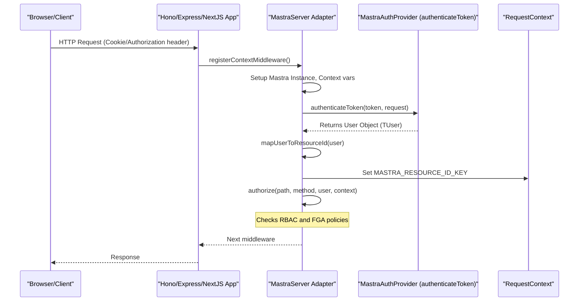
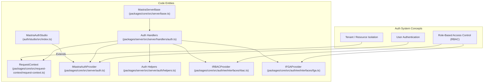

<!-- source: DeepWiki mcp.deepwiki.com · repo mastra-ai/mastra · page 13.2 Auth Provider Integrations · fetched 2026-10-26 -->

# Auth Provider Integrations

Relevant source files

The following files were used as context for generating this wiki page:

- [.changeset/sp5-host-only-studio-cookie.md](.changeset/sp5-host-only-studio-cookie.md)
- [auth/better-auth/package.json](auth/better-auth/package.json)
- [auth/studio/src/index.test.ts](auth/studio/src/index.test.ts)
- [auth/studio/src/index.ts](auth/studio/src/index.ts)
- [auth/studio/src/session-cookie-scope.test.ts](auth/studio/src/session-cookie-scope.test.ts)
- [e2e-tests/_local-registry-setup/pnpm-lock.yaml](e2e-tests/_local-registry-setup/pnpm-lock.yaml)
- [e2e-tests/_local-registry-setup/pnpm-workspace.yaml](e2e-tests/_local-registry-setup/pnpm-workspace.yaml)
- [e2e-tests/commonjs/template/package.json](e2e-tests/commonjs/template/package.json)
- [e2e-tests/experiment-worker/pnpm-lock.yaml](e2e-tests/experiment-worker/pnpm-lock.yaml)
- [e2e-tests/experiment-worker/pnpm-workspace.yaml](e2e-tests/experiment-worker/pnpm-workspace.yaml)
- [e2e-tests/monorepo/template/package.json](e2e-tests/monorepo/template/package.json)
- [e2e-tests/no-bundling/template/package.json](e2e-tests/no-bundling/template/package.json)
- [e2e-tests/pkg-outputs/pnpm-lock.yaml](e2e-tests/pkg-outputs/pnpm-lock.yaml)
- [e2e-tests/softwarefactory/pnpm-lock.yaml](e2e-tests/softwarefactory/pnpm-lock.yaml)
- [e2e-tests/softwarefactory/pnpm-workspace.yaml](e2e-tests/softwarefactory/pnpm-workspace.yaml)
- [examples/agent-builder/package.json](examples/agent-builder/package.json)
- [examples/agent-builder/pnpm-lock.yaml](examples/agent-builder/pnpm-lock.yaml)
- [examples/agent/package.json](examples/agent/package.json)
- [examples/agent/pnpm-lock.yaml](examples/agent/pnpm-lock.yaml)
- [examples/agent/pnpm-workspace.yaml](examples/agent/pnpm-workspace.yaml)
- [examples/durable-agents/package.json](examples/durable-agents/package.json)
- [examples/durable-agents/pnpm-lock.yaml](examples/durable-agents/pnpm-lock.yaml)
- [examples/evals-with-memory/package.json](examples/evals-with-memory/package.json)
- [examples/evals-with-memory/pnpm-lock.yaml](examples/evals-with-memory/pnpm-lock.yaml)
- [examples/evals-with-memory/pnpm-workspace.yaml](examples/evals-with-memory/pnpm-workspace.yaml)
- [examples/voice-agent/pnpm-lock.yaml](examples/voice-agent/pnpm-lock.yaml)
- [mastracode/factory-ui/src/ui/domains/auth/services/auth.ts](mastracode/factory-ui/src/ui/domains/auth/services/auth.ts)
- [mastracode/factory/src/auth-seam.test.ts](mastracode/factory/src/auth-seam.test.ts)
- [mastracode/factory/src/auth.test.ts](mastracode/factory/src/auth.test.ts)
- [mastracode/factory/src/auth.ts](mastracode/factory/src/auth.ts)
- [package.json](package.json)
- [packages/_internals/auth/src/session/index.ts](packages/_internals/auth/src/session/index.ts)
- [packages/agent-builder/integration-tests/package.json](packages/agent-builder/integration-tests/package.json)
- [packages/agent-builder/integration-tests/pnpm-lock.yaml](packages/agent-builder/integration-tests/pnpm-lock.yaml)
- [packages/mcp/integration-tests/package.json](packages/mcp/integration-tests/package.json)
- [packages/mcp/integration-tests/pnpm-lock.yaml](packages/mcp/integration-tests/pnpm-lock.yaml)
- [packages/mcp/integration-tests/pnpm-workspace.yaml](packages/mcp/integration-tests/pnpm-workspace.yaml)
- [packages/memory/integration-tests/package.json](packages/memory/integration-tests/package.json)
- [packages/memory/integration-tests/pnpm-lock.yaml](packages/memory/integration-tests/pnpm-lock.yaml)
- [packages/memory/integration-tests/pnpm-workspace.yaml](packages/memory/integration-tests/pnpm-workspace.yaml)
- [packages/playground/e2e/kitchen-sink/package.json](packages/playground/e2e/kitchen-sink/package.json)
- [packages/playground/e2e/kitchen-sink/pnpm-lock.yaml](packages/playground/e2e/kitchen-sink/pnpm-lock.yaml)
- [packages/playground/e2e/kitchen-sink/pnpm-workspace.yaml](packages/playground/e2e/kitchen-sink/pnpm-workspace.yaml)
- [packages/server/src/server/handlers/auth.test.ts](packages/server/src/server/handlers/auth.test.ts)
- [packages/server/src/server/handlers/auth.ts](packages/server/src/server/handlers/auth.ts)
- [pnpm-lock.yaml](pnpm-lock.yaml)
- [pnpm-workspace.yaml](pnpm-workspace.yaml)
- [voice/azure/package.json](voice/azure/package.json)
- [voice/gladia/package.json](voice/gladia/package.json)
- [voice/murf/package.json](voice/murf/package.json)
- [voice/murf/src/index.ts](voice/murf/src/index.ts)
- [voice/speechify/package.json](voice/speechify/package.json)

Mastra provides a flexible authentication framework designed to integrate with popular third-party auth providers. This system is responsible for verifying user identities (WHO the user is) while deferring permission and access control (WHAT the user can do) to integrated Role-Based Access Control (RBAC) and Fine-Grained Authorization (FGA) systems.

Authentication is implemented via middleware within the Mastra server adapters, enabling seamless protection of both internal Mastra API endpoints and custom user routes.

---

## Provider Configuration Patterns

Auth providers are configured through the `auth` property in the Mastra configuration. The system supports both standalone validation logic and specialized provider packages.

1.  **Simple Configuration**: Providing a configuration object with functions like `authenticateToken` for token verification or custom auth logic.
2.  **Provider Classes**: Using specialized classes extending a base auth provider that encapsulate integration with third-party SDKs and implement authentication lifecycle methods.

Mastra supports an extensive set of providers maintained as independent packages: Auth0, Better Auth, Clerk, Firebase, Google, Neon, Okta, Supabase, WorkOS, and specialized Mastra Studio/Cloud auth packages.

---

### Auth Execution Data Flow

The typical authentication lifecycle for a request involves the following components:

This chain ensures user tokens are validated, users are identified, tenant or resource scoping is applied, and authorization checks are performed prior to routing request handlers [packages/server/src/server/handlers/auth.ts:1-50]().

Sources:
- [packages/server/src/server/handlers/auth.ts:1-50]()
- [packages/memory/integration-tests/pnpm-lock.yaml:1-49]()

---

## Supported Auth Providers

Mastra offers a variety of integration packages tailored to different authentication styles and ecosystems.

---

### JWT / Token-Based Providers

These typically verify a JWT access token or API key issued by an OAuth/OIDC server or identity provider. The providers implement `authenticateToken` which validates tokens against JWKS endpoints or provider APIs.

| Provider | Package | Key Environment Variables |
| :------- | :------ | :------------------------ |
| Auth0 | `@mastra/auth-auth0` | `AUTH0_DOMAIN`, `AUTH0_AUDIENCE` |
| Clerk | `@mastra/auth-clerk` | `CLERK_SECRET_KEY`, `CLERK_PUBLISHABLE_KEY` |
| WorkOS | `@mastra/auth-workos` | `WORKOS_API_KEY`, `WORKOS_CLIENT_ID` |
| Okta | `@mastra/auth-okta` | `OKTA_DOMAIN`, `OKTA_CLIENT_ID` |
| Google | `@mastra/auth-google` | `GOOGLE_CLIENT_ID`, `GOOGLE_CLIENT_SECRET` |

These providers primarily support bearer token validation workflows and integrate with Mastra's internal auth middleware to establish user identity on incoming requests [packages/server/src/server/handlers/auth.ts:101-103]().

Sources:
- [packages/server/src/server/handlers/auth.ts:101-103]()
- [packages/server/src/server/handlers/auth.ts:140-144]()

---

### Session-Based Providers

These providers typically manage sessions with cookies and require server-side session handling. Mastra's server adapters facilitate session handling by configuring appropriate CORS and middleware settings.

| Provider | Package | Key Environment Variables |
| :------- | :------ | :------------------------ |
| Better Auth | `@mastra/auth-better-auth` | `BETTER_AUTH_SECRET` |
| Supabase | `@mastra/auth-supabase` | `SUPABASE_URL`, `SUPABASE_ANON_KEY` |
| Firebase | `@mastra/auth-firebase` | `FIREBASE_PROJECT_ID` |
| Neon | `@mastra/auth-neon` | `NEON_DATABASE_URL` |

Session-based auth enables more traditional sign-in/sign-out flows and stateful user sessions in Mastra-powered apps. The `better-auth` package is explicitly listed in `pnpm-lock.yaml` overrides [pnpm-lock.yaml:66](), indicating its use and potential version management within the monorepo.

Sources:
- [pnpm-lock.yaml:66]()
- [packages/memory/integration-tests/pnpm-lock.yaml:33]()
- [packages/playground/e2e/kitchen-sink/pnpm-lock.yaml:32]()
- [packages/mcp/integration-tests/pnpm-lock.yaml:23]()
- [packages/agent-builder/integration-tests/pnpm-lock.yaml:32]()

---

### Mastra Studio and Cloud Authentication

Specialized authentication mechanisms exist for Mastra Studio (local development and UI tooling) and Mastra Cloud (hosted platform) deployments.

-   **Mastra Studio Auth**: The framework uses `@mastra/auth-studio` to manage development credentials. The `MastraAuthStudio` class [auth/studio/src/index.ts:161-162]() extends `MastraAuthProvider` and handles authentication by proxying through a shared API, requiring no secrets in the deployed instance [auth/studio/src/index.ts:150-155](). It manages session cookies, including `__Host-wos-session` for secure deployments [auth/studio/src/index.ts:91-92](). The `organizationId` can be resolved from environment variables or a `.mastra-project.json` file [auth/studio/src/index.ts:39-41](), [auth/studio/src/index.ts:120-128]().
-   **Mastra Cloud Auth**: For Mastra Cloud deployments, authentication is centralized using the `@mastra/auth-cloud` package to handle identity provisioning and access management in managed environments.

Sources:
- [auth/studio/src/index.ts:39-41]()
- [auth/studio/src/index.ts:91-92]()
- [auth/studio/src/index.ts:120-128]()
- [auth/studio/src/index.ts:150-155]()
- [auth/studio/src/index.ts:161-162]()
- [packages/server/src/server/handlers/auth.ts:85-97]()
- [packages/server/src/server/handlers/auth.ts:165-174]()

---

## Route Level Authentication Configuration

Mastra provides granular control over authentication at the API route level. By default, internal API and custom routes are protected when `auth` is configured in server options.

| Configuration Property | Description |
| :--------------------- | :---------- |
| `protected` | Paths that must be authenticated |
| `public` | Paths that bypass authentication |
| `requiresAuth` | Override per-route to require auth |
| `requiresPermission` | Fine-grained permission check per route |

This flexible pattern supports both whitelist and blacklist style route guard configuration as well as explicit permissions based on RBAC/FGA [packages/server/src/server/handlers/auth.ts:165-174](). The `defineAuth` function is used to configure the `MastraAuthConfig` for the server.

Sources:
- [packages/server/src/server/handlers/auth.ts:165-174]()

---

## Technical Bridging of Natural Language to Code Entities

### Diagram 1: Auth System Components & Roles

Sources:
- [auth/studio/src/index.ts:161-162]()
- [packages/server/src/server/handlers/auth.ts:1-50]()
- [packages/server/src/server/handlers/auth.ts:165-174]()
- [mastracode/factory/src/auth.ts:11-12]()

---

### Diagram 2: Provider Package Ecosystem & Environment Variables

```mermaid
graph TD
    subgraph AuthProviders
        Auth0["Auth0\n@mastra/auth-auth0"]
        Clerk["Clerk\n@mastra/auth-clerk"]
        BetterAuth["Better Auth\n@mastra/auth-better-auth"]
        Firebase["Firebase\n@mastra/auth-firebase"]
        Google["Google\n@mastra/auth-google"]
        Neon["Neon\n@mastra/auth-neon"]
        Okta["Okta\n@mastra/auth-okta"]
        Supabase["Supabase\n@mastra/auth-supabase"]
        WorkOS["WorkOS\n@mastra/auth-workos"]
        MastraStudio["Mastra Studio\n@mastra/auth-studio"]
        MastraCloud["Mastra Cloud\n@mastra/auth-cloud"]
    end

    Auth0 --> Auth0Env["AUTH0_DOMAIN, AUTH0_AUDIENCE"]
    Clerk --> ClerkEnv["CLERK_SECRET_KEY, CLERK_PUBLISHABLE_KEY"]
    BetterAuth --> BetterEnv["BETTER_AUTH_SECRET"]
    Firebase --> FirebaseEnv["FIREBASE_PROJECT_ID"]
    Google --> GoogleEnv["GOOGLE_CLIENT_ID, GOOGLE_CLIENT_SECRET"]
    Neon --> NeonEnv["NEON_DATABASE_URL"]
    Okta --> OktaEnv["OKTA_DOMAIN, OKTA_CLIENT_ID"]
    Supabase --> SupabaseEnv["SUPABASE_URL, SUPABASE_ANON_KEY"]
    WorkOS --> WorkOSEnv["WORKOS_API_KEY, WORKOS_CLIENT_ID"]
    MastraStudio --> MastraStudioEnv["MASTRA_ORGANIZATION_ID, MASTRA_COOKIE_DOMAIN"]
    MastraCloud --> MastraCloudEnv["MASTRA_CLOUD_API_KEY"]
```

Sources:
- [auth/studio/src/index.ts:39-41]()
- [auth/studio/src/index.ts:58-59]()
- [packages/server/src/server/handlers/auth.ts:85-97]()
- [packages/server/src/server/handlers/auth.ts:165-174]()

---

## Summary

The Mastra auth architecture is designed for flexibility and extensibility. It supports multiple integration styles:

-   **Direct token or JWT validation** for providers like Auth0, Clerk, WorkOS, Okta, and Google.
-   **Session-based authentication** for providers like Better Auth, Supabase, Firebase, and Neon requiring cookie support. The `better-auth` package is explicitly managed in the monorepo's `pnpm-lock.yaml` [pnpm-lock.yaml:66]().
-   **Custom Mastra-internal environments** supporting Studio development and managed Cloud deployments. The `MastraAuthStudio` provider [auth/studio/src/index.ts:161-162]() is a key component for Studio, handling session management and organization ID resolution [auth/studio/src/index.ts:39-41](), [auth/studio/src/index.ts:120-128]().

Providers are integrated as separately maintained packages exposing standard methods for authentication. The middleware in Mastra server adapters centralizes request context population, resource scoping, and authorization checks based on the configured provider.

Sources:
- [pnpm-lock.yaml:66]()
- [auth/studio/src/index.ts:39-41]()
- [auth/studio/src/index.ts:120-128]()
- [auth/studio/src/index.ts:161-162]()
- [packages/server/src/server/handlers/auth.ts:1-50]()
- [packages/server/src/server/handlers/auth.ts:140-144]()

---

