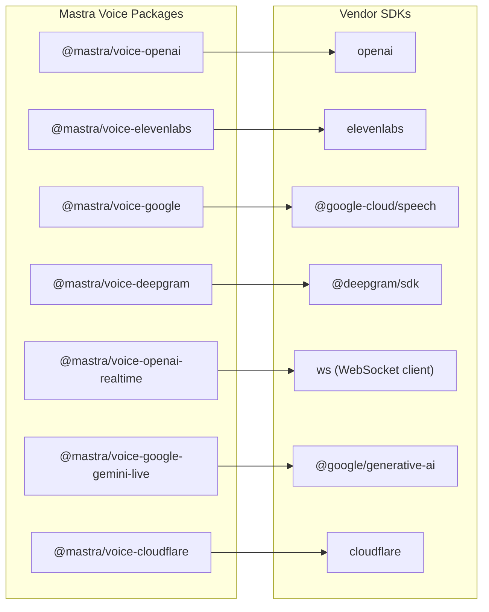

<!-- source: DeepWiki mcp.deepwiki.com · repo mastra-ai/mastra · page 14 Voice and Speech System · fetched 2026-10-26 -->

# Voice and Speech System

Relevant source files

The following files were used as context for generating this wiki page:

- [auth/better-auth/package.json](auth/better-auth/package.json)
- [e2e-tests/_local-registry-setup/pnpm-lock.yaml](e2e-tests/_local-registry-setup/pnpm-lock.yaml)
- [e2e-tests/_local-registry-setup/pnpm-workspace.yaml](e2e-tests/_local-registry-setup/pnpm-workspace.yaml)
- [e2e-tests/commonjs/template/package.json](e2e-tests/commonjs/template/package.json)
- [e2e-tests/experiment-worker/pnpm-lock.yaml](e2e-tests/experiment-worker/pnpm-lock.yaml)
- [e2e-tests/experiment-worker/pnpm-workspace.yaml](e2e-tests/experiment-worker/pnpm-workspace.yaml)
- [e2e-tests/monorepo/template/package.json](e2e-tests/monorepo/template/package.json)
- [e2e-tests/no-bundling/template/package.json](e2e-tests/no-bundling/template/package.json)
- [e2e-tests/pkg-outputs/pnpm-lock.yaml](e2e-tests/pkg-outputs/pnpm-lock.yaml)
- [e2e-tests/softwarefactory/pnpm-lock.yaml](e2e-tests/softwarefactory/pnpm-lock.yaml)
- [e2e-tests/softwarefactory/pnpm-workspace.yaml](e2e-tests/softwarefactory/pnpm-workspace.yaml)
- [examples/agent-builder/package.json](examples/agent-builder/package.json)
- [examples/agent-builder/pnpm-lock.yaml](examples/agent-builder/pnpm-lock.yaml)
- [examples/agent/package.json](examples/agent/package.json)
- [examples/agent/pnpm-lock.yaml](examples/agent/pnpm-lock.yaml)
- [examples/agent/pnpm-workspace.yaml](examples/agent/pnpm-workspace.yaml)
- [examples/durable-agents/package.json](examples/durable-agents/package.json)
- [examples/durable-agents/pnpm-lock.yaml](examples/durable-agents/pnpm-lock.yaml)
- [examples/evals-with-memory/package.json](examples/evals-with-memory/package.json)
- [examples/evals-with-memory/pnpm-lock.yaml](examples/evals-with-memory/pnpm-lock.yaml)
- [examples/evals-with-memory/pnpm-workspace.yaml](examples/evals-with-memory/pnpm-workspace.yaml)
- [examples/voice-agent/pnpm-lock.yaml](examples/voice-agent/pnpm-lock.yaml)
- [package.json](package.json)
- [packages/agent-builder/integration-tests/package.json](packages/agent-builder/integration-tests/package.json)
- [packages/agent-builder/integration-tests/pnpm-lock.yaml](packages/agent-builder/integration-tests/pnpm-lock.yaml)
- [packages/mcp/integration-tests/package.json](packages/mcp/integration-tests/package.json)
- [packages/mcp/integration-tests/pnpm-lock.yaml](packages/mcp/integration-tests/pnpm-lock.yaml)
- [packages/mcp/integration-tests/pnpm-workspace.yaml](packages/mcp/integration-tests/pnpm-workspace.yaml)
- [packages/memory/integration-tests/package.json](packages/memory/integration-tests/package.json)
- [packages/memory/integration-tests/pnpm-lock.yaml](packages/memory/integration-tests/pnpm-lock.yaml)
- [packages/memory/integration-tests/pnpm-workspace.yaml](packages/memory/integration-tests/pnpm-workspace.yaml)
- [packages/playground/e2e/kitchen-sink/package.json](packages/playground/e2e/kitchen-sink/package.json)
- [packages/playground/e2e/kitchen-sink/pnpm-lock.yaml](packages/playground/e2e/kitchen-sink/pnpm-lock.yaml)
- [packages/playground/e2e/kitchen-sink/pnpm-workspace.yaml](packages/playground/e2e/kitchen-sink/pnpm-workspace.yaml)
- [pnpm-lock.yaml](pnpm-lock.yaml)
- [pnpm-workspace.yaml](pnpm-workspace.yaml)
- [voice/azure/package.json](voice/azure/package.json)
- [voice/gladia/package.json](voice/gladia/package.json)
- [voice/murf/package.json](voice/murf/package.json)
- [voice/murf/src/index.ts](voice/murf/src/index.ts)
- [voice/speechify/package.json](voice/speechify/package.json)

The Mastra Voice and Speech system provides a unified integration layer that abstracts speech-to-text (STT) and text-to-speech (TTS) functionality across multiple providers. This enables AI agents and workflows to produce spoken audio output and convert incoming audio into textual representations seamlessly. The voice system supports both REST-based APIs and WebSocket-based real-time voice streams, allowing for diverse use cases from batch synthesis/transcription to live conversational interactions.

---

## System Overview

At its core, the voice system centers on a provider architecture built on the `MastraVoice` abstract base class. This abstraction defines the interface for voice providers, including support for speech synthesis (TTS), speech recognition (STT), and session management for real-time communications. Providers implement this interface to integrate vendor-specific SDKs and APIs.

Mastra also includes the `CompositeVoice` class, which can multiplex multiple provider instances to enable combinations like using one service for TTS and another for STT seamlessly.

Real-time voice interaction support is available via specialized classes such as `OpenAIRealtimeVoice` and `GeminiLiveVoice`, which manage WebSocket connections to their respective realtime APIs, handling streaming audio and event callbacks for low-latency bidirectional voice communication.

The voice system integrates with Mastra agents, enabling voice input processing and voice output synthesis as part of agent workflows.

---

**Voice System Entity Mapping**

```mermaid
graph TD
    subgraph "Natural Language Space"
        UserInput["User Audio Input"]
        AgentOutput["Agent Voice Output"]
    end

    subgraph "Mastra Code Entity Space"
        MastraVoice["MastraVoice (Base Class)"]
        CompositeVoice["CompositeVoice (Provider Multiplexer)"]
        AISDKSpeech["AISDKSpeech Adapter"]
        Agent["Agent (AI Model/Workflow)"]
    end

    subgraph "Provider Implementations and Packages"
        VoiceOpenAI["@mastra/voice-openai"]
        VoiceElevenLabs["@mastra/voice-elevenlabs"]
        OpenAIRealtime["OpenAIRealtimeVoice"]
        GeminiLive["GeminiLiveVoice"]
        VoiceGoogle["@mastra/voice-google"]
        VoiceDeepgram["@mastra/voice-deepgram"]
        VoiceSpeechify["@mastra/voice-speechify"]
        VoiceMurf["@mastra/voice-murf"]
        VoicePlayAI["@mastra/voice-playai"]
        VoiceCloudflare["@mastra/voice-cloudflare"]
        VoiceSarvam["@mastra/voice-sarvam"]
        VoiceAWS["@mastra/voice-aws-nova-sonic"]
        VoiceGladia["@mastra/voice-gladia"]
    end

    UserInput --> VoiceGoogle
    UserInput --> VoiceDeepgram
    UserInput --> VoiceOpenAI
    UserInput --> OpenAIRealtime
    UserInput --> GeminiLive
    UserInput --> VoiceCloudflare
    UserInput --> VoiceSarvam
    UserInput --> VoiceGladia

    Agent --> VoiceOpenAI
    Agent --> VoiceElevenLabs
    Agent --> VoiceMurf
    Agent --> VoicePlayAI
    Agent --> VoiceSpeechify
    Agent --> VoiceCloudflare
    Agent --> VoiceSarvam
    Agent --> VoiceAWS

    MastraVoice -- "Implemented by" --> VoiceOpenAI
    MastraVoice -- "Implemented by" --> VoiceGoogle
    MastraVoice -- "Implemented by" --> VoiceDeepgram
    MastraVoice -- "Implemented by" --> VoiceElevenLabs
    MastraVoice -- "Implemented by" --> VoiceMurf
    MastraVoice -- "Implemented by" --> VoicePlayAI
    MastraVoice -- "Implemented by" --> VoiceSpeechify
    MastraVoice -- "Implemented by" --> OpenAIRealtime
    MastraVoice -- "Implemented by" --> GeminiLive
    MastraVoice -- "Implemented by" --> VoiceCloudflare
    MastraVoice -- "Implemented by" --> VoiceSarvam
    MastraVoice -- "Implemented by" --> VoiceAWS
    MastraVoice -- "Implemented by" --> VoiceGladia

    CompositeVoice -- "Combines multiple" --> MastraVoice
    AISDKSpeech -- "Adapter to MastraVoice" --> MastraVoice

    VoiceOpenAI --> openai["openai SDK"]
    VoiceGoogle --> googleSDK["@google-cloud/text-to-speech, @google-cloud/speech"]
    VoiceDeepgram --> deepgram["@deepgram/sdk"]
    VoiceElevenLabs --> elevenlabs["elevenlabs SDK"]
    VoiceSpeechify --> speechify["@speechify/api-sdk"]
    OpenAIRealtime --> ws["ws WebSocket Client"]
    GeminiLive --> genai["@google/generative-ai"]
    VoiceCloudflare --> cloudflare["cloudflare SDK"]
    VoiceSarvam --> sarvam["sarvam SDK"]
    VoiceAWS --> aws["aws-sdk"]
    VoiceGladia --> gladia["gladia-sdk"]

```

Sources:
- [pnpm-workspace.yaml:17]()
- [packages/memory/integration-tests/pnpm-lock.yaml:52-128]()
- [packages/playground/e2e/kitchen-sink/pnpm-lock.yaml:45-72]()
- [packages/mcp/integration-tests/pnpm-lock.yaml:42-60]()
- [packages/agent-builder/integration-tests/pnpm-lock.yaml:46-62]()
- [examples/agent/pnpm-lock.yaml:77-170]()
- [examples/agent/package.json:8-39]()

---

## Voice Provider Architecture

The foundation of Mastra's Voice System is the abstract class `MastraVoice`, defined in the core voice package. This base class establishes the essential contract all voice providers must implement. Key capabilities include:

- **Text-to-Speech (TTS):** Methods to generate speech audio from text input. Providers implement batch and streaming synthesis.
- **Speech-to-Text (STT):** Methods to transcribe audio streams or buffers into text.
- **Real-time Voice Support:** Optional lifecycle methods (`open()`, `close()`, `send()`) and event handling for WebSocket-based voice protocols enabling duplex, low-latency conversations. For example, `OpenAIRealtimeVoice` and `GeminiLiveVoice` implement these for low-latency interaction.
- **Event System:** Providers emit events such as `speaking`, `transcribing`, and `error` to track and respond to voice processing states.
- **Tool Integration:** Some real-time providers support dynamic behaviors by interacting with agent tools during conversations. For instance, `GeminiLiveVoice` can handle tool calls from the model and dispatch them to registered tools, sending back `tool_result` messages. [voice/google-gemini-live-api/architecture-llm.md:188-220]()

The `CompositeVoice` class allows combining different voice provider instances. For example, one could configure Google Cloud STT with ElevenLabs TTS to optimize for transcription accuracy and voice quality respectively.

The adapter pattern is employed with classes like `AISDKSpeech` to wrap AI SDK speech and transcription interfaces into MastraVoice-compatible classes.

For in-depth details on the base voice system architecture, API signatures, and interaction models, see [Voice Provider Architecture](#14.1).

Sources:
- [pnpm-workspace.yaml:17]()
- [packages/memory/integration-tests/pnpm-lock.yaml:52-128]()
- [packages/playground/e2e/kitchen-sink/pnpm-lock.yaml:45-72]()
- [packages/mcp/integration-tests/pnpm-lock.yaml:42-60]()
- [packages/agent-builder/integration-tests/pnpm-lock.yaml:46-62]()
- [examples/agent/pnpm-lock.yaml:77-170]()
- [examples/agent/package.json:8-39]()
- [voice/google-gemini-live-api/architecture-llm.md:188-220]()

---

## Voice Provider Integrations

Mastra supports a rich ecosystem of voice providers, each encapsulated as a distinct package under the `voice/` directory. These packages wrap vendor SDKs and expose consistent MastraVoice implementations.

### Core Supported Providers

| Provider Package | Capabilities | Description |
|---|---|---|
| `@mastra/voice-openai` | TTS & STT | OpenAI speech API integration. |
| `@mastra/voice-google` | TTS & STT | Google Cloud Speech-to-Text and Text-to-Speech APIs. |
| `@mastra/voice-elevenlabs` | TTS | ElevenLabs high-quality text-to-speech service. |
| `@mastra/voice-murf` | TTS | Murf AI voice synthesis. |
| `@mastra/voice-playai` | TTS | PlayAI voice synthesis integration. |
| `@mastra/voice-speechify` | TTS | Speechify text-to-speech platform integration. |
| `@mastra/voice-deepgram` | STT | Deepgram speech recognition. |
| `@mastra/voice-cloudflare` | TTS & STT | Cloudflare AI voice synthesis and recognition. |
| `@mastra/voice-sarvam` | TTS & STT | Sarvam AI speech synthesis and recognition. |
| `@mastra/voice-aws-nova-sonic` | TTS | AWS Nova Sonic voice integration. |
| `@mastra/voice-gladia` | STT | Gladia audio transcription. |
| `@mastra/voice-inworld` | Real-time | Inworld AI character voice integration. |
| `@mastra/voice-openai-realtime` | Real-time TTS/STT | OpenAI Realtime API via WebSocket. |
| `@mastra/voice-google-gemini-live` | Real-time TTS/STT | Google Gemini Live API integration. |

Sources:
- [pnpm-workspace.yaml:17]()
- [packages/memory/integration-tests/pnpm-lock.yaml:52-128]()
- [packages/playground/e2e/kitchen-sink/pnpm-lock.yaml:45-72]()
- [packages/mcp/integration-tests/pnpm-lock.yaml:42-60]()
- [packages/agent-builder/integration-tests/pnpm-lock.yaml:46-62]()
- [examples/agent/pnpm-lock.yaml:77-170]()
- [examples/agent/package.json:8-39]()
- [voice/gladia/package.json:2-61]()
- [voice/murf/package.json:2-60]()
- [voice/speechify/package.json:2-63]()
- [voice/azure/package.json:2-60]()

### Real-time Voice APIs

Real-time voice communication is enabled primarily via WebSocket-based streaming voice APIs. The `OpenAIRealtimeVoice` class manages the connection and handles events like `transcribing`, `writing`, and `speaking`. Similarly, the `@mastra/voice-google-gemini-live` package provides access to Gemini's live multimodal capabilities through the `GeminiLiveVoice` class. This class handles bidirectional audio streaming, VAD, session management, and tool calling. [voice/google-gemini-live-api/src/index.ts:52-58]()

For multi-user environments, Mastra integrates with **LiveKit** via `@mastra/livekit`, which provides tools for real-time session management, dispatch, and worker bridges.

For details on other real-time voice APIs like xAI Realtime and the LiveKit integration, see [Voice Provider Integrations](#14.2).

### Package-to-SDK Mapping

Below is the high-level mapping between Mastra voice packages and the vendor SDKs they wrap:

Sources:
- [pnpm-workspace.yaml:17]()
- [packages/memory/integration-tests/pnpm-lock.yaml:52-128]()
- [packages/playground/e2e/kitchen-sink/pnpm-lock.yaml:45-72]()
- [packages/mcp/integration-tests/pnpm-lock.yaml:42-60]()
- [packages/agent-builder/integration-tests/pnpm-lock.yaml:46-62]()
- [examples/agent/pnpm-lock.yaml:77-170]()
- [examples/agent/package.json:8-39]()
- [voice/google-gemini-live-api/src/index.ts:52-58]()
- [voice/murf/src/index.ts:1-1]()

---

## Summary and Links to Child Pages

The Mastra Voice and Speech system provides a modular, extensible foundation to integrate voice capabilities into AI applications. Its design allows flexible combinations of providers for text-to-speech and speech-to-text, supports real-time conversational voice, and integrates tightly with agents and tools.

For detailed technical information, class descriptions, interface definitions, and provider-specific integrations, refer to these child pages:

- [Voice Provider Architecture](#14.1) — Detailed documentation on the `MastraVoice` base class, provider interfaces, real-time voice API support, event handling, and agent integration.
- [Voice Provider Integrations](#14.2) — Comprehensive guide on all supported voice providers, their package details, configuration options, and supported features including LiveKit and Gemini Live.

---

# End of Section 14: Voice and Speech System

---

