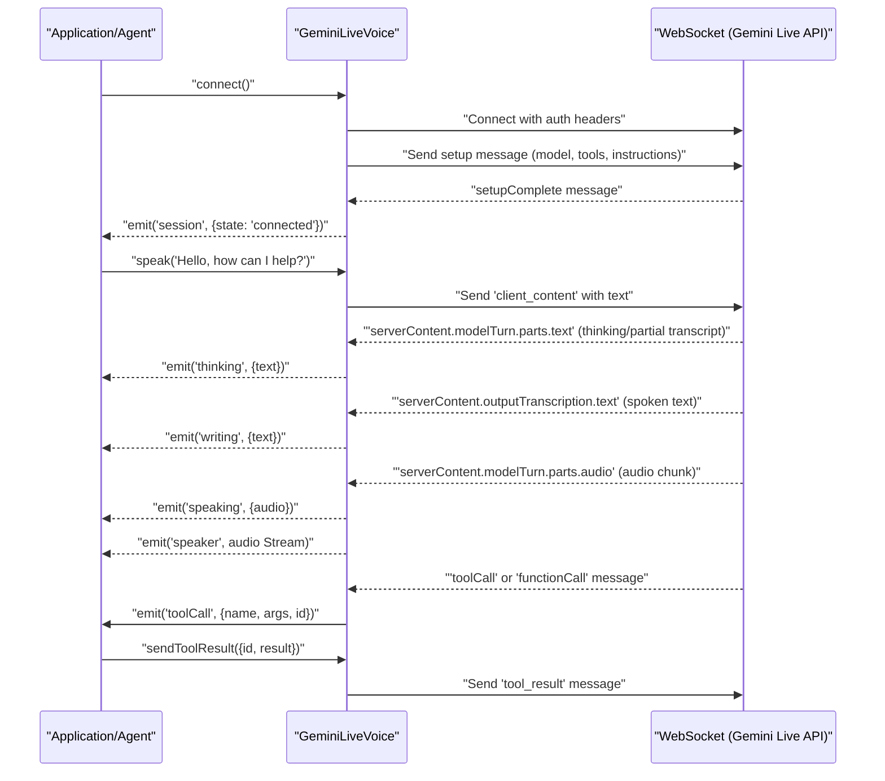
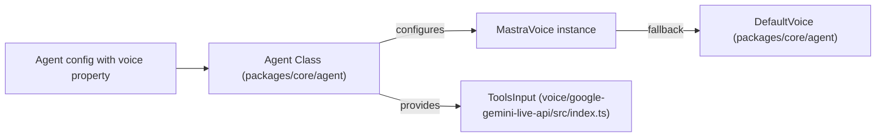
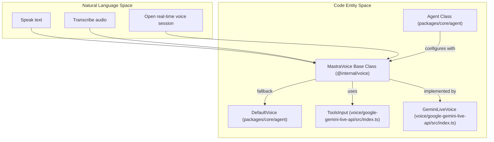

<!-- source: DeepWiki mcp.deepwiki.com · repo mastra-ai/mastra · page 14.1 Voice Provider Architecture · fetched 2026-10-26 -->

# Voice Provider Architecture

Relevant source files

The following files were used as context for generating this wiki page:

- [auth/better-auth/package.json](auth/better-auth/package.json)
- [e2e-tests/_local-registry-setup/pnpm-lock.yaml](e2e-tests/_local-registry-setup/pnpm-lock.yaml)
- [e2e-tests/_local-registry-setup/pnpm-workspace.yaml](e2e-tests/_local-registry-setup/pnpm-workspace.yaml)
- [e2e-tests/commonjs/template/package.json](e2e-tests/commonjs/template/package.json)
- [e2e-tests/experiment-worker/pnpm-lock.yaml](e2e-tests/experiment-worker/pnpm-lock.yaml)
- [e2e-tests/experiment-worker/pnpm-workspace.yaml](e2e-tests/experiment-worker/pnpm-workspace.yaml)
- [e2e-tests/monorepo/template/package.json](e2e-tests/monorepo/template/package.json)
- [e2e-tests/no-bundling/template/package.json](e2e-tests/no-bundling/template/package.json)
- [e2e-tests/pkg-outputs/pnpm-lock.yaml](e2e-tests/pkg-outputs/pnpm-lock.yaml)
- [e2e-tests/softwarefactory/pnpm-lock.yaml](e2e-tests/softwarefactory/pnpm-lock.yaml)
- [e2e-tests/softwarefactory/pnpm-workspace.yaml](e2e-tests/softwarefactory/pnpm-workspace.yaml)
- [examples/agent-builder/package.json](examples/agent-builder/package.json)
- [examples/agent-builder/pnpm-lock.yaml](examples/agent-builder/pnpm-lock.yaml)
- [examples/agent/package.json](examples/agent/package.json)
- [examples/agent/pnpm-lock.yaml](examples/agent/pnpm-lock.yaml)
- [examples/agent/pnpm-workspace.yaml](examples/agent/pnpm-workspace.yaml)
- [examples/durable-agents/package.json](examples/durable-agents/package.json)
- [examples/durable-agents/pnpm-lock.yaml](examples/durable-agents/pnpm-lock.yaml)
- [examples/evals-with-memory/package.json](examples/evals-with-memory/package.json)
- [examples/evals-with-memory/pnpm-lock.yaml](examples/evals-with-memory/pnpm-lock.yaml)
- [examples/evals-with-memory/pnpm-workspace.yaml](examples/evals-with-memory/pnpm-workspace.yaml)
- [examples/voice-agent/pnpm-lock.yaml](examples/voice-agent/pnpm-lock.yaml)
- [package.json](package.json)
- [packages/agent-builder/integration-tests/package.json](packages/agent-builder/integration-tests/package.json)
- [packages/agent-builder/integration-tests/pnpm-lock.yaml](packages/agent-builder/integration-tests/pnpm-lock.yaml)
- [packages/mcp/integration-tests/package.json](packages/mcp/integration-tests/package.json)
- [packages/mcp/integration-tests/pnpm-lock.yaml](packages/mcp/integration-tests/pnpm-lock.yaml)
- [packages/mcp/integration-tests/pnpm-workspace.yaml](packages/mcp/integration-tests/pnpm-workspace.yaml)
- [packages/memory/integration-tests/package.json](packages/memory/integration-tests/package.json)
- [packages/memory/integration-tests/pnpm-lock.yaml](packages/memory/integration-tests/pnpm-lock.yaml)
- [packages/memory/integration-tests/pnpm-workspace.yaml](packages/memory/integration-tests/pnpm-workspace.yaml)
- [packages/playground/e2e/kitchen-sink/package.json](packages/playground/e2e/kitchen-sink/package.json)
- [packages/playground/e2e/kitchen-sink/pnpm-lock.yaml](packages/playground/e2e/kitchen-sink/pnpm-lock.yaml)
- [packages/playground/e2e/kitchen-sink/pnpm-workspace.yaml](packages/playground/e2e/kitchen-sink/pnpm-workspace.yaml)
- [pnpm-lock.yaml](pnpm-lock.yaml)
- [pnpm-workspace.yaml](pnpm-workspace.yaml)
- [voice/azure/package.json](voice/azure/package.json)
- [voice/gladia/package.json](voice/gladia/package.json)
- [voice/murf/package.json](voice/murf/package.json)
- [voice/murf/src/index.ts](voice/murf/src/index.ts)
- [voice/speechify/package.json](voice/speechify/package.json)

The Voice Provider Architecture in Mastra defines a standardized, extensible framework for integrating speech synthesis (Text-to-Speech, TTS), speech recognition (Speech-to-Text, STT), and real-time voice capabilities into AI agents. It abstracts vendor-specific voice SDKs through a common `MastraVoice` base class interface, enabling seamless substitution and combination of multiple voice providers such as OpenAI, ElevenLabs, Deepgram, Google, Azure, and more.

This architecture supports multiple modalities of interaction:
- Offline synthesis of text to audio streams.
- Streaming transcription of audio to text.
- Low-latency, bidirectional real-time voice interaction via WebSocket-based protocols.
- Injection of agent instructions and tools into voice sessions to contextualize voice models.

---

## Core Abstractions

### MastraVoice Base Class

At the foundation is the abstract `MastraVoice` class. This class defines a contract for voice providers to implement methods for speech synthesis (`speak`) and recognition (`listen`).
The `MastraVoice` class is defined in the `@internal/voice` package [voice/google-gemini-live-api/src/index.ts:2]().

- **Speech Synthesis (`speak`)**: Converts input text or string streams into audio streams, typically Node.js `Readable` streams, allowing playback or further audio processing.
- **Speech Recognition (`listen`)**: Accepts audio buffers or streams and returns transcribed text, enabling voice input capabilities.
- **Supporting Methods**:
  - `getSpeakers()` returns available voice options (speakers).
  - `addInstructions()` registers system prompts or persona instructions for the voice model context.
  - `addTools()` synchronizes tools usable by the voice model for function call execution.

Implementations of `MastraVoice` adhere to this interface, which enables flexible voice integration within the Mastra ecosystem. The class is designed for asynchronous streaming scenarios and event-driven voice interactions.

### CompositeVoice

`CompositeVoice` acts as a wrapper to combine multiple voice providers to handle different modalities [packages/server/src/server/handlers/voice.test.ts:5](). For example, one provider can be responsible for speech synthesis (TTS), another for speech recognition (STT), and a third for real-time streaming.

This design allows developers to pick and mix best-of-breed providers under a single `MastraVoice` instance, transparently routing calls to the appropriate subsystem.

### DefaultVoice
The `DefaultVoice` class serves as the fallback implementation within the core agent system [packages/core/src/agent/agent.ts:137-137]().

Sources:
- [voice/google-gemini-live-api/src/index.ts:2]()
- [packages/server/src/server/handlers/voice.test.ts:5]()
- [packages/core/src/agent/agent.ts:137-137]()

---

## Voice Interface and Real-time Interaction

Mastra supports two main interaction patterns for voice:

### 1. Speech Synthesis (TTS) and Recognition (STT)

These are typically one-shot operations:
- `speak(text)` generates audio stream from input text.
- `listen(audio)` transcribes audio input to text.

Each provider implements these methods per their backend capabilities. For example:
- The OpenAI provider supports TTS and STT via native API calls.
- ElevenLabs focuses on high-fidelity TTS output.

### 2. Real-time Voice Interaction

Providers like `GeminiLiveVoice` implement real-time, low-latency voice sessions over WebSocket connections [voice/google-gemini-live-api/src/index.ts:103](). The server exposes metadata about available speakers via dedicated endpoints [packages/server/src/server/handlers/voice.ts:12-13]().

Key features of Real-time Voice:
- Maintains WebSocket connection lifecycle [voice/google-gemini-live-api/src/index.ts:110-111]().
- Supports a predefined set of voice IDs [voice/google-gemini-live-api/src/types.ts:31]().
- Offers API hooks to add instructions and tools for enhanced contextual voice interaction [voice/google-gemini-live-api/src/index.ts:105-108]().
- Handles simultaneous function calls triggered by voice commands, mapped to Mastra tools [voice/google-gemini-live-api/architecture-llm.md:188-220]().

---

### Real-time Voice Data Flow

**Title: Real-time Voice Interaction Sequence**
**Sources:**
- [voice/google-gemini-live-api/src/index.ts:103]()
- [voice/google-gemini-live-api/src/index.ts:105-108]()
- [voice/google-gemini-live-api/src/index.ts:110-111]()
- [voice/google-gemini-live-api/src/types.ts:31]()
- [voice/google-gemini-live-api/architecture-llm.md:188-220]()
- [voice/google-gemini-live-api/architecture-llm.md:148-158]()
- [voice/google-gemini-live-api/architecture-llm.md:168-175]()
- [voice/google-gemini-live-api/architecture-llm.md:177-186]()
- [packages/server/src/server/handlers/voice.ts:12-13]()

---

## Integration with Agents

Voice capabilities are tightly integrated into Mastra's agent system to enable multi-modal conversational AI.

1.  **Agent Configuration**: Each `Agent` instance can be configured with a `voice` property which is a `MastraVoice` instance to handle TTS/STT interaction for that agent [packages/server/src/server/handlers/voice.test.ts:27]().
2.  **Passing Agent Instructions to Voice**: Agents specify instructions or persona prompts that influence the voice model's output via `getInstructions` [packages/server/src/server/handlers/agent.test.ts:60-62]().
3.  **Tool Registration for Function Calls**: Voice providers can execute tools requested by the voice model. The agent's tool set is defined via `ToolsInput` [voice/google-gemini-live-api/src/index.ts:3]().
4.  **Voice Resolution**: The system resolves the enabled voice provider for the agent. The `DefaultVoice` is assigned if none is provided [packages/core/src/agent/agent.ts:137-137]().

---

### Agent-Voice Integration Diagram

**Title: Agent Configuration to Voice Provider Implementation**
**Sources:**
- [packages/server/src/server/handlers/voice.test.ts:27]()
- [packages/server/src/server/handlers/agent.test.ts:60-62]()
- [voice/google-gemini-live-api/src/index.ts:3]()
- [packages/core/src/agent/agent.ts:137-137]()

---

## Voice Provider Implementations

Mastra supports a wide range of voice provider implementations across the ecosystem:

- **OpenAI**: Support for standard TTS/STT and the Realtime API.
- **ElevenLabs**: High quality, expressive TTS voices.
- **Deepgram**: Specialized real-time audio transcription and speech recognition.
- **Google Gemini Live**: Real-time multimodal voice interactions with bidirectional audio streaming, VAD, and tool calling [voice/google-gemini-live-api/src/index.ts:52-101]().
- **Cloudflare**: Integration with Cloudflare AI for voice tasks.
- **Other Providers**: Mastra includes integrations for Murf, PlayAI, Sarvam, and Speechify.

Each provider implements the `MastraVoice` interface, maintaining a consistent API surface for the agent loop.

Sources:
- [voice/google-gemini-live-api/src/index.ts:52-101]()

---

## Summary

The Mastra Voice Provider Architecture provides a robust, modular, and extensible voice/speech layer that:

- Abstracts vendor-specific TTS and STT into a unified interface.
- Supports real-time, streaming low-latency interactions.
- Integrates tightly with the agent system for persona and tooling support.
- Allows composable voice provider stacks via composite patterns.

---

### Natural Language Voice Interface to Core Code Mapping

**Title: Natural Language Voice Interface to Core Code Mapping**
**Sources:**
- [voice/google-gemini-live-api/src/index.ts:2]()
- [voice/google-gemini-live-api/src/index.ts:3]()
- [voice/google-gemini-live-api/src/index.ts:103]()
- [packages/core/src/agent/agent.ts:137-137]()
- [packages/server/src/server/handlers/voice.test.ts:27]()

---

