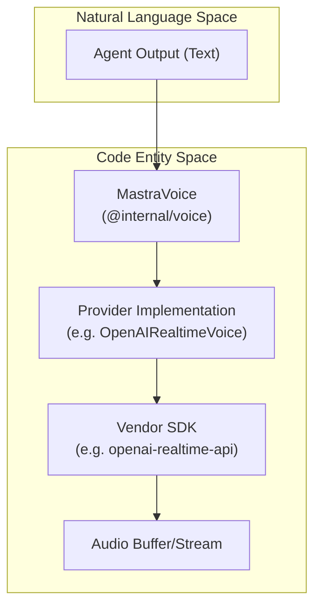
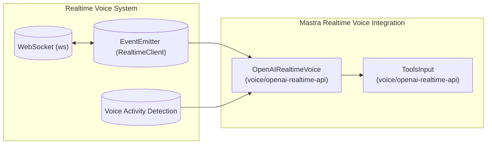
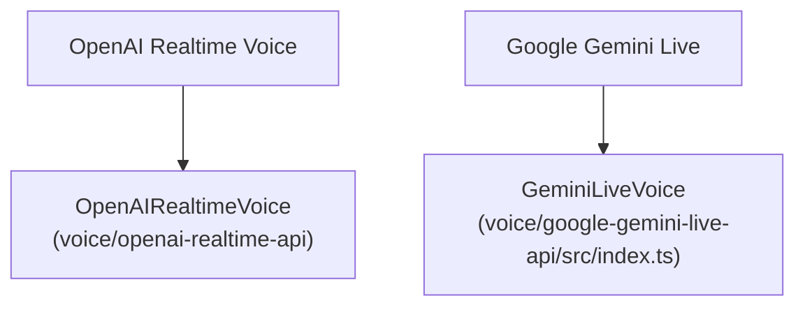

<!-- source: DeepWiki mcp.deepwiki.com · repo mastra-ai/mastra · page 14.2 Voice Provider Integrations · fetched 2026-10-26 -->

# Voice Provider Integrations

<details>
<summary>Relevant source files</summary>

The following files were used as context for generating this wiki page:

- [auth/better-auth/package.json](auth/better-auth/package.json)
- [e2e-tests/_local-registry-setup/pnpm-lock.yaml](e2e-tests/_local-registry-setup/pnpm-lock.yaml)
- [e2e-tests/_local-registry-setup/pnpm-workspace.yaml](e2e-tests/_local-registry-setup/pnpm-workspace.yaml)
- [e2e-tests/commonjs/template/package.json](e2e-tests/commonjs/template/package.json)
- [e2e-tests/experiment-worker/pnpm-lock.yaml](e2e-tests/experiment-worker/pnpm-lock.yaml)
- [e2e-tests/experiment-worker/pnpm-workspace.yaml](e2e-tests/experiment-worker/pnpm-workspace.yaml)
- [e2e-tests/monorepo/template/package.json](e2e-tests/monorepo/template/package.json)
- [e2e-tests/no-bundling/template/package.json](e2e-tests/no-bundling/template/package.json)
- [e2e-tests/pkg-outputs/pnpm-lock.yaml](e2e-tests/pkg-outputs/pnpm-lock.yaml)
- [e2e-tests/softwarefactory/pnpm-lock.yaml](e2e-tests/softwarefactory/pnpm-lock.yaml)
- [e2e-tests/softwarefactory/pnpm-workspace.yaml](e2e-tests/softwarefactory/pnpm-workspace.yaml)
- [examples/agent-builder/package.json](examples/agent-builder/package.json)
- [examples/agent-builder/pnpm-lock.yaml](examples/agent-builder/pnpm-lock.yaml)
- [examples/agent/package.json](examples/agent/package.json)
- [examples/agent/pnpm-lock.yaml](examples/agent/pnpm-lock.yaml)
- [examples/agent/pnpm-workspace.yaml](examples/agent/pnpm-workspace.yaml)
- [examples/durable-agents/package.json](examples/durable-agents/package.json)
- [examples/durable-agents/pnpm-lock.yaml](examples/durable-agents/pnpm-lock.yaml)
- [examples/evals-with-memory/package.json](examples/evals-with-memory/package.json)
- [examples/evals-with-memory/pnpm-lock.yaml](examples/evals-with-memory/pnpm-lock.yaml)
- [examples/evals-with-memory/pnpm-workspace.yaml](examples/evals-with-memory/pnpm-workspace.yaml)
- [examples/voice-agent/pnpm-lock.yaml](examples/voice-agent/pnpm-lock.yaml)
- [package.json](package.json)
- [packages/agent-builder/integration-tests/package.json](packages/agent-builder/integration-tests/package.json)
- [packages/agent-builder/integration-tests/pnpm-lock.yaml](packages/agent-builder/integration-tests/pnpm-lock.yaml)
- [packages/mcp/integration-tests/package.json](packages/mcp/integration-tests/package.json)
- [packages/mcp/integration-tests/pnpm-lock.yaml](packages/mcp/integration-tests/pnpm-lock.yaml)
- [packages/mcp/integration-tests/pnpm-workspace.yaml](packages/mcp/integration-tests/pnpm-workspace.yaml)
- [packages/memory/integration-tests/package.json](packages/memory/integration-tests/package.json)
- [packages/memory/integration-tests/pnpm-lock.yaml](packages/memory/integration-tests/pnpm-lock.yaml)
- [packages/memory/integration-tests/pnpm-workspace.yaml](packages/memory/integration-tests/pnpm-workspace.yaml)
- [packages/playground/e2e/kitchen-sink/package.json](packages/playground/e2e/kitchen-sink/package.json)
- [packages/playground/e2e/kitchen-sink/pnpm-lock.yaml](packages/playground/e2e/kitchen-sink/pnpm-lock.yaml)
- [packages/playground/e2e/kitchen-sink/pnpm-workspace.yaml](packages/playground/e2e/kitchen-sink/pnpm-workspace.yaml)
- [pnpm-lock.yaml](pnpm-lock.yaml)
- [pnpm-workspace.yaml](pnpm-workspace.yaml)
- [voice/azure/package.json](voice/azure/package.json)
- [voice/gladia/package.json](voice/gladia/package.json)
- [voice/google-gemini-live-api/architecture-llm.md](voice/google-gemini-live-api/architecture-llm.md)
- [voice/google-gemini-live-api/src/index.test.ts](voice/google-gemini-live-api/src/index.test.ts)
- [voice/google-gemini-live-api/src/index.ts](voice/google-gemini-live-api/src/index.ts)
- [voice/google-gemini-live-api/src/managers/AudioStreamManager.ts](voice/google-gemini-live-api/src/managers/AudioStreamManager.ts)
- [voice/google-gemini-live-api/src/types.ts](voice/google-gemini-live-api/src/types.ts)
- [voice/murf/package.json](voice/murf/package.json)
- [voice/murf/src/index.ts](voice/murf/src/index.ts)
- [voice/speechify/package.json](voice/speechify/package.json)

</details>


Mastra provides a comprehensive integration layer for voice and speech capabilities, enabling agents and workflows to interact with the physical world through audio. The framework supports Speech-to-Text (STT), Text-to-Speech (TTS), and advanced real-time voice APIs. The voice integrations are modularized as individual workspace packages within the `voice/` directory, allowing for focused dependency management and provider-specific configurations.

---

## Supported Voice Providers

Mastra integrates with a diverse set of industry-leading voice providers. Each provider is encapsulated in its own package with appropriate SDK dependencies to implement standard and advanced voice functionalities.

### Voice Provider Matrix

| Provider | Package | Key Dependencies | Primary Capabilities | Notes |
|---|---|---|---|---|
| **OpenAI** | `@mastra/voice-openai` | `openai` | Speech synthesis (TTS), Speech recognition (STT) (Whisper) | Native integration with OpenAI Speech models |
| **OpenAI Realtime** | `@mastra/voice-openai-realtime` | `openai-realtime-api`, `ws` | Low-latency, websocket-based real-time TTS/STT, VAD, tool invocation | Stateful WebSocket implementation with event-based audio streaming |
| **Google** | `@mastra/voice-google` | `@google-cloud/speech`, `@google-cloud/text-to-speech` | Standard STT and TTS | Uses Google Cloud SDKs for speech synthesis and recognition |
| **Google Gemini Live** | `@mastra/voice-google-gemini-live-api` | `ws`, `@google/genai`, `google-auth-library` | Real-time multimodal voice, streaming audio, live transcription, session and tool management | Supports Gemini Live API and Vertex AI |
| **ElevenLabs** | `@mastra/voice-elevenlabs` | `elevenlabs` | High-fidelity TTS and voice cloning | Focus on natural voice quality |
| **Deepgram** | `@mastra/voice-deepgram` | `@deepgram/sdk` | Low-latency STT and TTS | Real-time speech recognition and synthesis |
| **Speechify** | `@mastra/voice-speechify` | `@speechify/api-sdk` | Natural sounding TTS | Cloud-based speech synthesis |
| **Murf** | `@mastra/voice-murf` | Native REST | Studio-quality TTS | High-quality production voices |
| **PlayAI** | `@mastra/voice-playai` | Native REST | Conversational TTS | Designed for interactive voice apps |
| **Cloudflare** | `@mastra/voice-cloudflare` | `cloudflare`, `@cloudflare/workers-types` | Edge-based AI Speech | Runs efficiently in V8 isolates |
| **Sarvam** | `@mastra/voice-sarvam` | Native REST | Indic language TTS/STT | Specialized for Indian languages |
| **Azure** | `@mastra/voice-azure` | `microsoft-cognitiveservices-speech-sdk` | Enterprise TTS/STT | Microsoft Cognitive Services integration |
| **AWS Nova Sonic** | `@mastra/voice-aws-nova-sonic` | `@aws-sdk/client-bedrock-runtime` | Real-time multimodal voice | AWS Bedrock integration |
| **Gladia** | `@mastra/voice-gladia` | Native REST | Real-time STT, audio intelligence | Focus on real-time transcription and audio comprehension |
| **ModelsLab** | `@mastra/voice-modelslab` | Native REST | Voice cloning and synthesis | Lightweight customizable voice models |
| **xAI Realtime** | `@mastra/voice-xai-realtime` | `ws` | Low-latency multimodal voice | xAI's real-time API integration |

Sources: [pnpm-lock.yaml:181-189](), [pnpm-workspace.yaml:17-17](), [packages/memory/integration-tests/pnpm-lock.yaml:103-104](), [packages/playground/e2e/kitchen-sink/pnpm-lock.yaml:18-18](), [packages/agent-builder/integration-tests/pnpm-lock.yaml:16-16](), [voice/murf/package.json:1-60](), [voice/gladia/package.json:1-61](), [voice/speechify/package.json:1-61](), [voice/azure/package.json:1-60]()

---

## Implementation Architecture

The Mastra voice system acts as a bridge between high-level Agent abstractions and the vendor-specific voice SDKs and APIs. Each voice provider extends the abstract `MastraVoice` class or implements standardized interfaces for TTS and STT, ensuring a consistent API for agents and workflows.

### Core Voice Base Class

- `MastraVoice` (defined in `@internal/voice`) is the abstract base class for all voice providers. It defines core interfaces and lifecycle management for speech synthesis, recognition, and real-time audio interaction.
- Concrete voice providers implement provider-specific communication protocols and SDK calls, but expose uniform methods such as `speak()`, `listen()`, `addInstructions()`, and event hooks for streaming audio data.

### Data Flow: Text-to-Speech (TTS)

The TTS flow converts a text string from an Agent into an audio buffer or stream through the following layered components:

Title: "Voice Data Flow Architecture"


Sources: [pnpm-workspace.yaml:17-17]()

---

### Real-Time Voice APIs

Mastra supports advanced real-time streaming voice capabilities for interactive conversations, with multiple event-driven audio streams handled over WebSockets.

- **OpenAI Realtime:** Implements a WebSocket client via `ws` and `openai-realtime-api` SDK to allow low-latency bidirectional speech interaction. Features include voice activity detection (VAD), tool invocation during voice input, multiple voice options, and event-based audio chunk streaming.
- **Google Gemini Live:** Utilizes Google's Gemini Live API, supporting bidirectional audio streaming, session management with resumption, live transcription, tool call integration, and support for Vertex AI with OAuth authentication. [voice/google-gemini-live-api/src/index.ts:51-101]()
- **xAI Realtime:** Provides integration with xAI's real-time multimodal voice API via `@mastra/voice-xai-realtime`.

Title: "Real-time Voice Event Loop"


Sources: [pnpm-lock.yaml:81-81]()

---

## Provider-Specific Technical Details

### OpenAI Voice Integration

- Package: `@mastra/voice-openai`
- SDK: Official `openai` Node.js SDK
- Features: TTS using models like `tts-1` and `tts-1-hd`, STT using `whisper-1`.
- Real-time: `@mastra/voice-openai-realtime` implements `OpenAIRealtimeVoice` for WebSocket real-time audio, supporting multiple voices and VAD.

Sources: [pnpm-workspace.yaml:17-17]()

### Google Cloud Voice Integration

- Package: `@mastra/voice-google`
- SDKs: `@google-cloud/speech` for STT, `@google-cloud/text-to-speech` for TTS.
- Google Gemini Live API (package `@mastra/voice-google-gemini-live-api`) supports real-time multimodal streaming with session resumption, tool call handling, and Vertex AI support. [voice/google-gemini-live-api/src/index.ts:51-101]()

`GeminiLiveVoice` [voice/google-gemini-live-api/src/index.ts:103-109]() is the primary class for this integration. It extends `MastraVoice` [voice/google-gemini-live-api/src/index.ts:103-109]() and manages the WebSocket connection, audio streaming, and event handling. Key features include:
- WebSocket connection with automatic reconnect and session resumption [voice/google-gemini-live-api/src/index.ts:112-112]()
- Tool call integration allowing voice-triggered actions [voice/google-gemini-live-api/src/index.ts:133-140]()
- Audio streaming with buffer management via `AudioStreamManager` [voice/google-gemini-live-api/src/index.ts:124-124]()
- VAD and interrupt detection via `sessionConfig` [voice/google-gemini-live-api/src/types.ts:65-73]()
- Supports both REST and Vertex AI authentication flows [voice/google-gemini-live-api/src/index.ts:86-101]()

The `normalizeConfig` static method [voice/google-gemini-live-api/src/index.ts:155-177]() handles backward compatibility for configuration, converting direct `GeminiLiveVoiceConfig` [voice/google-gemini-live-api/src/types.ts:90-149]() to the standard `VoiceConfig` format.

Sources: [voice/google-gemini-live-api/src/index.ts:1-2414](), [voice/google-gemini-live-api/src/types.ts:1-447](), [voice/google-gemini-live-api/src/index.test.ts:1-2291]()

### Cloudflare Voice Integration

- Package: `@mastra/voice-cloudflare`
- Dependencies: `cloudflare`, `@cloudflare/workers-types`.
- This integration leverages Cloudflare's AI capabilities, designed to run efficiently in V8 isolates at the edge.

Sources: [pnpm-workspace.yaml:17-17]()

### AWS Nova Sonic Voice Integration

- Package: `@mastra/voice-aws-nova-sonic`
- Dependencies: `@aws-sdk/client-bedrock-runtime`.
- This provider integrates with AWS Bedrock for real-time multimodal voice interactions.

Sources: [pnpm-workspace.yaml:18-18]()

### LiveKit Integration

Mastra integrates with **LiveKit** to support real-time voice sessions in multi-user environments.

- **Session Management:** Handles joining and leaving rooms via the `livekit-client` dependency.
- **Dispatch:** Routes audio from Mastra agents to LiveKit participants.
- **Tools:** Provides `consent` and `end-call` tools for interactive voice flows as part of the LiveKit integration.
- **Worker Bridge:** Acts as a bridge between Mastra's internal voice processing and LiveKit's real-time Selective Forwarding Unit (SFU) infrastructure.

Sources: [pnpm-lock.yaml:137-139]()

---

## Package and Build Structure

Each voice provider package follows a similar organized structure with:

- An `index.ts` exporting the main client class.
- SDK dependencies (npm packages or native REST APIs).
- TypeScript configuration and bundling via `tsdown`.
- Tests written using `vitest`.

Title: "Standard Voice Package Structure"
```mermaid
graph LR
    subgraph "@mastra/voice-[provider]"
        INDEX[index.ts (exports provider class)]
        PROVIDER[Provider Client Class (e.g. OpenAIRealtimeVoice)]
        TSDOWN[tsdown.config.ts (bundle config)]
        TESTS[vitest test files]
    end

    subgraph "External Dependencies"
        CORE[@mastra/core]
        SDK[Vendor SDK (e.g. elevenlabs)]
    end

    INDEX --> PROVIDER
    PROVIDER --> CORE
    PROVIDER --> SDK
    PROVIDER --> TESTS
```

Sources: [package.json:33-34]()

# Summary Diagrams: Provider Mappings

Title: "Voice Provider to Code Entity Mapping"

```mermaid
graph TB
  OpenAI["OpenAI Voice"] --> OpenAIPkg["@mastra/voice-openai"]
  OpenAIRealtime["OpenAI Realtime"] --> OpenAIRealtimePkg["@mastra/voice-openai-realtime"]
  GoogleCloud["Google Cloud"] --> GooglePkg["@mastra/voice-google"]
  GeminiLive["Google Gemini Live"] --> GeminiPkg["@mastra/voice-google-gemini-live-api"]
  ElevenLabs["ElevenLabs"] --> ElevenLabsPkg["@mastra/voice-elevenlabs"]
  Deepgram["Deepgram"] --> DeepgramPkg["@mastra/voice-deepgram"]
  Speechify["Speechify"] --> SpeechifyPkg["@mastra/voice-speechify"]
  Murf["Murf"] --> MurfPkg["@mastra/voice-murf"]
  PlayAI["PlayAI"] --> PlayAIPkg["@mastra/voice-playai"]
  Cloudflare["Cloudflare"] --> CloudflarePkg["@mastra/voice-cloudflare"]
  Sarvam["Sarvam"] --> SarvamPkg["@mastra/voice-sarvam"]
  Azure["Azure"] --> AzurePkg["@mastra/voice-azure"]
  AWSNova["AWS Nova Sonic"] --> AWSPkg["@mastra/voice-aws-nova-sonic"]
  Gladia["Gladia"] --> GladiaPkg["@mastra/voice-gladia"]
  ModelsLab["ModelsLab"] --> ModelsLabPkg["@mastra/voice-modelslab"]
  xAIRealtime["xAI Realtime"] --> xAIPkg["@mastra/voice-xai-realtime"]
```


Sources:
[pnpm-workspace.yaml:17-17]()

Title: "Real-time Voice Provider Classes"


Sources:
[voice/google-gemini-live-api/src/index.ts:103-109]()

---

# References

- `MastraVoice` abstraction: `@internal/voice`
- `OpenAIRealtimeVoice` real-time implementation: `@mastra/voice-openai-realtime`
- `GeminiLiveVoice` implementation: `@mastra/voice-google-gemini-live-api` [voice/google-gemini-live-api/src/index.ts:103-109]()
- Cloudflare AI Voice: `voice/cloudflare/package.json`
- AWS Nova Sonic Voice: `voice/aws-nova-sonic/package.json`
- LiveKit Integration: `@mastra/livekit`

Sources:
[pnpm-workspace.yaml:17-17](),
[voice/google-gemini-live-api/src/index.ts:1-2414]()

---

