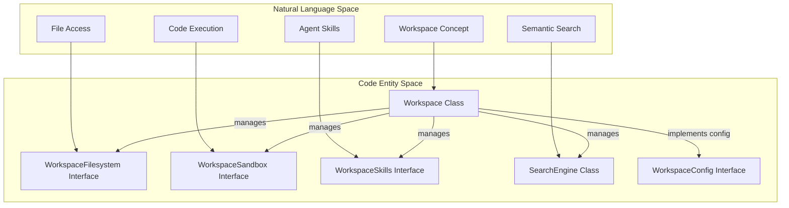
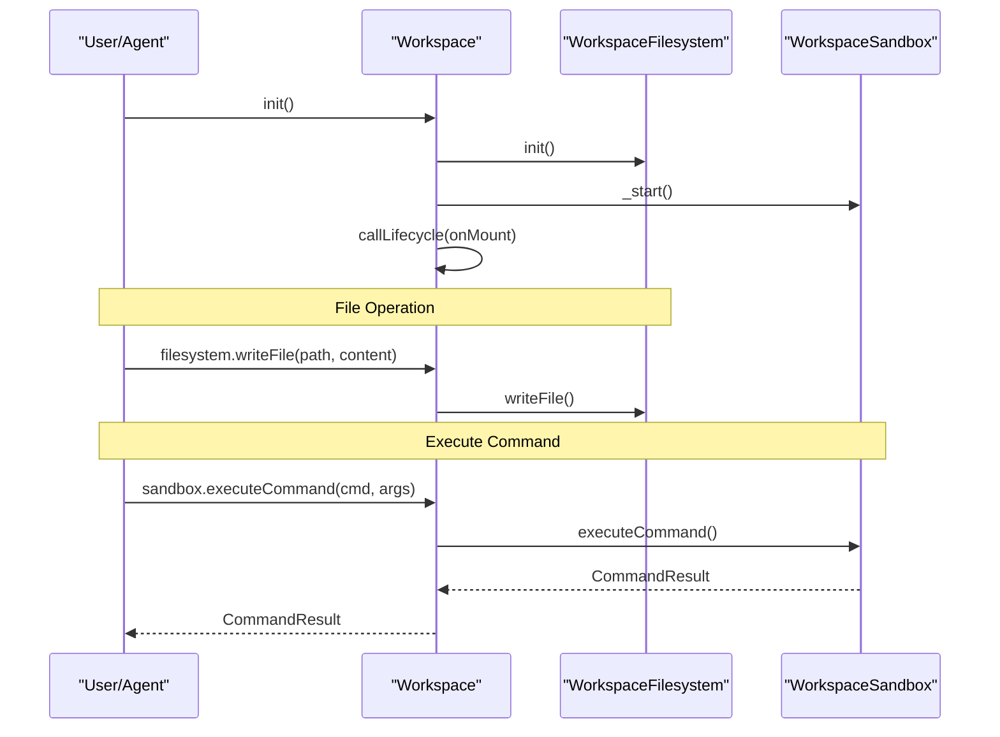
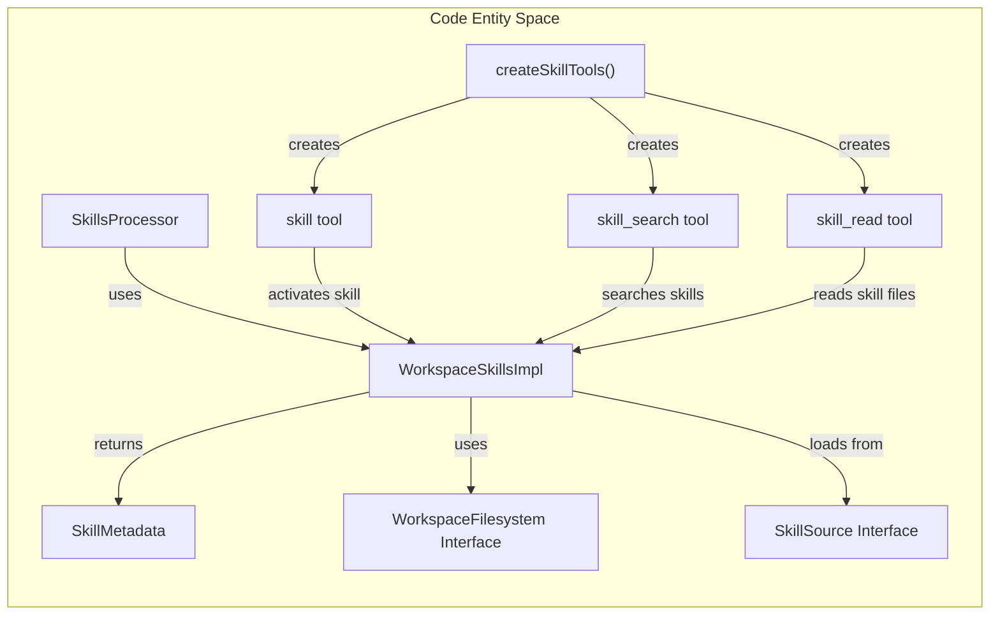

<!-- source: DeepWiki mcp.deepwiki.com · repo mastra-ai/mastra · page 15 Workspace and Sandbox System · fetched 2026-10-26 -->

# Workspace and Sandbox System

<details>
<summary>Relevant source files</summary>

The following files were used as context for generating this wiki page:

- [client-sdks/client-js/src/resources/workspace.test.ts](client-sdks/client-js/src/resources/workspace.test.ts)
- [client-sdks/client-js/src/resources/workspace.ts](client-sdks/client-js/src/resources/workspace.ts)
- [docs/src/content/en/docs/skills.mdx](docs/src/content/en/docs/skills.mdx)
- [docs/src/content/en/reference/processors/skill-search-processor.mdx](docs/src/content/en/reference/processors/skill-search-processor.mdx)
- [examples/agent/src/mastra/public/workspace/.agents/skills/find-skills/.meta.json](examples/agent/src/mastra/public/workspace/.agents/skills/find-skills/.meta.json)
- [examples/agent/src/mastra/public/workspace/.agents/skills/find-skills/SKILL.md](examples/agent/src/mastra/public/workspace/.agents/skills/find-skills/SKILL.md)
- [examples/agent/src/mastra/public/workspace/.agents/skills/frontend-design/.meta.json](examples/agent/src/mastra/public/workspace/.agents/skills/frontend-design/.meta.json)
- [examples/agent/src/mastra/public/workspace/.agents/skills/frontend-design/LICENSE.txt](examples/agent/src/mastra/public/workspace/.agents/skills/frontend-design/LICENSE.txt)
- [examples/agent/src/mastra/public/workspace/.agents/skills/frontend-design/SKILL.md](examples/agent/src/mastra/public/workspace/.agents/skills/frontend-design/SKILL.md)
- [packages/core/src/agent/__tests__/agent-skills-wiring.test.ts](packages/core/src/agent/__tests__/agent-skills-wiring.test.ts)
- [packages/core/src/agent/__tests__/skills-activation-persistence.test.ts](packages/core/src/agent/__tests__/skills-activation-persistence.test.ts)
- [packages/core/src/agent/__tests__/tool-approval.test.ts](packages/core/src/agent/__tests__/tool-approval.test.ts)
- [packages/core/src/agent/durable/__tests__/durable-agent-skill-tools-approval.test.ts](packages/core/src/agent/durable/__tests__/durable-agent-skill-tools-approval.test.ts)
- [packages/core/src/agent/durable/utils/skill-tools-approval.test.ts](packages/core/src/agent/durable/utils/skill-tools-approval.test.ts)
- [packages/core/src/processors/processors/skill-search.test.ts](packages/core/src/processors/processors/skill-search.test.ts)
- [packages/core/src/processors/processors/skill-search.ts](packages/core/src/processors/processors/skill-search.ts)
- [packages/core/src/processors/processors/skills.test.ts](packages/core/src/processors/processors/skills.test.ts)
- [packages/core/src/processors/processors/skills.ts](packages/core/src/processors/processors/skills.ts)
- [packages/core/src/skills/create-skill.ts](packages/core/src/skills/create-skill.ts)
- [packages/core/src/skills/index.ts](packages/core/src/skills/index.ts)
- [packages/core/src/skills/types.ts](packages/core/src/skills/types.ts)
- [packages/core/src/skills/validate.test.ts](packages/core/src/skills/validate.test.ts)
- [packages/core/src/workspace/skills/local-skill-source.ts](packages/core/src/workspace/skills/local-skill-source.ts)
- [packages/core/src/workspace/skills/schemas.test.ts](packages/core/src/workspace/skills/schemas.test.ts)
- [packages/core/src/workspace/skills/schemas.ts](packages/core/src/workspace/skills/schemas.ts)
- [packages/core/src/workspace/skills/skill-source.ts](packages/core/src/workspace/skills/skill-source.ts)
- [packages/core/src/workspace/skills/tools.test.ts](packages/core/src/workspace/skills/tools.test.ts)
- [packages/core/src/workspace/skills/tools.ts](packages/core/src/workspace/skills/tools.ts)
- [packages/core/src/workspace/skills/types.ts](packages/core/src/workspace/skills/types.ts)
- [packages/core/src/workspace/skills/workspace-skills.test.ts](packages/core/src/workspace/skills/workspace-skills.test.ts)
- [packages/core/src/workspace/skills/workspace-skills.ts](packages/core/src/workspace/skills/workspace-skills.ts)
- [packages/core/src/workspace/workspace.test.ts](packages/core/src/workspace/workspace.test.ts)
- [packages/core/src/workspace/workspace.ts](packages/core/src/workspace/workspace.ts)
- [packages/playground-ui/src/domains/workspace/__tests__/fixtures/workspace.ts](packages/playground-ui/src/domains/workspace/__tests__/fixtures/workspace.ts)
- [packages/playground/src/pages/workspace/index.tsx](packages/playground/src/pages/workspace/index.tsx)
- [packages/server/src/server/schemas/workspace.test.ts](packages/server/src/server/schemas/workspace.test.ts)
- [packages/server/src/server/schemas/workspace.ts](packages/server/src/server/schemas/workspace.ts)

</details>


The Workspace and Sandbox system in Mastra provides a structured abstraction for agents to interact with file systems and execute code in isolated environments. It bridges the gap between high-level agentic reasoning and low-level system operations by providing standardized interfaces for file manipulation, semantic search, and secure code execution.

## Workspace Architecture

The `Workspace` class acts as the central orchestrator for an agent's environment. It manages the lifecycle of both a `WorkspaceFilesystem` (for persistent storage and file access) and a `WorkspaceSandbox` (for code execution) [packages/core/src/workspace/workspace.ts:4-7](). Workspaces can be statically configured or dynamically generated per request using a `WorkspaceFilesystemResolver` or `WorkspaceSandboxResolver`, allowing for multi-tenant or project-specific environments [packages/core/src/workspace/workspace.ts:87-99]().

A workspace also integrates several specialized subsystems:

-   **Search Engine**: Supports BM25 keyword search, vector search via `MastraVector`, or hybrid search over indexed content [packages/core/src/workspace/workspace.ts:61-62]().
-   **Skills System**: Managed by `WorkspaceSkillsImpl`, it provides discovery, resolution, and search of reusable agent instructions called skills, stored as `SKILL.md` files [packages/core/src/workspace/skills/workspace-skills.ts:107-111]().
-   **LSP Manager**: Provides Language Server Protocol (LSP) integration for code intelligence features such as hover, go-to-definition, and references [packages/core/src/workspace/workspace.ts:50-51]().
-   **Tool Integration**: The utility `createWorkspaceTools` generates a rich toolset (e.g., `read_file`, `execute_command`) reflecting the configured workspace capabilities [packages/core/src/workspace/workspace.test.ts:21-21]().

### Example Code Snippet: Creating a Workspace

```typescript
import { Workspace, LocalFilesystem, LocalSandbox } from '@mastra/core/workspace'

const workspace = new Workspace({
  id: 'my-workspace',
  name: 'My Workspace',
  filesystem: new LocalFilesystem({
    basePath: './workspace',
  }),
  sandbox: new LocalSandbox({
    workingDirectory: './workspace',
  }),
  bm25: true,
  autoIndexPaths: ['docs'],
})
```
Sources:
- [packages/core/src/workspace/workspace.ts:10-34]()

### Natural Language to Code Entity Space: Workspace Orchestration



For details on the internal class structures, LSP integration, and agent interaction patterns, see **[Workspace Architecture](#15.1)**.

Sources:
- [packages/core/src/workspace/workspace.ts:4-7]()
- [packages/core/src/workspace/workspace.ts:87-99]()
- [packages/core/src/workspace/workspace.ts:61-62]()
- [packages/core/src/workspace/skills/workspace-skills.ts:107-111]()
- [packages/core/src/workspace/workspace.ts:50-51]()
- [packages/core/src/workspace/workspace.test.ts:21-21]()

---

## Filesystem and Sandbox Providers

Mastra supports a variety of providers to handle different storage and execution needs. These providers are swappable, allowing developers to move from local development to cloud-scale production environments without changing agent logic.

### Filesystem Providers

Filesystem providers implement the `WorkspaceFilesystem` interface, giving agents the ability to read, write, list, delete, and search files:

-   **LocalFilesystem**: Provides file storage on the local disk with optional path containment and access restrictions to prevent escape or traversal attacks [packages/core/src/workspace/workspace.ts:44-44]().
-   **CompositeFilesystem**: Allows mounting multiple filesystems at different root paths [packages/core/src/workspace/workspace.ts:44-44]().
-   **Other Providers**: Includes **S3**, **GCS**, **Azure**, **Google Drive**, **AgentFS**, **Mesa**, **Archil**, and **Files-SDK** [packages/core/src/workspace/workspace.ts:25-27]().

### Sandbox Providers

Sandbox providers implement the `WorkspaceSandbox` interface, offering isolated environments to execute commands or code safely:

-   **LocalSandbox**: Runs shell commands locally on the host machine [packages/core/src/workspace/workspace.ts:53-54]().
-   **PlatformSandbox**: A unified client for provisioning and interacting with remote sandboxes (e.g., Railway, E2B) via a workspace proxy, supporting direct WebSocket execution and private network dialing [packages/core/src/workspace/workspace.ts:28-29]().
-   **Cloud Sandboxes**: Include platforms like **E2B**, **Daytona**, **Blaxel**, **Vercel**, **Docker**, **Modal**, **Apple Container**, **Cloudflare Sandbox**, **AgentCore Runtime**, and **Railway** [packages/core/src/workspace/workspace.ts:28-29]().

#### Provider Integration Flow

The diagram below illustrates how a `Workspace` composes and manages these providers and handles operations:



For a complete list of filesystem and sandbox providers with their configuration patterns, see **[Filesystem and Sandbox Providers](#15.2)**.

Sources:
- [packages/core/src/workspace/workspace.ts:44-44]()
- [packages/core/src/workspace/workspace.ts:25-27]()
- [packages/core/src/workspace/workspace.ts:53-54]()
- [packages/core/src/workspace/workspace.ts:28-29]()

---

## Skills Integration

Mastra workspaces support **Skills**, which are reusable agent instructions and tools defined by `SKILL.md` files. Skills aid in composability by allowing agents to leverage external code or instructions.

-   The `WorkspaceSkillsImpl` class discovers skills from configured paths on the filesystem [packages/core/src/workspace/skills/workspace-skills.ts:107-111]().
-   Skills metadata is injected automatically into agent prompts by the `SkillsProcessor`, enabling agents to understand which skills are available and how to use them [packages/core/src/processors/processors/skills.ts:5-6]().
-   The `SkillsProcessor` can format skill information in XML, JSON, or Markdown for prompt inclusion [packages/core/src/processors/processors/skills.ts:114-155]().
-   The `createSkillTools` function generates tools like `skill`, `skill_search`, and `skill_read` that agents can use to interact with the skills system [packages/core/src/workspace/skills/tools.ts:31-36]().

### Skills Entity Diagram



For more on how agents utilize workspaces and skills, see **[Workspace Architecture](#15.1)**.

Sources:
- [packages/core/src/workspace/skills/workspace-skills.ts:107-111]()
- [packages/core/src/processors/processors/skills.ts:5-6]()
- [packages/core/src/processors/processors/skills.ts:114-155]()
- [packages/core/src/workspace/skills/tools.ts:31-36]()

---

## Code Mode (Isolated Execution)

**Code Mode** provides a specialized execution environment for running agent-authored code in constrained runtimes. It focuses on executing logic in transports like `isolated-vm` or `QuickJS` with strict security boundaries, often utilized when full system sandboxes are not required or for high-density isolated tasks.

For details on isolated execution transports and security boundaries, see **[Code Mode (Isolated Execution Transports)](#15.3)**.

---

## Workspace Tools (File, Shell, Search)

The `Workspace` system exposes a comprehensive set of tools that agents can use to interact with their environment. These tools are generated dynamically based on the capabilities of the configured filesystem and sandbox providers.

Key tools include:

-   **File System Tools**: `read_file`, `write_file`, `list_files`, `delete_file`, `create_directory`, `stat_file`. These allow agents to manage files and directories within their assigned filesystem [packages/server/src/server/schemas/workspace.ts:47-79]().
-   **Shell Execution Tools**: `execute_command`. This tool enables agents to run arbitrary shell commands within the sandbox environment, with careful consideration for security and output handling [packages/core/src/workspace/workspace.ts:33-33]().
-   **Search Tools**: `search_workspace`. This tool allows agents to perform keyword (BM25) or semantic (vector) searches across the indexed content of the workspace [packages/core/src/workspace/workspace.ts:61-62]().
-   **Skills Tools**: `skill`, `skill_search`, `skill_read`. These tools allow agents to activate, search, and read specific files from discovered skills [packages/core/src/workspace/skills/tools.ts:31-36]().

These tools are designed to handle process output, manage file locks for concurrent writes, and provide structured results to the agent.

For a detailed breakdown of each tool, its parameters, and usage examples, see **[Workspace Tools (File, Shell, Search)](#15.4)**.

Sources:
- [packages/server/src/server/schemas/workspace.ts:47-79]()
- [packages/core/src/workspace/workspace.ts:33-33]()
- [packages/core/src/workspace/workspace.ts:61-62]()
- [packages/core/src/workspace/skills/tools.ts:31-36]()

---

## References and Further Reading

-   [Workspace Architecture](#15.1) — Detailed class design, provider interfaces, LSP integration, and agent workspaces interaction
-   [Filesystem and Sandbox Providers](#15.2) — Full list of supported filesystem and sandbox providers, including configuration examples and cloud provider integration
-   [Code Mode (Isolated Execution Transports)](#15.3) — Documenting isolated runtimes and security boundaries for agent-authored code execution
-   [Workspace Tools (File, Shell, Search)](#15.4) — Document the built-in workspace tool surface: read/write/list files, grep, execute-command, process output handling, tree formatting, and output truncation helpers.

---

