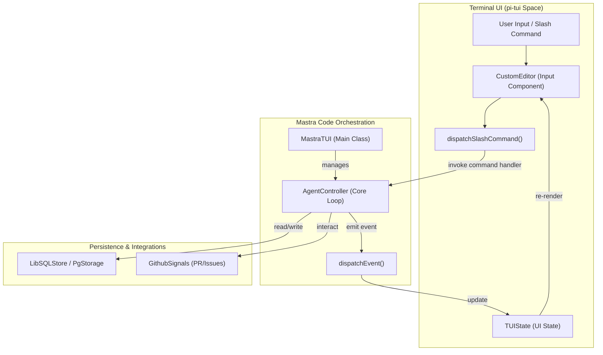
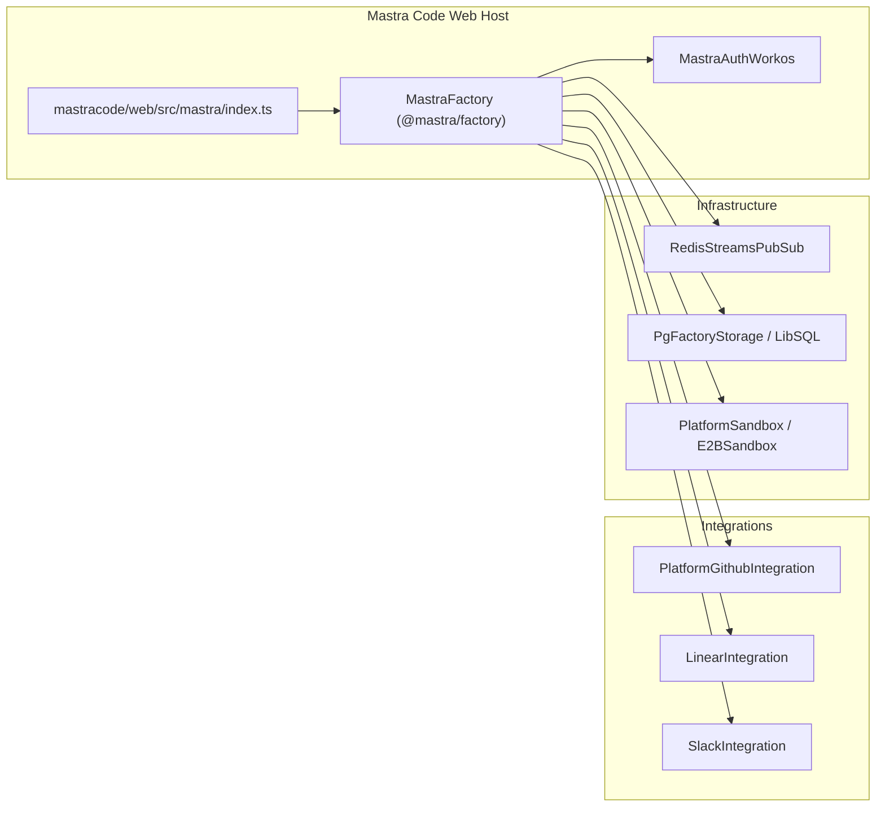

<!-- source: DeepWiki mcp.deepwiki.com · repo mastra-ai/mastra · page 16.2 TUI Interface and Commands · fetched 2026-10-26 -->

# TUI Interface and Commands

Relevant source files

The following files were used as context for generating this wiki page:

- [.changeset/no-bare-wake-without-owner.md](.changeset/no-bare-wake-without-owner.md)
- [docs/src/mastra-code/configuration.mdx](docs/src/mastra-code/configuration.mdx)
- [docs/src/mastra-code/customization.mdx](docs/src/mastra-code/customization.mdx)
- [docs/src/mastra-code/goals.mdx](docs/src/mastra-code/goals.mdx)
- [docs/src/mastra-code/headless.mdx](docs/src/mastra-code/headless.mdx)
- [docs/src/mastra-code/index.mdx](docs/src/mastra-code/index.mdx)
- [docs/src/mastra-code/modes.mdx](docs/src/mastra-code/modes.mdx)
- [docs/src/mastra-code/reference.mdx](docs/src/mastra-code/reference.mdx)
- [docs/src/mastra-code/themes.mdx](docs/src/mastra-code/themes.mdx)
- [docs/src/mastra-code/tools.mdx](docs/src/mastra-code/tools.mdx)
- [mastracode/sdk/src/__tests__/index.test.ts](mastracode/sdk/src/__tests__/index.test.ts)
- [mastracode/sdk/src/__tests__/notification-wake-without-session.test.ts](mastracode/sdk/src/__tests__/notification-wake-without-session.test.ts)
- [mastracode/sdk/src/headless/cli.test.ts](mastracode/sdk/src/headless/cli.test.ts)
- [mastracode/sdk/src/headless/cli.ts](mastracode/sdk/src/headless/cli.ts)
- [mastracode/sdk/src/index.test.ts](mastracode/sdk/src/index.test.ts)
- [mastracode/sdk/src/index.ts](mastracode/sdk/src/index.ts)
- [mastracode/sdk/src/utils/__tests__/storage-maintenance.test.ts](mastracode/sdk/src/utils/__tests__/storage-maintenance.test.ts)
- [mastracode/sdk/src/utils/storage-maintenance.ts](mastracode/sdk/src/utils/storage-maintenance.ts)
- [mastracode/tui/README.md](mastracode/tui/README.md)
- [mastracode/tui/e2e/terminal-backend.ts](mastracode/tui/e2e/terminal-backend.ts)
- [mastracode/tui/e2e/tui/approval-overlay-focus.ts](mastracode/tui/e2e/tui/approval-overlay-focus.ts)
- [mastracode/tui/e2e/tui/index.ts](mastracode/tui/e2e/tui/index.ts)
- [mastracode/tui/e2e/tui/startup.ts](mastracode/tui/e2e/tui/startup.ts)
- [mastracode/tui/e2e/tui/stream-error-retry.ts](mastracode/tui/e2e/tui/stream-error-retry.ts)
- [mastracode/tui/e2e/tui/types.ts](mastracode/tui/e2e/tui/types.ts)
- [mastracode/tui/src/main.ts](mastracode/tui/src/main.ts)
- [mastracode/tui/src/tui/__tests__/command-dispatch.test.ts](mastracode/tui/src/tui/__tests__/command-dispatch.test.ts)
- [mastracode/tui/src/tui/__tests__/mastra-tui-queueing.test.ts](mastracode/tui/src/tui/__tests__/mastra-tui-queueing.test.ts)
- [mastracode/tui/src/tui/__tests__/overlay-focus-handoff.test.ts](mastracode/tui/src/tui/__tests__/overlay-focus-handoff.test.ts)
- [mastracode/tui/src/tui/__tests__/setup-keyboard-shortcuts.test.ts](mastracode/tui/src/tui/__tests__/setup-keyboard-shortcuts.test.ts)
- [mastracode/tui/src/tui/__tests__/setup-layout.test.ts](mastracode/tui/src/tui/__tests__/setup-layout.test.ts)
- [mastracode/tui/src/tui/__tests__/status-line.test.ts](mastracode/tui/src/tui/__tests__/status-line.test.ts)
- [mastracode/tui/src/tui/command-dispatch.ts](mastracode/tui/src/tui/command-dispatch.ts)
- [mastracode/tui/src/tui/commands/__tests__/prune.test.ts](mastracode/tui/src/tui/commands/__tests__/prune.test.ts)
- [mastracode/tui/src/tui/commands/index.ts](mastracode/tui/src/tui/commands/index.ts)
- [mastracode/tui/src/tui/commands/prune.ts](mastracode/tui/src/tui/commands/prune.ts)
- [mastracode/tui/src/tui/components/__tests__/help-overlay.test.ts](mastracode/tui/src/tui/components/__tests__/help-overlay.test.ts)
- [mastracode/tui/src/tui/components/help-overlay.ts](mastracode/tui/src/tui/components/help-overlay.ts)
- [mastracode/tui/src/tui/handlers/__tests__/agent-lifecycle.test.ts](mastracode/tui/src/tui/handlers/__tests__/agent-lifecycle.test.ts)
- [mastracode/tui/src/tui/handlers/agent-lifecycle.ts](mastracode/tui/src/tui/handlers/agent-lifecycle.ts)
- [mastracode/tui/src/tui/mastra-tui.ts](mastracode/tui/src/tui/mastra-tui.ts)
- [mastracode/tui/src/tui/render-messages.ts](mastracode/tui/src/tui/render-messages.ts)
- [mastracode/tui/src/tui/setup.ts](mastracode/tui/src/tui/setup.ts)
- [mastracode/tui/src/tui/state.ts](mastracode/tui/src/tui/state.ts)
- [mastracode/tui/src/tui/status-line.ts](mastracode/tui/src/tui/status-line.ts)
- [packages/core/src/workspace/sandbox/local-process-manager-termination.test.ts](packages/core/src/workspace/sandbox/local-process-manager-termination.test.ts)
- [packages/core/src/workspace/sandbox/local-sandbox-timeout.test.ts](packages/core/src/workspace/sandbox/local-sandbox-timeout.test.ts)

The Mastra Code TUI (Terminal User Interface) is a terminal-centric application designed for AI-assisted coding workflows. Built atop the `pi-tui` UI framework and tightly coupled with the `AgentController` orchestration system, it provides an interactive environment with specialized terminal components, command routing, keyboard shortcut support, and persistent user preferences [mastracode/tui/src/tui/setup.ts:87-96]().

This page documents the TUI components, slash commands, keyboard shortcuts, OAuth integration, and the `mastracode/web` surface, which includes GitHub App integration, Linear intake routes, and the browser-based web UI.

---

## System Architecture

The TUI serves as the presentation layer for Mastra Code. UI state is managed via the `TUIState` type, which encapsulates mutable UI-related data including message queues, active input components, and configuration flags [mastracode/tui/src/tui/state.ts:58-63]().

The central class, `MastraTUI`, wires together terminal UI components with the `AgentController` layer. It subscribes to controller events to update the UI and processes user input events. The TUI supports deferred message rendering, slash command parsing, and dynamic mode switching [mastracode/tui/src/tui/mastra-tui.ts:1-4]().

### TUI to Code Entity Mapping

The following diagram illustrates how natural language user interactions in the terminal map to specific code entities and data flows within the Mastra Code architecture.

Sources: [mastracode/tui/src/tui/mastra-tui.ts:1-4](), [mastracode/tui/src/tui/command-dispatch.ts:47](), [mastracode/tui/src/tui/state.ts:58-63](), [mastracode/sdk/src/onboarding/settings.ts:106-180]()

---

## Slash Commands

Mastra Code supports built-in slash commands prefixed with `/` for administrative, configuration, and agent interaction workflows [docs/src/mastra-code/index.mdx:117-118]().

### Command Dispatch and Routing

Command dispatch is centralized in `dispatchSlashCommand()`. It extracts the command and arguments, mapping them to handlers imported from specific command modules [mastracode/tui/src/tui/command-dispatch.ts:47]().

| Command | Description |
|---|---|
| `/new` | Start a new conversation thread [docs/src/mastra-code/index.mdx:123]() |
| `/clone` | Clone the current thread (with optional rename) [docs/src/mastra-code/index.mdx:124]() |
| `/threads` | List all threads for this project [docs/src/mastra-code/index.mdx:125]() |
| `/thread` | Show current thread info [docs/src/mastra-code/index.mdx:128]() |
| `/name` | Rename the current thread [docs/src/mastra-code/index.mdx:129]() |
| `/rename` | Alias for `/name` [docs/src/mastra-code/index.mdx:130]() |
| `/model` | Change the current mode model; create `Custom` when a built-in pack is active, or update the active custom pack [docs/src/mastra-code/index.mdx:131]() |
| `/models` | Switch the model pack for all modes [docs/src/mastra-code/index.mdx:132]() |
| `/packs` | Alias for `/models` [docs/src/mastra-code/index.mdx:115]() |
| `/mode` | Switch or list modes [docs/src/mastra-code/index.mdx:116]() |
| `/goal` | Start, inspect, pause, resume, or clear a persistent goal [docs/src/mastra-code/goals.mdx:10]() |
| `/think` | Set the thinking level (off/low/medium/high/xhigh) [docs/src/mastra-code/modes.mdx:138]() |
| `/permissions` | Configure tool approval permissions [docs/src/mastra-code/tools.mdx:10]() |
| `/yolo` | Toggle YOLO mode (auto-approve all tools) [docs/src/mastra-code/modes.mdx:143]() |
| `/settings` | Open the settings panel [docs/src/mastra-code/modes.mdx:138]() |
| `/om` | Configure Observational Memory [docs/src/mastra-code/index.mdx:72]() |
| `/subagents` | Configure subagent model defaults [mastracode/tui/src/tui/commands/index.ts:10]() |
| `/skills` | List available skills [docs/src/mastra-code/index.mdx:17]() |
| `/connect` | Add a provider account or API key [docs/src/mastra-code/configuration.mdx:55]() |
| `/setup` | Configure authentication and model defaults [docs/src/mastra-code/configuration.mdx:55]() |
| `/login` | Sign in with an account (OAuth flow) [docs/src/mastra-code/configuration.mdx:95]() |
| `/logout` | Log out and clear session credentials [docs/src/mastra-code/configuration.mdx:119]() |
| `/prune` | Prune old threads and messages [mastracode/tui/src/tui/commands/prune.ts:10]() |
| `/update` | Update Mastra Code to the latest version [docs/src/mastra-code/index.mdx:115]() |

Sources: [docs/src/mastra-code/index.mdx:17](), [docs/src/mastra-code/index.mdx:72](), [docs/src/mastra-code/index.mdx:115](), [docs/src/mastra-code/index.mdx:117-132](), [docs/src/mastra-code/configuration.mdx:55](), [docs/src/mastra-code/configuration.mdx:95](), [docs/src/mastra-code/configuration.mdx:119](), [docs/src/mastra-code/modes.mdx:11](), [docs/src/mastra-code/modes.mdx:138](), [docs/src/mastra-code/modes.mdx:143](), [docs/src/mastra-code/goals.mdx:10](), [docs/src/mastra-code/tools.mdx:10](), [mastracode/tui/src/tui/command-dispatch.ts:47](), [mastracode/tui/src/tui/commands/index.ts:10](), [mastracode/tui/src/tui/commands/prune.ts:10]()

---

## Keyboard Shortcuts

The terminal interface registers global keyboard shortcuts via `setupKeyboardShortcuts()`, attaching them to the input components [mastracode/tui/src/tui/setup.ts:31-40]().

| Shortcut | Action |
|---|---|
| **Ctrl+C** | Interrupt current operation; double-tap to exit [mastracode/tui/src/tui/setup.ts:41-86]() |
| **Ctrl+D** | Exit if the input editor is empty [mastracode/tui/src/tui/setup.ts:121-125]() |
| **Ctrl+T** | Toggle visibility of "thinking" blocks [mastracode/tui/src/tui/setup.ts:128-131]() |
| **Ctrl+E** | Expand or collapse all tool outputs [mastracode/tui/src/tui/setup.ts:134-151]() |
| **Ctrl+Z** | Suspend process (SIGTSTP) [mastracode/tui/src/tui/setup.ts:89-109]() |
| **Alt+Z** | Undo last clear (restore editor text) [mastracode/tui/src/tui/setup.ts:112-117]() |
| **Shift+Tab** | Cycle controller modes [mastracode/tui/src/tui/setup.ts:160-174]() |
| **Enter** | Submit message or queue follow-up during an active run [docs/src/mastra-code/index.mdx:78-79]() |

Sources: [mastracode/tui/src/tui/setup.ts:31-174](), [docs/src/mastra-code/index.mdx:78-79]()

---

## Authentication and OAuth

Mastra Code supports **API keys** (via environment variables or `auth.json`) and **OAuth** for subscription-based access [docs/src/mastra-code/configuration.mdx:52-53]().

- **API Keys**: Can be set as environment variables (e.g., `ANTHROPIC_API_KEY`, `OPENAI_API_KEY`) or stored interactively via `/connect`. Environment variables take precedence over stored keys [docs/src/mastra-code/configuration.mdx:61-74]().
- **Interactive API Key Prompt**: If a selected model requires a provider key that is not configured, Mastra Code prompts the user to enter it. The key is stored in `auth.json` and loaded into the environment for the current session [docs/src/mastra-code/configuration.mdx:76-93]().
- **OAuth Login**: Users can sign in with supported provider accounts via `/login` or `/connect`. OAuth credentials are stored in `auth.json` [docs/src/mastra-code/configuration.mdx:95-105]().
  - **Supported Providers**: Anthropic (Claude Max), OpenAI (ChatGPT Plus / Codex), GitHub Copilot, Kimi For Coding, xAI (Grok) [docs/src/mastra-code/configuration.mdx:103-107]()
  - **Multiple Accounts**: Users can sign in with multiple accounts per provider and switch between them using the account manager [docs/src/mastra-code/configuration.mdx:108-119]().
  - **Subscription Routing**: Model packs can define subscription routing, allowing the TUI to use specific accounts for different models [mastracode/tui/src/tui/mastra-tui.ts:13-14]().

Sources: [docs/src/mastra-code/configuration.mdx:52-119](), [mastracode/tui/src/tui/mastra-tui.ts:13-14]()

---

## E2E TUI Harness

The `mastracode/tui/e2e/tui` directory contains a comprehensive suite of end-to-end tests for the TUI. These tests simulate user interactions and verify the TUI's behavior across various scenarios.

The `ScenarioName` type [mastracode/tui/e2e/tui/types.ts:6-208]() enumerates a wide range of test cases, including:
- `startup`: Initial application launch [mastracode/tui/e2e/tui/types.ts:7]()
- `factory-client-mode`: Testing the TUI in factory client mode [mastracode/tui/e2e/tui/types.ts:8]()
- `abort-followup`: Scenarios related to aborting follow-up actions [mastracode/tui/e2e/tui/types.ts:9]()
- `account-rotation`: Testing account rotation logic [mastracode/tui/e2e/tui/types.ts:15]()
- `api-key-prompt`: Verifying API key prompting behavior [mastracode/tui/e2e/tui/types.ts:28]()
- `approval-overlay-focus`: Testing focus management for approval overlays [mastracode/tui/e2e/tui/types.ts:29]()
- `automated-chat`: Automated chat interactions [mastracode/tui/e2e/tui/types.ts:31]()
- `browser-model-picker`: Browser model selection [mastracode/tui/e2e/tui/types.ts:42]()
- `custom-slash-command`: Testing custom slash commands [mastracode/tui/e2e/tui/types.ts:67]()
- `github-signals-command`: GitHub signals command interactions [mastracode/tui/e2e/tui/types.ts:78]()
- `goal-judge-esc-loaded`: Goal judge escape behavior [mastracode/tui/e2e/tui/types.ts:92]()
- `initial-prompt`: Initial prompt handling [mastracode/tui/e2e/tui/types.ts:99]()
- `login-dialog-masked-input`: Masked input in login dialogs [mastracode/tui/e2e/tui/types.ts:138]()
- `mcp-oauth-authenticate`: MCP OAuth authentication flow [mastracode/tui/e2e/tui/types.ts:146]()
- `om-settings`: Observational Memory settings [mastracode/tui/e2e/tui/types.ts:163]()
- `plugins-local-tool`: Local plugin tool functionality [mastracode/tui/e2e/tui/types.ts:113]()
- `shell-passthrough-during-run`: Shell passthrough during agent execution [mastracode/tui/e2e/tui/types.ts:197]()
- `storage-settings`: Storage configuration settings [mastracode/tui/e2e/tui/types.ts:207]()

These scenarios are implemented as individual test files (e.g., `abort-followup.ts`, `api-key-prompt.ts`) within the `mastracode/tui/e2e/tui` directory [mastracode/tui/e2e/tui/index.ts:2-208](). The `Terminal` class from `@earendil-works/pi-tui` is used to interact with the TUI in these tests [mastracode/tui/e2e/tui/types.ts:1]().

Sources: [mastracode/tui/e2e/tui/index.ts:2-208](), [mastracode/tui/e2e/tui/types.ts:1](), [mastracode/tui/e2e/tui/types.ts:6-208]()

---

## Mastra Code Web Surface

The `mastracode/web` package serves as the platform-deployable entry point for the Mastra Code web host. This section is not directly covered by the provided TUI files, but it's part of the broader `mastracode` product.

### GitHub App Integration
The web surface provides backend routes for the GitHub App integration, managed by `PlatformGithubIntegration`.
- **PR Subscription Signals**: The system uses `GithubSubscriptionStorage` to track session-specific subscriptions to Pull Requests.
- **Cloud Sandbox Fleet**: Supports `PlatformSandbox` and `E2BSandbox` for remote code execution.
- **Materialization**: Handles repository cloning and branch checkout within sandboxes via `materializeRepo` and `checkoutSessionBranch`.

### Linear Intake Routes
Intake for Linear is provided via `LinearIntegration`, allowing issues to be routed into the Mastra Code agentic workflow.

### Web Surface Architecture Diagram

This diagram shows the relationship between the web entry point, integrations, and infrastructure providers.

Sources: No direct file content provided for `mastracode/web` in this context. This section is based on the wiki TOC.

---

## Configuration Options

Mastra Code is configured through project-level files, global settings, and environment variables [docs/src/mastra-code/configuration.mdx:8-10]().

- **Custom Configuration Directory**: The `configDir` option in `createMastraCode()` allows specifying an alternative directory name for `.mastracode/` [docs/src/mastra-code/configuration.mdx:12-24]().
- **File Autocomplete**: The TUI supports file autocomplete using `@` followed by a filename. It leverages `fd` (or `fdfind`) and respects `.gitignore` [docs/src/mastra-code/configuration.mdx:26-49]().
- **Direct Shell Passthrough**: Input starting with `!` runs as a shell command. The shell behavior is configured via `shellPassthrough` in `settings.json` [mastracode/sdk/src/onboarding/settings.ts:106-117]().
  - **Modes**: `default`, `path`, `login` [mastracode/sdk/src/onboarding/settings.ts:107]().
  - **Families**: `posix`, `cmd`, `powershell` [mastracode/sdk/src/onboarding/settings.ts:110]().
- **Environment Overrides**: Environment variables like `MASTRACODE_MODEL_ID` and `MASTRACODE_YOLO` can set initial state [mastracode/tui/src/main.ts:72-77](). `MASTRACODE_TUI_INITIAL_PROMPT` can provide an initial message [docs/src/mastra-code/index.mdx:103]().
- **Storage Backend**: Configurable via `StorageSettings` in `settings.json`, supporting `libsql` (default) and `pg` (PostgreSQL) [mastracode/sdk/src/onboarding/settings.ts:106-180]().
- **Browser Settings**: Configuration for browser tools, including provider (`stagehand`, `agent-browser`), viewport, and Stagehand environment [mastracode/sdk/src/onboarding/settings.ts:162-168]().
- **Voice Settings**: Configuration for hold-space dictation, including `enabled`, `engine` (`macos-native`, `cloud`), `provider`, and `model` [mastracode/sdk/src/onboarding/settings.ts:119-124]().
- **Observational Memory (OM) Settings**: Configurable via `/om` command, including model choices and thresholds [docs/src/mastra-code/index.mdx:72](), [mastracode/sdk/src/onboarding/settings.ts:135-140]().
- **Model Packs**: Custom model packs can be created or edited via `/models` to mix providers and define fallback chains [docs/src/mastra-code/configuration.mdx:78-81]().

Sources: [docs/src/mastra-code/configuration.mdx:8-49](), [docs/src/mastra-code/configuration.mdx:78-81](), [docs/src/mastra-code/index.mdx:72](), [docs/src/mastra-code/index.mdx:103](), [mastracode/sdk/src/onboarding/settings.ts:106-180](), [mastracode/sdk/src/onboarding/settings.ts:119-124](), [mastracode/sdk/src/onboarding/settings.ts:135-140](), [mastracode/sdk/src/onboarding/settings.ts:162-168](), [mastracode/tui/src/main.ts:72-77]().

---

