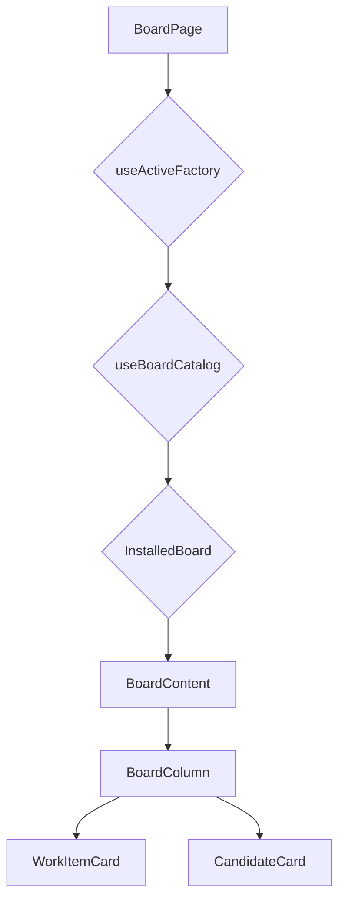
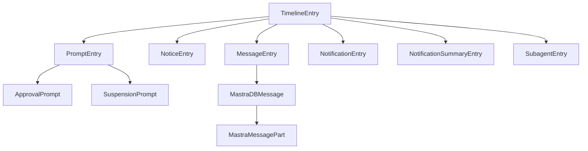

<!-- source: DeepWiki mcp.deepwiki.com · repo mastra-ai/mastra · page 16.5 Factory UI and Web Surface · fetched 2026-10-26 -->

# 16.5. Factory UI and Web Surface

<details>
<summary>Relevant source files</summary>

The following files were used as context for generating this wiki page:

- [.changeset/config.json](.changeset/config.json)
- [.github/workflows/sync-softwarefactory-template.yml](.github/workflows/sync-softwarefactory-template.yml)
- [e2e-tests/softwarefactory/setup.ts](e2e-tests/softwarefactory/setup.ts)
- [e2e-tests/softwarefactory/softwarefactory.test.ts](e2e-tests/softwarefactory/softwarefactory.test.ts)
- [e2e-tests/softwarefactory/vitest.config.ts](e2e-tests/softwarefactory/vitest.config.ts)
- [mastracode/factory-ui/src/hooks/__tests__/useRouteThreadSync.msw.test.tsx](mastracode/factory-ui/src/hooks/__tests__/useRouteThreadSync.msw.test.tsx)
- [mastracode/factory-ui/src/hooks/useAgentControllerRunMutations.ts](mastracode/factory-ui/src/hooks/useAgentControllerRunMutations.ts)
- [mastracode/factory-ui/src/ui/__tests__/BoardCardSessionLiveness.msw.test.tsx](mastracode/factory-ui/src/ui/__tests__/BoardCardSessionLiveness.msw.test.tsx)
- [mastracode/factory-ui/src/ui/__tests__/BoardPageCardClickStartsRun.msw.test.tsx](mastracode/factory-ui/src/ui/__tests__/BoardPageCardClickStartsRun.msw.test.tsx)
- [mastracode/factory-ui/src/ui/__tests__/BoardPagePendingStates.msw.test.tsx](mastracode/factory-ui/src/ui/__tests__/BoardPagePendingStates.msw.test.tsx)
- [mastracode/factory-ui/src/ui/__tests__/BoardPageProposedRun.msw.test.tsx](mastracode/factory-ui/src/ui/__tests__/BoardPageProposedRun.msw.test.tsx)
- [mastracode/factory-ui/src/ui/__tests__/workBoardStubs.ts](mastracode/factory-ui/src/ui/__tests__/workBoardStubs.ts)
- [mastracode/factory-ui/src/ui/domains/chat/components/ActivityLine.tsx](mastracode/factory-ui/src/ui/domains/chat/components/ActivityLine.tsx)
- [mastracode/factory-ui/src/ui/domains/chat/components/Composer.tsx](mastracode/factory-ui/src/ui/domains/chat/components/Composer.tsx)
- [mastracode/factory-ui/src/ui/domains/chat/components/StatusLine/ConnectionActivity.tsx](mastracode/factory-ui/src/ui/domains/chat/components/StatusLine/ConnectionActivity.tsx)
- [mastracode/factory-ui/src/ui/domains/chat/components/StatusLine/__tests__/ConnectionActivity.msw.test.tsx](mastracode/factory-ui/src/ui/domains/chat/components/StatusLine/__tests__/ConnectionActivity.msw.test.tsx)
- [mastracode/factory-ui/src/ui/domains/chat/components/Transcript.tsx](mastracode/factory-ui/src/ui/domains/chat/components/Transcript.tsx)
- [mastracode/factory-ui/src/ui/domains/chat/components/__tests__/ActivityLine.msw.test.tsx](mastracode/factory-ui/src/ui/domains/chat/components/__tests__/ActivityLine.msw.test.tsx)
- [mastracode/factory-ui/src/ui/domains/chat/components/__tests__/ComposerSteering.msw.test.tsx](mastracode/factory-ui/src/ui/domains/chat/components/__tests__/ComposerSteering.msw.test.tsx)
- [mastracode/factory-ui/src/ui/domains/chat/components/__tests__/TranscriptSignalRows.msw.test.tsx](mastracode/factory-ui/src/ui/domains/chat/components/__tests__/TranscriptSignalRows.msw.test.tsx)
- [mastracode/factory-ui/src/ui/domains/chat/components/__tests__/TranscriptToolRows.msw.test.tsx](mastracode/factory-ui/src/ui/domains/chat/components/__tests__/TranscriptToolRows.msw.test.tsx)
- [mastracode/factory-ui/src/ui/domains/chat/components/__tests__/TranscriptTurnGroups.msw.test.tsx](mastracode/factory-ui/src/ui/domains/chat/components/__tests__/TranscriptTurnGroups.msw.test.tsx)
- [mastracode/factory-ui/src/ui/domains/chat/components/chat-enter.css](mastracode/factory-ui/src/ui/domains/chat/components/chat-enter.css)
- [mastracode/factory-ui/src/ui/domains/chat/components/tool/ToolCard.tsx](mastracode/factory-ui/src/ui/domains/chat/components/tool/ToolCard.tsx)
- [mastracode/factory-ui/src/ui/domains/chat/components/tool/ToolGroup.tsx](mastracode/factory-ui/src/ui/domains/chat/components/tool/ToolGroup.tsx)
- [mastracode/factory-ui/src/ui/domains/chat/context/ChatTranscriptContext.ts](mastracode/factory-ui/src/ui/domains/chat/context/ChatTranscriptContext.ts)
- [mastracode/factory-ui/src/ui/domains/chat/context/ChatTranscriptProvider.tsx](mastracode/factory-ui/src/ui/domains/chat/context/ChatTranscriptProvider.tsx)
- [mastracode/factory-ui/src/ui/domains/chat/hooks/useAgentControllerTranscript.ts](mastracode/factory-ui/src/ui/domains/chat/hooks/useAgentControllerTranscript.ts)
- [mastracode/factory-ui/src/ui/domains/chat/services/__tests__/message-author.test.ts](mastracode/factory-ui/src/ui/domains/chat/services/__tests__/message-author.test.ts)
- [mastracode/factory-ui/src/ui/domains/chat/services/__tests__/transcript.test.ts](mastracode/factory-ui/src/ui/domains/chat/services/__tests__/transcript.test.ts)
- [mastracode/factory-ui/src/ui/domains/chat/services/message-author.ts](mastracode/factory-ui/src/ui/domains/chat/services/message-author.ts)
- [mastracode/factory-ui/src/ui/domains/chat/services/transcript.ts](mastracode/factory-ui/src/ui/domains/chat/services/transcript.ts)
- [mastracode/factory-ui/src/ui/domains/factory/boardCandidates.ts](mastracode/factory-ui/src/ui/domains/factory/boardCandidates.ts)
- [mastracode/factory-ui/src/ui/domains/factory/boardItems.test.ts](mastracode/factory-ui/src/ui/domains/factory/boardItems.test.ts)
- [mastracode/factory-ui/src/ui/domains/factory/boardItems.ts](mastracode/factory-ui/src/ui/domains/factory/boardItems.ts)
- [mastracode/factory-ui/src/ui/domains/factory/cardPrimaryAction.test.ts](mastracode/factory-ui/src/ui/domains/factory/cardPrimaryAction.test.ts)
- [mastracode/factory-ui/src/ui/domains/factory/cardPrimaryAction.ts](mastracode/factory-ui/src/ui/domains/factory/cardPrimaryAction.ts)
- [mastracode/factory-ui/src/ui/domains/factory/components/BoardCardParts.tsx](mastracode/factory-ui/src/ui/domains/factory/components/BoardCardParts.tsx)
- [mastracode/factory-ui/src/ui/domains/factory/components/BoardColumn.tsx](mastracode/factory-ui/src/ui/domains/factory/components/BoardColumn.tsx)
- [mastracode/factory-ui/src/ui/domains/factory/components/CandidateCard.tsx](mastracode/factory-ui/src/ui/domains/factory/components/CandidateCard.tsx)
- [mastracode/factory-ui/src/ui/domains/factory/components/CandidateCardRows.tsx](mastracode/factory-ui/src/ui/domains/factory/components/CandidateCardRows.tsx)
- [mastracode/factory-ui/src/ui/domains/factory/components/CandidateDetailsPanel.tsx](mastracode/factory-ui/src/ui/domains/factory/components/CandidateDetailsPanel.tsx)
- [mastracode/factory-ui/src/ui/domains/factory/components/CandidateListRow.tsx](mastracode/factory-ui/src/ui/domains/factory/components/CandidateListRow.tsx)
- [mastracode/factory-ui/src/ui/domains/factory/components/CardStatus.msw.test.tsx](mastracode/factory-ui/src/ui/domains/factory/components/CardStatus.msw.test.tsx)
- [mastracode/factory-ui/src/ui/domains/factory/components/InlineWorkItemComposer.tsx](mastracode/factory-ui/src/ui/domains/factory/components/InlineWorkItemComposer.tsx)
- [mastracode/factory-ui/src/ui/domains/factory/components/IntakeColumnExtras.tsx](mastracode/factory-ui/src/ui/domains/factory/components/IntakeColumnExtras.tsx)
- [mastracode/factory-ui/src/ui/domains/factory/components/IntakeFeedNotice.tsx](mastracode/factory-ui/src/ui/domains/factory/components/IntakeFeedNotice.tsx)
- [mastracode/factory-ui/src/ui/domains/factory/components/IntakeIcon.tsx](mastracode/factory-ui/src/ui/domains/factory/components/IntakeIcon.tsx)
- [mastracode/factory-ui/src/ui/domains/factory/components/WorkItemCard.tsx](mastracode/factory-ui/src/ui/domains/factory/components/WorkItemCard.tsx)
- [mastracode/factory-ui/src/ui/domains/factory/components/WorkItemCardRows.tsx](mastracode/factory-ui/src/ui/domains/factory/components/WorkItemCardRows.tsx)
- [mastracode/factory-ui/src/ui/domains/factory/components/WorkItemListRow.tsx](mastracode/factory-ui/src/ui/domains/factory/components/WorkItemListRow.tsx)
- [mastracode/factory-ui/src/ui/domains/factory/components/WorkItemTray.tsx](mastracode/factory-ui/src/ui/domains/factory/components/WorkItemTray.tsx)
- [mastracode/factory-ui/src/ui/domains/factory/components/reviewVerdict.test.ts](mastracode/factory-ui/src/ui/domains/factory/components/reviewVerdict.test.ts)
- [mastracode/factory-ui/src/ui/domains/factory/hooks/useCardMorph.ts](mastracode/factory-ui/src/ui/domains/factory/hooks/useCardMorph.ts)
- [mastracode/factory-ui/src/ui/domains/factory/services/factory.ts](mastracode/factory-ui/src/ui/domains/factory/services/factory.ts)
- [mastracode/factory-ui/src/ui/domains/factory/services/relationships.test.ts](mastracode/factory-ui/src/ui/domains/factory/services/relationships.test.ts)
- [mastracode/factory-ui/src/ui/domains/factory/services/relationships.ts](mastracode/factory-ui/src/ui/domains/factory/services/relationships.ts)
- [mastracode/factory-ui/src/ui/domains/workspace-viewer/hooks/useThreadWorkspacePath.ts](mastracode/factory-ui/src/ui/domains/workspace-viewer/hooks/useThreadWorkspacePath.ts)
- [mastracode/factory-ui/src/ui/pages/BoardPage.tsx](mastracode/factory-ui/src/ui/pages/BoardPage.tsx)
- [mastracode/factory-ui/src/ui/pages/ThreadPage.tsx](mastracode/factory-ui/src/ui/pages/ThreadPage.tsx)
- [mastracode/factory-ui/src/ui/pages/__tests__/PrivateSessionNotFound.msw.test.tsx](mastracode/factory-ui/src/ui/pages/__tests__/PrivateSessionNotFound.msw.test.tsx)
- [mastracode/factory-ui/src/ui/pages/__tests__/ThreadPageLoading.msw.test.tsx](mastracode/factory-ui/src/ui/pages/__tests__/ThreadPageLoading.msw.test.tsx)
- [mastracode/factory-ui/src/ui/pages/__tests__/ThreadPageRail.msw.test.tsx](mastracode/factory-ui/src/ui/pages/__tests__/ThreadPageRail.msw.test.tsx)
- [mastracode/factory/src/integrations/gitlab/rules.test.ts](mastracode/factory/src/integrations/gitlab/rules.test.ts)
- [mastracode/factory/src/integrations/gitlab/rules.ts](mastracode/factory/src/integrations/gitlab/rules.ts)
- [mastracode/factory/src/integrations/incidentio/rules.ts](mastracode/factory/src/integrations/incidentio/rules.ts)
- [mastracode/factory/src/integrations/jira/rules.ts](mastracode/factory/src/integrations/jira/rules.ts)
- [mastracode/factory/src/integrations/pull-request-head.test.ts](mastracode/factory/src/integrations/pull-request-head.test.ts)
- [mastracode/factory/src/integrations/pull-request-head.ts](mastracode/factory/src/integrations/pull-request-head.ts)
- [mastracode/factory/src/routes/automation-runs.ts](mastracode/factory/src/routes/automation-runs.ts)
- [mastracode/mastra-factory/README.md](mastracode/mastra-factory/README.md)
- [mastracode/mastra-factory/scripts/sync-template.mjs](mastracode/mastra-factory/scripts/sync-template.mjs)
- [mastracode/mastra-factory/src/create.test.ts](mastracode/mastra-factory/src/create.test.ts)
- [mastracode/mastra-factory/src/create.ts](mastracode/mastra-factory/src/create.ts)
- [mastracode/mastra-factory/src/index.ts](mastracode/mastra-factory/src/index.ts)
- [mastracode/mastra-factory/src/platform.test.ts](mastracode/mastra-factory/src/platform.test.ts)
- [mastracode/mastra-factory/src/platform.ts](mastracode/mastra-factory/src/platform.ts)
- [mastracode/mastra-factory/src/sync-template.test.ts](mastracode/mastra-factory/src/sync-template.test.ts)
- [mastracode/mastra-factory/template/README.md](mastracode/mastra-factory/template/README.md)
- [mastracode/web/.env.schema](mastracode/web/.env.schema)
- [mastracode/web/package.json](mastracode/web/package.json)
- [mastracode/web/pnpm-lock.yaml](mastracode/web/pnpm-lock.yaml)
- [mastracode/web/pnpm-workspace.yaml](mastracode/web/pnpm-workspace.yaml)
- [mastracode/web/src/factory-dev/cli.ts](mastracode/web/src/factory-dev/cli.ts)
- [mastracode/web/src/factory-dev/settings.test.ts](mastracode/web/src/factory-dev/settings.test.ts)
- [mastracode/web/src/factory-dev/settings.ts](mastracode/web/src/factory-dev/settings.ts)
- [mastracode/web/src/factory-dev/token-lifecycle.test.ts](mastracode/web/src/factory-dev/token-lifecycle.test.ts)
- [mastracode/web/src/factory-dev/token-lifecycle.ts](mastracode/web/src/factory-dev/token-lifecycle.ts)
- [mastracode/web/src/mastra/index.test.ts](mastracode/web/src/mastra/index.test.ts)
- [mastracode/web/src/mastra/index.ts](mastracode/web/src/mastra/index.ts)
- [mastracode/web/src/mastra/sandbox-provider.test.ts](mastracode/web/src/mastra/sandbox-provider.test.ts)
- [packages/playground-ui/src/ds/components/Composer/composer-ring.css](packages/playground-ui/src/ds/components/Composer/composer-ring.css)
- [packages/playground-ui/src/ds/components/Composer/composer.stories.tsx](packages/playground-ui/src/ds/components/Composer/composer.stories.tsx)
- [packages/playground-ui/src/ds/components/Composer/composer.test.tsx](packages/playground-ui/src/ds/components/Composer/composer.test.tsx)
- [packages/playground-ui/src/ds/components/Composer/composer.tsx](packages/playground-ui/src/ds/components/Composer/composer.tsx)
- [packages/playground-ui/src/ds/components/Composer/index.ts](packages/playground-ui/src/ds/components/Composer/index.ts)
- [packages/playground-ui/src/ds/components/MessageScroller/message-scroller.test.tsx](packages/playground-ui/src/ds/components/MessageScroller/message-scroller.test.tsx)
- [packages/playground-ui/src/ds/components/MessageScroller/message-scroller.tsx](packages/playground-ui/src/ds/components/MessageScroller/message-scroller.tsx)
- [packages/playground-ui/src/ds/components/Shimmer/shimmer.css](packages/playground-ui/src/ds/components/Shimmer/shimmer.css)
- [packages/playground-ui/src/ds/components/ThreadRail/thread-rail-turns.test.ts](packages/playground-ui/src/ds/components/ThreadRail/thread-rail-turns.test.ts)
- [packages/playground-ui/src/ds/components/ThreadRail/thread-rail-turns.ts](packages/playground-ui/src/ds/components/ThreadRail/thread-rail-turns.ts)
- [packages/playground-ui/src/ds/components/ai/tool-call/index.ts](packages/playground-ui/src/ds/components/ai/tool-call/index.ts)
- [packages/playground/e2e/tests/auth/login-flow.spec.ts](packages/playground/e2e/tests/auth/login-flow.spec.ts)
- [turbo.json](turbo.json)

</details>


This page details the user-facing components of the MastraCode Software Factory, specifically the `mastracode/factory-ui` and `mastracode/web` packages. `mastracode/factory-ui` provides the React-based user interface for interacting with the Factory, including the BoardPage, work item cards, chat transcript rendering, and tool cards. `mastracode/web` serves as the deployable host for the Factory, integrating with external services like GitHub and Linear, and providing browser-based access to the Factory UI.

## MastraCode Web Host (`mastracode/web`)

The `mastracode/web` package is the entry point for deploying the MastraCode Software Factory. It configures the `Mastra` instance, handles environment variable parsing, and integrates various backend services. It also serves the `factory-ui` in production.

### Configuration and Initialization

The `mastracode/web/src/mastra/index.ts` file is the primary configuration point. It reads environment variables to set up core Mastra components like storage, pub/sub, and authentication.

```typescript
// mastracode/web/src/mastra/index.ts:20-40
import { homedir } from 'node:os';
import { join } from 'node:path';
import { Mastra } from '@mastra/core/mastra';
import { LibSQLFactoryStorage } from '@mastra/libsql';
import { PgVector, PgFactoryStorage } from '@mastra/pg';
import { PlatformFactorySandbox } from '@mastra/platform-workspace';
import { E2BFactorySandbox } from '@mastra/e2b';
import { RedisStreamsPubSub } from '@mastra/redis-streams';
import { getDatabasePath } from '@mastra/code-sdk/utils/project';
import { DEFAULT_RETENTION } from '@mastra/code-sdk/utils/storage-maintenance';
import { MastraAuthWorkos } from '@mastra/auth-workos';
import { createFactorySecretEncryption, LocalFactorySandbox, MastraFactory } from '@mastra/factory';
import { GithubIntegration } from '@mastra/factory/integrations/github/integration';
import { GitLabIntegration } from '@mastra/factory/integrations/gitlab/integration';
import { parseAuthorizedBotsEnv } from '@mastra/factory/integrations/github/webhook';
import { IncidentioIntegration } from '@mastra/factory/integrations/incidentio/integration';
import { JiraIntegration } from '@mastra/factory/integrations/jira/integration';
import { PlatformJiraIntegration } from '@mastra/factory/integrations/platform/jira/integration';
import { LinearIntegration } from '@mastra/factory/integrations/linear/integration';
import { SlackIntegration } from '@mastra/factory/integrations/slack/integration';
import type { IMastraAuthProvider } from '@mastra/core/server';
```

Key configurations include:
- **Storage**: Uses `LibSQLFactoryStorage` or `PgFactoryStorage` based on environment variables. `LibSQLFactoryStorage` is used for local development, while `PgFactoryStorage` is for production deployments with PostgreSQL [mastracode/web/src/mastra/index.ts:23-24]().
- **Pub/Sub**: `RedisStreamsPubSub` is used for distributed eventing when `REDIS_URL` is set, enabling multiple web server processes to share an event bus [mastracode/web/src/mastra/index.ts:111-119]().
- **Sandboxes**: Supports `LocalFactorySandbox`, `PlatformFactorySandbox`, and `E2BFactorySandbox` for code execution environments [mastracode/web/src/mastra/index.ts:25-27, mastracode/web/src/mastra/index.ts:31]().
- **Authentication**: Integrates with `MastraAuthWorkos` or defers to a shared Mastra platform API based on `MASTRA_SHARED_API_URL` or `WORKOS_*` environment variables [mastracode/web/src/mastra/index.ts:132-133]().
- **Credential Encryption**: `FACTORY_CREDENTIAL_ENCRYPTION_KEY` is used to encrypt sensitive credentials at rest [mastracode/web/src/mastra/index.ts:66-102]().

### External Integrations

The `mastracode/web` package facilitates integrations with various external services, primarily through the `@mastra/factory` package.

- **GitHub**: `GithubIntegration` handles GitHub App webhooks and API interactions [mastracode/web/src/mastra/index.ts:33](). This includes parsing authorized bots from `GITHUB_APP_AUTHORIZED_BOTS` [mastracode/web/src/mastra/index.ts:35]().
- **GitLab**: `GitLabIntegration` for GitLab integration [mastracode/web/src/mastra/index.ts:34]().
- **Linear**: `LinearIntegration` provides intake routes for Linear issues [mastracode/web/src/mastra/index.ts:39]().
- **Jira**: `JiraIntegration` and `PlatformJiraIntegration` for Jira integration [mastracode/web/src/mastra/index.ts:37-38]().
- **Slack**: `SlackIntegration` for Slack channels [mastracode/web/src/mastra/index.ts:40]().
- **Incident.io**: `IncidentioIntegration` for incident management [mastracode/web/src/mastra/index.ts:36]().

### Development and Deployment

The `mastracode/web/package.json` defines scripts for development and deployment:
- `dev`: Runs the API and bundled UI locally [mastracode/web/package.json:13]().
- `dev:ui`: Runs Docker services, the API, and a Vite dev server for UI hot module replacement [mastracode/web/package.json:14]().
- `build`: Builds the Mastra application for deployment [mastracode/web/package.json:16]().
- `deploy`: Deploys the built application using the Mastra CLI [mastracode/web/package.json:17]().

Sources:
- `mastracode/web/src/mastra/index.ts`
- `mastracode/web/package.json`
- `mastracode/web/.env.schema`

## Factory UI (`mastracode/factory-ui`)

The `mastracode/factory-ui` package provides the React-based user interface for the MastraCode Software Factory. It's a single-page application designed to interact with the backend API provided by `mastracode/web`.

### BoardPage

The `BoardPage` component (`mastracode/factory-ui/src/ui/pages/BoardPage.tsx`) is the central view for managing work items. It displays a kanban-style board with columns representing different stages of a workflow.

```typescript
// mastracode/factory-ui/src/ui/pages/BoardPage.tsx:22-33
export function WorkBoardPage() {
  return <BoardLayout kind="work" />;
}

export function ReviewBoardPage() {
  return <BoardLayout kind="review" />;
}

export function CustomBoardPage() {
  const { boardId } = useParams<{ boardId: string }>();
  return <BoardLayout kind={boardId ?? ''} />;
}
```

The `BoardPage` renders different board layouts (`WorkBoardPage`, `ReviewBoardPage`, `CustomBoardPage`) based on the `kind` prop, which corresponds to the board ID. It fetches board definitions using `useBoardCatalog` [mastracode/factory-ui/src/ui/pages/BoardPage.tsx:46]().

#### Board Structure and Data Flow

The board consists of columns, each representing a stage. Work items are rendered as cards within these columns.

**BoardPage Data Flow**

- `useActiveFactory`: Provides the current factory project context [mastracode/factory-ui/src/ui/pages/BoardPage.tsx:36]().
- `useBoardCatalog`: Fetches the definitions of available boards [mastracode/factory-ui/src/ui/pages/BoardPage.tsx:46]().
- `BoardContent`: Orchestrates the rendering of board columns and their contents [mastracode/factory-ui/src/ui/pages/board/BoardContent.tsx]().
- `BoardColumn`: Renders a single column on the board [mastracode/factory-ui/src/ui/domains/factory/components/BoardColumn.tsx]().
- `WorkItemCard`: Displays individual work items [mastracode/factory-ui/src/ui/domains/factory/components/WorkItemCard.tsx]().
- `CandidateCard`: Displays potential work items from external sources (e.g., GitHub issues, Linear issues) in the "Intake" column [mastracode/factory-ui/src/ui/domains/factory/components/CandidateCard.tsx]().

Sources:
- `mastracode/factory-ui/src/ui/pages/BoardPage.tsx`
- `mastracode/factory-ui/src/ui/domains/factory/components/BoardColumn.tsx`
- `mastracode/factory-ui/src/ui/domains/factory/components/WorkItemCard.tsx`
- `mastracode/factory-ui/src/ui/domains/factory/components/CandidateCard.tsx`

### Work Item Cards (`WorkItemCard`)

The `WorkItemCard` component (`mastracode/factory-ui/src/ui/domains/factory/components/WorkItemCard.tsx`) is responsible for rendering a single work item on the board. It displays the item's title, status, and provides actions like moving the card between stages or starting agent runs.

```typescript
// mastracode/factory-ui/src/ui/domains/factory/components/WorkItemCard.tsx:38-93
export function WorkItemCard({
  item,
  deepLinkRef,
  deepLinkCommentId,
  highlighted,
  columnStage,
  relatedItems,
  projectRepositoryId,
  activityPage,
  preparing,
  evaluatingStage,
  transitionReason,
  decision,
  proposal,
  approvingDecisionId,
  retryingDecisionId,
  onApproveProposal,
  onDismissProposal,
  onRetryDecision,
  sessionStatus,
  onCreateSession,
  onMove,
  onRemove,
}: {
  item: WorkItem;
  // Hands the card's own control to the board, which scrolls to it and focuses it when the card is deeplinked.
  deepLinkRef: (element: HTMLElement | null) => void;
  /** Comment deep link (`?item&comment`): holds the details popover open so the feed is reachable. */
  deepLinkCommentId?: string;
  highlighted: boolean;
  columnStage: BoardStageId;
  /** Cards linked to this one, resolved once for the whole board. */
  relatedItems: WorkItem[];
  /** Repository id resolving GitHub descriptions in the detail panel. */
  projectRepositoryId: string;
  activityPage?: AuditEventPage;
  /** Status text while a session start is resolving, before its mutation starts. */
  preparing?: string;
  /** Destination stage of an in-flight transition; undefined = not moving. */
  evaluatingStage?: string;
  transitionReason?: string;
  decision?: FactoryDecisionSummary;
  /** Run a rule wants to start on this card, waiting for someone to release it. */
  proposal?: FactoryDecisionSummary;
  approvingDecisionId?: string;
  retryingDecisionId?: string;
  onApproveProposal: (decisionId: string) => void;
  onDismissProposal: (decisionId: string) => void;
  onRetryDecision: (decisionId: string) => void;
  /** Live status of the card's bound sessions, resolved once for the whole board. */
  sessionStatus?: SessionRowStatus;
  /** Fallback when the card offers no lane: open a session on it (no run). */
  onCreateSession: (spec: { branch: string; threadTitle: string }) => void;
  onMove: (toStage: string) => void;
  onRemove: () => void;
}) {
```

Key features of `WorkItemCard`:
- **Status Display**: Shows the current status of the work item, including any in-flight transitions or proposed agent runs [mastracode/factory-ui/src/ui/domains/factory/boardCardStatus.ts]().
- **Primary Actions**: Provides a primary button for the most relevant action, such as starting a run or approving a proposal [mastracode/factory-ui/src/ui/domains/factory/cardPrimaryAction.ts]().
- **Context Menu**: Offers a dropdown menu with additional actions like moving the card to a different stage or removing it [mastracode/factory-ui/src/ui/domains/factory/components/WorkItemMenuItems.tsx]().
- **Session Integration**: Links to active chat sessions associated with the work item [mastracode/factory-ui/src/ui/domains/factory/boardItems.ts:itemThreadSession]().
- **Activity Wick**: Displays recent activity related to the work item [packages/playground-ui/src/ds/components/Activity/activity-wick.tsx]().

Sources:
- `mastracode/factory-ui/src/ui/domains/factory/components/WorkItemCard.tsx`
- `mastracode/factory-ui/src/ui/domains/factory/boardCardStatus.ts`
- `mastracode/factory-ui/src/ui/domains/factory/cardPrimaryAction.ts`
- `mastracode/factory-ui/src/ui/domains/factory/components/WorkItemMenuItems.tsx`
- `mastracode/factory-ui/src/ui/domains/factory/boardItems.ts`

### Chat Transcript Rendering (`Transcript.tsx`)

The `Transcript` component (`mastracode/factory-ui/src/ui/domains/chat/components/Transcript.tsx`) is responsible for rendering the conversation history within an agent session. It displays messages, tool calls, and system notices.

```typescript
// mastracode/factory-ui/src/ui/domains/chat/components/Transcript.tsx:31-74
export function Transcript({ tail }: { tail?: ReactNode }) {
  const { sessionId, sessionEnabled, baseUrl, owner } = useChatSessionContext();
  const { transcript, resolvePrompt, busy, viewerId } = useChatTranscript();
  const { entries } = transcript;
  const hookArgs = {
    agentControllerId: AGENT_CONTROLLER_ID,
    sessionId,
    baseUrl,
    enabled: sessionEnabled,
  };
  const { mutateAsync: approve, isPending: approving } = useApproveAgentControllerToolMutation(hookArgs);
  const { mutateAsync: respond, isPending: responding } = useRespondAgentControllerSuspensionMutation(hookArgs);

  // Pinned: these reach every entry, and a fresh pair each token would redraw the lot.
  const onApprove = useCallback(
    async (toolCallId: string, approved: boolean, promptId: string) => {
      await approve({ toolCallId, approved });
      resolvePrompt(promptId);
    },
    [approve, resolvePrompt],
  );
  const onRespond = useCallback(
    async (toolCallId: string, resumeData: string | string[] | PlanResume, promptId: string) => {
      await respond({ toolCallId, resumeData });
      resolvePrompt(promptId);
    },
    [respond, resolvePrompt],
  );

  return (
    <ArrivalScope>
      <TranscriptEntries
        entries={entries}
        restoredHistory
        isSubmitting={approving || responding}
        onApprove={onApprove}
        onRespond={onRespond}
        running={busy}
        viewerId={viewerId}
        owner={owner}
        tail={tail}
      />
    </ArrivalScope>
  );
}
```

The `Transcript` component uses `useChatTranscript` to access the current transcript state [mastracode/factory-ui/src/ui/domains/chat/components/Transcript.tsx:32](). It renders `TimelineEntry` objects, which can be messages, notices, prompts, or subagent entries [mastracode/factory-ui/src/ui/domains/chat/services/transcript.ts:97-103]().

#### Transcript Entry Types


- `MessageEntry`: Represents a message from a user or agent, potentially including tool calls [mastracode/factory-ui/src/ui/domains/chat/services/transcript.ts:25-34]().
- `NoticeEntry`: Displays informational or error messages [mastracode/factory-ui/src/ui/domains/chat/services/transcript.ts:36-43]().
- `ApprovalPrompt`: Renders a prompt for user approval of a tool call [mastracode/factory-ui/src/ui/domains/chat/services/transcript.ts:48-54]().
- `SuspensionPrompt`: Renders a prompt when an agent suspends execution, requiring user input [mastracode/factory-ui/src/ui/domains/chat/services/transcript.ts:56-63]().
- `SubagentEntry`: Indicates the activity of a subagent [mastracode/factory-ui/src/ui/domains/chat/services/transcript.ts:90-96]().

The `transcriptReducer` (`mastracode/factory-ui/src/ui/domains/chat/services/transcript.ts:151-200`) manages the state of the transcript, processing events from the agent controller and local user input.

Sources:
- `mastracode/factory-ui/src/ui/domains/chat/components/Transcript.tsx`
- `mastracode/factory-ui/src/ui/domains/chat/services/transcript.ts`
- `mastracode/factory-ui/src/ui/domains/chat/context/useChatTranscript.ts`

### Tool Cards (`ToolCard.tsx`)

Tool calls within the chat transcript are rendered using `ToolCard` (`mastracode/factory-ui/src/ui/domains/chat/components/tool/ToolCard.tsx`) and `ToolGroup` (`mastracode/factory-ui/src/ui/domains/chat/components/tool/ToolGroup.tsx`). These components provide a human-readable representation of agent actions.

```typescript
// mastracode/factory-ui/src/ui/domains/chat/components/tool/ToolCard.tsx:1-10
import { ToolCallStatus, ToolCallStatusIcon } from '@mastra/playground-ui/components/ai/tool-call';
import { cn } from '@mastra/playground-ui/utils/cn';
import { ChevronDown, ChevronUp } from 'lucide-react';
import { useState } from 'react';
import { ToolCall } from '../../services/transcript';
import { toolActionLabel, toolArgsSummary, toolOutputSummary } from './tool-summaries';
```

Key aspects of tool card rendering:
- **Status Indicators**: `ToolCallStatusIcon` displays the status of a tool call (running, done, error) [packages/playground-ui/src/ds/components/ai/tool-call/tool-call.tsx]().
- **Humanized Labels**: `toolActionLabel` and `toolArgsSummary` provide user-friendly descriptions of the tool and its arguments, rather than raw tool names [mastracode/factory-ui/src/ui/domains/chat/components/tool/tool-summaries.ts]().
- **Expandable Details**: Tool cards can be expanded to show full arguments and output [mastracode/factory-ui/src/ui/domains/chat/components/tool/ToolCard.tsx:10]().
- **Tool Grouping**: Multiple consecutive tool calls can be collapsed into a `ToolGroup` for better readability [mastracode/factory-ui/src/ui/domains/chat/components/tool/ToolGroup.tsx]().

Sources:
- `mastracode/factory-ui/src/ui/domains/chat/components/tool/ToolCard.tsx`
- `packages/playground-ui/src/ds/components/ai/tool-call/tool-call.tsx`
- `mastracode/factory-ui/src/ui/domains/chat/components/tool/ToolGroup.tsx`
- `mastracode/factory-ui/src/ui/domains/chat/components/tool/tool-summaries.ts`

---

