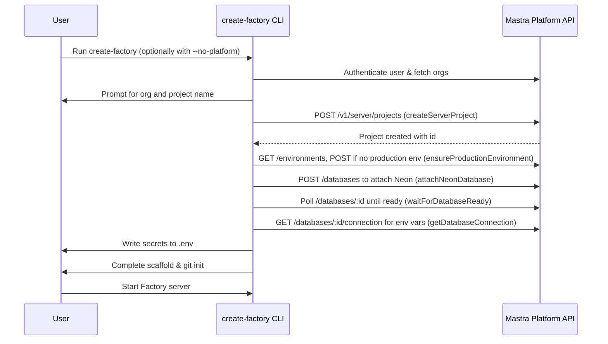

<!-- source: DeepWiki mcp.deepwiki.com · repo mastra-ai/mastra · page 16.6 create-factory Scaffolding and Templates · fetched 2026-10-26 -->

# 16.6 create-factory Scaffolding and Templates

<details>
<summary>Relevant source files</summary>

The following files were used as context for generating this wiki page:

- [.changeset/config.json](.changeset/config.json)
- [.github/workflows/sync-softwarefactory-template.yml](.github/workflows/sync-softwarefactory-template.yml)
- [e2e-tests/softwarefactory/setup.ts](e2e-tests/softwarefactory/setup.ts)
- [e2e-tests/softwarefactory/softwarefactory.test.ts](e2e-tests/softwarefactory/softwarefactory.test.ts)
- [e2e-tests/softwarefactory/vitest.config.ts](e2e-tests/softwarefactory/vitest.config.ts)
- [mastracode/factory/CHANGELOG.md](mastracode/factory/CHANGELOG.md)
- [mastracode/factory/package.json](mastracode/factory/package.json)
- [mastracode/mastra-factory/CHANGELOG.md](mastracode/mastra-factory/CHANGELOG.md)
- [mastracode/mastra-factory/README.md](mastracode/mastra-factory/README.md)
- [mastracode/mastra-factory/package.json](mastracode/mastra-factory/package.json)
- [mastracode/mastra-factory/scripts/sync-template.mjs](mastracode/mastra-factory/scripts/sync-template.mjs)
- [mastracode/mastra-factory/src/create.test.ts](mastracode/mastra-factory/src/create.test.ts)
- [mastracode/mastra-factory/src/create.ts](mastracode/mastra-factory/src/create.ts)
- [mastracode/mastra-factory/src/index.ts](mastracode/mastra-factory/src/index.ts)
- [mastracode/mastra-factory/src/platform.test.ts](mastracode/mastra-factory/src/platform.test.ts)
- [mastracode/mastra-factory/src/platform.ts](mastracode/mastra-factory/src/platform.ts)
- [mastracode/mastra-factory/src/sync-template.test.ts](mastracode/mastra-factory/src/sync-template.test.ts)
- [mastracode/mastra-factory/template/README.md](mastracode/mastra-factory/template/README.md)
- [mastracode/sdk/CHANGELOG.md](mastracode/sdk/CHANGELOG.md)
- [mastracode/sdk/package.json](mastracode/sdk/package.json)
- [mastracode/tui/CHANGELOG.md](mastracode/tui/CHANGELOG.md)
- [mastracode/tui/package.json](mastracode/tui/package.json)
- [mastracode/web/.env.schema](mastracode/web/.env.schema)
- [mastracode/web/package.json](mastracode/web/package.json)
- [mastracode/web/pnpm-lock.yaml](mastracode/web/pnpm-lock.yaml)
- [mastracode/web/pnpm-workspace.yaml](mastracode/web/pnpm-workspace.yaml)
- [mastracode/web/src/factory-dev/cli.ts](mastracode/web/src/factory-dev/cli.ts)
- [mastracode/web/src/factory-dev/settings.test.ts](mastracode/web/src/factory-dev/settings.test.ts)
- [mastracode/web/src/factory-dev/settings.ts](mastracode/web/src/factory-dev/settings.ts)
- [mastracode/web/src/factory-dev/token-lifecycle.test.ts](mastracode/web/src/factory-dev/token-lifecycle.test.ts)
- [mastracode/web/src/factory-dev/token-lifecycle.ts](mastracode/web/src/factory-dev/token-lifecycle.ts)
- [mastracode/web/src/mastra/index.test.ts](mastracode/web/src/mastra/index.test.ts)
- [mastracode/web/src/mastra/index.ts](mastracode/web/src/mastra/index.ts)
- [mastracode/web/src/mastra/sandbox-provider.test.ts](mastracode/web/src/mastra/sandbox-provider.test.ts)
- [packages/playground/e2e/tests/auth/login-flow.spec.ts](packages/playground/e2e/tests/auth/login-flow.spec.ts)
- [turbo.json](turbo.json)

</details>


This page documents the `create-factory` CLI and the `mastra-factory` package within the Mastra codebase. It covers the implementation details of the project scaffolding process, template synchronization scripts, platform provisioning during setup, and end-to-end (E2E) tests to validate the software factory scaffold. This package provides a streamlined way for users to bootstrap and manage a Mastra Factory project, an environment that leverages coding agents for automating software delivery workflows.

---

## Overview

`create-factory` is a CLI tool and scaffold package that helps users create a new Mastra Factory project. The Factory itself is an agent-powered software delivery environment designed to intake issues from systems such as GitHub or Linear, facilitate work through agents, and manage pull request lifecycle. The scaffolding process includes downloading a minimal server scaffold, setting up project dependencies, provisioning platform resources optionally, and initializing the git repository.

The Factory UI is bundled separately by the Mastra CLI and supplied dynamically. The generated scaffold is intentionally minimal, containing only server-side code and configuration without frontend build dependencies in order to optimize the default user experience.

Key capabilities covered here:
- Project scaffolding from a template repository or directory
- Generation of a minimal Factory server scaffold
- Synchronization of versions for dependencies pinned to published packages
- Automated platform resource provisioning: project creation, database attachment, environment setup
- E2E tests validating the integrity and functionality of the scaffolded project

Sources:
[mastracode/mastra-factory/package.json:2-5]()

---

## Project Scaffolding and Template Generation

### `sync-template.mjs`

The script `mastracode/mastra-factory/scripts/sync-template.mjs` is responsible for producing the Factory template from the user-owned server scaffold located in `mastracode/web`. It creates a minimal server-side project scaffold that excludes browser source code and frontend dependencies, which are dynamically provided at runtime by the Mastra CLI.

**Highlights of the script:**

- Inputs:
  - Copies only `src/mastra/*.ts` files, excluding tests [mastracode/mastra-factory/scripts/sync-template.mjs:9-9]()
  - Includes `.env.schema`, `docker-compose.yml` [mastracode/mastra-factory/scripts/sync-template.mjs:10-11]()
- Outputs:
  - Generates files such as `package.json`, `tsconfig.json`, `.env.example`, `.gitignore`, `pnpm-workspace.yaml`, `.npmrc` (optional), and `README.md` in the output directory (`template-out` by default). [mastracode/mastra-factory/scripts/sync-template.mjs:13-16]()
- Dependency version resolution:
  - Pins runtime dependencies (`@mastra/auth-workos`, `@mastra/code-sdk`, `@mastra/core`, etc.) to exact published versions based on an optional `--tag` parameter specifying the dist-tag (e.g., `latest`, `alpha`). [mastracode/mastra-factory/scripts/sync-template.mjs:18-22]()
  - Resolves versions by querying the npm registry via `npm view`. [mastracode/mastra-factory/scripts/sync-template.mjs:99-101]()
  - Ensures local linked dependencies are not leaked into the generated template.
- Safety checks:
  - Prevents output directory overlaps with the monorepo to avoid accidental overwrites. [mastracode/mastra-factory/scripts/sync-template.mjs:51-55]()
- Usage:
  - Can be run directly with Node.js CLI. [mastracode/mastra-factory/scripts/sync-template.mjs:1-1]()
  - Supports options `--out` to specify output directory and `--tag` to pin versions. [mastracode/mastra-factory/scripts/sync-template.mjs:38-41]()

The script ensures that the generated template project uses exact published versions of dependencies rather than local monorepo links, making the template stable for external consumption.

### Dependency Version Resolution Logic

The script distinguishes dependencies using local workspace link references (e.g., `link:` prefixes) and replaces them with exact resolved versions fetched from npm for the specified dist-tag. This is handled by functions:

- `linkSpecToRelPath(spec)` - Converts a link spec to a relative monorepo path. [mastracode/mastra-factory/scripts/sync-template.mjs:73-80]()
- `linkedPackageVersion(name, relPath)` - Reads and validates the linked package's version. [mastracode/mastra-factory/scripts/sync-template.mjs:82-89]()
- `resolveTaggedVersion(name, tag)` - Queries npm for the version corresponding to a dist-tag. [mastracode/mastra-factory/scripts/sync-template.mjs:93-109]()
- `resolveLinkedVersion(name)` - Resolves version for a linked package with optional pinning via tag. [mastracode/mastra-factory/scripts/sync-template.mjs:111-114]()
- `resolveDependency(manifest, name)` - Main logic to switch between local specs and actual published versions. [mastracode/mastra-factory/scripts/sync-template.mjs:122-129]()

### Output Generation

The script builds the `package.json` manifest for the scaffold project with resolved dependencies and devDependencies. [mastracode/mastra-factory/scripts/sync-template.mjs:132-175]() It also externalizes versioning logic for certain key dependencies (`@mastra/memory`). [mastracode/mastra-factory/scripts/sync-template.mjs:167-173]() Additionally, it generates supporting config files like `tsconfig.json` with strict TypeScript compiler options tailored to the server scaffold. [mastracode/mastra-factory/scripts/sync-template.mjs:177-186]()

Sources:
[mastracode/mastra-factory/scripts/sync-template.mjs:1-186]()

---

## CLI Interface: `create-factory`

The CLI entry point is `mastracode/mastra-factory/src/index.ts`. It uses the `commander` package to declare commands and options:

- Default command creates a Mastra Factory project. [mastracode/mastra-factory/src/index.ts:20-21]()
- Supports options such as:
  - `--template <template-url>`: specify a public GitHub template URL (default: `softwarefactory-template` repo). [mastracode/mastra-factory/src/index.ts:23-24]()
  - `--no-platform`: skip Mastra platform provisioning (auth, projects, database). [mastracode/mastra-factory/src/index.ts:25-26]()
  - `--org <org>`: pass org id or name to skip the interactive organization picker during provisioning. [mastracode/mastra-factory/src/index.ts:27-28]()
  - `--region <region>`: specify platform project region (`eu` or `us`). [mastracode/mastra-factory/src/index.ts:29-30]()

The CLI tracks analytics using PostHog via `PosthogAnalytics` and passes command execution details to telemetry systems. [mastracode/mastra-factory/src/index.ts:32-33]()

Sources:
[mastracode/mastra-factory/src/index.ts:1-102]()

---

## Project Creation Workflow (`create.ts`)

The core functionality of bootstrapping a new project resides in `mastracode/mastra-factory/src/create.ts`, exposing an async function `create(args: CreateArgs)`:

### Step 1: Interactive or Arg-Based Input

- Prompts user for a project name if one is not provided. [mastracode/mastra-factory/src/create.ts:30-32]()
- Optionally accepts a platform project region (`eu` or `us`). [mastracode/mastra-factory/src/create.ts:33-34]()
- Validates to avoid overwriting existing directories. [mastracode/mastra-factory/src/create.ts:36-40]()

### Step 2: Clone and Setup Template

- Uses `cloneTemplate` to clone the specified template repository or directory. [mastracode/mastra-factory/src/create.ts:42-43]()
- Renames the project internally by updating the `package.json` name field. [mastracode/mastra-factory/src/create.ts:45-48]()
- Copies `.env.example` to `.env` as a starting configuration, with file permissions tightened (mode 0o600). [mastracode/mastra-factory/src/create.ts:50-54]()
- Installs dependencies using the detected package manager (`npm`, `yarn`, `pnpm`). [mastracode/mastra-factory/src/create.ts:56-60]()

### Step 3: Optional Platform Provisioning

If `noPlatform` is false (default), the CLI authenticates with Mastra platform and performs:

- Selecting or resolving organization (`org`) and region. [mastracode/mastra-factory/src/create.ts:64-70]()
- Creating a platform server project via `createServerProject`. [mastracode/mastra-factory/src/create.ts:72-73]()
- Ensuring a production environment exists or creating it (`ensureProductionEnvironment`). [mastracode/mastra-factory/src/create.ts:75-76]()
- Attaching a Neon Postgres database to the project (`attachNeonDatabase`). [mastracode/mastra-factory/src/create.ts:78-79]()
- Polls for database readiness (`waitForDatabaseReady`). [mastracode/mastra-factory/src/create.ts:81-82]()
- Fetches database connection credentials (`getDatabaseConnection`) and writes them securely to `.env`. [mastracode/mastra-factory/src/create.ts:84-87]()
- Mints organization API keys (`mintOrgApiKey`). [mastracode/mastra-factory/src/create.ts:89-90]()
- Writes the platform connection secrets to `.env`. [mastracode/mastra-factory/src/create.ts:92-93]()

If any step fails, the CLI logs warnings and continues where practical. [mastracode/mastra-factory/src/create.ts:95-96]()

### Step 4: Git Initialization

- Appends `.env` to `.gitignore` to avoid accidentally committing secrets. [mastracode/mastra-factory/src/create.ts:100-103]()
- Initializes a new git repository, adds all files, and commits the scaffold. [mastracode/mastra-factory/src/create.ts:105-108]()
- Skips git initialization if `.gitignore` cannot be updated safely. [mastracode/mastra-factory/src/create.ts:109-110]()

### Step 5: User Guidance and Next Steps

- Shows success messages including the URLs to access the Mastra Factory UI (typically `http://localhost:4111`). [mastracode/mastra-factory/src/create.ts:112-115]()
- Advises on optional platform setup actions. [mastracode/mastra-factory/src/create.ts:117-118]()
- Logs any warnings or errors for platform provisioning problems. [mastracode/mastra-factory/src/create.ts:120-121]()

Sources:
[mastracode/mastra-factory/src/create.ts:26-182]()

---

## Mastra Platform Provisioning (platform.ts)

Platform provisioning logic is encapsulated in `mastracode/mastra-factory/src/platform.ts`. This module interfaces with Mastra platform REST endpoints to:

- Create server projects (`createServerProject`) with `factoryEnabled` flag. [mastracode/mastra-factory/src/platform.ts:100-114]()
- List or create production environments (`ensureProductionEnvironment`). [mastracode/mastra-factory/src/platform.ts:116-130]()
- Mint WorkOS API keys for authenticated API usage (`mintOrgApiKey`). [mastracode/mastra-factory/src/platform.ts:132-144]()
- Attach Neon PostgreSQL databases (`attachNeonDatabase`), requiring admin role. [mastracode/mastra-factory/src/platform.ts:146-160]()
- Poll database provisioning status until ready (`waitForDatabaseReady`). [mastracode/mastra-factory/src/platform.ts:162-176]()
- Retrieve connection environment variables for database access (`getDatabaseConnection`). [mastracode/mastra-factory/src/platform.ts:178-192]()

Errors are captured in `PlatformApiError` instances with HTTP status and descriptive messages. [mastracode/mastra-factory/src/platform.ts:20-24]()

Sources:
[mastracode/mastra-factory/src/platform.ts:1-224]()

---

## E2E Testing of the Software Factory Scaffold

End-to-end tests for the scaffold are located in `e2e-tests/softwarefactory/softwarefactory.test.ts`. These tests cover:

- Generating the Factory template using `sync-template.mjs` pinned to the test registry dist-tag. [e2e-tests/softwarefactory/softwarefactory.test.ts:20-21]()
- Cloning and scaffolding the project using the built CLI. [e2e-tests/softwarefactory/softwarefactory.test.ts:23-24]()
- Typechecking the scaffolded project code. [e2e-tests/softwarefactory/softwarefactory.test.ts:26-27]()
- Building the server and CLI-bundled Factory UI. [e2e-tests/softwarefactory/softwarefactory.test.ts:29-30]()
- Starting the dev server and verifying UI and API routes respond. [e2e-tests/softwarefactory/softwarefactory.test.ts:32-33]()
- Checking `.env` file contains only commented placeholder values to avoid leaking secrets. [e2e-tests/softwarefactory/softwarefactory.test.ts:35-36]()
- Ensuring that the dependencies used are pinned and no monorepo links remain. [e2e-tests/softwarefactory/softwarefactory.test.ts:38-39]()

The E2E tests execute typical project lifecycle commands (`npm run check`, `npm run build`, `npm run dev`) in a temporary directory with injected test registry settings for package resolution. [e2e-tests/softwarefactory/softwarefactory.test.ts:41-42]()

Sources:
[e2e-tests/softwarefactory/softwarefactory.test.ts:1-177]()

---

## GitHub Workflow: Template Synchronization

A GitHub Actions workflow `.github/workflows/sync-softwarefactory-template.yml` automates synchronization of the generated Factory template to the external `softwarefactory-template` repository. It works as follows:

- Triggers on pushes that modify the `mastracode/web` source scaffold or the `sync-template.mjs` script. [e2e-tests/softwarefactory/softwarefactory.test.ts:1-107]()
- Runs the `sync-template.mjs` script to generate a fresh template pinned to local monorepo versions. [e2e-tests/softwarefactory/softwarefactory.test.ts:1-107]()
- Validates the template by installing dependencies, typechecking, and building. [e2e-tests/softwarefactory/softwarefactory.test.ts:1-107]()
- Checks out the external `softwarefactory-template` repo with token-permissions. [e2e-tests/softwarefactory/softwarefactory.test.ts:1-107]()
- Deletes all files except `.git`, then copies the generated template files over. [e2e-tests/softwarefactory/softwarefactory.test.ts:1-107]()
- Commits and pushes changes if any. [e2e-tests/softwarefactory/softwarefactory.test.ts:1-107]()

This workflow ensures the external template repo stays in sync with the monorepo's scaffold source.

Sources:
[.github/workflows/sync-softwarefactory-template.yml:1-106]()

---

## Integration and Usage Summary

- Users run `npm create factory` (or via Yarn or pnpm) to invoke `create-factory`, which bootstraps a Mastra Factory project using the verified template. [mastracode/mastra-factory/package.json:2-5]()
- The created project is minimal, server-side only, with frontend UI dynamically provided by the Mastra CLI. [mastracode/mastra-factory/scripts/sync-template.mjs:4-6]()
- Platform provisioning automates project and cloud resource setup if desired, or can be skipped (self-host mode). [mastracode/mastra-factory/src/create.ts:62-63]()
- The generated `.env` file contains placeholders except for platform-added secrets. [mastracode/mastra-factory/src/create.ts:50-54]()
- The system provides a released and tested scaffold that simplifies Factory adoption.

---

## Mermaid Diagrams

### Diagram 1: create-factory Tool and Template Associations

```mermaid
graph TD
  subgraph CLI
    A[create-factory CLI] --> B[create(args: CreateArgs) in create.ts]
    B --> C[cloneTemplate() + renameProject()]
    B --> D[install dependencies via packageManager]
    B --> E[platform provisioning (optional)]
    E --> F[createServerProject() in platform.ts]
    E --> G[ensureProductionEnvironment()]
    E --> H[attachNeonDatabase()]
    E --> I[getDatabaseConnection()]
    B --> J[git init & commit]
  end

  subgraph Template Sync
    K[sync-template.mjs script] --> L[Generate minimal server scaffold]
    L --> M[Resolve dependency versions via npm registry]
    M --> N[Generate package.json & config files]
  end

  CLI --> K
```
Sources:
[mastracode/mastra-factory/src/index.ts:20-30]()
[mastracode/mastra-factory/src/create.ts:26-121]()
[mastracode/mastra-factory/scripts/sync-template.mjs:4-16]()
[mastracode/mastra-factory/scripts/sync-template.mjs:132-175]()
[mastracode/mastra-factory/scripts/sync-template.mjs:93-109]()
[mastracode/mastra-factory/src/platform.ts:100-192]()

### Diagram 2: Platform Provisioning Flow in create-factory


Sources:
[mastracode/mastra-factory/src/create.ts:64-93]()
[mastracode/mastra-factory/src/platform.ts:100-192]()

---

## Summary Table

| Component | Role/Responsibility | Key Files/Functions |
|---|---|---|
| Template Generation Script | Create minimal server scaffold with pinned deps | `scripts/sync-template.mjs` |
| Project Creation Function | Clone template, install deps, optionally provision platform | `src/create.ts` `create()` |
| Platform Provisioning Interface | API calls for provisioning project, DB, env | `src/platform.ts` |
| CLI Entrypoint | Command parsing, analytics, error handling | `src/index.ts` |
| E2E Tests | Validate full scaffold lifecycle and build | `e2e-tests/softwarefactory/softwarefactory.test.ts` |
| Template Sync Workflow | Automate template generation and push to external repo | `.github/workflows/sync-softwarefactory-template.yml` |
| README / User Docs | Guide users on usage, setup, deployment | `template/README.md` |

---

## References and Sources

- `mastracode/mastra-factory/scripts/sync-template.mjs:1-186`
- `mastracode/mastra-factory/src/create.ts:26-182`
- `mastracode/mastra-factory/src/platform.ts:1-224`
- `mastracode/mastra-factory/src/index.ts:1-103`
- `e2e-tests/softwarefactory/softwarefactory.test.ts:1-177`
- `.github/workflows/sync-softwarefactory-template.yml:1-107`
- `mastracode/mastra-factory/template/README.md:1-103`

These files provide detailed source implementations of scaffolding, dependency resolution, platform API interactions, CLI logic, testing, and documentation supporting the create-factory toolchain.

---

